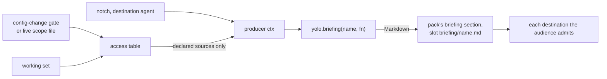

# A briefing that knows what this jail may push: computed pack prose

**Status:** 2026-10-24. Nothing is built. Every claim about the tree was checked against
`3aba3dad3` on that date.

> **In short.** A pack's briefing should be computable from the facts of this launch the same way
> its config surfaces already are, by one more registration in its `derive.lua`. The facts it
> needs about git are already decided by core at the approval gate, so core should hand them over
> as a named, declared input, not have one pack publish them for another.

**Why it matters.** The maintainer, 2026-10-24: *"I'm gonna have certain workspaces where it's
allowed, certain where it's not, and I want to be able to have a briefing that tells the agent
exactly what to do when they're done with the change, whether it's just commit or push, and I
don't want to give them an if statement in a briefing file."* Today the maintainer's own house
rules say *"just keep committing to the branch you're on"* in every jail, whatever that jail may
push.

**The shape.** A **briefing producer** in a pack's `derive.lua`, declared by a `briefing` line in
its manifest that also names the **access source** it reads. Core composes the producer's output
into the pack's section, at both notches, from the grants the approval gate passed.

**Cost.** A third Lua registration and a second derive caller on the host, and briefing
composition that now reads the broker's scope files and working set.

**Start at [§3](#3-the-proposed-shape)**, then the worked example in
[§4](#4-worked-example-the-maintainers-finishing-rules).

**Needs your ruling:** [OQ-CB1](#OQ-CB1), [OQ-CB2](#OQ-CB2), [OQ-CB3](#OQ-CB3).

**Reads with:** [`computed-briefings-plan.md`](computed-briefings-plan.md) (the implementation
plan's seed: not a hand-off, incomplete until this design is accepted),
[`readable-config.md`](readable-config.md) (renames the grant config this design reads; the
dependency is in [§3.2](#32-what-a-producer-reads)), [`git-broker.md`](git-broker.md) (what each
git grant lets a push do).

---

## Defined terms

- **Briefing** (ours): the instruction file an agent reads at session start, composed by yolo per
  destination ([`agent-briefings.md`](../reference/agent-briefings.md)).
- **Derive slot** (ours): the one place a pack runs Lua, a sandboxed and deterministic producer of
  a value from inputs core hands it ([`pack-system.md`](../reference/pack-system.md#the-derive-slot)).
- **Notch** (ours): where an environment runs on the confinement dial: a jail, the macOS guest,
  or the host itself ([`agent-briefings.md`](../reference/agent-briefings.md#confinement)).
- **Brokered source** (ours): the name a brokered loophole's manifest declares under
  `brokered.source`, such as `git` for the git pack's git-broker and `github` for the github
  pack's github-broker (`yolo config-ref`, the `brokered` key).
- **Grant** (ours): approved permission for a brokered source to act on a repository: `read`,
  and for git `create-branch` and `branch`
  ([`boundary-broker.md`](boundary-broker.md#16-the-grant-model-2026-10-23)).
- **Working set** (ours): the branches a workspace may push to without asking, created under a
  `create-branch` grant or declared by a `branch` grant
  ([`git-broker.md`](git-broker.md#51-the-working-set-of-pushable-branches)).
- **Briefing producer** *(coined here)*: a function a pack registers with `yolo.briefing(name, fn)`
  that returns Markdown for one briefing destination. It is not a surface derive: it produces
  prose for a briefing, never a config value.
- **Access table** *(coined here)*: `ctx.access`, the facts a briefing producer may read about what
  this launch's brokers will do with the user's logins, keyed by brokered source. It is not the
  config: it holds what the gate approved and the broker applies, not what a config file asks for.
- **Access source** *(coined here)*: one key of the access table, which is a brokered source's
  name.

## 1. The verdict

Build the briefing producer, and feed it a core-owned access table that a pack must declare
before it reads. Four reasons carry it:

1. **The derive slot already is "a pack computes content from live facts".** Briefings are the
   one kind of pack output with no computed layer. Adding one reuses the sandbox, the determinism
   rules and the version-boundary rules unchanged.
2. **The grant facts are core's, not the git pack's.** The approval gate computes them from the
   config and the human's answer, the broker enforces them, and the git pack ships only a loophole
   manifest and prose. A git pack that "published its grants" would be passing on what core gave
   it.
3. **Naming the source in the manifest is the maintainer's idea, and it is safe.** The consumer
   says *"I read the git facts"* by the brokered-source name, which the producing loophole
   declares, never by pack slug, which a config entry can rename
   ([OQ-BA1](../reference/agent-briefings.md#oq-ba1)). The declaration makes the reference
   checkable, as the
   [stringly-typed references principle](../reference/stringly-typed-references-principle.md)
   requires.
4. **The briefing advises and the broker enforces.** Text that is stale, missing or wrong can never
   let an agent push what the broker refuses. That is what makes it acceptable to compose this
   text from launch-time facts and to let a broken script degrade rather than refuse
   ([OQ-CB3](#OQ-CB3)).

## 2. What exists today

### 2.1 The derive slot

- A pack ships `derive.lua` at its root. It registers `yolo.derive(agent, surface, fn)`, a
  surface's computed layer, and `yolo.env(agent, fn)`, process environment; `yolo.model_for` is
  the one helper ([`pack-system.md`](../reference/pack-system.md#the-derive-slot)).
- The inputs are **"closed and core-owned: a pack projects from these into its tool's dialect,
  and never invents a new source"**. `DeriveCtx` in
  [`derive.go`](../../internal/agentcfg/luahook/derive.go) enumerates them: provider and profile
  facts, the MCP and LSP tables, the saved selection and the active set. None of them is a
  broker fact.
- The VM is pure-Go gopher-lua with `os`, `io`, `require`, `print` and the random-number
  generator stripped, and a 5-second wall-clock budget (`DefaultTimeout` in
  [`vm.go`](../../internal/agentcfg/luahook/vm.go)).
- Surface derives run in the jail's entrypoint. The env producer already runs **on the host**,
  through `packload.AgentEnv` in [`deriveenv.go`](../../internal/packload/deriveenv.go). Host-side
  pack Lua is not new.
- An unknown `yolo.*` member is a warning on the rendering readers and an error on the host env
  reader, because the set of registrations is a version boundary.

### 2.2 Briefing composition

- A pack's prose is its `briefing/*.md` files plus any file a `from` names, routed by `agents`
  (an audience of agent names), `into`, or neither (a broadcast)
  ([`pack-system.md`](../reference/pack-system.md#briefing)).
- One pack's files form **one section**, ordered byte-wise by pack-relative path, appended last in
  the briefing, in config order
  ([part 4](../reference/agent-briefings.md#what-a-composed-briefing-contains)).
- Composition is **host-side, on every invocation**, launch and attach alike, written in place so
  a running jail's bind mount sees the new bytes
  ([refresh](../reference/agent-briefings.md#refresh--a-live-jail-sees-host-edits)).
  `refreshJailBriefings` in [`prepare.go`](../../internal/cli/run/prepare.go) is the jail's and
  macos-user's composer; `ComposeHostBriefings` in
  [`hostbriefing.go`](../../internal/entrypoint/hostbriefing.go) is the host notch's.
- **The body states what the launch applies, never what the config asked for**, and the composer
  runs no host probe, because an attach must re-derive the same answer
  ([applied, never configured](../reference/agent-briefings.md#what-the-body-describes-applied-never-configured)).
- At the host notch the destinations are files in the real home (`~/.claude/CLAUDE.md`), shared by
  every workspace on the machine.

### 2.3 Where the grants are decided, and when they change

- **At a fresh launch**, the config-change gate (`runConfigGate` in
  [`preflight.go`](../../internal/cli/run/preflight.go)) shows each repository and grant and
  records the approved result in memory (`recordApprovedScopes` in
  [`brokeredscope.go`](../../internal/cli/run/brokeredscope.go)). The gate runs **before** the
  briefing is composed in [`run.go`](../../internal/cli/run/run.go), so a launch's composer can
  read what was just approved.
- `writeScopeFiles` writes that result into one **scope file** per brokered loophole per launch,
  with its repositories and grants ([`file.go`](../../internal/brokerscope/file.go)). The broker
  reads only that file.
- **During a jail's life the grants can change**: `yolo config apply` rewrites the running jail's
  scope files with the newly approved repositories and grants (`ReplaceScopeContext` in
  [`live.go`](../../internal/brokerscope/live.go), called from
  [`liveapply.go`](../../internal/cli/run/liveapply.go)). It does not re-compose briefings today.
- **The working set changes on its own**: a branch pushed under `create-branch` joins it when the
  remote accepts it, and it lasts across launches, keyed by workspace
  ([`working.go`](../../internal/brokerstore/working.go)).
- **macos-user has no attach.** Every invocation is a fresh launch that runs the gate.
- **The host notch runs no broker.** An agent there pushes with the human's own credentials, so
  there are no grants for it to reflect.

## 3. The proposed shape



### 3.1 The briefing producer

- **Registration.** `yolo.briefing(name, fn)` in `derive.lua`. `name` is a lower-case slug; `fn`
  receives the producer ctx ([§3.2](#32-what-a-producer-reads)) and returns a Markdown string, or
  `nil` or `""` to contribute nothing to that destination.
- **Declaration.** Each producer is declared by a `briefing` content line in the pack manifest:

  ```jsonc
  { "kind": "briefing", "derive": "finishing",
    "reads": [{ "access": "git", "optional": true }],
    "agents": ["claude", "pi"] }
  ```

  `agents` narrows it exactly as for a file, and silence broadcasts. `into` and `from` are refused
  on a `derive` line, naming `agents`: a content `into` narrows only at the host notch, and a
  producer has no file to name.
- **The pairing is checked both ways.** A declared `derive` with no registration delivers nothing
  and is warned about, by the rule for a `from` that names no file
  ([P4](../reference/pack-system.md#briefing-p4)). A registration no line declares is refused at
  launch and at `yolo host apply`, naming the line to add, because without the line there is
  nowhere to say what it reads. Two registrations of one name are a Lua error. `yolo pack lint`
  checks both directions, because it can list a script's registrations without a ctx, as
  `yolo config ls` already does.
- **Placement.** The output takes the slot `briefing/<name>.md` would take in the pack's
  byte-wise order, so the author decides where it sits among the pack's files by naming it. A real
  `briefing/<name>.md` beside a producer of the same name is refused, naming both. It never sits
  outside its pack's section, and the section's position (part 4, config order) is unchanged.
- **Called once per destination.** The ctx carries the destination's agent identity, so one
  producer can word the same rule differently for claude and pi. Destinations are deduplicated by
  path first, as today.
- **Output limits.** A string, at most 64 KiB per call. Anything else (a table, a number, a larger
  string) is a producer error ([§3.6](#36-failure-modes)).
- **Lint and footprint.** `yolo pack lint` lists a producer under `delivers:` as
  `derive:finishing → claude, pi (reads access: git, optional)`, so the delivery is visible before
  any launch ([P6](../reference/pack-system.md#briefing-p6)).

### 3.2 What a producer reads

The producer ctx is its own, narrower than a surface derive's. It holds:

| Field | Value |
| :--- | :--- |
| `ctx.notch` | the notch the briefing's confinement header names: `jail`, `guest` or `host` |
| `ctx.agent` | the destination's declared agent identity, `""` for a destination that declares none |
| `ctx.access` | one entry per access source **this line declares**, and nothing else |

Each `ctx.access.<source>` entry:

| Field | Meaning |
| :--- | :--- |
| `running` | the broker serves this launch: its pack is selected, the backend runs host services, and the placement rule did not refuse it |
| `why_not` | one plain sentence when `running` is false (*"the git pack is not selected"*, *"this backend runs no host services"*, *"on the host, the agent uses your own login"*); `""` otherwise |
| `remotes` | the workspace's approved remotes, remote name → repository identity (`origin` → `github.com/o/r`) |
| `repos` | repository identity → what the broker will do on it, below |

Each `repos.<identity>` entry speaks what the broker will **do**, not the grant kinds' spellings:

| Field | Meaning |
| :--- | :--- |
| `read` | a fetch works: a read grant covers this repository |
| `push_new_branches` | a push may create a branch under `refs/heads/`: a `create-branch` grant and a read grant cover it |
| `push_branches` | sorted list of `{ name = "main", why = "declared" }` or `why = "created"`: the working-set branches a push may update, force-update or delete |

Rules:

- **Applied, never configured.** Every value is what the launch applies: the gate's approved
  result, the broker's start decision, the working set. A grant written in config that the human
  declined is absent. This is the body's existing rule extended to pack prose.
- **A wildcard is expanded.** A grant on `*` appears on every approved repository; a producer
  never sees `*`.
- **Concept names, not config names.** `push_new_branches` and `push_branches` survive the
  readable-config rename of `brokered` to `as_you`, and of grant kinds to `fetch` and `push`
  ([§4.2 there](readable-config.md#42-what-a-jail-may-do-with-your-logins)). A producer reads the
  same fields whichever spelling the config uses. This design does not wait on that one.
- **Sorted and stable.** Every list is sorted, so the same facts give the same bytes.
- **No credential, no host path.** Nothing in the table is a token, a key path or a host
  directory.
- **Version boundary.** The table grows only additively. A field a producer reads that this build
  does not have is `nil`, which a producer written defensively treats as false. Producers run on
  the host, in the same binary that composes, so the jail-image skew that once broke surface
  derives does not arise for them.

The surface-derive tables (`mcp_servers`, `providers` and the rest) are **not** in the producer
ctx. Whether more of the config should be is [OQ-CB2](#OQ-CB2).

### 3.3 Declaring the read

`reads` on the `derive` line names each access source the producer may read. It amends one
sentence of the derive slot: today every input is handed over implicitly; this input is handed
over only on request. The inputs stay **closed and core-owned**: the pack names which core table
it reads, and it cannot add a source.

- **Undeclared read.** `ctx.access.github` from a line that declared only `git` raises a Lua error
  naming the missing `reads` entry. It never returns `nil`, which would read as "not running".
- **A name no loophole on this machine declares** (a typo such as `gti`) refuses the launch and
  `yolo host apply`, with a did-you-mean, which is the
  [supersession check](../reference/pack-system.md#capabilities-and-supersession)'s universe and
  wording reused.
- **A real source whose pack is not selected** refuses the launch, unless the entry says
  `"optional": true`; then the entry is present with `running = false` and a `why_not` naming the
  unselected pack. Those are the principle's two questions, kept apart
  ([two questions](../reference/stringly-typed-references-principle.md#a-reference-asks-two-questions-and-only-one-of-them-is-optional)).

Whether a consumer should instead name a **producing pack** that publishes facts of its own is
[OQ-CB1](#OQ-CB1).

### 3.4 When it renders, and how fresh it is

| Event | Where the access facts come from | New? |
| :--- | :--- | :--- |
| Fresh launch, container or macos-user | the gate's in-memory approved result and the broker start decision, before the scope files are written; the working set read under the store's lock | the reads are new; the trigger exists |
| Attach | the running jail's live scope files and its brokers' liveness; the working set read now | the reads are new; the trigger exists |
| `yolo config apply` that changed a jail's scope | the scope it just wrote | **new trigger**: re-compose that jail's briefings after the scope replacement, under the launch lock |
| `yolo host apply` | none: every declared source is `running = false`, `why_not` = the host sentence | the trigger exists |

- **One writer.** Every composition of a jail's staging already runs under that workspace's launch
  lock. The new `yolo config apply` re-composition takes the same lock, so two writers cannot
  interleave.
- **What does not trigger a render.** A push that adds a branch to the working set does not. A
  broker writing briefing files would be a daemon writing outside its store. The branch appears at
  the next invocation.
- **A running session has already read its briefing.** A re-composition reaches the next agent
  session started in that jail, not the one that is running. Both kinds of staleness are safe, by
  verdict reason 4: text that says "push" after a grant was revoked meets the broker's refusal,
  which the git pack's prose already teaches the agent to read; text that says "commit only"
  after a grant was added costs a push the human makes.
- **No probe.** The composer still runs no subprocess. The current branch is not a fact, because
  learning it would mean running `git` in the composer.

### 3.5 Parity

The same producer runs at every notch and every backend, so a pack author writes one script. The
facts differ, and they differ honestly:

| Where | The producer runs | `ctx.access.<source>` |
| :--- | :--- | :--- |
| podman jail | host side, at launch, attach and live apply | the jail's approved grants |
| macos-user | host side, at each session's launch | that session's approved grants |
| Apple Container | host side, at launch and attach | `running = false`: this backend runs no host services |
| `yolo host apply` | host side | `running = false`, `why_not` names the host; one text for every workspace on the machine, because the destination is machine-wide |

The host row is a fact, not a gap. A host briefing is one file for the whole machine, and
per-project text there would mean writing into each repository, which
[`agent-briefings.md`](../reference/agent-briefings.md#what-this-does-not-license) rules out.

### 3.6 Failure modes

| Failure | What happens | Who finds out |
| :--- | :--- | :--- |
| Lua error, timeout, or a non-string or oversized return | **provisional, [OQ-CB3](#OQ-CB3):** the launch goes ahead; the slot holds one fixed line saying this pack's computed rules failed to render and to ask the human before pushing; the launch prints the error with file and line and names `yolo pack lint` | the human at launch, and the agent, in its briefing |
| `reads` names an unknown source | refused, with did-you-mean | the human at launch or at `yolo host apply` |
| `reads` names a source whose pack is unselected, without `optional` | refused, naming the pack to select or `"optional": true` | the human at launch |
| A producer reads an undeclared source | the producer's Lua error, handled like any other | as the first row |
| A declared `derive` with no registration | nothing delivered; a warning naming the line | the human at launch; `yolo pack lint` |
| A registration no line declares | refused, naming the line to add | the human at launch; `yolo pack lint` |
| The scope file of a running jail cannot be read on attach | the source is `running = false` with `why_not` *"its scope could not be read"*; the attach goes ahead | the agent, in the text its producer writes |

Every refusal above names its next step, as the
[happy path principle](../reference/happy-path-principle.md) requires.

### 3.7 Degenerate cases

| Case | `ctx.access.git` |
| :--- | :--- |
| No git pack selected, `optional` | `running = false`, `why_not` names the pack |
| Broker running, no read grant | `running = true`; every repository `read = false` |
| Read only | `read = true`, `push_new_branches = false`, `push_branches = {}` |
| A `branch main` grant | `push_branches = { {name="main", why="declared"} }` |
| New branches only | `push_new_branches = true`; `push_branches` lists the branches this workspace created earlier |
| Several remotes, different grants | one `repos` entry each; `remotes` says which is `origin` |
| A workspace with no remotes | `remotes = {}`, `repos = {}` |

## 4. Worked example: the maintainer's finishing rules

The maintainer moves the commit-and-push paragraph out of `briefing/prose.md` in the `matt` pack
into a producer named `finishing`, declared by the manifest line in [§3.1](#31-the-briefing-producer).

```lua
-- matt/derive.lua
local function finish_line(repo)
  if repo == nil or not repo.read then
    return "When the change is done, commit it on the current branch. " ..
           "Do not push: the human pushes from the host."
  end
  local branches = {}
  for _, b in ipairs(repo.push_branches) do
    if b.why == "declared" then branches[#branches + 1] = "`" .. b.name .. "`" end
  end
  if #branches > 0 then
    return "When the change is done, commit it, then push it to " ..
           table.concat(branches, " or ") .. ". Push no other branch."
  end
  if repo.push_new_branches then
    return "When the change is done, commit it on a new branch of your own " ..
           "(`agent/<topic>`) and push that branch. Never push `main` " ..
           "or a branch you did not create."
  end
  return "When the change is done, commit it on the current branch. " ..
         "Do not push: the human pushes from the host."
end

yolo.briefing("finishing", function(ctx)
  local head = "## Finishing a change\n\n"
  if ctx.notch == "host" then
    return head .. "Commit it. Do not push; on this machine the human pushes."
  end
  local git = ctx.access.git
  local origin = git.running and git.repos[git.remotes.origin] or nil
  return head .. finish_line(origin)
end)
```

What each workspace's agent reads:

| Workspace | Approved | The agent reads |
| :--- | :--- | :--- |
| yolo-jail, with `branch main` | read, `branch main` | *commit it, then push it to `main`. Push no other branch.* |
| A client repository, new branches allowed | read, `create-branch` | *commit it on a new branch of your own (`agent/<topic>`) and push that branch …* |
| A repository with read only | read | *commit it on the current branch. Do not push: the human pushes from the host.* |
| Any workspace on Apple Container | (broker not running) | the same commit-only line |
| `yolo host apply` | (no broker) | *Commit it. Do not push; on this machine the human pushes.* |

No `if` reaches the agent: each one reads a single instruction.

## 5. Trust and determinism

- **What the producer can reach.** Only its ctx and its return value. It cannot reach the broker,
  the store, the filesystem or the network; the sandbox is the derive slot's, unchanged.
- **What crosses into the jail.** Only the Markdown the producer returns, in the briefing. The
  facts it was built from are already visible to an agent in the jail: the launch names every
  grant in force (`writeScopeFiles`), `git remote -v` names the remotes, and the broker's refusals
  name what is missing. No new fact crosses.
- **Consent.** Selecting a pack is consent to its prose ([OQ-PB4](../reference/pack-system.md#oq-pb4)),
  and its `reads` line is listed by `yolo pack lint` and `yolo pack footprint`. No new launch
  disclosure: no credential crosses, so the launch's trust-boundary banners have nothing new to
  say.
- **Host-side execution.** A third-party `derive.lua` already runs on the host for `yolo.env`.
  The producer adds a second host caller of the same VM.
- **Determinism.** The same ctx gives the same bytes, under the existing rules: randomness is
  stripped, and the `tostring` reference gap is [OQ-DR1](../reference/pack-system.md#oq-dr1)'s,
  not re-decided here. The access table's lists are sorted.

## 6. Alternatives considered

| Alternative | Verdict |
| :--- | :--- |
| Keep static prose with both cases written out | Rejected by the request: the agent reads an `if` and must work out which branch applies. |
| A templated briefing file (`{{ if push }}` in Markdown) | Rejected: a second logic language beside Lua, which the derive slot exists to avoid ("there is no reshape op DSL"). |
| A derived `files` contribution writing the text | Rejected: `files` lands in typed slots, not in briefing destinations, and the briefing composer owns those files whole. |
| Core writes the push rule into the jail-managed body | Rejected as the answer: the wording is the maintainer's house rule, not a fact about the jail. A factual line there could complement it later. |
| An environment variable (`YOLO_GIT_PUSH=…`) the prose tells the agent to read | Rejected: that is the `if` moved into the agent's head. |
| The producing pack publishes facts (`yolo.publish`) and the consumer names that pack | Open, as [OQ-CB1](#OQ-CB1) option B. |
| Re-render inside the jail when grants change | Rejected: the briefing is a read-only mount composed on the host, and the agent has already read it. |

## 7. What this does not do

- **No live grant query for the agent.** A command an agent runs to ask the broker what it may
  push now would close the freshness gap in [§3.4](#34-when-it-renders-and-how-fresh-it-is). It
  is a separate, complementary design.
- **No change to the shipped git pack's prose.** That pack's own `briefing/git.md` could become a
  producer that states the actual grants. That is a follow-on, not this design.
- **No per-workspace text at the host notch** ([§3.5](#35-parity)).
- **No pack-to-pack API.** Unless [OQ-CB1](#OQ-CB1) rules otherwise, no pack reads another pack's
  values.
- **No authority.** Nothing a producer writes changes what the broker allows.
- **No producers for skills or files.** Briefings only.

## 8. Costs and risks

| Risk | Mitigation |
| :--- | :--- |
| Attach gets slower: a Lua VM per declaring pack, on every invocation | One VM session per pack per composition, invoking the producer per destination, under the existing 5-second budget. Packs that declare no `derive` line cost nothing. |
| The jail and host composers drift in what they hand a producer | Both build the ctx from one function. The existing jail/host briefing parity test (`briefingparity_test.go`) gains a producer case. |
| A stale briefing leads an agent to try a push that is refused | Safe by construction: the broker refuses, and the git pack's prose already says to read the reason and not retry. |
| The access table freezes broker vocabulary into a pack API | It speaks what the broker does (`push_new_branches`), not config spellings, and it grows only additively. |
| A pack author reads a fact that is wrong at the host notch | The host row is explicit: `running = false` with a sentence, and `ctx.notch` says which notch. |

## 9. What done looks like

- In a workspace whose approved grants include `branch main`, a new claude session's
  `CLAUDE.md` holds the maintainer's "push it to `main`" line, and a pi session's `AGENTS.md`
  holds the same rule.
- After `yolo config apply` approves a `create-branch` grant for a running jail, a second agent
  session started in that jail reads the new-branch line with no restart.
- The same pack in a read-only workspace, on Apple Container, and at `yolo host apply` delivers the
  commit-only and host lines.
- `"reads": [{"access": "gti"}]` refuses the launch with a did-you-mean naming `git`.
- `yolo pack lint` on the `matt` pack lists `derive:finishing` with its audience and its reads,
  and refuses a registration with no declaring line.
- A producer that raises a Lua error behaves as [OQ-CB3](#OQ-CB3) is ruled, and the launch output
  names the file and line.

## 10. What I would build, in order

1. **The producer with `ctx.notch` and `ctx.agent` only.** The registration, the manifest field,
   the slot, lint, both notches. This is useful alone: a pack can word a rule per agent or per
   notch.
2. **The access table at launch and attach**, with `reads`, its two checks, and the working set.
   This is the maintainer's case.
3. **Re-composition at `yolo config apply`.** Small, and it closes the mid-jail gap for new
   sessions.

## 11. Open questions

1. 💬 <a id="OQ-CB1"></a>**OQ-CB1: Should a pack read git facts from core, or from the git pack itself?**

   The maintainer's `matt` pack wants to know whether this workspace may push. The facts it needs
   (which grants the human approved at launch, and which branches the workspace already created)
   are decided by core at the approval gate, enforced by the broker, and written to files the git
   pack never touches. Today no pack can read them, and the maintainer suggested that their pack
   "reference that I am going to read values from another pack", the one with the git grants.

   - **A — Core hands over the facts, and the pack names the source.** The manifest line says
     `"reads": [{"access": "git"}]`; the producer sees `ctx.access.git`. One kind of fact today,
     and no pack-to-pack interface to keep stable.
   - **B — The git pack publishes, and the consumer names the git pack.** The git pack would get a
     `yolo.publish` registration that copies out the facts core handed it, and any pack could
     publish anything. That is more general, but the only known case is facts the git pack does
     not own, and a published shape becomes an API between two pack authors.

   <!-- vantage: question id=OQ-CB1 leaning="A. The one real case is core's own facts, so publishing would only copy them through a pack. Reopen B when a pack holds a fact core does not." -->

   _Leaning:_ A. The one real case is core's own facts, so publishing would only copy them through
   a pack. Reopen B when a pack holds a fact core does not.

   **Answer:**
   > _(empty — fill in when decided)_

2. 💬 <a id="OQ-CB2"></a>**OQ-CB2: Should a briefing script see the whole config, or only named facts?**

   The maintainer said the briefing should be built "from whatever config, in a fully custom way".
   Today the producer would see three things: the notch, the agent, and what the brokers will do.
   Suppose the maintainer later wants the text to depend on the selected provider, or on a key
   they invented.

   - **A — Named facts only.** Each new need is a new core table, added when a real case appears.
     A config rename (such as the readable-config redesign's) never breaks a script.
   - **B — The whole effective config, read-only.** Anything is reachable today, but every config
     key becomes an interface a pack depends on. The readable-config rewrite would break every
     script that read `brokered`. It would also show what the human asked for rather than what was
     approved, which is the error the briefing body's rules exist to prevent.
   - **C — Named facts plus the pack's own settings.** A pack could declare typed settings and
     read its own values, the way loopholes already declare settings. A "fully custom" switch would
     then be the pack author's key, not a core one.

   <!-- vantage: question id=OQ-CB2 leaning="A now, with C as the route for a pack's own knobs when a case appears. B makes the config's spelling a pack API and shows requested rather than approved grants." -->

   _Leaning:_ A now, with C as the route for a pack's own knobs when a case appears. B makes the
   config's spelling a pack API and shows requested rather than approved grants.

   **Answer:**
   > _(empty — fill in when decided)_

3. 💬 <a id="OQ-CB3"></a>**OQ-CB3: Should a broken briefing script stop the jail from starting?**

   The maintainer edits `matt/derive.lua`, makes a typo, and runs `yolo` in a workspace. The
   finishing producer raises a Lua error. A surface derive error today is loud and leaves no
   partial output. For a briefing, the question is what the agent and the human get.

   - **A — Refuse the launch**, printing the error with file and line. Nothing starts until the
     script is fixed, in every workspace that selects the pack, attaches included.
   - **B — Start, and say so in two places.** The finishing section is replaced by one line telling
     the agent its pack's computed rules failed and to ask the human before pushing. The launch
     prints the error with file and line and names `yolo pack lint`. The broker still refuses any
     push it was not granted.

   <!-- vantage: question id=OQ-CB3 leaning="B. The text only advises, and the broker still enforces every grant, so a missing section cannot let an agent do more. Refusing would block every jail over a typo in prose." -->

   _Leaning:_ B. The text only advises, and the broker still enforces every grant, so a missing
   section cannot let an agent do more. Refusing would block every jail over a typo in prose.

   **Answer:**
   > _(empty — fill in when decided)_

## Decision Ledger

| ID | Ruling / Decision | Date | Settled in | Built |
| :--- | :--- | :--- | :--- | :--- |
