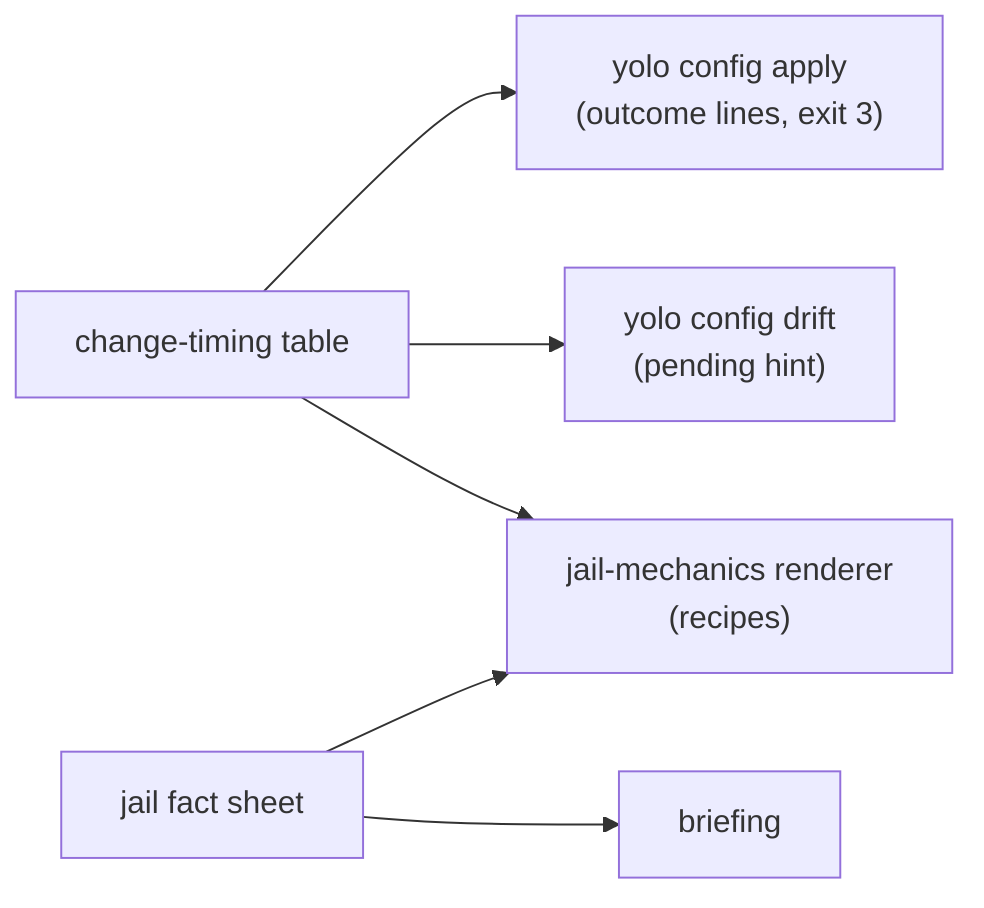

# One skill that says how this jail works, rendered from the launch that made it

**Status:** 2026-10-23. All four questions ruled in review on 2026-10-23, each as leaned. Nothing
built. Evidence read at `2ac50a040`.

> **In short.** Agents get jail mechanics wrong because every text they read about them is
> static prose that has to cover every backend and every config at once, and so is either
> conditional or false. A skill rendered from the launch's own decisions can say only the case that
> holds, and stays right because the code that decides each fact is the code that writes its
> sentence.

**Why it matters.** Today three texts give an agent three different next steps for one config edit:
the briefing says *"ask the human to restart the jail"*, configuring-the-jail says *"ask the human to
run `yolo config apply`"*, and `yolo config-ref`'s workflow says *"Please restart the jail for new
packages"* ([§2](#2-what-agents-read-today-and-where-it-is-wrong)).

**The shape.** One host-side record of what this launch applied (the **jail fact sheet**), one per-key
**change-timing table** shared with `yolo config apply`, and one renderer that writes a short
`SKILL.md` plus a few recipe files into the skills staging every entry already refreshes.

**Cost.** The briefing loses its lifecycle text. The two existing built-in skills become renderings
too ([OQ-JM2](#OQ-JM2)), so the built-in suite stops being embedded files at all.

**Start at [§4](#4-what-dynamic-means-the-jail-fact-sheet).** The chunking in
[§5](#5-the-skill-a-short-index-and-generated-recipes) and the correctness tests in
[§7](#7-how-it-stays-correct) follow from it.

**Ruled 2026-10-23, nothing open:** [OQ-JM1](#OQ-JM1) (one pointer line in the briefing),
[OQ-JM2](#OQ-JM2) (every built-in skill rendered), [OQ-JM3](#OQ-JM3) (real paths, host paths
included), [OQ-JM4](#OQ-JM4) (a host rendering).

**Reads with:** [`jail-mechanics-skill-plan.md`](jail-mechanics-skill-plan.md) (the implementation
plan; a seed until it is completed against the tree), [`live-config-apply.md`](live-config-apply.md) (the per-key timing this
reuses), [`agent-briefings.md`](../reference/agent-briefings.md) (the briefing and skills staging),
[`jail-home.md`](../reference/jail-home.md#the-storage-class-briefing-section) (the persistence map).

---

## 1. Recommendation and principles

Add a third built-in skill, **`jail-mechanics`**, rendered by the host-side launcher into the skills
staging on every fresh launch, every attach and every `yolo config apply`, and by `yolo host apply`
at the host notch ([OQ-JM4](#OQ-JM4)). It covers two things and nothing else, as the maintainer asked
(2026-10-23):

> *"only describe the mappings to host files and the life cycles of making changes: restarting, when
> host apply is needed, all that stuff should be dynamically generated based on what the user's
> config is at the moment. So there's not a thing that says 'if this is configured, then your
> workspace is bind mounted, otherwise it's this.' It should just be 'it is this.'"*

1. <a id="JM-P1"></a>**P1. State the case that holds.** No rendered sentence names a backend, notch
   or setting this jail does not have, and none says "if" about a fact the launcher already knows.
2. <a id="JM-P2"></a>**P2. The decider writes the sentence.** Each fact is read from the function that
   makes the launch's decision, never from a second list. This is
   [DS-P1](../reference/jail-home.md#DS-P1) applied to every fact in the skill, not only the
   storage classes.
3. <a id="JM-P3"></a>**P3. Applied, never configured.** The skill describes what the jail has, which
   at an attach is not always what the config now says
   ([the briefing's rule](../reference/agent-briefings.md#what-the-body-describes-applied-never-configured)).
4. <a id="JM-P4"></a>**P4. Steps, not explanations.** A recipe is numbered steps with exact commands
   and exact paths: what the agent runs, the words it gives the human, and what the human's command
   will report.
5. <a id="JM-P5"></a>**P5. Small at rest.** An agent that never invokes the skill pays for its
   description only. One that does reads the index and one recipe.
6. <a id="JM-P6"></a>**P6. The rule covers everything yolo pushes in.** The ruling on
   [OQ-JM2](#OQ-JM2) widens P1 and P2 from this skill to every built-in skill and every
   informational text yolo writes into the jail: *"Whatever is dynamically shoved into the jail for
   informational purposes should only apply to the situation in which the jail is in."*

### Terms

- **Jail fact sheet** *(coined here)*: the host-side record of what one launch applied (or, at the
  host notch, what one `yolo host apply` applies), assembled from its deciders, and the only input
  the renderer reads. It is not the config,
  and not `.yolo/config-boot.json` (the agent-writable effective-config record).
- **Change-timing table** *(coined here)*: for each config key and backend, when a change to it takes
  effect, and who must act. It is today's `keyOutcome` table
  ([`liveapplyplan.go`](../../internal/cli/run/liveapplyplan.go)) widened by three timing classes it
  does not yet carry ([§6.1](#61-the-timing-classes)).
- **Recipe** *(coined here)*: one generated file of the skill that covers one kind of change, as
  numbered steps.

## 2. What agents read today, and where it is wrong

Read at `2ac50a040`.

| Text | What it says about a config edit | What the code does |
| :--- | :--- | :--- |
| Briefing, "Packages & Resource Limits" ([`briefing.go` `packagesSection`](../../internal/jailcontent/briefing.go)) | edit, `yolo check`, *"ask the human to restart the jail"* | A restart is not the human's next step: `yolo config apply` records the approval and applies what it can ([`live-config-apply.md` §3](live-config-apply.md#3-the-command)). |
| configuring-the-jail, "Rebuild vs. restart" | `mounts`, `env_sources` and `packs` are all restart-only | `mounts` apply live on Linux podman, and `env_sources` reaches the next session (`keyOutcome`, `mountsOutcome`). |
| `yolo config-ref`, agent workflow ([`config_ref.txt`](../../internal/cli/config_ref.txt)) | *"Please restart the jail for new packages"* | Same as the briefing row. |
| Briefing, macos-user arm of the same section | *"edit `/workspace/yolo-jail.jsonc`"* | That backend has no `/workspace`; the Environment block of the same briefing says so. |
| [diagnosing-the-jail](../../internal/jailcontent/builtinskills/diagnosing-the-jail/SKILL.md)'s log-path and macOS-permissions steps; [configuring-the-jail](../../internal/jailcontent/builtinskills/configuring-the-jail/SKILL.md)'s dotfiles item | backend-conditional prose (*"container backends … macos-user …"*, *"or `.yolo/home/.pi` on Apple Container"*) | The launcher knows which one holds. |
| Briefing at an attach ([`prepare.go` `refreshJailBriefings`](../../internal/cli/run/prepare.go)) | mounts, ports, resource limits and blocked tools read from the **current** config | The jail still has the ones it launched with, until a live apply or restart moves them ([LA-D7](live-config-apply.md#LA-D7)). |

Three facts make a host-side rendering the only one that can be right:

- **The jail cannot tell its own backend.** Every container jail is handed `YOLO_RUNTIME=podman`, for
  a nested launch's sake, so an Apple Container jail says `podman` too
  ([`assemble.go`](../../internal/cli/run/assemble.go)).
- **Most timing facts are host facts.** Whether a broker takes live scope, whether `podman info`
  proved rootless, whether a second `yolo` attaches or starts a fresh sandbox: none is visible inside.
- **The staging is already refreshed per entry.** Skills are composed host-side and synced into the
  bound staging dir on every launch and attach, preserving inodes
  ([`skills.go` `prepareSkillTarget`](../../internal/jailcontent/skills.go)). A rendered skill rides
  that path; it needs no new delivery.

## 3. Goals and non-goals

**Goals**

- An agent that has just edited a config file, a skill or a host-facing file, or wants a tool,
  limit, mount or loophole, finds the exact steps for this jail in one recipe.
- An agent can answer "where does this path live on the host, is it live or a copy, can I write it,
  and does it survive a restart?" for every path the launch made.
- The skill, the briefing, `yolo config apply` and `yolo config drift` never disagree about timing.

**Non-goals**

- **Key syntax and semantics.** Port order, mount entry forms, merge layering and the generated-file
  modes stay in configuring-the-jail and `yolo config-ref`. The skill links them.
- **Diagnosis.** Probes and triage stay in diagnosing-the-jail.
- **Pending state.** The skill does not list which changes are pending right now; `yolo config
  drift` answers that live, and the skill tells the agent to run it
  ([JM-D6](#JM-D6)). A rendered list would be stale the moment a config file is saved.
- **New capability.** Nothing here changes when any change takes effect. It changes what the agent
  is told.
- **An agent-initiated host command.** "Ask the human" stays the step until the
  [host-run mailbox](host-run-mailbox.md) or the broker's request store exists; then the recipe's
  host step changes in one place ([§6.3](#63-the-host-step-has-one-writer)).

## 4. What "dynamic" means: the jail fact sheet

The run pipeline already builds `jailcontent.BriefingInput` from what the launch applies. The fact
sheet is that record, widened by the fields below, and built once per entry in the same function.
The renderer reads nothing else: no file, no environment variable, no probe
([the composer's no-probe rule](../reference/agent-briefings.md#what-the-body-describes-applied-never-configured)).

### 4.1 Rendered facts and their deciders

| Fact | What the skill says, for this jail only | Decider (already exists unless marked) |
| :--- | :--- | :--- |
| Backend and notch | nothing by name; it selects which sentences exist | `rt`, `config.ResolveConfinement` |
| Workspace | its jail path, its host path, that it is the host's directory (bind or native), and each `workspace_readonly` sub-path with whether this backend enforces it | `BriefingInput.Workspace`, the `workspace_readonly` mount decider; enforcement per Apple Container version (**new field**) |
| Workspace config file | its exact name and jail path, whether the agent may edit it, the local file if present | `config.ResolveWorkspaceConfigPath`, `workspaceConfigLocked` |
| User config file | its host path, and that the agent cannot see or edit it | the user-scope path resolver (**new field**) |
| Home | each writable path, its host source, its class, and that the rest is read-only, or writable-and-kept on a backend where it is | `persistenceMapFor`, widened by a host-source column (**new field**) |
| Per-launch paths | the list, their backing (disk volume or RAM), and that they are gone at restart | the same map, `PerLaunchInRAM` |
| Durable dir | its path | `o.durable` |
| Context mounts | each path, host source, mode, and whether a host edit is live or arrives at the next launch | `briefedCtxMounts` |
| `host_files` | each destination, its source, and whether it is a bind (live) or a copy (next launch) | the `host_files` staging decider (**new field**) |
| Skills and briefings | which skills dirs are staged read-only, which project dirs are writable, and when a host or workspace edit reaches this jail | `packSkillTargets`, the workspace layer's project dirs, the backend's delivery (bind or copy) |
| Network | the applied mode, both port directions | `appliedNetMode`, `briefingPortsFor` |
| Nix | host daemon or native | `hostNixMounted` |
| Loopholes and packs | which are on, that both are host-side switches, and the exact host command for each | `briefingLoopholes`, the staged pack set |
| Package delivery | baked image or store-delivered farm, which decides whether a `packages` change rebuilds | the store-packages decision (**new field**) |
| Sessions | whether a second `yolo` attaches to this jail or starts a fresh sandbox, and that a restart ends every session | `rt` |
| Restart | the exact commands | `stopRemedy` and `yolo` on a container backend; on macos-user, which has no `yolo stop` to run, the session model: end this session, run `yolo` |
| Timing per key | [§6](#6-lifecycle-one-table-three-readers) | the change-timing table |

Every path is rendered as it is, host paths included ([OQ-JM3](#OQ-JM3)): on macos-user the
workspace is its real path, and every recipe names the host directory the human runs a command in.
For generated text this supersedes the 2026-09-13 ruling that every text spells `/workspace`
([`declaration-parity.md`](declaration-parity.md)), whose reason was that the built-in skills were
static.

### 4.2 Static content

Static means the same bytes in every jail of a notch: the skill's description, the recipe titles,
the order of steps, and the sentences that hold everywhere (*"`yolo check --no-build` validates your
edit; read every `[FAIL]` before anything else"*). Static text carries no backend name.

### 4.3 Which config the facts come from

- **A fresh launch** renders from the config it launched with, which is what it applied.
- **An attach** renders from the **effective config**: what the jail has after any live apply
  ([JM-D3](#JM-D3)). The host already holds the inputs it needs for that: the inspected container's
  environment, the live mount record, the running jail's pack tree. The attach's current config is
  read only by the change-timing table, never by the fact sheet.
- **macos-user** has no attach. Every entry is a fresh launch, so the first rule covers it.
- **`yolo host apply`** renders the host version from the user config it applies, and says only
  what applies on the real machine ([OQ-JM4](#OQ-JM4)): no restart, no jail path, no loophole, and
  `yolo host apply` as the step after every edit. A recipe with nothing to say at the host is not
  written, by the rule in [§5.1](#51-layout).

That rule applies to the briefing's own facts as well, because both read one fact sheet. It closes
the briefing half of [LA-D7](live-config-apply.md#LA-D7) without a second change.

## 5. The skill: a short index and generated recipes

### 5.1 Layout

```text
jail-mechanics/
  SKILL.md                 # description + where you are (≤ 12 lines) + recipe index
  host-map.md              # every path the launch made: jail path, host source, mode, lifetime
  recipes/
    workspace-config.md    # you edited (or want to edit) the workspace config
    user-config.md         # the change needs the user's own config on the host
    packs-and-loopholes.md # an agent, a pack or a host capability
    skills-and-briefing.md # a skill, a briefing, agents_md_extra, a handoff
    host-files.md          # a file the jail reads from the host
    tools.md               # a tool now (no config) vs a tool for every session
    restart.md             # what a restart costs and keeps, and its exact commands
    yolo-update.md         # the launcher on the host is newer or older than this jail
```

A recipe that has nothing to say for this jail is **not written**, and the index omits it: a jail
with no loophole-bearing pack gets no `packs-and-loopholes.md` paragraph about loopholes, not a
sentence saying there are none ([JM-P1](#JM-P1)).

### 5.2 SKILL.md

The description decides whether an agent picks the skill. Its text is static, so every jail's agent
sees the same trigger words:

> *How THIS jail is wired and what to do after any change: which host path each path here is, what
> survives a restart, and the exact steps after editing the jail config, a skill or a host file, or
> before asking the human to restart. Read before telling the human to restart anything.*

The body is three parts, at most about 40 lines:

1. **Where you are**, rendered: workspace (jail path = host path, live), durable dir, config file and
   whether you may edit it, how a restart is spelled. No more than 12 lines.
2. **The index**: one line per written recipe, *"You edited `yolo-jail.jsonc` → `recipes/workspace-config.md`"*.
3. **Two standing rules**: run `yolo config drift` to see what is pending now; the human's command
   output is authoritative over this skill's expectation ([JM-D5](#JM-D5)).

### 5.3 A recipe, rendered

For the workspace config, the recipe is a short table of this jail's keys by timing class, then one
numbered sequence per class present. Rendered for a Linux podman jail on a rootless host, whose
workspace config is not locked:

```markdown
## You changed `mounts` (read-only, under /ctx)

1. `yolo check --no-build`. Fix every `[FAIL]`. The warning "host path does not exist" is
   expected in here: mounts are resolved on the host.
2. Tell the human: "Please run `yolo config apply` in `/home/matt/code/proj` on the host."
3. Expected: `applied now`. The mount appears at its `/ctx` path in every session of this jail,
   with no restart. If the command reports `at next restart` instead, go to `restart.md`.
```

The same key rendered for an Apple Container jail has no live step: step 2 asks for
`yolo config apply` *and* the restart, and step 3 says the mount appears after it. For macos-user,
step 2 asks the human to start a new `yolo` session, whose own gate asks the question. No rendering
mentions another backend.

The `packages` sequence on a baked-image launch says the restart rebuilds the image first and names
that as slow; on a store-delivered launch it says no rebuild happens.

### 5.4 Size

| Piece | Read when | Budget |
| :--- | :--- | :--- |
| description | always, by every agent that lists skills | about 60 words |
| `SKILL.md` body | the skill is invoked | about 40 lines |
| `host-map.md` | the agent asks where something lives | one line per path; about 40 lines on podman |
| each recipe | its case arises | 15 to 60 lines |

The budgets are targets for the golden tests to report, not limits they enforce
([JM-D9](#JM-D9)).

## 6. Lifecycle: one table, three readers

### 6.1 The timing classes

The change-timing table carries one class per key and backend. The first four exist in `keyOutcome`
and its siblings today; the last three are new rows of the same table.

| Class | Meaning | Who acts |
| :--- | :--- | :--- |
| applied now | live in every session | the human runs `yolo config apply` |
| next session | the next `yolo` entry has it; running processes do not | the human runs `yolo config apply`, or any interactive `yolo` |
| at next restart | approved, not applied | `yolo config apply`, then the restart |
| at next launch | no jail is running | the next `yolo` |
| **restart and rebuild** *(new)* | as above, and the restart builds a new image first | as above; slow |
| **user scope only** *(new)* | the workspace file cannot carry it | the agent writes the exact edit for the human's user config |
| **host switch** *(new)* | turned on per project on the host, never in a file the agent edits | the human runs the named host command, then restarts |

The three new classes come from deciders that already exist: the image-input predicate
(`config.EffectivePackages` and the `gpu.vaapi` rule) for the rebuild, `internal/config/validate.go`'s
user-scope refusals for the second, and the loophole manifest's `brokered` switch for the third. The
table **reads** them; it does not restate them.

### 6.2 The three readers



`yolo config apply` keeps its per-change probe: whether this jail's broker takes live scope, whether
this host proved rootless. The table gives the class a change has **on this backend when every probe
succeeds**, and the command narrows it per run. The skill renders the table's answer as the
expectation, and step 3 of every recipe says the command's own output wins ([JM-D5](#JM-D5)). That
step is the one place a rendered recipe admits an outcome other than the expected one, and it is not
an "if configured": it is the command reporting a runtime fact the renderer cannot see.

### 6.3 The host step has one writer

Every "ask the human" sentence is produced by one function from three inputs: the host command, the
host workspace path, and whether it ends sessions. Today the wording lives in at least five places
(`outcomeNextRestart.String`, `stopRemedy`, `configdrift.go`, the briefing's `lockedConfigRequest`,
`brokercmd.go`). The renderer uses that one function, and the existing callers move to it where their
words are the same sentence ([JM-D8](#JM-D8)). When the host-run mailbox lands, that function is
where "ask the human" becomes "request it".

### 6.4 Every change kind the recipes cover

| Change | Recipe | Its steps come from |
| :--- | :--- | :--- |
| a workspace config key | `workspace-config.md` | the change-timing table, per key present in `config-ref`'s schema |
| a user-scope key (`packs`, a read-write mount, `host_files`, `writable_home_dirs`, `agents_md_extra` for every workspace) | `user-config.md` | the user-scope refusals; the human edits the user file on the host, runs `yolo check` there, then restarts |
| a loophole on or off; a brokered repository list | `packs-and-loopholes.md` | the loophole manifest; `yolo loopholes enable <name>` on the host; the scope row for `brokered.*.repos` |
| a workspace skill, a host briefing file, `agents_md_extra`, `.yolo/handover.md` | `skills-and-briefing.md` | the backend's staging delivery: refreshed at every entry on a bind, at the next launch on a copy |
| a host file the jail reads | `host-files.md` | the `host_files` decider: live through a bind, next launch through a copy |
| a tool | `tools.md` | the persistence map: where `npm i -g`, `pip install --user` and `mise use` land, and whether that path survives a restart; then `packages` / `mise_tools` timing for a permanent one |
| a restart | `restart.md` | `stopRemedy`; the per-launch class (what is lost); the session model |
| a newer or older host launcher | `yolo-update.md` | the attach's contract-tag check: an attach from a launcher this jail cannot serve offers the restart |

## 7. How it stays correct

Each test below is asked the [AGENTS.md question](../../AGENTS.md#testing): **does it fail if I delete
the call site?**

1. **The production call site renders the skill.** A test drives the run pipeline's staging function
   with a launch fixture and reads `jail-mechanics/` out of the staging dir. Deleting the renderer's
   call, or writing the skill from the embedded tree instead, fails it. The same test reads
   configuring-the-jail and diagnosing-the-jail, which are rendered too ([OQ-JM2](#OQ-JM2)), and a
   second one drives `yolo host apply`'s render path for the host version ([OQ-JM4](#OQ-JM4)).
2. **The host map is the argv.** The existing persistence-map test compares the map with the
   assembled argv in both directions per backend
   ([DS-D17](../reference/jail-home.md#DS-D17)). It is widened to parse `host-map.md` from the same
   fixture and require one line per writable mount and per context mount, with the argv's host
   source. A mount added to the argv and not to the map fails twice.
3. **The skill and the command agree.** For every key the config schema lists and every backend, the
   class the recipe renders equals the outcome `yolo config apply`'s planner gives that key with every
   probe answering yes. Both call the table, so this fails if either stops calling it. A schema key
   with no row fails too, which is what makes a new key impossible to ship unclassified.
4. **Only the case that holds.** Each backend's rendering is checked for every other backend's name
   (`macos-user`, `Apple Container`, `podman`, `Seatbelt`), every other notch's, and a short phrase
   list (`if configured`, `otherwise`, `on this backend only`, `depending on`). A heuristic, stated as
   one: it catches the regression of pasting static prose back in, not every conditional.
5. **The restart is the jail's.** On each container backend fixture the rendered restart command
   equals `stopRemedy`'s, and on macos-user no rendering names `yolo stop`.
6. **Goldens per backend.** One full rendering per backend fixture (Linux podman rootless, Apple
   Container, macos-user, and the host notch per [OQ-JM4](#OQ-JM4)), regenerated with a flag
   and reviewed as a diff. A golden pins bytes, not truth; tests 2 to 5 pin truth.

## 8. Relation to the briefing and the two existing skills

**Nothing is said twice in two wordings.** A fact appears in the briefing and in the skill only when
both render it from one fact-sheet field through one function. All three built-in skills render from
the one fact sheet ([OQ-JM2](#OQ-JM2)), so each shows only this jail's case.

| Text | Keeps | Loses (moves to jail-mechanics) |
| :--- | :--- | :--- |
| Briefing | Environment block, network, storage classes ([DS-D13](../reference/jail-home.md#DS-D13)), loopholes, blocked tools, context mounts, limitations | "Packages & Resource Limits"' request loop and the locked-config request; the macos-user resource paragraph moves into the `resources` row of `workspace-config.md`. In its place, one rendered pointer line ([OQ-JM1](#OQ-JM1)): *"Before editing `yolo-jail.jsonc`, asking for a restart, or relying on a file from the host: read **jail-mechanics**."* The macos-user line *"there is no `/workspace` on this backend"* goes once no text pushed into the jail spells `/workspace` ([OQ-JM3](#OQ-JM3)) |
| configuring-the-jail, rendered | which file (its real path), merge layers, generated home files for this backend only, the six wrong beliefs, the schema pointer | "You already know the loop", "When the config file is read-only", "Rebuild vs. restart", the brokered-switch paragraph |
| diagnosing-the-jail, rendered | triage steps 1, 3, 4, 5, 7; step 2 with this backend's one log path; step 2b, the macOS ACL fix, on macos-user only ([OQ-JM2](#OQ-JM2)) | step 6, "my fix isn't taking effect", becomes a pointer to `yolo config drift` and the skill |
| `yolo config-ref` agent workflow | the key reference | its "restart the jail" workflow paragraphs become one line naming the skill |

The briefing's "Skills" section names the new skill first and says when to read it.

## 9. Parity across backends and notches

| | podman (Linux) | podman (macOS machine) | Apple Container | macos-user | `yolo host` |
| :--- | :--- | :--- | :--- | :--- | :--- |
| Rendered at | launch, attach, `config apply` | same | launch only ([JM-D7](#JM-D7)) | every launch | `yolo host apply` ([OQ-JM4](#OQ-JM4)) |
| Workspace sentence | `/workspace` is the host dir, bound live | same | same | the real path, not a mount ([OQ-JM3](#OQ-JM3)) | the real machine's directory |
| Restart recipe | `yolo stop`, then `yolo` | same | same | end the session, run `yolo` | none: no jail |
| Live-apply recipes | the table's A and B rows | the table, M3 unbuilt rows at restart | restart for mounts and scope | next session for every key | `yolo host apply` |

Every backend gets the skill and every recipe kind; what differs is the rendered content, never
whether a backend is served: the maintainer's parity principle (2026-10-18), that every backend and
notch gets the same behavior whoever uses it, and [`backend-parity.md`](backend-parity.md) for how a
mechanism goes missing on one backend quietly.

## 10. When it regenerates

| Event | Re-renders | Why |
| :--- | :--- | :--- |
| fresh launch | everything | the fact sheet is new |
| attach (any, interactive or not) | everything, from the effective config | already the skills staging's trigger ([§4.3](#43-which-config-the-facts-come-from)) |
| `yolo config apply` that applied something | the skill's host map and `SKILL.md` | a skill is read on demand, mid-session, so a mount applied now must appear in it ([JM-D4](#JM-D4)) |
| `yolo config apply` that applied nothing | nothing | the effective config did not move |
| a config file edit inside the jail | nothing | the jail cannot render; `yolo config drift` reports the edit |
| Apple Container, any re-entry | nothing | the staged copy is the launch's ([JM-D7](#JM-D7)) |
| `yolo host apply` | the host version | the host notch has no launch; its apply is the entry ([OQ-JM4](#OQ-JM4)) |

A failed render never fails the entry: the previous rendering stays, and the launch prints one line
naming the failure and that the skill describes the previous launch. Two renders of one jail are
serialized by the launch lock both callers already hold ([`live-config-apply.md`
§3.2](live-config-apply.md#32-the-sequence)).

## 11. Alternatives considered

- **Render in the jail from environment variables.** Rejected: the jail cannot tell its backend, and
  most timing facts are host facts ([§2](#2-what-agents-read-today-and-where-it-is-wrong)).
- **Put it all in the briefing.** Rejected: it is always loaded, and the maintainer asked for the
  steps to sit in a skill so they cost nothing until needed.
- **One `SKILL.md` with every recipe inline.** Rejected: about 300 lines on podman, read whole for
  one case ([JM-P5](#JM-P5)).
- **Render the pending changes into the skill.** Rejected for v1: stale the moment a file is saved;
  `yolo config drift` is live ([JM-D6](#JM-D6)).
- **A static skill with per-backend sections.** Rejected: it is the conditional prose the request
  names.
- **A three-step summary in the briefing beside the pointer** ([OQ-JM1](#OQ-JM1) B). Rejected
  2026-10-23: a second copy of the sentence that drifted.
- **Strip the two existing skills to backend-neutral static text** ([OQ-JM2](#OQ-JM2) A). Rejected
  2026-10-23: the maintainer asked for everything generated that can be.
- **Keep `/workspace` in rendered text** ([OQ-JM3](#OQ-JM3) B). Rejected 2026-10-23: a copied
  `/workspace` path fails on macos-user.
- **No mechanics skill at the host** ([OQ-JM4](#OQ-JM4) B and C). Rejected 2026-10-23: the host
  agent gets what applies there.

## 12. Risks

| Risk | Mitigation |
| :--- | :--- |
| An agent never picks the skill | static trigger wording ([§5.2](#52-skillmd)); the briefing's one pointer line names it beside the actions that need it ([OQ-JM1](#OQ-JM1)) |
| The expectation disagrees with the command at runtime (an unproven rootless probe) | step 3 of every recipe says the command's output wins ([JM-D5](#JM-D5)) |
| Apple Container's copy is agent-writable and never refreshed | it is the launch's copy of the launch's facts, so it is true of the jail; an edit misleads only the agent that made it ([the misguided-agent principle](../reference/misguided-agent-principle.md)) |
| A pack ships a skill named `jail-mechanics` | the rendered skill wins over every layer, like yolo's LSP plugin, and the collision is reported ([JM-D2](#JM-D2)) |
| The fact sheet grows a host probe | [the composer's no-probe rule](../reference/agent-briefings.md#what-the-body-describes-applied-never-configured) applies; a probe's result reaches the sheet only through a value the launch already recorded |

## 13. Sequencing

1. The change-timing table moves out of the live-apply planner into a package all three readers
   import, with its three new classes and the schema-coverage test.
2. The fact sheet, as a widening of `BriefingInput`, built from the effective config at attach.
3. The renderer and `SKILL.md`, `host-map.md`, `workspace-config.md`, `restart.md`: the four that
   carry the reported confusion.
4. The remaining recipes; the briefing's pointer line in place of its lifecycle text; configuring-the-jail
   and diagnosing-the-jail rendered from the fact sheet ([OQ-JM2](#OQ-JM2)).
5. `yolo config apply`'s re-render; the host version rendered by `yolo host apply`
   ([OQ-JM4](#OQ-JM4)).

## 14. Open questions

1. ✅ <a id="OQ-JM1"></a>**OQ-JM1: What stays in the always-on briefing about making a change?**

   Matt's jail agent wants `ffmpeg` permanently. It has the briefing in context and sees
   jail-mechanics only as a one-line description among its skills. What the briefing says decides
   whether it edits the config without ever opening the skill.

   - **A — One pointer line.** *"Before editing `yolo-jail.jsonc`, asking for a restart, or relying
     on a file from the host: read **jail-mechanics**."* The loop lives only in the skill.
   - **B — The pointer and a three-step summary.** Edit, `yolo check --no-build`, then the steps in
     jail-mechanics. About four lines, rendered, so it cannot disagree with the skill.

   _Leaning:_ A — the request is to move the steps into a skill; a summary is a second copy of the
   one sentence that drifted.

   **Answer:**
   > **Ruled in review 2026-10-23, as leaned:** A. The briefing carries one pointer line to
   > jail-mechanics, and the steps live only in the skill. *"37 Yes A"*

2. ✅ <a id="OQ-JM2"></a>**OQ-JM2: Are the two existing built-in skills rendered too, or only stripped?**

   On macos-user, diagnosing-the-jail today tells the agent two log paths and a macOS-only ACL fix,
   and on podman the same skill shows that ACL section to an agent that can never hit it.

   - **A — Strip them.** Every backend-specific paragraph moves into jail-mechanics; the two skills
     stay static and backend-neutral. The ACL triage becomes a jail-mechanics recipe on macos-user.
   - **B — Render all three.** One renderer and one fact sheet for the whole built-in suite; each
     backend's diagnosing-the-jail shows only its own log path and its own fixes.

   _Leaning:_ B — the ACL fix is diagnosis, not mechanics, and stripping it into the mechanics skill
   moves it where a diagnosing agent will not look.

   **Answer:**
   > **Ruled in review 2026-10-23, as leaned, and broader:** B. Every built-in skill, and any
   > informational content yolo pushes into the jail, is generated from the same facts and
   > describes only the situation this jail is in. *"yes, we want to generate whatever we can.
   > Whatever is dynamically shoved into the jail for informational purposes should only apply to
   > the situation in which the jail is in."*

3. ✅ <a id="OQ-JM3"></a>**OQ-JM3: Does the 2026-09-13 ruling to keep `/workspace` canonical still hold?**

   On macos-user the workspace is `/Users/Shared/yolo/proj` and `/workspace` does not exist. The
   [ruling](declaration-parity.md) kept `/workspace` in every text because the built-in skills were
   static markdown; rendered skills remove that reason.

   - **A — Real path in rendered text.** Every rendered skill says `/Users/Shared/yolo/proj`. The
     briefing's *"there is no `/workspace` on this backend"* line stays only while some static text
     still spells `/workspace`.
   - **B — Keep `/workspace` everywhere.** Rendered text spells `/workspace` too, and the briefing's
     line keeps translating it.

   _Leaning:_ A — the agent copies commands verbatim, and a copied `/workspace` path fails on that
   backend.

   **Answer:**
   > **Ruled in review 2026-10-23, as leaned:** A. Generated skills show real paths, host paths
   > included. For generated text this supersedes the 2026-09-13 always-`/workspace` ruling.
   > *"if you're asking if the generated skills can expose host paths, I think the answer is yes.
   > And that will allow the agent and the generated stuff to be correct."*

4. ✅ <a id="OQ-JM4"></a>**OQ-JM4: Does a host agent get a rendered mechanics skill?**

   Matt runs `yolo host -- claude` in `~/code/proj`, and the agent adds an MCP server to
   `~/.config/yolo-jail/config.jsonc`. It needs to know that `yolo host apply` renders it and that
   no restart exists. Today `yolo host apply` writes no built-in skill, because they describe a jail
   ([`applyhostskills.go`](../../internal/cli/applyhostskills.go)).

   - **A — A host rendering.** `yolo host apply` writes the same skill rendered at the host notch:
     the real machine, which files it renders, and `yolo host apply` as the step after every edit.
   - **B — No skill at the host.** The host briefing gets one lifecycle line instead.
   - **C — Neither.** The host agent reads `yolo --help`.

   _Leaning:_ A — the old reason was that the skills describe a jail, which a host rendering does
   not; parity asks for the same help at every notch.

   **Answer:**
   > **Ruled in review 2026-10-23, as leaned:** A. `yolo host apply` renders a host version with
   > exactly what applies on the host. *"If you run an agent with YOLO host, it should get exactly
   > as much as it needs. Yeah, the host version, whatever is applicable there."*

## Decision Ledger

The four OQ rows are the maintainer's rulings. The JM-D rows are implementation decisions, taken in
this design; each is reversible.

| ID | Decision | Date | Settled in | Built |
| :--- | :--- | :--- | :--- | :--- |
| [OQ-JM1](#OQ-JM1) | **Ruled, as leaned:** the briefing carries one pointer line to jail-mechanics; the steps live only in the skill. *"37 Yes A"* | 2026-10-23 | [§8](#8-relation-to-the-briefing-and-the-two-existing-skills) | pending |
| [OQ-JM2](#OQ-JM2) | **Ruled, as leaned, and broader:** every built-in skill and any informational content pushed into the jail is generated from the same facts, describing only this jail's situation. *"yes, we want to generate whatever we can."* | 2026-10-23 | [§1](#1-recommendation-and-principles) ([JM-P6](#JM-P6)), [§8](#8-relation-to-the-briefing-and-the-two-existing-skills) | pending |
| [OQ-JM3](#OQ-JM3) | **Ruled, as leaned:** generated skills show real paths, host paths included; supersedes the 2026-09-13 always-`/workspace` ruling for generated text. *"that will allow the agent and the generated stuff to be correct."* | 2026-10-23 | [§4.1](#41-rendered-facts-and-their-deciders) | pending |
| [OQ-JM4](#OQ-JM4) | **Ruled, as leaned:** `yolo host apply` renders a host version with exactly what applies on the host. *"the host version, whatever is applicable there."* | 2026-10-23 | [§4.3](#43-which-config-the-facts-come-from), [§10](#10-when-it-regenerates) | pending |
| <a id="JM-D1"></a>JM-D1 | The skill is named `jail-mechanics`, the maintainer's own phrase. The description, which decides selection, is static ([§5.2](#52-skillmd)) | 2026-10-23 | [§5.2](#52-skillmd) | — |
| <a id="JM-D2"></a>JM-D2 | The rendered skill is written over every skills layer, as yolo's LSP plugin is, and a pack or workspace skill of that name is reported as shadowed. No layer knows the launch's facts | 2026-10-23 | [§12](#12-risks) | — |
| <a id="JM-D3"></a>JM-D3 | An attach builds the fact sheet from the effective config, never the current one; the briefing reads the same sheet, closing LA-D7's briefing half | 2026-10-23 | [§4.3](#43-which-config-the-facts-come-from) | — |
| <a id="JM-D4"></a>JM-D4 | `yolo config apply` re-renders the skill when it applied something. LA-D7's reason for not re-rendering, that an agent read its briefing at start, does not hold for a skill read on demand. It still does not re-render the briefing | 2026-10-23 | [§10](#10-when-it-regenerates) | — |
| <a id="JM-D5"></a>JM-D5 | A recipe states the expected outcome and says the host command's own report wins. The renderer cannot see per-run probes, and refusing to state any expectation would leave the agent guessing | 2026-10-23 | [§6.2](#62-the-three-readers) | — |
| <a id="JM-D6"></a>JM-D6 | No pending-change list in the skill; it names `yolo config drift` | 2026-10-23 | [§3](#3-goals-and-non-goals) | — |
| <a id="JM-D7"></a>JM-D7 | Apple Container's skill is the launch's copy and is not refreshed at re-entry, as its briefing is not. Making AC's staging a live bind is outside this design | 2026-10-23 | [§10](#10-when-it-regenerates) | — |
| <a id="JM-D8"></a>JM-D8 | Every "ask the human" step comes from one function; existing callers whose sentence is the same move to it | 2026-10-23 | [§6.3](#63-the-host-step-has-one-writer) | — |
| <a id="JM-D9"></a>JM-D9 | The size budgets are reported by the golden tests, not enforced | 2026-10-23 | [§5.4](#54-size) | — |
| <a id="JM-D10"></a>JM-D10 | A failed render keeps the previous rendering and prints one line; it never fails the entry | 2026-10-23 | [§10](#10-when-it-regenerates) | — |
| <a id="JM-D11"></a>JM-D11 | **The maintainer's ruling, 2026-10-23** (asked after [OQ-JM4](#OQ-JM4) left it open): `yolo host apply` also renders host versions of configuring-the-jail and diagnosing-the-jail, keeping only what applies on the host (config edits, `yolo host apply`, the host's own logs); a skill with nothing that applies is not written. *"Question 41, yes, A is the right answer."* | 2026-10-23 | [§4.3](#43-which-config-the-facts-come-from) | — |
