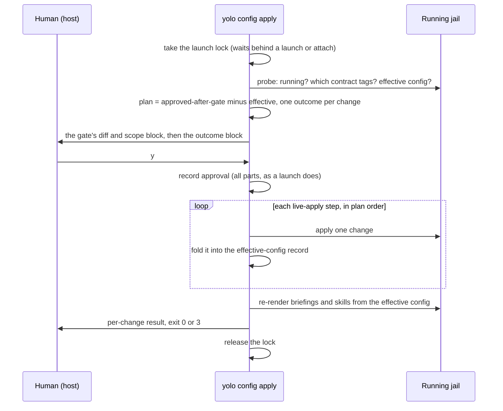

# Approve a config change once, on the host, and let the running jail take what it can

**Status:** 2026-10-18. Every question ruled the same day; nothing built. Evidence read at
`79d4e0a22`. MEASURED: mount injection into a running `--read-only` container, in this jail's
nested podman only (`--userns host`); the rootless-host case it stands in for is UNMEASURED
([§5.4](#54-what-still-has-to-be-measured)).

> **In short.** "Restart to apply" is wrong for the two changes people actually make mid-session,
> a read-only mount and a GitHub repository: both can reach a running jail. So approval moves to a
> host command that reuses the launch's gate unchanged, and so does any attach a human is at, and
> "applied now" or "at next restart" becomes a per-change outcome, not a property of the whole config.

**Why it matters.** Today every config edit ends every session of the jail
([`config-safety.md`](../reference/config-safety.md#what-this-does-not-license): *"An attached
session's config is frozen until restart"*), even an edit the jail could take in place.

**The shape.** One host verb; the existing gate as its first half; a per-key **live-apply step**
table as its second; the approval record and a new **effective-config record** as its two outputs.

**Cost.** Two maintainer-adjacent rules move: the broker's start-time scope
([BB-D32](boundary-broker.md#BB-D32)) and the frozen-`/ctx` assumption. The launch gains a
`/ctx` tmpfs and a contract tag; a jail started before them takes mounts only at its next restart.

**Start at [§3](#3-the-command).** The eligibility table in [§4](#4-which-changes-can-reach-a-running-jail)
and the mount mechanism in [§5](#5-mount-injection-per-backend) follow from it.

**Needs your ruling:** None.

**Reads with:** [`live-config-apply-plan.md`](live-config-apply-plan.md) (the implementation plan), [`config-safety.md`](../reference/config-safety.md) (the gate
reused here), [`workspace-widening.md`](workspace-widening.md) (the scope entry and its approval),
[`attach-daemon-activation.md`](attach-daemon-activation.md) (the sibling that adds daemons to a
running jail), [`context-mounts.md`](../reference/context-mounts.md) (mount semantics).

---

## 1. Recommendation and principles

Build `yolo config apply`: a host command that takes the jail's own config-change gate to a running
jail. It records trust for every approved change and applies, live, the ones a running jail can
take. The maintainer's request, 2026-10-18:

> *"I want to allow certain jail config changes to be applied without restarting the jail. … the
> one I'm thinking about right now is … the read-only mounts, it would be nice to add GitHub
> permissions too if we could. … the user will have to run a command on the host … and the same
> confirmation for jail config changes that comes at jail startup will appear … It's possible it'll
> … give you the choice to accept now and just know that it won't be applied until the next jail
> restart, but it will at least capture that trust."*

1. <a id="LA-P1"></a>**P1. One gate.** The command calls the gate a fresh launch calls. Same diff, same scope
   block, same y/N, same record. It never forks a second approval path.
2. <a id="LA-P2"></a>**P2. Approval is about the config, application is about the jail.** A y records the
   approval first. Applying is a separate step that can fail without un-approving anything.
3. <a id="LA-P3"></a>**P3. Every change gets exactly one outcome**, printed before the question and again after
   it ran ([§6](#6-outcomes-and-what-each-party-sees)).
4. <a id="LA-P4"></a>**P4. Live is never wider than a launch.** A change applied live passes the same
   validation, scope refusals and disclosures that the next launch would apply to it.
5. <a id="LA-P5"></a>**P5. Nothing read from inside the jail is trusted.** The jail's mount namespace and files
   are agent-controlled. A host path is resolved on the host before the jail's namespace is entered.

### Terms

- **Live apply** *(coined here)*: changing what a running jail has, without ending its sessions. It
  is not a restart, and not the attach's per-entry channel rewrite, which already exists.
- **Effective config** *(coined here)*: the workspace config a running jail actually has. That is
  the config it booted with, plus every change live-applied since. It is not the approval record,
  which can be ahead of it.
- **Pending change** *(coined here)*: approved, but not in the effective config. That is either
  restart-only or a live step that failed.
- **Live-apply step** *(coined here)*: the per-key mechanism that moves one change from pending to
  effective. A key with no step is restart-only.
- **Session**, **keeper**: as in [`jail-lifetime-last-session-wins.md`](jail-lifetime-last-session-wins.md#11-terms).

## 2. What exists today

Verified against the tree at `79d4e0a22` on 2026-10-18.

| Fact | Evidence |
| :--- | :--- |
| The gate is `config.ApproveConfigAndScope`. It compares the canonical workspace config (`brokered` excluded) and the repository scope against `~/.local/share/yolo-jail/approvals/<cname>.json`, `.scope.json` and `.scope-sources.json`. | `internal/config/snapshot.go:329-477`, `:43-48`; `internal/config/scopeapproval.go:213-235` |
| Its prompt is `Accept these workspace config changes? [y/N]`. A y records every part together; an N records nothing. With no terminal it refuses unless `--accept-config-changes` is given. There is deliberately no env hatch. | `internal/cli/run/preflight.go:564-599`, `:620-640`; `snapshot.go:73-84`, `:429-458` |
| It runs only at a fresh launch: container `run.go:1589`, macos-user `run.go:542`, sealed `seal.go:402`. An attach returns before it. | `internal/cli/run/run.go:1554-1591`; `preflight.go:414-415` |
| `yolo check --accept-config-changes` already records an approval from the host, with no y/N and no effect on a running jail. In a jail it warns and writes nothing ([OQ-S2](../reference/config-safety.md#oq-s2)). | `internal/cli/check/check.go:696-716` |
| `.yolo/config-boot.json` is the workspace config a container jail booted with. It is written at fresh launch and read by `yolo config drift` (exit 0 in sync, 3 drifted, 4 no baseline). macos-user carries a per-session digest instead. | `internal/config/drift.go:35-139`; `preflight.go:522-537`; `internal/cli/configdrift.go:45-103` |
| An attach recomposes the provider, profile and env channel from the **current** config, and re-renders skills and briefings. The briefing re-render reads the current config's mounts, network and blocked tools, which can describe a mount the jail does not have. | `run.go:2852`, `:2975-2991`, `:3054-3071`; `internal/cli/run/prepare.go:42-83` |
| The launch lock is `~/.local/share/yolo-jail/locks/<cname>.lock`, a `flock`. A waiter prints "Waiting for concurrent jail launch". | `internal/cli/run/flock.go:69-99`, `:204-206`, `:293-318` |
| A container backend runs one container per workspace, named by `runtime.FromWorkspace`. macos-user sessions of one workspace overlap. | `internal/runtime/naming.go:34-80`; `run.go:1655-1700`; `drift.go:63-72` |
| An attach refuses a jail missing a capability it needs, through **contract tags** frozen at launch. | `internal/cli/run/contracttags.go:17-60`; [`attach-skew.md`](../reference/attach-skew.md#contract-tags) |
| The container rootfs is `--read-only`. `/ctx` is part of it, so nothing can make a new directory there after launch. Checked in this jail: `touch /ctx/x` gives EROFS. | `internal/cli/run/assemble.go:380` |
| Every podman arm adds `CAP_SYS_ADMIN` to the jail. A rootless host jail gets its own user namespace through `--uidmap 0:0:1 --uidmap 1:1:65536`. The nested arm uses `--userns host`. | `internal/cli/run/assemble_parts.go:252-298` |
| The github-broker's per-launch scope file is written once, by the keeper, from the gate's in-memory result. The daemon classifies every request against a **start-time copy** (`daemon.go:435`). Its authority check re-reads the file on every request (`authority.go:89`, `:118`). So editing the file can narrow a running broker but never widen it. | `internal/cli/run/brokeredscope.go:61-153`; `internal/ghbroker/daemon.go:109`, `:173`, `:435-437`; `internal/ghbroker/authority.go:30-118` |
| No `yolo config apply` exists. `config`'s verbs are `render ls diff reset capture promote drift dump`. "apply" already names `yolo apply` (provision) and `yolo host apply` (render into the real home). | `internal/cli/config.go:222-246`; `internal/cli/dispatch.go:19-63` |

## 3. The command

### 3.1 Surface

```console
$ yolo config apply                 # in the workspace, on the host
$ yolo config apply --accept-config-changes   # no terminal: the launch's own opt-in
$ yolo config apply --record-only   # approve; touch no running jail
```

- **The name is `yolo config apply`** ([LA-D1](#LA-D1)). It sits beside `drift`:
  `drift` says what a restart would change, and `apply` changes what it can without one. Under
  `config` the word is unambiguous; `yolo apply` and `yolo host apply` stay as they are.
- The workspace is the current directory's, found the way `yolo` finds it. There is no
  `--workspace` flag, as there is none on a launch.
- **In a jail it refuses**, naming the host command
  ([OQ-S2](../reference/config-safety.md#oq-s2) holds: recording an approval must not be
  reachable from the side being approved).
- **The in-jail agent cannot request an apply** ([OQ-LA6](#decision-ledger)). It edits the config
  and asks the human, in its own words, to run the command; there is no new channel. The
  maintainer: *"it can certainly ask the user to do whatever it wants. We're not creating a new
  channel, but you can throw this on the icebox, I guess, blocked on our brokered asker thing."*
  A request through the boundary broker's request store and doorbell is iced
  ([the iced slice](#LA-S5)).
- `yolo check --accept-config-changes` keeps its meaning: record, never touch a running jail
  ([LA-D2](#LA-D2)).
- `--record-only` is the maintainer's "accept now, apply at next restart" choice, made
  explicitly: it runs the gate, records the approval and applies nothing. The plain command applies
  what it can and records the rest, so the trust is captured either way.
- **An attach a human is at runs the same sequence** before its session starts
  ([§3.3](#33-the-attach-time-gate)). The command is one place a human is known to be present; an
  interactive attach is another, and the maintainer ruled that both ask
  ([OQ-LA4](#decision-ledger)).

### 3.2 The sequence



1. **Lock.** Take `locks/<cname>.lock` for the whole run, prompt included, as a fresh launch holds it
   through its own prompt ([LA-D3](#LA-D3)). A launch or attach that arrives meanwhile prints the
   existing waiting line.
2. **Probe** the jail with the tri-state probe a launch uses. *Could not ask* is not *not running*.
   - Not running: the command becomes `--record-only` and says the next `yolo` launches with the
     changes, without asking.
   - Could not ask: record only, and name the runtime error.
3. **Plan.** The change set is the config after this gate minus the effective config, so an
   approval recorded earlier by `yolo check --accept-config-changes` is applied now without a
   second prompt. Each change gets its outcome from [§4](#4-which-changes-can-reach-a-running-jail),
   narrowed by what this jail supports: its contract tags, its backend, and its broker's capability
   ([§5.5](#55-old-jails), [§7](#7-github-scope-live)).
4. **Gate.** When the workspace part or the scope differs from the record, call the launch's gate
   unchanged. The outcome block prints after the gate's own diff and before its question. Changes
   coming only from user config are disclosed, not asked about
   ([OQ-S1](../reference/config-safety.md#oq-s1) holds), with the launch's own disclosure lines
   (for example, the read-write mount line).
5. **Record** on y, exactly as a launch does. An N records nothing, applies nothing, and exits 1 with
   the gate's decline lines.
6. **Apply** each live step in order. Every step is idempotent, and is independent of the others
   ([§8](#8-failure-concurrency-and-recovery)).
7. **Re-render** the briefings and skills staging from the effective config, as an attach does
   ([LA-D7](#LA-D7)).
8. **Report and exit.** Exit 0 means nothing is pending. Exit 3 means approved with restart still
   owed, matching `drift`'s 3. Exit 1 means declined, refused or failed before the record was
   written.

**The command never offers to restart the jail** ([OQ-LA5](#decision-ledger)); it prints
`yolo stop`, then `yolo`. A restart ends every session of the jail
([`jail-lifetime-last-session-wins.md`](jail-lifetime-last-session-wins.md)). The maintainer:
*"I don't think we should offer to restart the jail. You can certainly give the commands by happy
path, but I don't want people to accidentally restart their jails. That's not fun. They may not
realize what they're doing."*

An apply is **not a session**: it is not counted, and it neither keeps a jail
alive nor delays the keeper's teardown. If the jail ends mid-apply, the remaining steps report
"jail stopped; applies at next launch", and the approval stands.

### 3.3 The attach-time gate

The maintainer, ruling [OQ-LA4](#decision-ledger) on 2026-10-18:

> *"Second session in the same jail should also ask you this because the whole point of the
> command is just so that there's a point where we know a human's there. So whenever we know a
> human's there, yes, ask."*

- **"A human is there" is the launch gate's own predicate: stdin is a terminal**
  ([LA-D13](#LA-D13)). It is the probe `config.ApproveConfigAndScope` is handed at a fresh launch
  (`Options.IsTTYStdin`), so a launch and an attach never disagree about who can be asked. Stdout is
  deliberately not part of it: `claude --print foo > out.txt` has a redirected stdout and a person
  at stdin.
- **An interactive attach** runs steps 2 to 8 of [§3.2](#32-the-sequence), unchanged, inside the
  attach's existing hold of the launch lock (the attach already holds it through its contract gate),
  after the contract gate and before the session's exec. The prompt, the outcome block and the
  per-change results are the command's.
  - An approval already recorded (by `yolo config apply --record-only`, or by
    `yolo check --accept-config-changes`) is applied without a second question, as the command
    applies it.
  - **An N does not stop the attach** ([LA-D14](#LA-D14)). Nothing is recorded or applied, and the
    session starts in the jail as it is. The decline lines say so instead of "Exiting", and name
    `yolo config apply` as the way to approve later. Refusing entry to a running jail over a
    question about a change would make every new tab a hostage to the diff.
- **A non-interactive attach** keeps today's behavior plus one line: it asks nothing, records
  nothing, applies nothing, and prints the pending-changes notice naming `yolo config apply` and
  `yolo config drift` ([LA-D9](#LA-D9)). `--accept-config-changes` on such an attach is the
  launch's own opt-in and means the same thing there: record and apply, without a question.
- **macos-user has no attach**: every invocation is a fresh launch, which already runs the gate.
  Apple Container's attach runs the gate like podman's, and its live steps report per the backend
  table ([§4](#4-which-changes-can-reach-a-running-jail)).
- A failed live step at attach never fails the attach: it reports, the change stays pending, and
  the session starts.

## 4. Which changes can reach a running jail

Classes:

- **A** live now, or already reaching the next session at no cost.
- **B** live with mechanism work, named in the row.
- **C** restart-only, for the reason given.
- **next** reaches the next session but not processes already running. macos-user has no attach,
  so every key behaves this way there: each invocation is a fresh sandbox
  ([`settings-per-setup.md`](../../userguide/reference/settings-per-setup.md)).

| Key or kind | podman (Linux) | podman (macOS machine) | Apple Container | macos-user | Why |
| :--- | :--- | :--- | :--- | :--- | :--- |
| `mounts` read-only, landing under `/ctx` | **B** | **B**, run inside the VM, and the source must be VM-shared | **C** | next; the gate and the record still apply | Injection with the new mount API ([§5](#5-mount-injection-per-backend)). Apple Container shares are fixed when its VM boots. A macos-user session's Seatbelt profile is fixed at exec. |
| `mounts` read-only, with `at` outside `/ctx` | C | C | C | refused today | The parent directory is in the read-only image rootfs. Making a mountpoint there means writing the container layer ([§10](#10-non-goals)). |
| `mounts` read-write (user scope only) | **B**, ruled in by [OQ-LA2](#decision-ledger) | **B** | C | next | Same mechanism without `MOUNT_ATTR_RDONLY`. Validation stays user-scope-only ([`OQ-WT1`](workspace-config-trust.md#OQ-WT1) is unchanged). |
| `mounts` removed | **B**, ruled in by [OQ-LA3](#decision-ledger) | **B** | C | next | Lazy detach in the jail's namespace. |
| `brokered.github.repos`, and remotes changing scope | **B** | B | n/a: the broker never starts | **B**, for every live session's broker | Rewrite the scope file. The broker classifies against its re-read ([§7](#7-github-scope-live)). |
| `env_sources`, `providers`, `profiles`, `profile`, `model_facts`, `adapters`; pack `env`, `profile`, `provider`, `models`, `adapter` | A, next | A, next | A, next | next | An attach already recomposes the channel (`run.go:2852`). A process keeps its environment. |
| `agents_md_extra`, `briefing_provenance`; built-in, user and workspace skills | A | A | B, because the briefing is copied once (`attachskewbriefing.go:64-66`) | next | Bind-mounted staging, which the apply re-renders ([LA-D7](#LA-D7)). |
| `mcp_servers`, `mcp_presets`, pack `mcp`, `lsp_servers` | B, next | B, next | B, next | next | Boot regenerates them every session, but the input is frozen launch argv `-e`. Moving it into the per-entry channel makes the next session pick it up. |
| `security.blocked_tools`, pack `blocked-tool`, `intercept` | B, next | B, next | B, next | next | Same: `YOLO_BLOCK_CONFIG` is argv. Shims regenerate per session. |
| `mise_tools` | B, next | B, next | B, next | next | Channel input, plus a re-run of provisioning. |
| `resources.cpus`, `.memory`, `.pids_limit` | B | B, within the VM | C | next | `podman update` changes cgroup limits live. Rootless needs cgroup v2 controller delegation (unmeasured). Apple Container has no known update verb. |
| `resources.io` | C | C | C | next | Frozen on purpose: an attach reads the launched value (`prepare.go:34-39`). |
| `network.forward_host_ports` | B | B | C | n/a | The socket dir is a live bind, so it needs a new socat and an in-jail forwarder. Apple Container uses `--publish-socket` in argv. |
| `network.mode`, `network.ports` | C | C | C | n/a | podman cannot re-network or add a publish to a running container. |
| `devices`, `gpu`, `kvm` | C | C | C | C | Device nodes and cgroup device rules are set at create. |
| `host_files` list, `writable_home_dirs`, `cache_relocations`, `per_side_paths`, `workspace_readonly`, `ephemeral_storage` | C | C | C | next | The same injection could reach some of them, but each shadows a path an agent may hold open ([§10](#10-non-goals)). The bytes behind an existing `host_files` bind are already live. |
| `packages` | C | C | C | next | The image, or the store farm, is chosen per launch. |
| `packs`, and every pack-tree kind (`program`, `requires`, `files`, `config*`, `hook`, `state`, `mount`, `reads-host`, `loophole`, `service`) | C | C | C | next | **By ruling**: a running jail keeps its booted pack tree ([OQ-PK2](../reference/pack-system.md#oq-pk2)) and is never re-rendered ([Rulings 3 and 4](../reference/pack-system.md#open-rulings-3)). |
| `loopholes`, enable or disable | C | C | C (inert) | next | Needs `--add-host`, the CA and `YOLO_JAIL_DAEMONS` in argv. [Attach-daemon activation](attach-daemon-activation.md#1-recommendation-and-unchanged-authority)'s P1 keeps enabled loopholes as the ceiling. |
| `agent_updates`, `programs`, `confinement`, `runtime`, `required_capabilities` | C | C | C | next | Launch-time selections. |
| Host-only keys (`host_*`, `provisioners`, `prune`, `update_check`, `perf_logging`, `promotion_target`, `include_if_found`) | n/a | n/a | n/a | n/a | No running jail reads them. They act at their next host use. |

Evidence for the delivery moment of each row: `internal/cli/run/assemble.go`,
`assemble_parts.go`, `ctxmounts.go`, `hostfiles.go`, `packloopholes.go`,
`internal/entrypoint/bootsteps.go`, and the 23 kinds in `internal/packdecl/kinds.go:46-377`, read
2026-10-18. The plan sketch keeps the per-row file:line list.

**What v1 builds** is the four bold rows: read-only mounts under `/ctx`, read-write mounts, mount
removal, and GitHub scope in both directions. The maintainer, ruling [OQ-LA1](#decision-ledger)
on 2026-10-18: *"let's go with yours. A let's try this out first. We can keep the rest on the
design doc for our future. So we don't lose track of it ... and stage it on the roadmap."* On
read-write ([OQ-LA2](#decision-ledger)): *"I just don't use them yet, but yes, I think we should
have ReadWrite available."* On removal ([OQ-LA3](#decision-ledger)): *"definitely removes. If we
can add, we can definitely remove."*

- Every **A** row reports *next session*: an attach already recomposes those inputs.
- Every **C** row, and every **B** row v1 does not build, reports *at next restart*. The command
  reports them and captures the trust for them ([LA-D4](#LA-D4)). The unbuilt **B** rows are the
  later slices of [§13](#13-sequencing).
- A read-write mount carries the launch's disclosure line in the outcome block, and the one y the
  command already asks covers it; validation stays user-scope-only.
- A removal narrows now: the mount is lazily detached, and a repository leaves the broker's scope
  at its next request. Its outcome line says that a file an agent already holds open stays readable
  until it is closed (M5).

## 5. Mount injection per backend

### 5.1 The mechanism

From a namespace that sees the host source, the injector does five things in order:

1. `open_tree(source, OPEN_TREE_CLONE | AT_RECURSIVE)` makes a detached copy of the source mount.
2. `mount_setattr(AT_RECURSIVE, MOUNT_ATTR_RDONLY)` marks the copy read-only, recursively. It does
   this before the jail can see the copy.
3. `setns` moves the injector into the jail's mount namespace.
4. The mountpoint is created **through a private writable clone of `/ctx`**:
   `open_tree(/ctx, OPEN_TREE_CLONE)`, then clear `RDONLY` on that clone only, then `mkdirat`. The
   jail's own view of `/ctx` is never writable.
5. `move_mount` attaches the copy at the new mountpoint.

Prior art: systemd's `machinectl bind --read-only --mkdir` and LXD/Incus hot-plugged disk devices
do the same thing for running containers. This is from their documentation; it was not checked in
this repo.

**Launches gain a `/ctx` tmpfs, read-only to the jail** ([LA-D5](#LA-D5)), because
step 4 needs a filesystem the host may add a directory to. Today `/ctx` is part of the read-only
image rootfs. podman still creates the launch-time mountpoints under the tmpfs, and copies up the
image's baked `/ctx` directories (both seen in the probe).

### 5.2 The probe, 2026-10-18

The probe was run in this jail (kernel 7.2.9, podman 5.8.8). It used `localhost/yolo-jail:latest`
with `--read-only --mount type=tmpfs,destination=/ctx,ro=true`, an existing `:ro` bind under
`/ctx`, and a Go program making the raw syscalls.

| Check | Result |
| :--- | :--- |
| A jail process: `mkdir /ctx/agenttry` | `Read-only file system` |
| Steps 1 to 5 above | Each `ok` |
| A jail process: `cat /ctx/live-probe/file.txt` | The host's bytes |
| A jail process: write inside the injected mount | `Read-only file system` |
| A jail process: `mkdir /ctx/agenttry2` after the injection | `Read-only file system`. The private clone never exposed `/ctx`. |
| The jail's mountinfo | `/ctx ro`, `/ctx/existing ro`, `/ctx/live-probe ro` |

> [!WARNING]
> **What this probe is not.** It ran in a nested podman under `--userns host`, so the injector and
> the container shared one user namespace. That is the in-jail (nested) launch arm. A rootless
> **host** jail gets a child user namespace through `--uidmap`, and that is where the injector's
> capability over the jail's mount namespace has to be shown. AGENTS.md's second carve-out says a
> nested jail cannot see this class at all.

### 5.3 Verdict per backend

| Backend | Verdict | Where the injector runs |
| :--- | :--- | :--- |
| **podman, rootless (Linux)**, the common case | **Feasible**, pending M1. The jail's user namespace is a child of podman's rootless namespace, created by its owner. A process in `podman unshare` has every capability over it. | Host `yolo`, re-executed under `podman unshare` so that it runs in podman's rootless user and mount namespaces, where the host source is visible. The rootless or rootful branch is read from `podman info` beforehand, never decided by retrying a failure, as the image copy does. |
| **podman, rootful (Linux)** | Feasible when yolo already drives podman as root (M2). Otherwise *at next restart*: the command never asks for `sudo`. | Host `yolo`, as the user that runs podman. |
| **podman, macOS machine** | Feasible inside the VM (M3). The source must be in a folder the machine shares, which is the launch's own rule. | The Linux `yolo` from the mounted bundle, through `podman machine ssh`. |
| **Apple Container** | **Restart-only.** Each jail is a VM whose virtiofs shares are set at boot, and `container` has no verb to add one (M4). A symlink in an existing share resolves inside the guest, and a copy is what [DP-D15](declaration-parity.md#7-ruled-divergent-and-the-ones-i-would-re-open) rejected for size. | none |
| **macos-user** | **Next session.** There are no mounts, only a root-owned link plus Seatbelt rules, and a running session's profile cannot be widened after `sandbox_init`. Every new invocation already runs the gate and re-stages links. So the command records trust and changes the broker scope ([§7](#7-github-scope-live)). | none for mounts |

### 5.4 What still has to be measured

- <a id="LA-M1"></a>**M1, rootless podman on a real host, and in CI on both arches** (the only
  instruments AGENTS.md accepts for this class). Three things to show:
  - steps 1 to 5 from `podman unshare` into a jail started with `--uidmap 0:0:1 --uidmap 1:1:65536`;
  - that the injected mount is read-only inside;
  - and the result with the jail's own `CAP_SYS_ADMIN`, which can remount any unlocked mount. The
    same holds for launch-time `:ro` binds, so live must match launch, not exceed it ([LA-P4](#LA-P4)).

  Report `podman info --format '{{.Host.Security.Rootless}}'` with the result.
- **M2**, rootful podman. **M3**, a podman machine on a Mac.
- **M4**, Apple Container: confirm the installed `container` has no way to add a share to a running
  container.
- **M5**, removal: a lazy detach while an agent's working directory is inside the mount.
- **M6**, `podman update` on a rootless host. Needed only by the resources slice
  ([§13](#13-sequencing)).

### 5.5 Old jails

A jail launched before this ships has no `/ctx` tmpfs, so it cannot take a new
mountpoint. Its launch freezes a new **contract tag**, `live-ctx-mounts`, into the jail's contract
env, the mechanism [attach-skew](../reference/attach-skew.md#contract-tags) already uses. With the
tag absent, every mount change is *at next restart*, and the outcome line says *"this jail started
before live mounts existed"* ([LA-D6](#LA-D6)). There is no bootstrap shim, as
[AD-D6](attach-daemon-activation.md#11-engineering-decision-ledger) decided for daemons.

### 5.6 Safety of the injector

- **Host paths are resolved before `setns`, and never after** ([LA-P5](#LA-P5)). Resolution uses
  the launch's own path: `~` expansion, symlink resolution, the scope refusals, and the read-write
  breach predicate.
- **Jail-side resolution is a destination only**, opened with no symlink following. The jail's
  namespace is the agent's, so the worst it can do is redirect an approved mount elsewhere inside
  its own jail. The injector refuses when `/ctx` is not the tmpfs the launch made, rather than
  attaching anywhere else.
- **The injector is short-lived and holds no secret.** It runs per apply, never as a daemon.

## 6. Outcomes, and what each party sees

| Outcome | Meaning | Line (wording is the implementer's) |
| :--- | :--- | :--- |
| applied now | effective in every session, running processes included | `+ /ctx/datasets (read-only): applied now` |
| next session | effective for every later `yolo` entry; running processes keep what they have | `~ providers: from your next yolo session` |
| at next restart | approved, recorded, not applied | `= network.ports: at next restart (yolo stop, then yolo)` |
| refused | fails validation or a scope refusal; nothing recorded | the launch's own refusal text |

- **The human** sees the outcome block twice: before the y/N, as the plan, and after it, as the
  result. Each *at next restart* line names the next step ([happy-path
  principle](../reference/happy-path-principle.md)).
- **The in-jail agent** sees three things ([LA-D7](#LA-D7)):
  - the mount appear;
  - the briefing re-rendered from the effective config, which also fixes today's attach re-render
    from the unapproved config ([§2](#2-what-exists-today));
  - `yolo config drift` answering against the effective config: exit 0 once nothing is pending.

  Nothing is pushed into a running agent's conversation, because agents do not poll a channel.
- **The effective-config record** is `.yolo/config-boot.json`, rewritten in
  place ([LA-D8](#LA-D8)). It keeps its file name, and its meaning widens from "booted with" to
  "has now".
  - It stays a convenience for `drift`, inside the agent-writable workspace, as now. Trust lives
    only in the host-side record.
  - A key is folded in only once **every** element of its change applied. A key with a failed
    element keeps its boot value, so `drift` keeps reporting it, and re-running the command retries
    only what is missing.
  - On macos-user it is not written. Each session's digest already says what that session has.
- **The github briefing and the broker's out-of-scope refusal**
  ([WW-D5](workspace-widening.md#WW-D5), [WW-D6](workspace-widening.md#WW-D6)) say *"ask the user
  to run `yolo config apply` on the host"* where the running broker can take live scope, and keep
  *"restart"* where it cannot. The rulings' substance, that the agent asks the human, holds.
- **An attach that finds pending changes** runs the gate and applies when a human is at it, and
  prints one line naming `yolo config apply` and `yolo config drift` when not
  ([§3.3](#33-the-attach-time-gate), [LA-D9](#LA-D9)).

## 7. GitHub scope live

- **The broker classifies every request against the scope file it already re-reads**, not the copy
  it took at start ([LA-D10](#LA-D10)). Today it re-reads only to narrow (`authority.go:89`), after
  the start-time copy refuses first (`daemon.go:435`).
- **The apply rewrites `Repos` only**, inside the broker source's existing lock transaction, and
  keeps the identity fields (`launch_id`, `container`, `workspace`, `pid`, `broker_start`,
  `broker_pid`). If those changed, the broker's validation would refuse every request.
- **A broker that takes live scope says so**: it writes a capability field into its scope file at
  bind ([LA-D11](#LA-D11)). It is a field rather than a contract tag because the broker is a host
  process started by the host `yolo`, not jail code. With the field absent, a scope change is
  *at next restart*.
- **macos-user**: every live session of the workspace has its own launch-id scope file, and the
  apply rewrites each one.
- **Prior rulings.**
  - [OQ-BB7](boundary-broker.md#15-decision-ledger)'s approval half holds: scope changes only
    through the gate. Its fresh-launch half is re-ruled by the request quoted in
    [§1](#1-recommendation-and-principles).
  - [BB-D32](boundary-broker.md#BB-D32) and [WW-P2](workspace-widening.md#33-what-the-broker-gets)
    are amended. Nothing **but a host-side approval** changes a running daemon's scope, and the
    scope file is still written only from a gate's in-memory result, never from re-reading the
    config.
  - [OQ-K3](../reference/pack-system.md#why-its-this-way)'s reason holds too: the agent cannot
    widen anything without a y on the host.

## 8. Failure, concurrency and recovery

- **The order fixes the semantics.** The approval is recorded before any live step. So a failed or
  interrupted apply leaves the trust captured, and the change pending, which the next restart
  finishes ([LA-P2](#LA-P2)).
- **No rollback across steps.** Each step is self-contained: one mount, or one scope file. A step
  that succeeded stays.
- **A step cleans up only its own partial state.** For example, a mountpoint whose `move_mount`
  failed is removed if empty. That cleanup is best-effort and reported.
- **The effective record is written after each successful step**, so a Ctrl-C or a dead jail
  mid-apply leaves it true.
- **Concurrency: one lock, one writer.**
  - The launch lock serializes the apply against launches, attaches and other applies.
  - The approval record's writers are a launch's gate, `yolo check --accept-config-changes` and this
    command. Only the first and last hold the lock. `check` keeps today's unlocked last-writer-wins
    behavior, which is harmless because it writes only a newer approval.
  - The scope file has two writers: the keeper, at launch, and this command, under the lock and
    the broker transaction. They cannot overlap: the keeper writes before the launch releases the
    lock.
  - On macos-user the lock is held only for staging, so a session starting during an apply runs its
    own gate against the record. It sees either the old record, and asks, or the new one.
- **Probe failures** ("could not ask the runtime") record and apply nothing live. They never guess.
- **Defaults.** Each live step has a 10-second deadline. The whole apply has a 60-second budget
  after the y. A step past its deadline is *at next restart*, with the reason.

## 9. What done looks like

- Add a read-only `mounts` entry in a running rootless podman jail and run `yolo config apply`. You
  see the same diff and question as a launch, then `applied now`. An agent already running lists
  the files, cannot write them, and `yolo config drift` exits 0. The next `yolo` asks nothing.
- Add `org/lib` under `brokered.github.repos` and apply. `gh repo view org/lib` works in the
  running session, and the next launch asks nothing.
- Change `network.ports` and apply. You see `at next restart`, with the stop-and-launch commands.
  Exit 3. After `yolo stop` and `yolo` the jail has the port, and no prompt appears.
- Run it with no jail running: the approval is recorded and the command says so.
- Run it in a jail: a refusal naming the host command.
- Run it against a jail from before this build: every mount line says why it waits.
- Answer N: nothing recorded, nothing applied, exit 1.

## 10. Non-goals

- **No re-render of a running jail's packs**, and no pack added or removed live: those are rulings
  ([OQ-PK2](../reference/pack-system.md#oq-pk2)).
- **No live mount with `at` outside `/ctx`.** It would mean writing into the container layer of the
  read-only rootfs.
- **No live `host_files`, `writable_home_dirs` or `workspace_readonly`**, though the same mechanism
  reaches them: each changes a path an agent may already hold open.
- **No new consent store.** The approval record is the only one
  ([OQ-TP9](trust-paths.md#decision-ledger) deleted the others).
- **No automatic restart**, and no change to what a fresh launch does.
- **No daemon additions.** That is [`attach-daemon-activation.md`](attach-daemon-activation.md).

## 11. Alternatives considered

| Alternative | Verdict |
| :--- | :--- |
| A propagation point: a host directory bound `rslave` at launch, with later mounts made under it from `podman unshare` | Rejected. It depends on podman's rootless mount namespace propagating `shared`, which is unmeasured. It also needs the same `/ctx` provisioning, and adds a host-side mount that must be cleaned up. The new mount API needs neither. |
| A notice only at attach, never a prompt | Rejected by [OQ-LA4](#decision-ledger): an interactive attach is a moment a human is known to be present, and the command exists to find one. A new tab that does not want the question answers N and starts anyway ([LA-D14](#LA-D14)). |
| Copy the source into the jail | Rejected for size, as [DP-D15](declaration-parity.md#7-ruled-divergent-and-the-ones-i-would-re-open) was. |
| Restart the broker with a new scope file | Rejected. Supervised restarts reuse the argv and file ([BB-D32](boundary-broker.md#BB-D32)), a restart drops in-flight `gh` calls, and the re-read already exists. |
| A separate `yolo trust` verb that records only | Rejected. `--record-only` on the one verb covers it, and [OQ-WT5](workspace-config-trust.md#OQ-WT5) already leans toward the existing prompt. |

## 12. Risks

| Risk | Mitigation |
| :--- | :--- |
| Rootless capability over the jail's child user namespace is not what the probe showed | M1 is an integration test in CI's rootless jobs. If it fails there, the podman mount rows fall to *at next restart* and the command still ships as a trust recorder. |
| The agent remounts an injected read-only mount read-write, using the jail's `CAP_SYS_ADMIN` | No weaker than a launch-time `:ro` bind. M1 records which holds. Host DAC still applies. |
| A lazy-detached mount stays alive under an open file | Stated in the outcome line for removals ([OQ-LA3](#decision-ledger)). |
| An attach stops on a diff the person opening a tab did not expect | One y/N, and N starts the session anyway ([LA-D14](#LA-D14)). A script's attach never prompts. |
| `drift` and the briefing disagree with the jail after a partial apply | Per-key fold-in, plus the briefing rendered from the same record ([LA-D8](#LA-D8)). |

## 13. Sequencing

v1 is items 1 to 3 ([OQ-LA1](#decision-ledger)); item 4 is staged on the
[roadmap](../plans/roadmap.md) and built one slice at a time.

1. The command as a **trust recorder**: gate, record, outcome block, no live steps (everything is
   *at next restart*), the in-jail refusal, and the **attach-time gate** with its notice
   ([§3.3](#33-the-attach-time-gate)). This ships the maintainer's minimum on its own.
2. **GitHub scope live**, widen and narrow: the broker capability field and classification on the
   re-read file.
3. The `/ctx` tmpfs, the contract tag, and **mount injection** on podman: read-only, read-write,
   and removal. M1 is the integration test that runs in CI's rootless jobs.
4. <a id="LA-S4"></a>**Later slices**, each its own build:
   - <a id="LA-S4a"></a>**Next-session moves** (the B option of [OQ-LA1](#decision-ledger)):
     `mcp_servers`, `lsp_servers` and `security.blocked_tools` into the per-entry channel, and
     `mise_tools` with its provisioning re-run.
   - <a id="LA-S4b"></a>**Apple Container's briefing re-copy**, so skills and briefings reach its
     next session.
   - <a id="LA-S4c"></a>**Resources live** through `podman update` (the C option), after M6.
   - <a id="LA-S4d"></a>**`network.forward_host_ports` live**: a new socat and in-jail forwarder.
5. <a id="LA-S5"></a>**Iced: an in-jail agent's apply request**, riding the boundary broker's
   request store and doorbell ([`boundary-broker.md`](boundary-broker.md#6-the-doorbell-a-persistent-desktop-notification);
   the stopgap is [`host-run-mailbox.md`](host-run-mailbox.md)). It waits for that mechanism to be
   ready, by [OQ-LA6](#decision-ledger).

## Decision Ledger

The `OQ-LA` rows are the maintainer's rulings of 2026-10-18, quoted in the sections they settle. The
`LA-D` rows are implementation decisions, reversible. Nothing is built.

| ID | Ruling / Decision | Date | Settled in | Built |
| :--- | :--- | :--- | :--- | :--- |
| OQ-LA1 | v1 applies live: read-only mounts and GitHub scope (option A), plus read-write mounts and removal. The next-session moves and resources stay in this doc as later slices, staged on the roadmap | 2026-10-18 | [§4](#4-which-changes-can-reach-a-running-jail), [§13](#13-sequencing) | — |
| OQ-LA2 | A read-write mount may be added live, with the launch's disclosure line and the command's one y | 2026-10-18 | [§4](#4-which-changes-can-reach-a-running-jail) | — |
| OQ-LA3 | An apply removes what the config no longer lists: removed mounts are lazily detached, removed repositories leave the scope now | 2026-10-18 | [§4](#4-which-changes-can-reach-a-running-jail) | — |
| OQ-LA4 | An attach runs the same gate and applies before its session starts whenever a human is there; the leaning (notice only) was rejected | 2026-10-18 | [§3.3](#33-the-attach-time-gate) | — |
| OQ-LA5 | The command never offers a restart; it prints `yolo stop`, then `yolo` | 2026-10-18 | [§3.2](#32-the-sequence) | — |
| OQ-LA6 | The agent cannot request an apply: it asks the human in its own words, and no channel is added. A broker-store request is iced | 2026-10-18 | [§3.1](#31-surface), [§13](#13-sequencing) | — |
| <a id="LA-D1"></a>LA-D1 | The verb is `yolo config apply`, host-only, cwd-scoped | 2026-10-18 | [§3.1](#31-surface) | — |
| <a id="LA-D2"></a>LA-D2 | `--record-only` is the explicit accept-without-applying. `check --accept-config-changes` never touches a running jail | 2026-10-18 | [§3.1](#31-surface) | — |
| <a id="LA-D3"></a>LA-D3 | The launch lock is held for the whole command, prompt included. An apply is not a session | 2026-10-18 | [§3.2](#32-the-sequence) | — |
| <a id="LA-D4"></a>LA-D4 | Every change has one of four outcomes. Restart-only changes are recorded and reported | 2026-10-18 | [§4](#4-which-changes-can-reach-a-running-jail) | — |
| <a id="LA-D5"></a>LA-D5 | Launches mount `/ctx` as a jail-read-only tmpfs. Mountpoints are made through a private writable clone | 2026-10-18 | [§5.1](#51-the-mechanism) | — |
| <a id="LA-D6"></a>LA-D6 | A `live-ctx-mounts` contract tag. Without it, a mount change waits for restart, and there is no shim | 2026-10-18 | [§5.5](#55-old-jails) | — |
| <a id="LA-D7"></a>LA-D7 | Briefings and skills are re-rendered from the effective config, by the apply and by an attach | 2026-10-18 | [§6](#6-outcomes-and-what-each-party-sees) | — |
| <a id="LA-D8"></a>LA-D8 | `.yolo/config-boot.json` becomes the effective config, folded per key, and written after each step | 2026-10-18 | [§6](#6-outcomes-and-what-each-party-sees) | — |
| <a id="LA-D9"></a>LA-D9 | An interactive attach runs the gate and the apply in its lock hold, after the contract gate and before the exec; a non-interactive one asks nothing and prints one line naming `apply` and `drift`, unless given `--accept-config-changes` | 2026-10-18 | [§3.3](#33-the-attach-time-gate) | — |
| <a id="LA-D10"></a>LA-D10 | The github-broker classifies against the re-read scope file. The apply rewrites `Repos` only, under the broker transaction | 2026-10-18 | [§7](#7-github-scope-live) | — |
| <a id="LA-D11"></a>LA-D11 | The broker advertises live scope by a capability field in its scope file | 2026-10-18 | [§7](#7-github-scope-live) | — |
| <a id="LA-D12"></a>LA-D12 | Approve first, then apply. No cross-step rollback. 10 s per step, 60 s per apply | 2026-10-18 | [§8](#8-failure-concurrency-and-recovery) | — |
| <a id="LA-D13"></a>LA-D13 | "A human is there" is the launch gate's predicate, stdin is a terminal (`Options.IsTTYStdin`); stdout is not consulted | 2026-10-18 | [§3.3](#33-the-attach-time-gate) | — |
| <a id="LA-D14"></a>LA-D14 | An N at an attach records and applies nothing and still starts the session; a failed live step never fails an attach | 2026-10-18 | [§3.3](#33-the-attach-time-gate) | — |
