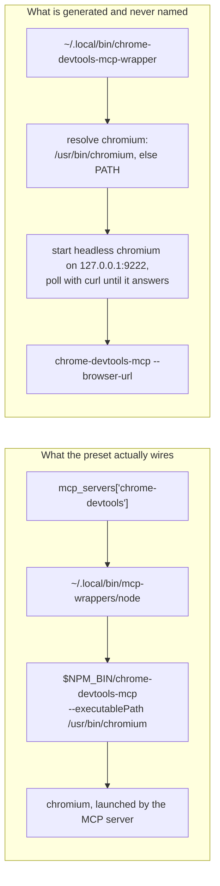

# Two presets, seven hardcodings, and a backend that can have neither

**Status:** 2026-10-23 — every question settled, the last, [`OQ-MP9`](#OQ-MP9), ruled and built
the same day as a pack-declared `boot_check` hook ([MP-D11](#MP-D11)), and every step of
[§13](#13-what-i-would-build-in-order) is built: the chromium-path fix,
the `mcp` kind (`packdecl.KindMCP`, composed by `packload.ComposeMCPServers`),
`packs/chrome-devtools`, delivered in a container jail, on macos-user and at `yolo host`, and on
2026-10-23 step 3, the retirement of `mcp_presets` ([MP-D10](#MP-D10)). It waited on
[`OQ-PK1`](../reference/pack-system.md#oq-pk1), ruled the same day: no pack may be named at
workspace scope for now, so the browser is turned on only by selecting the pack in the user
config. A config carrying `mcp_presets` is refused at either scope (a warning inside a jail,
where the config is the host's snapshot), `sequential-thinking` is gone, and core names no MCP
server of its own. UNMEASURED: no agent has connected to the server the pack composes, at any
notch, and no browser has been driven through it; the Mac half has run on no Mac.

> **In short.** `mcp_presets` is the last place core states *which MCP servers exist*, and that
> is a content claim, not a domain one — so it dissolves rather than moves. `sequential-thinking`
> is deleted; `chrome-devtools` becomes a builtin pack. The design's real content is that no
> contribution kind can express an MCP server today, and the browser's configuration is hairy
> enough that inventing one is cheaper than handing the config to users.

**Why it matters.** The hardcoding already costs a whole backend the feature — macos-user refuses
presets outright ([§7](#7-macos-user-the-backend-that-can-have-neither)). It also cost one delivery
mode until 2026-09-14: the `chrome-devtools` server entry pinned `/usr/bin/chromium`, a path a
`YOLO_STORE_PACKAGES=1` launch does not have. That half is fixed in core, which is exactly the
kind of browser-finding this change moves out of core
([§3](#3-the-two-scripts-and-the-one-that-is-never-spawned)).

**The shape.** `mcp_servers` stays core's domain table, unmoved. A pack contributes *entries* into
it the way a `kind: "provider"` pack contributes entries into `providers` — pack facts under user
overrides, `null` removes — and `chrome-devtools` becomes the first such pack.

**Cost.** One config key retires. One preset disappears with no replacement. The feature's scope
demotes from workspace-expressible to user-scope-only, because `packs` is user-scope by
construction ([§8](#8-the-scope-demotion-nobody-asked-for)).

**Start at [§5](#5-the-chrome-devtools-inventory--what-the-pack-carries-what-the-image-keeps)** —
the dependency inventory. It is the whole reason `chrome-devtools` is a pack and not a deletion,
and [§6](#6-there-is-no-mcp-contribution-kind)'s question falls out of it.

**Needs your ruling:** **Nothing open.** [`OQ-MP9`](#OQ-MP9), opened by the build when
[MP-D5](#MP-D5) reported the browser from the pack's wrapper and declared no `requires`, was
ruled 2026-10-23 (the pack's own check, run at boot, a warning only) and built as
[MP-D11](#MP-D11). The six questions
before it were settled 2026-09-20 ([§Decision Ledger](#decision-ledger)): five were ruled, and
[`OQ-MP4`](#decision-ledger) was **dissolved** against the tree, its premise being false. One other build
decision is flagged for your review rather than ruled: [MP-D4](#MP-D4), which leaves a fetched
pack's server out at the host. ⚠ One ruling ([`OQ-MP7`](#decision-ledger)) reversed its leaning and opened
a larger question that lives elsewhere: the `packs` workspace-scope rule should be redrawn on
host-reach rather than on install, which bears on
[the workspace skills layer](../reference/agent-briefings.md#the-workspace-layer)'s [`OQ-WS1`](../reference/agent-briefings.md#oq-ws1) and on
[`loophole-system.md`](../reference/loophole-system.md#principles)'s `R5`.

**Reads with:** [`mcp-configuration.md`](../reference/mcp-configuration.md) (the pipeline as built,
and the ruling this doc must not undo), [`pack-system.md`](../reference/pack-system.md) (the kind
registry a new kind joins), [`providers.md`](../reference/providers.md) (the composition shape this
copies), [`../reference/macos-user-provisioning.md`](../reference/macos-user-provisioning.md) (the backend this unblocks),
[`image-staging-vs-baking.md`](../reference/image-staging-vs-baking.md) (why `/usr/bin/chromium` is
not a constant), [`mcp-presets-removal-plan.md`](mcp-presets-removal-plan.md) (the implementation
sketch — incomplete, and unstable while questions are open).

---

## 1. Verdict up front

**Dissolve the mechanism; ship the browser as a pack; delete the other one.** Three claims, each
argued below.

- **P1. `mcp_presets` is a content claim wearing a config key.** Core owns the *domain* —
  `manifest.SourceMCPServers` is a yolo concept and stays one — but core has no business holding
  an opinion about which two servers a person might want. That opinion is exactly what a pack is
  for, and it is the last one core still holds.
- **P2. The two presets share nothing but the allowlist.** `sequential-thinking` is one npm
  package and a `command`/`args` pair. `chrome-devtools` is an npm package, a browser binary, a
  font stack, five sandbox flags, a resolved executable path and a readiness poll. Treating them
  as instances of one mechanism is what produced seven hardcodings across two packages
  ([§2](#2-what-mcp_presets-is-today--seven-places-two-packages)).
- **P3. The hardcoding is not hypothetical debt — it is shipped breakage.** macos-user warns and
  delivers nothing; a store-packages launch got a server entry pointing at an absent path until
  core learned to resolve it (2026-09-14); and the fat generated script that also resolves
  chromium has no producer that spawns it.

**What I would not do:** treat this as a chance to re-open where `mcp_servers` lives. That ruling
is in [`sources.go`](../../internal/agentcfg/manifest/sources.go) — *"an MCP server and an LSP
server are yolo config concepts, not agent concepts"* — and it is what makes one table serve every agent pack's own
dialect. Nothing here touches it.

---

## 2. What `mcp_presets` is today — seven places, two packages

The key accepts a closed set of exactly two names. Those names, and their direct consequences, are
spelled **seven** times:

| # | Where | What is hardcoded |
| :-- | :--- | :--- |
| 1 | `validMCPPresets`, `internal/config` | the two names, as the host-side allowlist |
| 2 | `Env.LoadMCPServers`'s `presets` map, `internal/entrypoint` | the two names → their `{command, args}` entries |
| 3 | `Env.chromeDevtoolsArgs`, `internal/entrypoint` | chrome's whole argv, including the `/usr/bin/chromium` pin |
| 4 | `mcpPresetNpmPackages`' `switch preset`, `internal/entrypoint` | the two names → their npm packages |
| 5 | `bootstrapTemplate`'s `case "$pkg" in`, `internal/entrypoint` | the two npm packages → their binary names |
| 6 | `chromeWrapper`, `internal/entrypoint` | the `chrome-devtools-mcp-wrapper` script body |
| 7 | `catalogLocalBinOrphans`' `declared` map, `internal/entrypoint` | `chrome-devtools-mcp-wrapper`, so the boot catalog does not report it as an orphan |

> [!NOTE]
> **#5 is the one that is easy to miss**, and it is the one that decides whether the install
> happens at all. It lives in the generated bootstrap script rather than in Go, it keys on the
> *package* name rather than the preset name, and it is the "is this already installed?" probe —
> a package whose `bin=` line is missing simply never registers as missing, so the install is
> skipped forever. It sits in the same file as #4 and is a second, independent map.

Beside those, the **key** `mcp_presets` is plumbed everywhere a config key goes, and none of
those sites names a preset: the schema census, the inheritance table, the two copies of
`checkPresetNullConflicts` (the run preflight and `yolo check`), the `YOLO_MCP_PRESETS` env var
the launcher emits, the macos-user run plan, `Env.SkipMCPPresets`, `RunDarwinBootstrap`'s warning, `macosuser.ProvisionNeeded`'s
carve-out, the store-packages inert-feature note, and `config_ref.txt`. Those are mechanical and
follow the key; they are the sketch's problem, not this doc's.

### 2.1 What the preset mechanism actually buys, stated fairly

Three things, and the third is the only one that is hard:

1. **A name instead of a config block.** `["chrome-devtools"]` instead of a hand-written
   `mcp_servers` entry.
2. **A gated install.** `mcpPresetNpmPackages` feeds three consumers — the bootstrap's npm
   install, the boot catalog's declared set, and `serverRefreshSet`'s evergreen refresh — so a
   preset's package is installed, accounted for, and kept fresh. Before it was gated, the install
   was unconditional: **112 npm packages in a jail with zero agents and zero presets**, measured
   and recorded at `mcpPresetNpmPackages`.
3. **A `command` that survives a sanitized environment.** MCP clients spawn servers with scrubbed
   environments, which is why every preset's `command` is an absolute path to a self-contained
   wrapper rather than a PATH lookup. A pack that ships an MCP server has to solve this too, and
   it is the hard half of [§6.3](#63-where-it-composes-on-the-host).

---

## 3. The two scripts, and the one that is never spawned

`GenerateMCPWrappers` writes three executables every boot. Two are thin (`mcp-wrappers/node`,
`mcp-wrappers/npx`: export fontconfig, `exec` the nix binary). The third, `chrome-devtools-mcp-wrapper`,
is fat — and **nothing yolo generates ever spawns it.**



Verified 2026-09-12: the only references to `chrome-devtools-mcp-wrapper` in the tree are its
generator, the boot catalog's declared-orphan entry that stops it being reported, and three test
files.
No `command` names it, and no user-facing doc mentions it.

**The two used to differ in exactly the way that matters.** The orphan resolves chromium at run
time — `/usr/bin/chromium` first, `command -v chromium` as a fallback — with a comment explaining
that a store-packages launch has no `/usr/bin/chromium` and a `chromium` on PATH instead. The wired
path pinned the absolute path with no fallback.

> [!NOTE]
> **That pin was a live defect on a `YOLO_STORE_PACKAGES=1` launch, and it is fixed (2026-09-14,
> [§13](#13-what-i-would-build-in-order) step 0).** The lean image is built with
> `mkBinPathLinks { withChromium = false; }`, and the `/usr/bin/chromium` symlink is created only
> inside that `withChromium` block (`flake.nix`). The wired entry now asks
> `entrypoint.chromiumExecutablePath`, which looks `chromium` up on the image probe path (the
> store-packages farm included) and falls back to `/usr/bin/chromium` only when nothing resolves.
> That fix lives in **core**, at boot — the very browser-finding [OQ-MP5](#decision-ledger) rules out of
> core — so the pack must still carry its own run-time resolution, and step 3 deletes this one.

**Ruled ([OQ-MP8](#decision-ledger), 2026-09-20): keep it simple.** The pack's shape is an
executable path, one plain wrapper script, not a service and not a daemon. It must not be
always-running and must not be orphaned. The `service` conversion is explicitly not taken now; if
it is ever wanted, it is a later, separate change.

---

## 4. `sequential-thinking` is deleted — what that costs, and what a user does instead

Ruled ([OQ-MP1](#decision-ledger)): dropped, not migrated, not re-homed.

**What a user does instead**, in the workspace config, today, with no new mechanism:

```jsonc
{
  "mcp_servers": {
    "sequential-thinking": {
      "command": "npx",
      "args": ["-y", "@modelcontextprotocol/server-sequential-thinking"]
    }
  }
}
```

Three honest costs, stated rather than softened:

- **The install is theirs now.** `mcp_servers` has no install channel — a custom entry is stored
  verbatim, and nothing installs a package for it. `npx -y` covers it at the price of a cold-start
  fetch; a `packages:` entry does not, because this is npm, not nix.
- **The wrapper is bypassed.** A bare `npx` resolves to the mise shim rather than
  `~/.local/bin/mcp-wrappers/npx`, so the entry misses the fontconfig export and pays mise's
  per-directory resolution on every cold start. This is the pre-existing gap already documented at
  [`mcp-configuration.md`](../reference/mcp-configuration.md#the-gap-a-custom-server-bypasses-the-wrapper);
  it does not matter for a server that never drives chromium.
- **It stops being evergreen and stops being accounted for.** It leaves `serverRefreshSet` and the
  boot catalog's declared set, so nothing refreshes it and — if a stale copy is still in the npm
  prefix from a previous jail — the boot catalog will now report it as an orphan.

That last line is the one a user will actually notice, and it is the right outcome: an unmanaged
server *is* unmanaged, and the catalog saying so is the catalog working.

**The replacement snippet must land in [`USER_GUIDE.md`](../../userguide/README.md) in the same
commit as the removal.** A key that refuses a name with no worked alternative is how a removal
reads as a regression.

---

## 5. The `chrome-devtools` inventory — what the pack carries, what the image keeps

This is the section the design exists for. Twelve dependencies, split by who must own them.

| # | Dependency | Supplied today by | Pack-declarable? |
| :-- | :--- | :--- | :--- |
| 1 | npm package `chrome-devtools-mcp` | bootstrap install, gated on `mcpPresetNpmPackages` | **Yes** — `kind: "program"`, `via: "npm"` |
| 2 | evergreen refresh of that package | `serverRefreshSet`, fed by the same gate | **Yes** — falls out of #1: the launcher in `~/.yolo/bin/launch/` mediates every invocation |
| 3 | boot-catalog accounting (npm + `~/.local/bin`) | `catalogNpmOrphans`, `catalogLocalBinOrphans` | **Yes** — pack installs are read off `HonoredInstalls` automatically |
| 4 | the server entry itself (`command` + `args`) | `Env.LoadMCPServers`'s preset map | **No kind exists** — [§6](#6-there-is-no-mcp-contribution-kind) |
| 5 | `--headless`, `--isolated` | `Env.chromeDevtoolsArgs` | **Yes** — inert data in the manifest |
| 6 | three `--chrome-arg=` sandbox flags | `Env.chromeDevtoolsArgs` | **Yes** — same; see the callout below |
| 7 | the chromium **binary** | image: `fullPackages`, or `yoloImageExtras` on a lean launch | **No** — image content, and it must stay so |
| 8 | the path to that binary | resolved at boot by core (wired, `chromiumExecutablePath`) / resolved at run time (orphan script) | **Must be resolved, not declared** — [OQ-MP5](#decision-ledger) |
| 9 | fonts: `/etc/fonts`, `/usr/share/fonts`, `FONTCONFIG_*` | image `withChromium` block; `configureStoreFontconfig` on a lean launch | **No** — image and boot |
| 10 | `/bin/node` (what the thin wrapper execs) | image core floor (`nodejs_24`) | Declarable as `kind: "requires"`, delivered by the image |
| 11 | `curl` (the orphan script's readiness poll) | image core floor | Declarable as `kind: "requires"`, delivered by the image |
| 12 | the wrapper script itself | `GenerateMCPWrappers` | **Yes** — `kind: "files"`, with caveats below |

### 5.1 The three sandbox flags are the pack's, and they are not tuning

```text
--chrome-arg=--no-sandbox                    --chrome-arg=--disable-gpu
--chrome-arg=--disable-setuid-sandbox
```

Each corresponds to something a jail structurally does not have — a usable user namespace for
chromium's own sandbox, a setuid helper, a GPU. They are facts about running chromium inside
a container, which is exactly the kind of fact a pack is supposed to carry so nobody has to
rediscover it. **Any design that makes the user write these has failed**, and that is the whole
of [OQ-MP2](#decision-ledger)'s reasoning.

`--disable-dev-shm-usage` is deliberately absent. yolo-jail mounts a 2 GB tmpfs at `/dev/shm`,
and modern Linux Chromium uses `memfd_create` for anonymous shared memory without touching
the filesystem. Passing `--disable-dev-shm-usage` forces Chromium to write temporary shared-memory
files into `/tmp`, which fails whenever `/tmp` is read-only for capability-dropped child processes.

`--disable-software-rasterizer` is deliberately absent. Headless Chromium still needs its
software renderer when the hardware GPU is disabled; disabling both lets navigation and DOM
inspection work while `Page.captureScreenshot` fails with an internal protocol error.

### 5.2 What the image must keep providing, and why the pack cannot take it

Rows 7 and 9 are image content, and the reason is not inertia. A pack has no channel that
installs a nix package: `via` is a closed set of two — `npm` and `installer` — and neither can
put chromium, fontconfig and a font tree where a container's read-only root filesystem needs
them. A pack asking for chromium says so with `kind: "requires"`, which asserts presence, reports
a missing binary by name, and generates nothing that could shadow anything.

> [!NOTE]
> **The `/lib` farm looks like it belongs on this list, and does not** — it is the natural wrong
> answer, so it is recorded here rather than left to be re-derived. `chromiumLibPackages` is linked into `/lib` only under the same `withChromium` gate,
> but its own comment says it exists for *"a non-nix chromium (playwright's downloaded build, and
> anything else without an RPATH into the store)"*. The **baked nix chromium is
> RPATH-self-contained** and does not need the farm. The farm and the browser move together
> because one `withChromium` flag gates both — not because this preset depends on it.

### 5.3 `kind: "files"` will carry a script, with two sharp edges

A `files` contribution is bind-mounted `:ro` into the jail at `/home/agent/<into>`, one mount per
contribution, and Apple Container is handed a COPY rather than a single-file bind, so a one-file contribution
lands in the workspace state dir instead. (That was attributed to apple/container#1089;
refuted on `container` 1.1.0, measured 2026-09-14 — the copy is retained because it needs no
version floor.) Two consequences for a wrapper script: the executable bit
has to survive staging, and the script must resolve `$HOME`, `$NPM_CONFIG_PREFIX` and the chromium
path **at run time**, because a read-only file cannot be rendered per jail. The existing wrapper
already resolves all three that way, which is evidence the shape works — it is written in terms of
`$HOME`-relative constants and `command -v`, deliberately, because agents sanitize child
environments.

---

## 6. There is no MCP contribution kind

The kind registry is **closed** (`footprints` in `internal/packdecl/kinds.go`; `packdecl.KnownKinds`
lists it). None of its kinds can express *"here is an MCP server, put it in the canonical table."*
The newest member does not change that: `config-list` (built 2026-09-24,
[`pack-system.md`](../reference/pack-system.md#adding-entries-to-an-array-config-list)) appends entries to an array on a surface an
agent pack owns. That is Shape B below in list form, and it cannot address yolo's own `mcp_servers`
table, which is a map, not an agent surface.

The closed hook set does not rescue this either: every member of `packdecl.KnownHooks` is a named
link or history capability, and there is no general "run this at boot" escape hatch, by design.
`claude_plugins` was a member until it was retired ([`pi-pack-extensions.md`](pi-pack-extensions.md)
[`OQ-2`](pi-pack-extensions.md#10-decision-ledger), 2026-09-19 — retire it and add nothing like
it, no agent-named hook). The one member added since, `shared_directory` (2026-09-21), generalizes
an existing link hook and names no agent. So an MCP kind cannot expect to arrive as a hook by
precedent; the precedent runs the other way.

### 6.1 The three candidate shapes

| Shape | What it is | Verdict |
| :--- | :--- | :--- |
| **A. A new `kind: "mcp"`** | A named server entry — `name`, `command`, `args`, `env`, `requires_env`, `provides` — composed into `mcp_servers` exactly as `kind: "provider"` composes into `providers`: pack facts first, user entries merged over per field, `null` removes | **Ruled ([OQ-MP3](#decision-ledger), 2026-09-20).** It is the shape the tree already has a worked precedent for, and exclusivity-by-name falls straight out |
| **B. `config-overlay` per agent surface** | Each agent pack owns an MCP surface; a chrome-devtools pack overlays `claude/config`, `copilot/mcp`, `codex/config`… | **Rejected.** It is [`pack-system.md`](../reference/pack-system.md#principles)'s principle 2 violated from the pack side: the contributing pack would have to know every agent's dialect, which is precisely what one canonical table exists to prevent. It also works *today* at the host notch — [the migration guide's host-render preview](../../userguide/guides/migrating-to-packs.md#step-2-apply) keeps a hand-added `mcpServers` entry by declaring it as a `config-overlay` on `claude/config` — which makes it tempting and no less wrong |
| **C. An `mcp` block on `kind: "program"`** | The server rides along with the npm install that provides it | **Rejected.** It welds two independent claims: a server whose binary the image already bakes (or which is reached by `npx`) has no `program` to hang off, and a `program` that happens to be an MCP server is not one claim on the environment but two, with different combine rules |

**The precedent, spelled out.** `ComposeProviders` walks the selected packs, sets each declared
entry under its name, then folds the user's `providers` table over it: a `null` entry deletes —
*"the user's config is the override layer, and 'override' has always included 'no'"* — and a map
entry merges field by field. Every clause of that has an MCP counterpart, including the one that
matters most: `mcp_servers` **already** treats `null` as a removal, so *"disable the pack's
server"* needs no new vocabulary at all. It is the same sentence users write today to disable a
preset.

### 6.2 What the kind must be able to carry, at minimum

Not negotiable, because each already exists in the table it composes into:

- `command` and `args` — with a path vocabulary, per [§6.3](#63-where-it-composes-on-the-host);
- `env` — literal strings only, `${VAR}` written verbatim and never interpolated;
- `requires_env` — the gate that drops a server (with a notice) when a variable is unset, and is
  then **stripped** from the entry before any agent sees it;
- `provides` — the capability tag `packs/claude`'s derive already reads, to suppress a
  `web_search` MCP when Claude has native search. A pack-shipped entry that could not carry it
  would be second-class.

**Combine rule:** exclusive by server **name**, for `provider`'s reason exactly — the name is the
key the entry lands under, two packs shipping one name are each claiming to be "the" one, and a
single pack shipping several servers is ordinary. **Review-worthiness:** none. A server entry is
data in a config file; it crosses no boundary, reads no host state and installs nothing. The
install, where there is one, is the `program` contribution beside it, and that kind already
carries its own review. Both are ruled ([OQ-MP3](#decision-ledger)): exclusive by server name,
and never review-worthy, so an MCP server declaration, which reaches only the jail, does not
enter the host-grant banner.

### 6.3 Where it composes: on the host

**Ruled ([OQ-MP4](#decision-ledger), 2026-09-20): host-side, exactly like `providers`.** There is
no second option and no new placeholder vocabulary. The question was withdrawn rather than
answered: it assumed *"a preset's `command` is a jail path that the host does not know"*, and
the host does know it. Three facts in the tree settle it:

- **[`paths.JailPathHomeDirs`](../../internal/paths/paths.go) is a HOST-side constant** naming
  the jail's PATH directories (`.local/bin`, `.npm-global/bin`, the two `.yolo/bin` script dirs,
  `go/bin`), each relative to the home. The jail's layout is not discovered at boot; yolo decides
  it, so the side that decides it can state it.
- **It cannot silently rot.** `TestJailPathHomeDirsCoversBootPath` pins that list to
  `entrypoint.BootPath`, so a PATH that gains a home directory cannot leave the host's copy short.
- **Manifests already name home-relative paths.** `appendPathProblems` refuses an absolute
  destination outright, so every declaration is already in the only form this needs.

So the closed placeholder vocabulary already exists, closed and tested: it is that list. The
composer joins the notch's home to a home-relative entry and produces the absolute `command` an
MCP client needs (absolute because a client spawns servers with a sanitized environment, so no
PATH lookup happens; that constraint does not require the jail to do the joining).

**The host notch takes the same mechanism.** `yolo host apply` renders into a real home whose
PATH yolo does not control, so it gets only the overlap, `.local/bin`, and no pretense of
completeness. One list, one composer, two homes: the host notch narrows rather than diverging.

> [!WARNING]
> `mcp_presets` composes in-jail today, and it is easy to read the status quo as a constraint.
> It is not one: the presets mechanism predates `JailPathHomeDirs` and never used it.

---

## 7. macos-user: the backend that can have neither

Today the backend refuses presets in four coordinated places, and the refusal is honest: the
wrappers hardcode `/usr/bin/chromium`, `/bin/node` and `/etc/fonts` with no GOOS guard, and this
backend bakes no image, so on macOS all three paths are simply absent (verified on macOS 26.5).

| Where | What it does today | After |
| :--- | :--- | :--- |
| `RunDarwinBootstrap` | warns *"mcp_presets are not delivered on macos-user"*, naming each preset it left out, and skips wrapper generation | **Gone with the key** (step 3). Since step 2 the `chrome-devtools` pack is the server on this backend: the plan composes its entry for the sandbox home from the staged tree and bakes it into the bootstrap env, as `YOLO_MCP_SERVERS` |
| `Env.SkipMCPPresets` | keeps every preset's server entry out of the MCP table each agent's config renders from, and empties the npm arm of the generated bootstrap script. The entry half was added 2026-10-04: until then each agent's config named the `mcp-wrappers` `node` this backend never writes | **Gone** (step 3) — a pack's `program` install is the backend's ordinary path, and is the one the pack takes since step 2. The skip leaves the pack's entry alone: it is not a preset |
| `macosuser.ProvisionNeeded` | excludes `mcp_presets` from the two keys that start a stage | **Gone** — the carve-out's whole comment is about presets |
| the store-packages inert-feature note | records `mcp_presets` as the one thing genuinely still undelivered here | **Gone** (step 3); what it records stays true of the key, and the pack is the delivered route |

**This is the strongest argument for the pack**, and it is an argument about capability, not
tidiness. The refusal exists because *core* pinned Linux paths in a Go string. A pack that
declares `kind: "requires"` for its browser and resolves the executable at run time is refused
for a reason a user can act on — *install a browser* — on a machine that may well already have
one. (As built, the report is the wrapper's and there is no `requires`: [MP-D5](#MP-D5), ruled
at [`OQ-MP9`](#OQ-MP9) and printed at boot by the pack's `boot_check`, [MP-D11](#MP-D11).) Nothing here promises chrome-devtools works on macOS; it promises the
reason it does not is no longer "yolo hardcoded a Linux path".

> [!IMPORTANT]
> The macos-user floor shipped on 2026-09-12 and bakes `nodejs_24` and `curl`, so one of the
> three absent paths — `/bin/node` — has an answer on that backend for the first time, and so
> does the readiness poll's `curl`. **Neither chromium nor fontconfig is in that floor**, and no
> pack channel can supply either. Since step 2 the pack's wrapper looks for a browser the Mac
> already has — `/Applications/Google Chrome.app` among the standard paths it tries
> ([MP-D5](#MP-D5)) — and `--check` names what it found, so on a Mac with Chrome the browser half
> is answered by the machine and on one without it is a named absence, not a hardcoded path. See
> [`../reference/macos-user-provisioning.md`](../reference/macos-user-provisioning.md#the-floor).

---

## 8. The scope demotion nobody asked for

`mcp_presets` is read from the **merged** config, so a workspace `yolo-jail.jsonc` can commit
*"this project needs a browser"* and every collaborator gets it.

`packs` cannot. It is **user-scope only by construction** — read from the user config path
directly, so workspace scope is inexpressible rather than merely validated against. The reason is
the security model: a workspace config travels with the repo and is agent-editable, and a pack can
carry skills and briefing prose an agent then follows.

**So this change silently demotes the scope of the feature**, and the demotion is a real loss for
the one case presets were best at. Three responses:

1. **Accept it.** The workspace half survives as `mcp_servers` — a workspace can still write the
   server entry; what it cannot do is cause an install. Users who want the install write one line
   in their user config, once, per machine. **Rejected by the maintainer**
   ([OQ-MP7](#decision-ledger), 2026-09-20).
2. Give the pack a workspace-expressible *enable* separate from selection. **Rejected**: that is
   `packs` with a second name, and it re-opens a ruling that is load-bearing.
3. Keep `mcp_presets` alive as a thin alias for "select this pack". **Rejected**: it preserves
   every one of the seven hardcodings this change exists to delete, and adds a scope laundering
   path from workspace config into pack selection — the exact crossing the `packs` rule forbids.

**Ruled ([OQ-MP7](#decision-ledger), 2026-09-20): do not just lose it.** Reconsider "no packs in
workspaces" by defining a **safe subset** of packs a workspace MAY declare. The point of the rule
was never to stop a workspace configuring the jail; it was to stop a workspace controlling **what
runs on the host**, and an MCP server for an agent inside the jail is not that. The
subset itself is not ruled here; it is [OQ-PK1](../reference/pack-system.md#oq-pk1)'s to define.

- **The current rule does not say what it means.**
  [`loophole-system.md`](../reference/loophole-system.md#principles)'s **R5** is *"install is
  user-scope; enable is either scope"*, an **install vs enable** axis. The ruling's axis is **host
  reach vs jail-only**, the one the rest of the codebase already uses (host grants, the read/exec
  banners, `host_files` being user-scope). Read that way most of `packs` is still refused from a
  workspace (`host_files`, `mounts`, `env_sources`, a `host_daemon` loophole, a host-side hook),
  but an `mcp` entry, and content kinds generally, are not. R5's wording is the rule being
  amended, so it cannot stay as written.
- **It is probably the answer to a second doc.**
  [the workspace skills layer](../reference/agent-briefings.md#the-workspace-layer)'s
  [`OQ-WS1`](../reference/agent-briefings.md#oq-ws1), whether a workspace may contribute skills,
  is the same question one kind over, and the reasoning applies more strongly: committed skills
  are inert content in a repository whose code you already run. Rule both in the same sitting,
  since two docs deciding one boundary from opposite sides is how this corpus grew its
  asymmetries.

> [!WARNING]
> **The hard case the safe-subset rule must survive is not skills.** An MCP server is code that
> executes unconditionally at jail start, inside a jail whose home holds real credentials
> (`.claude/.credentials.json` and the shared-credential symlinks). *"The agent could exfiltrate
> those anyway"* is not quite an answer: the agent might choose not to, whereas a declared server
> runs whether or not any agent does anything. The marginal grant is **unconditional
> execution**, not execution. A safe subset that admits `mcp` has to say why that is acceptable,
> or admit content kinds first and leave executable kinds for a second ruling. That is
> deliberately not settled here.

---

## 9. The day this ships — pre-existing state

Four populations exist on disk when the key retires. All four must be answered, and only the
first is obvious.

1. **A host config saying `["sequential-thinking"]`.** The name leaves the allowlist. Today an
   unknown preset is an *error* from `validateMCPPresets`, so this refuses the launch with
   *"unknown preset"* and a list of the valid ones — which would be an empty list, or a list of
   one. That message is wrong for a retirement, which is why the key should retire whole rather
   than shed a name.
2. **A host config saying `["chrome-devtools"]`.** Same, and the remedy is one line:
   `"packs": ["chrome-devtools"]` in the user config.
3. **An in-jail config snapshot written by an older host.** In the jail, `LoadConfig` returns the
   host-written assembled snapshot **verbatim** — that is the fix for the config-diff ping-pong —
   so a running jail's own config *will* carry the retired key, through no fault of the user's.
   The established answer is `validateJournalRetired`'s: **error on the host, warn in-jail**,
   with the in-jail text saying *"ignored here: this is the host-generated config snapshot, so
   remove the key from the HOST config."* Anything else refuses a jail for a file the user cannot
   edit from inside it.
4. **A frozen boot baseline at `.yolo/config-boot.json` carrying the key.** Removing it from the
   workspace config is a config change like any other: one `config drift` entry and the launch's
   y/N diff prompt. That is correct behaviour and needs no special handling — it is named here
   only so nobody treats the drift report as a bug.

**The ruled disposition** ([OQ-MP6](#decision-ledger), 2026-09-20): full retirement, both
names, with no warn-and-ignore release, which would leave the browser **silently gone** from a
jail whose config still asks for one. `mcp_presets` joins
`retiredTopLevelConfigKeys` — the same list as `agents`, `journal`, `host_processes`,
`repo_path` and `agent_profiles` — which keeps the key in the accepted set solely so it earns a
targeted message instead of a generic *unknown key*. Its message names both outcomes: `packs`
for the browser, an `mcp_servers` snippet for the other.

### 9.1 The degenerate cases, named

| Input | Behaviour |
| :--- | :--- |
| `"mcp_presets": []` | Retired like any other spelling — an empty array is still the key being present. Refusing it looks pedantic and is right: leaving it accepted means a config that "works" while the key means nothing |
| `"mcp_presets": ["chrome-devtools"]` **plus** `"packs": ["chrome-devtools"]` | The retirement message fires anyway. It is a refusal to carry the key, not a check for whether the user got what they wanted |
| `"mcp_servers": {"chrome-devtools": null}` with the pack selected | Works, unchanged, and is the documented way to disable it — the composer's `null` removes a pack-shipped entry exactly as it removes a preset today |
| Two packs both shipping a server named `chrome-devtools` | A collision, refused at load, by the generic exclusive loop — no dedicated pass |
| The pack selected but its npm package not yet installed | The `program` launcher installs on first spawn. A failed install is **reported, not fatal**: the agent starts with one server missing, which is the rule `serverRefreshSet` already states for absent servers |
| The pack selected on a jail with no browser | `kind: "requires"` reports the missing binary by name at boot. **Not fatal** — a missing MCP server is not a reason to refuse a jail |

---

## 10. What this does not license

- **Not** moving `mcp_servers` out of core. It is a domain noun and it stays one.
- **Not** a per-tool branch anywhere — in core *or* in the contributing pack. Shape B of
  [§6.1](#61-the-three-candidate-shapes) is that branch relocated, and it is still the thing the
  canonical table exists to prevent.
- **Not** `${VAR}` interpolation, in any notch, in any field. Removed 2026-08-03 by ruling; a pack
  shipping a server writes the literal and the consumer resolves it.
- **Not** a second preset mechanism under a new name. If the answer to *"how do I get a curated
  server list?"* is a new closed set in core, nothing was learned.
- **Not** a workspace-scoped `packs` decided here. [OQ-MP7](#decision-ledger) asks for a safe subset a
  workspace may declare, and that subset is [OQ-PK1](../reference/pack-system.md#oq-pk1)'s to
  define; nothing in this doc pre-empts it, in either direction. (This bullet used to forbid a
  workspace-scoped `packs` "in any form, including one restricted to safe packs", which the
  ruling contradicts.)
- **Not** re-homing `sequential-thinking` as a pack, a skill, or a default `mcp_servers` entry. It
  is deleted.
- **Not** a nix-package install channel for packs. Rows 7 and 9 of
  [§5](#5-the-chrome-devtools-inventory--what-the-pack-carries-what-the-image-keeps) stay image
  content; wanting otherwise is a different design.

---

## 11. Alternatives considered

| Alternative | Verdict |
| :--- | :--- |
| **Keep both presets; fix the hardcoding by putting the table in one place** | **Rejected.** It is the cheapest change and it fixes the least: core still holds an opinion about which servers exist, macos-user still gets nothing, and the `/usr/bin/chromium` pin still has to be fixed separately. The seven places become one place that is still in core |
| **Delete both presets; document `mcp_servers` recipes for each** | **Rejected by [OQ-MP2](#decision-ledger)**, and the evidence supports the ruling: chrome-devtools needs five sandbox flags, a resolved executable path, a readiness poll and a fontconfig export. A recipe in a guide rots; a pack is tested |
| **Ship chrome-devtools as `kind: "service"`** — a supervised headless chromium with an endpoint file, and an MCP entry that dials `--browser-url` | **Rejected for v1, deliberately named.** It is genuinely the right shape for a long-lived browser: the orphan wrapper already starts chromium on `127.0.0.1:9222` and polls it, which is a supervised daemon written by hand. Two things block it. A service's `cmd` is *"the argv, run as-is in the jail. No tokens are substituted"*, and the endpoint file at `/run/yolo-services/<name>.endpoint` is written by the daemon — so a bare `chromium` argv publishes nothing and a `yolo-jaild` subcommand means core ships a chromium supervisor, which is the coupling this change removes. And it still needs the MCP kind for the entry that dials it. One new kind at a time; see [OQ-MP8](#decision-ledger) |
| **Make `mcp_presets` a thin alias that selects packs** | **Rejected** — [§8](#8-the-scope-demotion-nobody-asked-for), response 3 |

---

## 12. Risks

| Risk | Mitigation |
| :--- | :--- |
| **R1. A user's jail stops having a browser and they do not know why.** The key errors, the pack is not selected, and the failure is at launch rather than at use | The retirement message names `"packs": ["chrome-devtools"]` verbatim. This is the whole reason for the targeted-message treatment over a generic unknown-key error |
| **R2. The new kind is built for one pack and fits nothing else.** A kind invented around chrome-devtools' needs is a kind shaped by an npm binary and a browser | [§6.2](#62-what-the-kind-must-be-able-to-carry-at-minimum) derives the field set from the **table it composes into**, not from chrome-devtools. If a field is in `knownMCPServerKeys` the kind carries it; if it is not, the kind does not invent it |
| **R3. Composition-site skew.** Presets compose in-jail and providers compose host-side. Getting [OQ-MP4](#decision-ledger) wrong means one launch composes twice, or the CLI reports a table the jail does not build | Whichever site wins, it is **one** composition, and the other side reads the result — the rule `composePackChannel` already states for the profile/provider channel |
| **R4. The lean-launch fix is bundled with a migration and lands untested.** [§3](#3-the-two-scripts-and-the-one-that-is-never-spawned)'s pinned path was a live defect | **Retired.** It was fixed first, as its own change against the existing preset (2026-09-14, [§13](#13-what-i-would-build-in-order) step 0), so the migration inherits working behavior |
| **R5. A stale `config_ref.txt`.** It documents both preset names and, separately, still claims `mcp_servers.env` expands `${VAR}` — which was removed 2026-08-03 | Both are text edits in one file, and the second is a pre-existing defect this work should not inherit silently |

---

## 13. What I would build, in order

**Step 0 — fix the pin, before anything moves. BUILT 2026-09-14.** The wired `chrome-devtools`
entry resolves chromium (`entrypoint.chromiumExecutablePath`) instead of pinning
`/usr/bin/chromium`. It was a bug fix against today's mechanism, and it means the migration
inherits working behaviour rather than carrying a defect across. It resolves at boot, in core, so
steps 1–3 still replace it with the pack wrapper's run-time resolution ([OQ-MP5](#decision-ledger)).

**Step 1 — the kind.** Register it, give it its footprint row and combine rule, teach the composer
to fold pack entries under user entries, and wire the composed table into whichever loader
[OQ-MP4](#decision-ledger) names. No pack uses it yet, and nothing observable changes.

**Step 2 — the pack.** `packs/chrome-devtools`, added to `packs/embed.go`'s explicit `go:embed`
list — `packs/` is already a `goSrc` fileset entry, so the directory needs no flake change, only
the embed one. It carries the `program`, the `requires`, the MCP entry, the wrapper, and prose
saying what a jail needs for it to work. (As built it carries no `requires`, the wrapper reporting
the browser instead: [MP-D5](#MP-D5), ruled at [`OQ-MP9`](#OQ-MP9); its boot check is
[MP-D11](#MP-D11).)

**Step 3 — the retirement. BUILT 2026-10-23** ([MP-D10](#MP-D10)). Delete the seven hardcodings,
retire the key, delete `Env.SkipMCPPresets` and the three macos-user carve-outs, and land the docs
in the same commit.

**Steps 1 and 2 shipped before step 3, which waited on [`OQ-PK1`](../reference/pack-system.md#oq-pk1)** ([MP-D8](#MP-D8), amending the
sentence that stood here: "Steps 1–3 do not ship separately"). Its three reasons, answered in
turn: a kind with no pack would be dead code, and the two shipped together; a pack with the key
still live is two mechanisms for one thing, which is the cost taken knowingly, bounded by the
pack's entry replacing a same-named preset with no rule of its own (a jail lets
`YOLO_MCP_SERVERS` override its presets by name); and a retirement without the pack would be a
feature deletion, which is why the retirement is the step that waits.

**As built (2026-10-05).** Step 1: `packdecl.KindMCP` with its validation on both decode paths,
the footprint claim and the composer, wired into the three deliveries — the container argv's
`YOLO_MCP_SERVERS` (`run.jailMCPServers`), the macos-user bootstrap env (`entrypoint.MCPServersAt`
over the staged tree), and `yolo host apply`'s inputs (`cli.composeHostInputs`). Step 2:
`packs/chrome-devtools`, with the wrapper as a `files` tree and the jail-only chrome flags on the
autonomy kind's autonomous posture. Decisions [MP-D1](#MP-D1) to [MP-D9](#MP-D9) record the calls
the build made, MP-D9 the fix review asked for: the agents' launchers install the server's program
before they start the agent.

**As built (2026-10-23), step 3.** `mcp_presets` is a retired key (`retiredTopLevelConfigKeys`),
refused by `validateMCPPresetsRetired` with `config.MCPPresetsRetiredMessage`, which names the
pack, says a workspace file cannot select it, and gives [§4](#4-sequential-thinking-is-deleted--what-that-costs-and-what-a-user-does-instead)'s
`mcp_servers` entry; `yolo host apply`, which runs no full validation, names it in its report. The
preset table, its chromium resolution, the never-spawned `chrome-devtools-mcp-wrapper`, the
bootstrap's preset install, `YOLO_MCP_PRESETS`, `validMCPPresets`, `Env.SkipMCPPresets`, the
macos-user notice step and the same-file preset/null check are deleted, and with them the
interim rule that the pack's entry replaced a same-named preset.

---

## 14. What done looks like

Observable outcomes a human can check, not test names:

- `yolo check` on a config carrying `mcp_presets` names `packs` and exits non-zero on the host;
  the same jail, entered with an older snapshot, warns and boots.
- With `"packs": ["chrome-devtools"]` and nothing else, a fresh jail's `~/.claude.json`,
  `~/.copilot/mcp-config.json` and `~/.codex/config.toml` each carry a `chrome-devtools` entry —
  **through their own derives, with no core branch naming any of the three.**
- The same jail launched with `YOLO_STORE_PACKAGES=1` also carries a working entry: the browser
  resolves from PATH and the MCP server connects.
- `"mcp_servers": {"chrome-devtools": null}` with the pack selected yields no entry in any of the
  three files.
- On macos-user, selecting the pack produces a named missing-binary report rather than a blanket
  *"not delivered on this backend"*. **Amended under [`OQ-MP9`](#OQ-MP9), ruled 2026-10-23:**
  the report is the wrapper's own — a stderr line at every server start, `--check` on demand,
  and, once at boot in a jail and on macos-user, one warning line from its `--boot-check` when
  no browser is found, which never stops the launch; the blanket line is gone
  ([MP-D5](#MP-D5), [MP-D11](#MP-D11)).
- No non-test source under `internal/` names `sequential-thinking`.
- The boot catalog reports no orphan in a jail where the pack is the only thing installing
  anything.

---

## 15. Open Questions

1. ✅ <a id="OQ-MP9"></a>**[OQ-MP9](#OQ-MP9): Is the wrapper's own browser report enough, dropping [`OQ-MP5`](#decision-ledger)'s `requires` half?**

   The build declared no `requires` ([MP-D5](#MP-D5) says why: a Mac's Chrome is an app
   bundle, not `chromium` on PATH). The report is the wrapper's stderr line at each server start
   and its `--check`; no launch prints one ([§14](#14-what-done-looks-like)).

   - **A — Keep MP-D5.**
   - **B — A `requires` with alternatives**, names and app-bundle paths: a schema change, and a
     second copy of the wrapper's search.
   - **C — A plain `requires: chromium`**: a false warning at every launch on a machine whose
     only browser is Chrome.
   - **D — A pack-declared check the launch runs**, the wrapper's `--check`: a launch-visible
     line from the one resolver, for a new kind or hook.

   _Leaning:_ **A for this build, and D if you want the report at launch.** A reports the browser
   that will actually run and builds nothing new; D is the one route to a launch line that keeps
   the search in one place. C misreports, and B duplicates the search.

   **Answer:**
   > **Ruled in review 2026-10-23, D in the pack's own terms, a warning only:** *"if the pack can
   > do it itself, then yes, this should be printed. I don't want Yolo to be doing anything here,
   > but if the pack discovers at boot for whatever it's trying to wrap, it runs some script and
   > sees that it's not there, then it should print it … it is possible after boot that it could
   > be installed through Nix or whatever, and then it will just start working, so it is just a
   > warning."* So the pack runs its own check (the wrapper's `--check`) at boot, inside the jail,
   > and its one line is printed. yolo knows nothing browser-specific: it only runs a check a pack
   > declares. A missing browser never stops a launch, since one installed later just works.

---

## Decision Ledger

The first two rows were ruled by the maintainer **before this document was drafted**. They are
premises of the design, not conclusions of it. The other six were settled on 2026-09-20 and are
folded into the sections each row names.

| ID | Ruling / Decision | Date | Settled in |
| :--- | :--- | :--- | :--- |
| OQ-MP1 | `sequential-thinking` is **dropped with no replacement** — not migrated, not re-homed | 2026-09-12 | [§4](#4-sequential-thinking-is-deleted--what-that-costs-and-what-a-user-does-instead) |
| OQ-MP2 | `chrome-devtools` becomes a **builtin pack**, *"because that has hairy config to get right"* | 2026-09-12 | [§5](#5-the-chrome-devtools-inventory--what-the-pack-carries-what-the-image-keeps) |
| OQ-MP3 | A new **`mcp` kind**, composed into `mcp_servers` the way `provider` composes into `providers`; exclusive by server name, never review-worthy | 2026-09-20 | [§6.1](#61-the-three-candidate-shapes) |
| OQ-MP4 | **Dissolved**, its premise false: compose host-side, through `paths.JailPathHomeDirs` | 2026-09-20 | [§6.3](#63-where-it-composes-on-the-host) |
| OQ-MP5 | `requires` plus run-time resolution in the pack's own wrapper, which hands back an absolute path. Core resolving a candidate list would put browser-finding back in core; a bare binary name loses to environment sanitization. The build kept the run-time half and not the `requires` half ([MP-D5](#MP-D5)), ruled at [`OQ-MP9`](#OQ-MP9) and built as [MP-D11](#MP-D11) | 2026-09-20 | [§5](#5-the-chrome-devtools-inventory--what-the-pack-carries-what-the-image-keeps) |
| OQ-MP6 | Full retirement of both names, with a targeted message naming the packs to add and an `mcp_servers` snippet to paste; no warn-and-ignore release | 2026-09-20 | [§9](#9-the-day-this-ships--pre-existing-state) |
| OQ-MP7 | **No** to the scope demotion: define a safe subset of packs a workspace may declare. The subset itself is not ruled | 2026-09-20 | [§8](#8-the-scope-demotion-nobody-asked-for) |
| OQ-MP8 | An executable path: one plain wrapper script, not a service and not a daemon; never always-running, never orphaned. The `service` conversion is not taken now | 2026-09-20 | [§3](#3-the-two-scripts-and-the-one-that-is-never-spawned) |
| <a id="MP-D1"></a>MP-D1 | *Implementation decision, taken under the maintainer's 2026-10-04 delegation ("make them and build it … adjust later"); reversible.* (a) **The wrapper is a `files` tree OFF PATH, at `~/.local/share/yolo-chrome-devtools/chrome-devtools-mcp-wrapper`, and the entry runs it as `/bin/sh <file>`.** A `files` destination may not land on a PATH dir (`appendJailPathProblems`); a pack selected by its bare name carries no exec bit (`embed.FS` holds none, `packs/hello-daemon/README.md`), so the command is the interpreter and the file its argument. `.local/share` because `yolo host apply` writes the same tree into a real home, where a new top-level dotdir would be clutter | 2026-10-05 | [§13](#13-what-i-would-build-in-order) |
| <a id="MP-D2"></a>MP-D2 | *Implementation decision, as MP-D1.* (b) **The jail-only chrome flags are the autonomy kind's AUTONOMOUS launch flags for `chrome-devtools-mcp`**: `--headless`, `--isolated`, and [§5.1](#51-the-three-sandbox-flags-are-the-packs-and-they-are-not-tuning)'s three `--chrome-arg=` flags. A jail's and macos-user's launcher bakes them in, so every start gets them however the client reached the program; the GUARDED posture, the host's, declares none, so Chrome keeps its own sandbox there, opens a window, and keeps chrome-devtools-mcp's own profile. Never decided from the environment at run time: an MCP client scrubs what a detection would read | 2026-10-05 | [§5.1](#51-the-three-sandbox-flags-are-the-packs-and-they-are-not-tuning) |
| <a id="MP-D3"></a>MP-D3 | *Implementation decision, as MP-D1.* (c) **`yolo host -- <agent>` also installs into yolo's floor the program each composed entry's `bin` names**, after the agent's own: the host has no lazy launcher to install it on first use. A failure, or a program the floor may not hold, is one line naming `yolo host apply --assert` or the PATH lookup, and costs that server, never the agent ([§9.1](#91-the-degenerate-cases-named)). `bin` is a field of the kind rather than an inference from the pack, so an entry names the program it needs. Recorded for the host as [HC-D28](../reference/host-agent-environment.md#HC-D28) | 2026-10-05 | [§9.1](#91-the-degenerate-cases-named) |
| <a id="MP-D4"></a>MP-D4 | *Implementation decision, as MP-D1; ⚠ possibly the maintainer's call.* (d) **At the host an entry composes only from a pack yolo ships or one at a path on this machine** (`Pack.MayRunHostHalf`, the predicate a launch asks before it runs a pack's host code); a FETCHED pack's entry is left out and named, with the step that runs it (write it under `mcp_servers` yourself). At the host the entry's command runs unconfined as you whenever the agent starts, which is host code, and [`OQ-HS4`](host-notch-services.md#11-decision-ledger) refuses a fetched pack's host code by name until a trust ruling exists; in a jail every pack's entry composes. Recorded for the host as [HC-D26](../reference/host-agent-environment.md#HC-D26) | 2026-10-05 | [§6.3](#63-where-it-composes-on-the-host) |
| <a id="MP-D5"></a>MP-D5 | *Implementation decision, as MP-D1; departs from half of [`OQ-MP5`](#decision-ledger)'s answer, which was "`requires` plus run-time resolution in the pack's own wrapper", and was ruled at [`OQ-MP9`](#OQ-MP9) (2026-10-23: the pack's own check at boot, a warning only; built as [MP-D11](#MP-D11)).* (e) **The wrapper resolves the browser at run time** ([`OQ-MP5`](#decision-ledger)): `chromium`, `chromium-browser`, `google-chrome` or `google-chrome-stable` on PATH, then the standard install paths (`/usr/bin/chromium`, `/opt/google/chrome/chrome`, the store-delivered farm, `/Applications/Google Chrome.app`, `Chromium.app`, the same under `~/Applications`), passed as `--executablePath`; with none, nothing is passed and chrome-devtools-mcp detects Chrome itself. A browser the caller's own arguments name is never overridden. **The browser-presence report is the wrapper's own** — a stderr line at every start, and `--check` — not a `requires` contribution, which names one binary on PATH and cannot see an app bundle or a set of alternatives, so it would report a missing browser on every Mac with Chrome | 2026-10-05 | [§7](#7-macos-user-the-backend-that-can-have-neither) |
| <a id="MP-D6"></a>MP-D6 | *Implementation decision, as MP-D1.* **The kind's shape is `{name, bin, config: <entry>}`.** The entry rides the contribution's `config` payload in exactly mcp_servers' shape, its keys pinned to the config's `knownMCPServerKeys` by test ([§6.2](#62-what-the-kind-must-be-able-to-carry-at-minimum), risk R2); top-level fields would have collided with the retired `env` tombstone. Its path vocabulary is one prefix, `~/` at the start of a `command` or `args` word, joined by the composer to the notch's home ([`OQ-MP4`](#decision-ledger): the composing side decides the home) | 2026-10-05 | [§6.2](#62-what-the-kind-must-be-able-to-carry-at-minimum) |
| <a id="MP-D7"></a>MP-D7 | *Implementation decision, as MP-D1.* **Composition follows the provider precedent's shape**: the selected packs' entries in pack order, a name two declarations ship held by the later (NC-D59) and refused before any launch by validation (`config.validatePackMCPServers`) and in `yolo pack footprint` (`Collisions`); the user's entry merges over the pack's per field, `env` per variable; a user `null` removes the pack's and stays in the table as a removal, so a jail's preset of that name goes too | 2026-10-05 | [§6.1](#61-the-three-candidate-shapes) |
| <a id="MP-D8"></a>MP-D8 | *Implementation decision, as MP-D1, amending [§13](#13-what-i-would-build-in-order)'s "Steps 1–3 do not ship separately".* **Steps 1 and 2 ship before step 3**, which waits on [`OQ-PK1`](../reference/pack-system.md#oq-pk1): a key a workspace can write cannot retire into a selection only user scope can make until [`OQ-MP7`](#decision-ledger)'s demotion is ruled. The cost is two mechanisms at once, bounded by the pack's entry replacing a same-named preset, and the build answers the maintainer's request for the server at `yolo host` ([roadmap](../plans/roadmap.md) item 44: "the maintainer wants it") | 2026-10-05 | [§13](#13-what-i-would-build-in-order) |
| <a id="MP-D9"></a>MP-D9 | *Implementation decision, as MP-D1; fixes a defect review found in the jail half.* **A jail's and macos-user's agent launchers install and refresh a pack server's program before they exec the agent**, as they do a preset's package: a server takes the trigger of the agent that connects to it, and nothing may move at connect time ([program-delivery.md §3.5](program-delivery.md#35-the-second-axis-who-the-dependency-serves-amendment-2026-09-03), [`OQ-PD12a`](program-delivery.md#decision-ledger)). The npm `program` an `mcp` entry's `bin` names joins the transitive refresh set while the composed table holds that server, and the program's own launcher, which the server runs through for the posture's flags, bakes no update and no server refresh of its own; its cold install stays, for a server no agent's launcher started. **Every launcher's install writes to stderr**: npm's and an installer's output went to stdout, the server's JSON-RPC channel, ahead of its `initialize` response. An installer program, and an npm one whose pack declares install flags, keep their own launcher's trigger, since the refresh hands npm a spec alone; a pinned one is installed again once at its first start, the refresh writing no record of the declaration its launcher compares | 2026-10-05 | [§13](#13-what-i-would-build-in-order) |
| <a id="MP-D10"></a>MP-D10 | *Implementation decision, building step 3 after [`OQ-PK1`](../reference/pack-system.md#oq-pk1) was ruled on 2026-10-23 ("no workspace packs for now, retire mcp_presets").* **The key is refused at either scope with every value, `[]` and `null` included**, as the other retired keys are: an error on the host, a warning inside a jail. The refusal names `chrome-devtools` as a `packs` entry "beside your agents" rather than spelling a whole `"packs": [...]` list, because a pasted list would replace the user's agents. `yolo host apply` names the key in its report, since the host notch runs only the providers' validation. | 2026-10-23 | [§13](#13-what-i-would-build-in-order) |
| <a id="MP-D11"></a>MP-D11 | *Implementation decision, building [`OQ-MP9`](#OQ-MP9) (ruled 2026-10-23, D in the pack's own terms); **built 2026-10-23**.* **A fifth hook, `boot_check` (`from`, plus `flags` as its arguments), and the wrapper's `--boot-check`.** The boot runs `/bin/sh ~/<from> <flags...>` once, in its own `run_pack_boot_checks` step after the home overlay (which is what puts the script in a macos-user home), and prints each line it says as `⚠ <pack>: <line>`; never on a container session's attach, in a sealed build jail or at `yolo host`. It never stops a launch: a silent non-zero exit, a check that cannot run, one still running after 5 seconds (stopped), and a script the home does not hold each cost one line naming the next step. A hook rather than a new kind because a hook is already a named capability core runs at boot with home-relative `from`; `flags` is the field `program` and `blocked-tool` already use for argv words, refused on every other hook. The wrapper's `--boot-check` is `--check`'s browser half by the same search a server start runs, silent with a browser and one line naming what to install without one; it leaves out the server, which the boot checks before its first install. Core names no pack and no browser | 2026-10-23 | [§14](#14-what-done-looks-like) |
