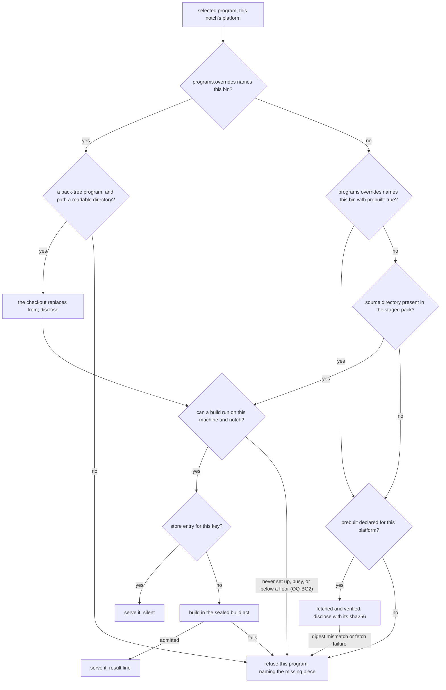

# A pack's own tool, built from its own tree: one more source for the fork route's build act

**Status:** 2026-10-22. Nothing built. Evidence read at `c0a14f4e4`. Written overnight under the
maintainer's delegation; every implementation decision is in the
[Decision Ledger](#decision-ledger) for morning review, and the three product questions are
[open](#open-questions) with leanings the [plan](pack-buildable-programs-plan.md) builds on.

> **In short.** A tool a pack builds from its own tree is a fork whose source is the pack itself.
> So the feature is a new *source* for the fork route's existing build act, keyed by the content of
> the pack's tree. It is not a second build system. The dev override and the prebuilt download
> are two more answers to "where do this program's bytes come from", and they share that
> program's single precedence and its single "which bytes" line.

**Why it matters.** Today a pack can install a tool from npm, from a vendor script, or as a fork
of an agent pack. It cannot ship a tool that needs compiling, run one from the checkout you are
editing, or fetch a verified build for someone without the sources
([the request](#1-the-request-and-the-verdict)).

**The shape.** One `via: "pack"` program declaration. It feeds a resolver with four rungs: dev
override, then build, then prebuilt, then refuse. Behind the resolver sit three things that
already exist: the sealed build act, the capture store and the source launcher.

**Cost.** One more value in the closed `via` set and one user-scope config option. Nothing is
deleted. A tool built this way is subject to the fork route's limits: no cross-compiling, and no
store mounted on Apple Container below its read-only bind floor.

**Start at [§4](#4-precedence-one-resolver-four-rungs)**, the precedence. Everything else is how
each rung gets its bytes.

**Needs your ruling:** nothing open. **Ruled 2026-10-23:** [OQ-BG1](#OQ-BG1), [OQ-BG2](#OQ-BG2), [OQ-BG3](#OQ-BG3).

**Reads with:** [`pack-buildable-programs-plan.md`](pack-buildable-programs-plan.md) (the
implementation plan, written against the tree tonight on the leanings, by the maintainer's
authorization);
[`forked-programs-as-packs.md`](forked-programs-as-packs.md) (the build act, the seal and the
store identity this reuses);
[`program-readiness.md`](../reference/program-readiness.md) (the launch's install act this joins);
[`pack-binaries.md`](../reference/pack-binaries.md) (the verified download this reuses).

---

## For morning review

The maintainer asked for this list at the top. Builders proceed on every leaning below until a
ruling says otherwise.

**Open questions** (product behavior with no single right answer):

- [OQ-BG1](#OQ-BG1): ✅ ruled 2026-10-23: a failed build stops the launch exactly as a fork
  build's does, with the same bypass.
- [OQ-BG2](#OQ-BG2): ✅ ruled 2026-10-23: never substituted automatically; always available by explicit choice. Original question: may the prebuilt artifact stand in where no build can run on this machine,
  or only where the pack carries no source? I lean towards also allowing it where the builder is
  permanently unavailable, but never where it is only busy.
- [OQ-BG3](#OQ-BG3): ✅ ruled 2026-10-23: an override is built at launch from the checkout on disk, like a fork; nothing is picked up inside a running jail.
  I lean towards running it as found.

**Implementation decisions**, each recorded as *decided under the 2026-10-22 overnight
delegation; review in the morning*: [BG-D1](#BG-D1) to [BG-D17](#BG-D17) in the
[Decision Ledger](#decision-ledger). The ones most likely to draw a comment:

- [BG-D1](#BG-D1): the new value is `via: "pack"`, not a reuse of `via: "source"`.
- [BG-D4](#BG-D4): the build runs where its output will live, in the home.
- [BG-D7](#BG-D7): the download is a single file. Archives are not supported in v1.
- [BG-D8](#BG-D8): the override is `programs.overrides` in the user config. Since
  [BG-D19](#BG-D19) it applies to pack-tree programs only.
- [BG-D11](#BG-D11): `yolo pack build` covers `via: "pack"` programs only. For a fork it names
  `yolo capture`.

## Defined terms

- **Pack-tree program** *(coined here)*: a `kind: "program"` contribution with `via: "pack"`,
  whose bytes come from the pack's own tree. Not a fork: it owns its `bin` and names no base.
- **Source directory** *(coined here)*: the directory, relative to the pack root, that a
  pack-tree program builds from (its `from`). It is absent when the pack tree has no directory
  there.
- **Dev override** *(coined here)*: a user-scope setting that builds one pack-tree program from
  a host checkout the user names, in place of its pack's tree, at each launch. Not a pack and not a
  mount: the checkout is copied into the build, never mounted.
- **Prebuilt artifact** *(coined here)*: a file a pack names by URL and sha256, per platform,
  for a pack-tree program to use when its source directory is absent, or when the user opts into
  it ([BG-D18](#BG-D18)). Not a `binaries` entry,
  which is a loophole's ([`pack-binaries.md`](../reference/pack-binaries.md)), though it is
  fetched and verified the same way.
- **Build act**, **sealed**, **store key**, **capture store**: the fork route's, defined in
  [`forked-programs-as-packs.md`](forked-programs-as-packs.md) and
  [`install-capture.md`](../reference/install-capture.md#defined-terms).
- **Notch**: where an agent runs (a jail, `yolo host`, or the unbuilt guest), from
  [the patched-fork notch table](../reference/patched-forks.md#9-notch-coverage).

## 1. The request, and the verdict

The request (the maintainer's handoff of 2026-10-22, whose canonical record is item 26 of the dotfiles
repository's yolo fix requests) names three cases as one feature: build a tool from the pack's own sources, run it from the
workspace's own checkout while it is being developed, and fetch a verified platform artifact for
a pack given to someone else. The outcome it asks for, and which this design treats as binding:

1. **Three sources, one stated precedence**: the dev override, then the pack build, then the
   prebuilt artifact, then a refusal that names the exact missing piece.
2. **"Which bytes am I running" is never a guess.** A launch that used an override or an artifact
   says so in one line.
3. **Content-keyed caching**: no rebuild without a change, and never a stale serve.
4. **An explicit `yolo pack build <pack>`**, with `--force`.
5. **Failure is scoped to the one program**, naming the build log and the retry command.
6. **The override is user scope only.**

The JSON in the handoff is explicitly not required. **My verdict:** every hard part of this
already exists in the fork route, so this design adds no machinery of its own:

- the sealed build jail, built per platform and never on the host;
- the per-build lock, where a waiter adopts the winner's result;
- content-addressed admission into the capture store;
- the reflink materialize;
- the macos-user darwin act;
- the host floor's relocated copy;
- the launch's build pool, with its start, progress and result lines.

What a fork has that a pack-tree program lacks is a source *address* and a *pin*. The pack's own
tree replaces both: its digest is the revision, and staging the pack is the fetch.

### Principles

- <a id="P1"></a>**P1. One build act.** A pack-tree program is built by the fork route's build
  act, unchanged apart from where its source comes from. A second build path is the drift the
  notch-convergence ruling exists to end.
- <a id="P2"></a>**P2. The key names every input.** A build's identity is the content of its
  source directory, its recipe and its platform. A change to any of the three is a new build. No
  change to any of them is a hit, and a hit does no work and prints nothing.
- <a id="P3"></a>**P3. Which bytes is always answerable, and said when it is not the default.**
  A build that serves is the default and implied. An override or a prebuilt artifact is
  disclosed on every launch, and a launch has no quiet mode
  ([`OQ-RO3`](../reference/report-tiers.md#why-its-this-way)).
- <a id="P4"></a>**P4. Only the user's own config can choose bytes the pack did not.** A
  workspace config travels with the repository and an agent can edit it. It may not point a
  program at other bytes, for the same reason `host_wrappers` is user scope only.
- <a id="P5"></a>**P5. No silent substitution.** A source that was chosen and failed is a
  failure. It never falls through to a lower rung
  ([PD-NF1](program-delivery.md#36-no-silent-fallback-to-an-older-version-pd-nf1)).

## 2. Goals and non-goals

**Goals:** the six outcomes in [§1](#1-the-request-and-the-verdict), at every notch and backend
that can run a source-built program today ([§9](#9-notch-and-backend-coverage)).

**Non-goals**, each considered and set aside:

- **Cross-compiling.** A notch gets a build for its own platform or none, as a fork does.
- **A remote build cache, signing or reproducible builds.** These are the fork route's non-goals
  and stay so.
- **Archive artifacts in v1.** A prebuilt artifact is one file ([BG-D7](#BG-D7)).
- **Running a dev override's checkout live**, without a launch ([OQ-BG3](#OQ-BG3) ruled: it is
  built at launch, as a fork is).
- **A dev override of a program no pack builds from its tree** ([BG-D19](#BG-D19)). A fork pack
  builds such a program from a checkout.
- **Overrides inherited by a nested launch.** An inner jail's own user config decides
  ([BG-D15](#BG-D15)).
- **A pack-declared toolchain beyond what a fork's build gets.** The build has the image, the
  program's `node_floor` and the network, and fetches anything else in its build line
  ([FP-D19](forked-programs-as-packs.md#FP-D19)).
- **Picking up an override's change in a running jail.** A change to `programs.overrides`, or an
  edit inside the checkout, takes effect at the next fresh launch, which builds it
  ([§5](#5-the-dev-override)).

## 3. The declaration

```jsonc
{
  "kind": "program",
  "bin": "board",
  "via": "pack",
  "from": "tools/board-cli",              // source directory, relative to the pack root
  "build": "npm ci && npm run bundle",     // optional: absent means the tree runs as shipped
  "run": "dist/board.js",                  // the program, relative to `from`, after the build
  "prebuilt": {                            // optional: used when `from` is absent, or by the user's opt-in (BG-D18)
    "linux/amd64":  { "url": "https://example.invalid/board-linux-amd64",  "sha256": "<64 hex>" },
    "linux/arm64":  { "url": "https://example.invalid/board-linux-arm64",  "sha256": "<64 hex>" },
    "darwin/arm64": { "url": "https://example.invalid/board-darwin-arm64", "sha256": "<64 hex>" }
  }
}
```

| Field | Rule |
| :--- | :--- |
| `via: "pack"` | A new value in the closed `via` set ([BG-D1](#BG-D1)). |
| `from` | **Required.** Relative, cleaned, with no `..` and not absolute. `"."` means the pack root. An absent directory is legal ([§4](#4-precedence-one-resolver-four-rungs)), and `yolo pack lint` warns when one is absent with no `prebuilt` ([BG-D16](#BG-D16)). |
| `build` | **Optional.** One command line with no newline (the fork rule). Run by bash with the program's directory as its working directory ([§6.2](#62-the-build-runs-where-its-output-lives)). Absent means no build ([§6.4](#64-no-build-line-no-jail)). |
| `run` | **Required.** Relative to `from`, cleaned, with no `..`. After the build it must name a regular file inside the program's directory, or a symlink that resolves inside it. yolo sets its exec bit ([BG-D6](#BG-D6)). |
| `prebuilt` | **Optional.** A map from an exact `<goos>/<goarch>` key to `{url, sha256}`, under `binaries`' rules: https only, no credentials in the URL, 64 lowercase hex characters, at least one platform. **Refused in an official pack** ([BG-D7](#BG-D7), carrying [OQ-BP8](../reference/pack-binaries.md#OQ-BP8)). |
| `platforms`, `node_floor` | Allowed, with their meaning on any program. |
| Behavior fields (`probe_args`, `refresh`, `capabilities`, launch flags and the rest) | Allowed. The pack owns this program, unlike a fork, which leaves them to its base. |
| Delivery fields of other vias (`package`, `url`, `flags`, `update`, `versions_dir`, `installer_env`, `install_hints`) and the fork fields (`fork_of`, `source`, `produces`, `patches`, `follow`, `patch_branch`) | **Refused by name**, saying which `via` reads them. |

> [!WARNING]
> **`prebuilt`, not `fallback`.** The `fallback` key is taken: on a `files` contribution it is an
> unmodified extension's list entry, typed as a string (`Contribution.Fallback`). An object under
> that key on a program would not decode.

A yolo older than this design reads `via: "pack"` the way it reads any unknown `via`: the tolerant
decoder skips the contribution with a skew note, and validation refuses it on the host by naming
the closed set. A fetched pack newer than the binary therefore degrades loudly rather than
installing something wrong ([BG-D1](#BG-D1)).

## 4. Precedence: one resolver, four rungs

For each selected pack-tree program, on each notch that runs it, one resolver answers "which
bytes", in this order. The first rung that applies decides. A rung that applies and then fails
is a failure ([P5](#P5)); it never falls through to the next rung. **A prebuilt is never
substituted for a present source** ([OQ-BG2](#OQ-BG2)): a build that cannot run, for a builder
never set up or one that is busy, is a refusal. The user's explicit opt-in
(`programs.overrides.<bin>: {"prebuilt": true}`, [BG-D18](#BG-D18)) is the one way a present
source gives way to the prebuilt.



**The refusal names the exact missing piece**, in one of these forms. The wording belongs to the
implementer; the facts each line carries do not:

| Rung that stopped | The line names |
| :--- | :--- |
| Override path missing, not a directory, or a credential-boundary path | the path as written, why it was refused, and the config file and key to edit (`programs.overrides.<bin>` in `~/.config/yolo-jail/config.jsonc`) |
| Override of a program that is not a pack-tree program | the key, the program's `via`, and the next step: a fork pack (`via: "source"`, `fork_of`, a `git+file://` source), or removing the setting ([BG-D19](#BG-D19)) |
| Override checkout gone or unreadable at the launch | the checkout, the cause, and the key to fix or remove |
| Build failed | the pack, the program, the build log path, the retry command `yolo pack build <pack>`, and the bypass ([§8](#8-failure-and-the-next-step)) |
| Builder busy, or Apple Container below its read-only bind floor | the existing fork-route reason, unchanged |
| Build environment never set up (a Mac with no sandbox account, in the account mode) | the setup step (`yolo macos-setup`) and, when `prebuilt` declares this platform, the opt-in that runs it instead ([OQ-BG2](#OQ-BG2)) |
| Opt-in set, but no prebuilt for this platform | the setting, the platform, and the platforms `prebuilt` does declare (or "none") |
| No source and no prebuilt for this platform | the pack, `from` as declared, the platform, and the platforms `prebuilt` does declare (or "none") |
| Prebuilt fetch failed, or its digest did not match | the URL and, for a mismatch, both digests ([the integrity rule](../reference/pack-binaries.md#principles)) |

**The disclosure lines**, one per program, printed on every fresh launch and every attach while
they hold ([BG-D10](#BG-D10)):

```text
board: built from your checkout /home/me/code/board-cli (programs.overrides.board in ~/.config/yolo-jail/config.jsonc) — rebuilt at tree digest 3f9c0a1b2d4e
board: prebuilt artifact from pack dotfiles (no tools/board-cli in the pack) — sha256 8caa07df9d1f… verified, https://example.invalid/board-linux-amd64
board: prebuilt artifact from pack dotfiles (programs.overrides.board.prebuilt is set) — sha256 8caa07df9d1f… verified, https://example.invalid/board-linux-amd64
```

An override's line is printed whether its build ran or was reused, and says which
([§5](#5-the-dev-override)). A build that ran prints the build pool's existing start, progress and result lines
([the pool's output](../reference/patched-forks.md#7-the-build-and-the-launch)). Its result line
names the source directory's tree digest in place of a commit. A hit prints nothing, by
[P2](#P2) and the readiness act's own rule that a hit is silent
([what ready means](../reference/program-readiness.md#what-ready-means)). `yolo pack status
<pack>` names what serves in every case.

## 5. The dev override

```jsonc
// ~/.config/yolo-jail/config.jsonc only
"programs": {
  "overrides": {
    "board": { "path": "~/code/board-cli" }   // build board from this checkout, not the pack's tree
  }
}
```

**What it is, as ruled** ([OQ-BG3](#OQ-BG3), 2026-10-23, against the leaning): the checkout
replaces the pack's `from`, and nothing else changes. At each fresh launch, each `yolo host` floor
resolution and each `yolo pack build`, the program is built from the checkout exactly as a
pack-tree program is built from its pack's tree ([§6](#6-building-the-fork-routes-act-with-the-packs-tree-as-its-source)):
the same sealed build act, the pack's own `build` and `run`, the same store, lock and pool lines,
and the same fatal refusal when the build fails ([OQ-BG1](#OQ-BG1)). In the maintainer's words: *"you
start the jail, it gets built and that's it ... just like the forks work."* There is no live
mount, no build at run time and no pickup in a running jail. An edit in the checkout is built at
the next fresh launch, and an unchanged checkout is a hit that builds nothing.

**Where it lives.** `programs` is already a user-scope-only key: its one option before this,
`autoprune`, is refused in a workspace config, and its reader reads the user file directly
(`validatePrograms`, [`programs.go`](../../internal/config/programs.go)). `overrides` joins that
object, so a workspace value is an error that names the user file, by the same construction
([BG-D8](#BG-D8)). The override is keyed by `bin`. Two selected packs cannot claim one `bin` (the
launch's collision pre-flight), so a `bin` names at most one program.

**The prebuilt opt-in is the entry's other form**: `"chart": { "prebuilt": true }` names no
checkout. It runs the pack's verified prebuilt artifact for a pack-tree program, even with the
source present ([§7](#7-the-prebuilt-artifact), [BG-D18](#BG-D18)). It cannot sit beside `path` in
one entry, and validation names both fields. It is no dev override: nothing below applies to it.

**What it applies to: a pack-tree program only** ([BG-D19](#BG-D19)). An override names a checkout
to build with the pack's own build line, and only a `via: "pack"` program has one. An override
naming any other program a selected pack declares (an npm agent, a vendor script, a fork) refuses
the launch, `yolo host` and `yolo check`, naming the key and the next step: a fork pack, which is
how yolo builds a program from a checkout it has no build line for (`via: "source"`, `fork_of`, and
a `git+file://` source naming the checkout,
[`forked-programs-as-packs.md`](forked-programs-as-packs.md)). An override naming a `bin` that no
selected pack declares does nothing, because the user config spans every workspace; `yolo check`
lists it as information, not as a failure.

**`path`**, at every fresh launch, on the host: `~` is expanded, symlinks are resolved first (the
darwin symlink class), and the path must be an existing directory. It is refused when it is or
contains the home, the user config directory or yolo's state directory: the read half of the
credential boundary (`paths.WorkspaceScopeBreach`,
[the workspace-scope invariant](../../AGENTS.md#invariants--gotchas)), at every notch, for one rule
([BG-D9](#BG-D9)). The former `run` field is retired: an entry still carrying it is a validation
error that says the pack's own `run` is used now.

**What keys it.** The revision is the tree digest of the checkout as it sits on disk: the working
tree, uncommitted edits included, with `.git` skipped, by the same rule as a pack's `from`
([BG-D3](#BG-D3)). **Git-ignored files are included** ([BG-D20](#BG-D20)): yolo reads no
`.gitignore` and never runs git on the checkout, so a `node_modules` or a previous build's output
in the checkout is digested, copied and handed to the build like any other file. A checkout that
keeps such a tree pays for it on every launch, as a large `from` does
([§6.1](#61-the-source-and-what-keys-it)'s warning). The build source is
`checkout:<pack>:<path>`, so a checkout's builds never share a store entry with the pack's own.

**The checkout is copied, then checked.** A launch digests the checkout, and the build act copies
it (minus `.git`) into the build's staging and digests the copy. A checkout edited between the two
refuses that build, naming the relaunch that builds what it holds now. The build reads the copy
only, so nothing writes into the checkout.

**The line.** Every fresh launch names it, whether the build ran or was reused:

```text
board: built from your checkout /home/me/code/board-cli (programs.overrides.board in ~/.config/yolo-jail/config.jsonc) — rebuilt at tree digest 3f9c0a1b2d4e
board: built from your checkout /home/me/code/board-cli (programs.overrides.board in ~/.config/yolo-jail/config.jsonc) — reused its build at tree digest 3f9c0a1b2d4e, the checkout unchanged
```

An attach names the build its jail's launch made and says an edit since is built at the next fresh
launch. `yolo host` and `yolo pack build` name the checkout the same way.

> [!NOTE]
> **No warning that the override runs the checkout's code.** Running what you develop is the
> product, so a warning about it would only help against a deliberate adversary
> ([the misguided-agent principle](../reference/misguided-agent-principle.md#how-to-apply-it)).
> The disclosure line is enough. What the principle does require is that the *choice* is out of
> an agent's easy reach, which user scope provides ([P4](#P4)).

## 6. Building: the fork route's act with the pack's tree as its source

### 6.1 The source, and what keys it

- **The source is the launch's own staged pack tree.** Every fresh launch stages the selected
  packs into a new tree that nothing edits afterwards
  ([`packtree.go`](../../internal/cli/run/packtree.go)), so the digest is of bytes that cannot
  change under the build. Outside a launch, `yolo pack build` reads the same resolution through
  the process pack tree (`config.ResolvePack`).
- **The revision is the source directory's tree digest**: `treedigest` over `from`, skipping
  `.git` (directories, symlinks by their unfollowed target, files by exec bit and content,
  sorted). The build is handed exactly the digested bytes: staging copies `from` minus `.git`.
  Anything outside `from` is not copied, so it cannot affect the build.
- **The recipe** is a hash over the declaration's build inputs: the `pack` tag, `build`, `run` and
  the placement layout's version. It is tagged so that it never equals a fork's recipe for the
  same strings, as a patched extension's recipe is tagged
  ([BG-D3](#BG-D3)).
- **The build identity** is the fork route's own formula: source, revision, recipe and platform.
  The source string is `pack:<pack>/<from>`, so two packs that ship the same tree build apart.
- **Not in the key, and recorded instead:** the toolchain (the image identity, or the darwin
  floor's store path), exactly as [OQ-FP2](forked-programs-as-packs.md#14-decision-ledger) rules
  for a fork. The pack's commit is not in the key either: the digest covers every byte that
  reaches the build, which is what makes an edit to a `file://` pack rebuild once and no more.

> [!WARNING]
> **The cost of the digest is a full read of the source directory on every fresh launch.** That
> is the same order as the staging copy every launch already makes of the whole pack, so the
> digest adds a constant factor, not a new class of cost. A pack that keeps a large tree under
> `from` pays for it. A stat-keyed digest cache is the remedy if a measurement ever asks for one,
> and it is not built speculatively.

### 6.2 The build runs where its output lives

The build jail copies the staged source directory into the program's own directory in the build
home, `~/.local/lib/yolo-programs/<bin>/`, and runs `build` there, with that directory as its
working directory. When `build` succeeds, yolo places a relative symlink at `~/.local/bin/<bin>`
pointing to `../lib/yolo-programs/<bin>/<run>`, and sets the exec bit on `<run>`. The entry the
store admits holds exactly those two paths. Anything else the build wrote into the home is left
out, and the build log names it ([BG-D4](#BG-D4)).

**Why build in place rather than build in `/workspace/src` and copy the result:** a build embeds
its own absolute paths (an interpreter line, a `RUNPATH`, a generated config). An embedded path
under the home is one the capture's relocation already records and rewrites for the host floor
and macos-user. An embedded path under a build-jail scratch directory is one nothing records, and
it breaks the moment the tree moves. Building in place puts every self-reference in the one place
relocation covers.

### 6.3 The build act, reused unchanged

Everything below is the fork route's, and the pack-tree program takes it as is:

- **The seal** ([FP-D9](forked-programs-as-packs.md#FP-D9)): no credential, host file,
  `env_sources`, loophole or nix socket, and private `~/.cache` and `/mise`. The network beyond
  loopback stays open for dependency fetches. The build never runs on the host.
- **The per-build lock and its bounded wait**, `forkBuildWaitBound` (20 minutes). The hit is
  checked again after the lock is taken.
- **Admission** by rename into the capture store, with the completion marker written last, and a
  `kind:"build"` receipt beside the entry.
- **The launch pool**, its interrupt scope and its Ctrl-C rules
  ([§7.1 of the patched-fork reference](../reference/patched-forks.md#71-cancelling-a-launchs-builds)).
- **Delivery**: the host passes the store key per `bin`, the store is mounted read-only, and the
  source launcher materializes the entry into the home at first use and runs
  `~/.local/bin/<bin>`.

### 6.4 No build line, no jail

A pack-tree program with no `build` runs nothing, so it needs no sealed jail. The host lays out
the same two paths (the directory copied, the link, the exec bit) as a proto-entry and admits it
under the same lock, key and receipt kind. The receipt records that no build ran
([BG-D5](#BG-D5)). Delivery is then the same as for a built program, so there is one launcher and
one store shape for every rung, the override's included.

### 6.5 Materialize replaces the whole program directory

Before the source launcher materializes an entry whose key differs from the one it last placed,
it removes `~/.local/lib/yolo-programs/<bin>/` whole. A file the new build no longer produces
therefore cannot survive from the old one ([BG-D12](#BG-D12)). The directory is yolo's by name,
so nothing of the user's is in it.

### 6.6 Two at once

| Case | Behavior |
| :--- | :--- |
| Two launches need the same build | Serialized on the build's lock. The waiter takes the winner's result, success or failure, rather than repeating a failing build ([BG-D13](#BG-D13)). A launch that *starts* after a failure builds again, with no back-off. |
| `yolo pack build` while a launch builds the same key | Waits on the same lock and the same bound. Without `--force` it then finds the hit and prints that it is up to date. With `--force` it rebuilds anyway. |
| Two different programs, or two platforms | Different identities, so they build in parallel under the pool's existing bound. |
| A `file://` pack edited during a launch | No effect on that launch, which digests its own staged copy. The next launch sees the edit. |
| An override's checkout edited during or after a launch | No effect on the running jail. An edit between the launch's digest and the build's copy refuses that build, naming the relaunch; the next fresh launch builds what the checkout holds then ([§5](#5-the-dev-override)). |
| A prebuilt fetch racing another | The download cache admits by verified rename, so the fetch is idempotent. The entry is admitted under the build lock. |

## 7. The prebuilt artifact

- **When it is used:** `prebuilt` declares this notch's platform, and either the source
  directory is absent from the staged pack, so the artifact is the only bytes the pack offers, or
  the user opted that program into it with `programs.overrides.<bin>: {"prebuilt": true}`
  ([BG-D18](#BG-D18)). **Never in place of a build that cannot run** ([OQ-BG2](#OQ-BG2)): a source
  present on a machine that never set up its build environment is a fatal refusal through the
  missing-build path, with the same `YOLO_ALLOW_MISSING_PROGRAMS=1` bypass. It names the setup step
  and, when `prebuilt` declares the platform, the opt-in. An opt-in for a platform `prebuilt` does
  not declare refuses the program, naming the platforms it does.
- **Fetched by:** the launch's build slot on the host, before the jail; `yolo pack install` and
  `yolo pack update`, which prefetch every selected program's artifact as they do loophole
  binaries; and `yolo pack build`. All three go through the existing download cache
  (`packbin.Fetcher.Ensure`). That cache already enforces https at every hop, a 512 MiB bound, a
  digest check after the last byte, and admission only by verified rename. A launch may fetch,
  unlike a loophole binary, because a program is installed at launch by ruling
  ([OQ-JR1](../reference/program-readiness.md#OQ-JR1)). [BG-D7](#BG-D7) states why
  [BP-D5](../reference/pack-binaries.md#BP-D5) does not govern this case.
- **Admitted as:** a proto-entry built on the host, with no jail, laid out as
  `~/.local/lib/yolo-programs/<bin>/<bin>` (the file, mode 0755) and the same link. Its receipt
  records the URL and sha256 as its revision. Delivery is therefore the same as a build's.
- **Offline:** an artifact admitted once is a store hit. A launch with no network and no entry is
  refused, naming the URL and `yolo pack install`.
- **Never** used after a build that was attempted and failed ([P5](#P5)), and never fetched when
  the source directory is present, unless the user opted in.

## 8. Failure, and the next step

**Every failure refuses that program**, naming the pack, the program, the cause, the log when one
exists, the retry command and the bypass. The leaning of [OQ-BG1](#OQ-BG1) is that such a failure
stops the launch, as it does for every program today
([OQ-JR1](../reference/program-readiness.md#OQ-JR1)): the readiness act's install-only run of the
program's launcher exits non-zero, and the act refuses with `provision.RefusedStatus`.
`YOLO_ALLOW_MISSING_PROGRAMS=1` starts the jail without that program, loudly, and the jail's other
programs are untouched.

| Failure | Behavior |
| :--- | :--- |
| Build line exits non-zero | Program refused; the build log is `<workspace>/.yolo/build-<slug>.log` (the pool's existing log); retry `yolo pack build <pack>` |
| Build exits 0 but `run` is absent or not a file | Treated as a failed build, named as "the build produced no `<run>`" |
| Build jail never started (runtime down, seal refused) | The fork route's not-started reason and cause, unchanged |
| Lock wait ran out (20 minutes) | That launch's failed build, naming the holder's pid and the lock |
| Apple Container busy with another jail | The existing refusal ([PF-D92](../reference/patched-forks.md#PF-D92)), which names the retry once the other jails stop |
| Source absent, no prebuilt for the platform | Refused, naming what is declared ([§4](#4-precedence-one-resolver-four-rungs)) |
| Source present, build environment never set up | Refused, naming the setup step and, when one is declared for the platform, the prebuilt opt-in; never the prebuilt ([OQ-BG2](#OQ-BG2)) |
| Prebuilt opt-in set, no prebuilt for the platform | Refused, naming the setting and the platforms declared |
| Prebuilt fetch failed or digest mismatch | Refused; nothing cached; never falls back to a cached copy that does not match |
| Override invalid, its checkout gone, or naming a program that is not a pack-tree program | Refused, naming the path, the key and the next step ([§5](#5-the-dev-override)) |
| Override's checkout fails the pack's build | The build failure above, naming the checkout as the source |
| Store entry half-written (crash mid-admit) | Missing completion marker reads as absent; the next launch rebuilds |

**`yolo pack build`** is the explicit act, on the host:

```text
yolo pack build [<pack>...] [--force] [--at jail|host]
```

- **No argument**: every pack-tree program of every pack the workspace's config selects. **Named
  packs**: only theirs. A named pack that is not selected or not found is refused, naming
  `yolo pack ls`. A selected pack with no pack-tree program prints that there is nothing to build
  in it.
- **`--at`** picks the platform it builds for: the workspace runtime's jail platform by default,
  or the host notch's (on a Mac, the darwin act). This mirrors `yolo apply --at`.
- **`--force`** rebuilds even on a hit, and the new entry's receipt is newer, so it serves.
- **A dev override set for a program** is what it builds: the checkout, exactly as a launch
  builds it, with the line naming the checkout. A second run on an unchanged checkout is up to
  date.
- **A fork in a named pack** is skipped with a line naming `yolo capture <bin>`, its explicit
  rebuild ([BG-D11](#BG-D11)).
- **Inside a jail** it refuses, naming the host command, since builds never run in a jail.
- **Output and exit**: one line per program, *up to date*, *built* or *failed* with its log. Exit
  0 when nothing failed, 1 otherwise.

## 9. Notch and backend coverage

Parity: every backend that can deliver a source-built program today gets every rung, and each
difference below is one the fork route already has, for the reason given.

| Notch / backend | Build | No-build copy and prebuilt | Dev override |
| :--- | :--- | :--- | :--- |
| **jail, podman** (Linux, or a macOS VM) | Sealed build jail at a fresh launch, in the pool | Admitted on the host, delivered from the store | Built from the checkout, as the Build column says |
| **jail, Apple Container** | One build at a time. Refused while another jail runs (the existing gate). Below the read-only bind floor no store is mounted, so nothing store-delivered works, and the reason says so | Same store, so the same floor applies | Built from the checkout, so the same gate and floor apply |
| **jail, macos-user** | The sealed darwin act as the sandbox account ([FP-D24](forked-programs-as-packs.md#FP-D24)); the key is staged into the sandbox's capture store | darwin artifact, staged the same way | Built from the checkout by the darwin act |
| **`yolo host`, Linux** | The floor's build through the sealed capture jail, materialized into the floor prefix when relocatable ([FP-D16](forked-programs-as-packs.md#FP-D16)) | Linux artifact into the floor | Built from the checkout into the floor at each `yolo host` launch |
| **`yolo host`, macOS** | The darwin act. With no sandbox account the build is refused, naming `yolo macos-setup` and the prebuilt opt-in when a darwin artifact is declared ([OQ-BG2](#OQ-BG2)) | darwin artifact into the floor, where the source is absent or the user opted in | Built from the checkout by the darwin act, refused the same way with no sandbox account |
| **guest** | Unbuilt, as every verb there is. Nothing here is keyed on there being two notches | | |

> [!IMPORTANT]
> **Nothing here can be verified for macos-user, Apple Container or a Mac's `yolo host` from
> Linux.** A nested podman jail verifies the podman rows. The rest need a real Mac, as the fork
> route's darwin act did ([§11](#11-what-done-looks-like)).

## 10. Forbidden behavior

- **Never build on the host**, on any backend. A pack-tree build is the sealed act, and a no-build
  copy runs no code.
- **Never serve an entry whose key does not match.** A near miss is a build, not a substitution.
- **Never fall back after a chosen source failed**: no prebuilt after a failed build, no pack build
  after a broken override, no older build after a newer one failed ([P5](#P5)).
- **Never write into the pack tree or into the override's directory.**
- **Never deliver an override live**: no mount or link of the checkout into a jail, no run of the
  checkout's own files on `yolo host`, and no build at run time ([OQ-BG3](#OQ-BG3)).
- **Never let a workspace config set `programs.overrides`**, and never read one from there.
- **Never fetch a prebuilt artifact while the source directory is present**, unless the user
  opted that program into it ([BG-D18](#BG-D18)). Never substitute one for a build that cannot run
  ([OQ-BG2](#OQ-BG2)).
- **Never build, fetch or digest on an attach, a dry run, `yolo check`, inside a jail, or on a
  timer.**
- **Never print a hit.** Never omit an override or prebuilt line.

## 11. What done looks like

The handoff's six steps are the acceptance criteria. Each runs with a scratch pack whose tool
needs a build. The plan gives each an integration test.

1. **A launch installs it; `<bin> --version` reports the built tree.**
2. **Edit the source and relaunch: it rebuilds once and serves the new bytes.**
3. **Relaunch with no change: no rebuild,** and no build line printed.
4. **Set `programs.overrides` to a checkout and relaunch: `<bin>` is built from the checkout,
   and the launch names it. Relaunch unchanged: no rebuild. Edit the checkout and relaunch: it
   rebuilds.**
5. **Remove the pack's sources: it uses the declared prebuilt artifact and reports the checksum
   it verified.**
6. **Break the build: only that program is refused, and the log path is named.** By
   [OQ-BG1](#OQ-BG1), the launch stops by default. With `YOLO_ALLOW_MISSING_PROGRAMS=1`
   it starts, and every other program works.

| Where | Steps verifiable |
| :--- | :--- |
| Nested podman jail, from a matched dev bundle | 1–6 |
| A Linux host's `yolo host` | 1–6 on the floor |
| A real Mac: macos-user, Apple Container, and `yolo host` | 1–6 on each; owed, as for every darwin build |

## 12. Alternatives, with verdicts

| Alternative | Verdict |
| :--- | :--- |
| **Reuse `via: "source"`, dropping `fork_of` when the source is the pack** | **Rejected.** A fork leaves the program's behavior to its base; a pack-tree program owns it. Mixing the two puts two field tables behind one name. It also turns version skew into a hard error: an older yolo knows `source` and refuses a source program with no `fork_of`, where it skips an unknown `via` with a note. |
| **A `files` contribution plus a hand-written launcher** | **Rejected as the answer, though it works today for a tool that needs no build** (the handoff's own Node case). It has no build, no key, no override and no artifact. |
| **`binaries` with a build step** | **Rejected by ruling** ([OQ-BP5](../reference/pack-binaries.md#OQ-BP5)): a build is arbitrary code, and belongs in the sealed capture jail, which is where this design puts it. |
| **Build in a scratch directory, copy the output** | **Rejected** for the relocation reason in [§6.2](#62-the-build-runs-where-its-output-lives). |
| **The override builds the checkout in a sealed jail at launch, keyed on its digest** | **Chosen by ruling** ([OQ-BG3](#OQ-BG3), 2026-10-23), over this design's leaning. It gives up the request's "pick up changes without a launch", which the maintainer set aside: a checkout behaves like a fork's or a pi extension's, built at launch and nothing more. The cost is a digest of the working tree, `node_modules` included, on every launch ([BG-D20](#BG-D20)). |
| **Run the checkout as found, live** (the former leaning: a mount, a context link, the host path) | **Rejected by ruling** ([OQ-BG3](#OQ-BG3)): it is special behavior the forks do not have. A developer who wants a live checkout in one jail builds it and points at it there, with no help from yolo. |
| **Key on the pack's commit instead of the tree digest** | **Rejected.** A `file://` pack has no commit, and a commit that touched only other files would rebuild for nothing. |

## 13. Risks

| Risk | Mitigation |
| :--- | :--- |
| A large `from` makes every launch slow | It costs the same order as staging; measure before adding a stat cache ([§6.1](#61-the-source-and-what-keys-it)) |
| A build with a toolchain the sealed jail lacks | It fails like any other build, naming its log. The build line can fetch its own toolchain, as a fork's does |
| A built tree embeds an absolute path outside the home | Relocation reports the entry as not movable, and the host floor reports it, as for a fork. The jail is unaffected, because it materializes at the same home |
| Override on the host notch runs a build of bytes a jail can write | This is the product ([§5](#5-the-dev-override)'s note). The choice is user scope, the build is sealed, and every launch discloses it |
| The prebuilt artifact and the source drift apart | Out of yolo's reach by design. The two are used in different situations, never mixed, and the line says which one runs |

## Open Questions

1. <a id="OQ-BG1"></a>✅ **OQ-BG1: Does a program that cannot be delivered stop the launch?**

   The handoff asks that a failed build "not stop an unrelated launch, the same rule the other
   program kinds follow". Since 2026-10-05 every program's install failure stops the launch, by
   [OQ-JR1](../reference/program-readiness.md#OQ-JR1), with a bypass.

   - **A — Stop the launch, with the bypass.** This is [OQ-JR1](../reference/program-readiness.md#OQ-JR1)'s rule, applied unchanged. Only this
     program is named, and the bypass leaves every other program working.
   - **B — Start without it, loudly.** This reopens [OQ-JR1](../reference/program-readiness.md#OQ-JR1) for one `via`, so a launch would mean
     two different things depending on the program's delivery.

   _Leaning:_ A — stop the launch with YOLO_ALLOW_MISSING_PROGRAMS as the bypass: it is the standing readiness rule, and matching it is what "the same rule the other program kinds follow" asks.

   **Answer:**
   > **Ruled in review 2026-10-23, as leaned (A):** a pack build is handled *"identically to how
   > we handle builds of extensions and forks and stuff. We have the same escape hatch, it's the
   > same happy path, and it's the same fatal error."* Built that way: a pack-tree build runs
   > through the fork route's build act and its missing-build refusal, which names the build log,
   > `yolo pack build <pack>` and `YOLO_ALLOW_MISSING_PROGRAMS=1`.

2. <a id="OQ-BG2"></a>✅ **OQ-BG2: May the prebuilt artifact stand in where no build can run on this machine?**

   The handoff names the artifact for an absent source. Some machines can never build: a Mac with
   no sandbox account, for `yolo host`. Others cannot build right now: Apple Container while
   another jail runs.

   - **A — Absent source only.** Exactly the handoff's rule. A Mac with no sandbox account gets
     no program, even though the pack ships one for it.
   - **B — Absent source, or a builder that is permanently unavailable.** A busy builder still
     refuses, so the bytes never change from one launch to the next because of timing.
   - **C — Any time a build cannot run now.** The bytes then depend on whatever else is running.


   _Leaning:_ B — absent source or a permanently unavailable builder, disclosed with its checksum; never a busy one, so the bytes do not depend on timing.

   **Answer:**
   > **Ruled in review 2026-10-23, none of the options as written:** *"if you've never set up your
   > building environment, I suppose we just should have a fatal error when building is required.
   > If there's a pre-built option, we should always allow you to use the pre-built, but I don't
   > think we should ... automatically give you some old version just because this, I think that
   > breaks mental models."* So where the pack ships its source, yolo builds it or the launch stops,
   > and the refusal names the setup step; a prebuilt is never substituted automatically. The user
   > may always choose the pack's prebuilt explicitly, at user scope (`programs.overrides.<bin>`
   > with `"prebuilt": true`), and the refusal names that choice. A pack that ships no source uses
   > its prebuilt, since nothing is substituted.
   > Confirmed for that case 2026-10-23: *"adding the pack is your acknowledgement that you trust
   > this pack and you will then run whatever the pack runs."*

3. <a id="OQ-BG3"></a>✅ **OQ-BG3: Does yolo build a dev override, or run the checkout as it finds it?**

   The override's purpose is to pick up changes "without a launch". For a compiled tool, someone
   has to rebuild after an edit.

   - **A — Run as found.** The developer builds, as they would anyway. A missing `run` file is
     refused, and the refusal names the pack's build line.
   - **B — Build at invocation, in the session.** Automatic, but it runs the build with the
     session's authority on every changed invocation. On `yolo host` it would build on the host.
   - **C — Build at launch, in the sealed jail.** Changes are then picked up only at a launch.


   _Leaning:_ A — run as found: it is the only option that keeps both "no launch needed" and "never build on the host", and the refusal names the build line.

   **Answer:**
   > **Ruled in review 2026-10-23, against the leaning (C, built the fork way):** *"I don't want
   > these builds to like automatically be building in the jail. I want them to be like pi
   > extensions or the pi fork. Like you start the jail, it gets built and that's it. ... I want
   > workspace B upon launch to recompile from what is sitting on disk at its launch, just like the
   > forks work. I don't want special behavior here. ... If you're developing board in Jail
   > Workspace A, you will build it and point to it yourself. You don't need any help from YOLO."*
   > An override builds the program at each launch from the checkout as it sits on disk, through
   > the same sealed build act and cache as a pack-tree build; nothing is picked up inside a
   > running jail.

## Decision Ledger

Every row is *decided under the 2026-10-22 overnight delegation; review in the morning*, and
reversible until it is built.

| ID | Ruling / Decision | Date | Settled in | Built |
| :--- | :--- | :--- | :--- | :--- |
| [OQ-BG1](#OQ-BG1) | A pack build that fails is handled identically to a fork build: the same fatal refusal, the same next steps, the same `YOLO_ALLOW_MISSING_PROGRAMS=1` bypass. | 2026-10-23 | [§11](#11-what-done-looks-like) | built: the fork route's missing-build refusal |
| [OQ-BG2](#OQ-BG2) | A present source is built or the launch stops; a prebuilt is never substituted for it automatically. The user may always choose the prebuilt explicitly at user scope, and a pack shipping no source uses its prebuilt. | 2026-10-23 | [§4](#4-precedence-one-resolver-four-rungs), [§7](#7-the-prebuilt-artifact) | built: `packload.PackTreeResolve` has no unbuildable input; the opt-in is [BG-D18](#BG-D18) |
| [OQ-BG3](#OQ-BG3) | A dev override is built at each launch from the checkout as it sits on disk, through the pack-tree build act and its cache; no live mount and no build at run time. | 2026-10-23 | [§5](#5-the-dev-override) | pending |
| <a id="BG-D1"></a>BG-D1 | **The new delivery is `via: "pack"`**, a fourth value in the closed set, delivered by the source launcher. It is not a relaxed `via: "source"`, which keeps its fork meaning. An older yolo skips the new value with a skew note instead of refusing it as a malformed fork. | 2026-10-22 | [§3](#3-the-declaration), [§12](#12-alternatives-with-verdicts) | — |
| <a id="BG-D2"></a>BG-D2 | **The build is the fork route's build act**, sealed and never on the host. The pack-tree source is staged by copying the staged pack's `from` minus `.git`, in place of a git checkout. | 2026-10-22 | [§6.3](#63-the-build-act-reused-unchanged) | — |
| <a id="BG-D3"></a>BG-D3 | **Identity**: source `pack:<pack>/<from>`; revision is the tree digest of `from` with `.git` skipped; recipe is a tagged hash of `build`, `run` and the layout version; platform. The toolchain is recorded, not keyed. | 2026-10-22 | [§6.1](#61-the-source-and-what-keys-it) | — |
| <a id="BG-D4"></a>BG-D4 | **The build runs where its output lives**: `from` is copied to `~/.local/lib/yolo-programs/<bin>/` and built there, with `~/.local/bin/<bin>` as a relative link to `<run>`. The entry holds only those two paths. | 2026-10-22 | [§6.2](#62-the-build-runs-where-its-output-lives) | — |
| <a id="BG-D5"></a>BG-D5 | **No `build` means no jail**: the host admits the copied layout directly, under the same lock and key. | 2026-10-22 | [§6.4](#64-no-build-line-no-jail) | — |
| <a id="BG-D6"></a>BG-D6 | **`run` names the program relative to `from`**, and yolo sets its exec bit at placement rather than requiring the author to commit one. | 2026-10-22 | [§3](#3-the-declaration) | — |
| <a id="BG-D7"></a>BG-D7 | **`prebuilt`** is a per-platform `{url, sha256}` map under `binaries`' rules. It holds one file, with no archives in v1. It is fetched through `packbin` by a launch, `yolo pack install`/`update` and `yolo pack build`, admitted as a store entry, and refused in an official pack. A launch may fetch it, despite [BP-D5](../reference/pack-binaries.md#BP-D5), because BP-D5 governs a loophole's binary, while a program is installed at launch by [OQ-JR1](../reference/program-readiness.md#OQ-JR1). | 2026-10-22 | [§7](#7-the-prebuilt-artifact) | — |
| <a id="BG-D8"></a>BG-D8 | **The override is `programs.overrides.<bin>` `{path}`** in the user-scope-only `programs` key, keyed by `bin`, on every workspace. Narrowed by [BG-D19](#BG-D19): it applies to pack-tree programs only, and its `run` is retired. | 2026-10-22 | [§5](#5-the-dev-override) | built: `config.ProgramOverrides` |
| <a id="BG-D9"></a>BG-D9 | **A `path` at the credential boundary is refused at every notch.** The live delivery this row also decided (a context mount, a macos-user link and grant, the host path on `yolo host`) is deleted by [BG-D19](#BG-D19). | 2026-10-22 | [§5](#5-the-dev-override) | built: `run.ProgramCheckout` |
| <a id="BG-D10"></a>BG-D10 | **Lines**: an override or prebuilt line on every fresh launch and attach; the pool's lines when a build runs; nothing on a hit. | 2026-10-22 | [§4](#4-precedence-one-resolver-four-rungs) | — |
| <a id="BG-D11"></a>BG-D11 | **`yolo pack build [<pack>...] [--force] [--at jail\|host]`** runs on the host only. It waits on the build lock, covers pack-tree programs, and names `yolo capture <bin>` for a fork. | 2026-10-22 | [§8](#8-failure-and-the-next-step) | — |
| <a id="BG-D12"></a>BG-D12 | **Materializing a new key replaces the program directory whole.** | 2026-10-22 | [§6.5](#65-materialize-replaces-the-whole-program-directory) | — |
| <a id="BG-D13"></a>BG-D13 | **A waiter takes the winner's result, failure included.** A launch starting after a failure builds again, with no back-off. | 2026-10-22 | [§6.6](#66-two-at-once) | — |
| <a id="BG-D14"></a>BG-D14 | **A build failure's retry command is `yolo pack build <pack>`**, and its log is the pool's existing per-build log. | 2026-10-22 | [§8](#8-failure-and-the-next-step) | — |
| <a id="BG-D15"></a>BG-D15 | **A nested launch inherits no override.** Its own user config decides. | 2026-10-22 | [§2](#2-goals-and-non-goals) | — |
| <a id="BG-D16"></a>BG-D16 | **`yolo pack lint` warns** when `from` is absent in the linted tree and no `prebuilt` is declared. | 2026-10-22 | [§3](#3-the-declaration) | — |
| <a id="BG-D18"></a>BG-D18 | **The prebuilt opt-in is `programs.overrides.<bin>: {"prebuilt": true}`**, user scope only, beside the dev override's `{path, run}` and mutually exclusive with it in one entry (a validation error naming both). With it set, a pack-tree program takes its verified prebuilt for the notch's platform on every notch (launch, macos-user, `yolo host`, `yolo pack build`, `yolo pack install`'s prefetch), even with the source present, disclosed with its sha256. A platform the pack declares no prebuilt for is a refusal naming the platforms it does; `yolo check` reports an opt-in that can do nothing. Decided by the lead, under [OQ-BG2](#OQ-BG2)'s ruling. | 2026-10-23 | [§5](#5-the-dev-override), [§7](#7-the-prebuilt-artifact) | built: `config.ProgramPrebuiltOptIns` |
| <a id="BG-D17"></a>BG-D17 | ~~No receipt for an override: nothing is installed.~~ Superseded by [BG-D19](#BG-D19): an override is a build like any other, admitted with its receipt, and its line names the checkout. | 2026-10-22 | [§4](#4-precedence-one-resolver-four-rungs) | superseded |
| <a id="BG-D19"></a>BG-D19 | **Under [OQ-BG3](#OQ-BG3)'s ruling, a dev override builds its checkout in place of the pack's `from`**, at each fresh launch, `yolo host` floor resolution and `yolo pack build`, through the same build act, store, lock and fatal refusal, keyed by the checkout's tree digest under the build source `checkout:<pack>:<path>`. All live delivery is deleted: the `/ctx/program-overrides` mount, the macos-user link and Seatbelt grant, the host-path run on `yolo host`, the override launcher and its readiness check. It applies only to `via: "pack"` programs, narrowing [BG-D8](#BG-D8) and [BG-D9](#BG-D9): an override naming any other declared program refuses the launch, `yolo host` and `yolo check`, naming a fork pack as the next step. The override's `run` is retired, a validation error naming the pack's own `run`. Every fresh launch names the checkout and whether its build was rebuilt or reused. Decided by the lead under the ruling. | 2026-10-23 | [§5](#5-the-dev-override) | built: `run.ResolvePackTreeProgram`, `run.NonPackTreeOverrideLines` |
| <a id="BG-D20"></a>BG-D20 | **A checkout's digest and copy include git-ignored files**; only `.git` is skipped, by [BG-D3](#BG-D3)'s rule. yolo parses no `.gitignore` and never runs git on a checkout an agent may write (a repository's own config can run code through git, such as an fsmonitor hook). The cost of a large ignored tree is a slower digest, never a wrong build. | 2026-10-23 | [§5](#5-the-dev-override) | built: `packload.PackTreeDigest` over the checkout |
