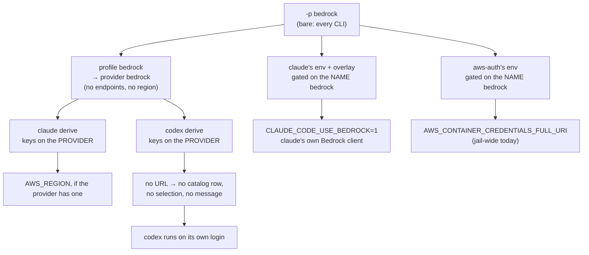

# Providers and profiles, redesigned: what `-p <name>` should mean

**Status:** 2026-09-25. [PP-D13](#PP-D13) to [PP-D15](#PP-D15) ruled and built 2026-10-11: in a jail a profile choice overrides the imported host settings, every launcher makes an agent's provider variables the selection's, and no capture records an edit at a provider key. [OQ-BR8](#8-decision-ledger) and [OQ-BR2](#8-decision-ledger) ruled 2026-09-29 (key facts on the provider, recognized by its `platform` field), and [PP-D1](#PP-D1) the same day; all three **built 2026-09-29** ([§8](#8-decision-ledger) has how), with the review's fixes the same day: a user's own provider of a platform co-claims its credential names ([PP-D9](#PP-D9)), a switch `yolo host apply` wrote is yolo's to clear and to name ([PP-D1](#PP-D1)), and a via no route carries claude through is disclosed ([PP-D4](#PP-D4)). Trap D5 is closed. [PP-D10](#PP-D10), the `profile` config key that mirrors `-p` and replaces `use_profiles`, was ruled and built the same day ([PP-D11](#PP-D11) has how). Triaged 2026-09-30: [OQ-PP2](#8-decision-ledger) is answered by [OQ-BR1](bedrock-plumbing.md#decision-ledger) with [OQ-WG2](wire-bridge-gateway.md#OQ-WG2), and [OQ-PP3](#8-decision-ledger) by [OQ-AP3](active-provider-sets.md#11-decision-ledger), whose launch line was found already built as the profile line's per-agent warning. [OQ-PP1](#OQ-PP1) stays open, restated against what those rulings built.
BUILT AND MEASURED BY TESTS ONLY: each moved fact is pinned where it is delivered, through the
credential gate and the shipped derives, for the shipped profile, a user's own profile over
`bedrock` and a user's own provider declaring `"platform": "aws-bedrock"`; no launch was run, no
agent was started and no request reached AWS.
MEASURED: the split between name-keyed gates and provider-keyed derives
([§2.2](#22-gates-key-on-the-name-derives-key-on-the-provider)), read at `7ad8358c`, re-read
at `f491d192`, and re-checked by grep at `ee8154f2` on 2026-09-24; the three copies of the
credential adapter's port and the test pinning all three against each other; every schema fact in
[§4](#4-the-marker-how-a-derive-recognizes-what-a-pick-is).
UNMEASURED: no launch was run for this doc. The loss a second profile suffers
([§2.1](#21-d5-a-second-profile-over-one-provider-silently-loses-every-gated-fact)) was measured
by a 2026-09-23 triage and re-derived here by reading the gates, not re-run.

**The question this doc answers.** When you type `yolo -p bedrock -- codex`, what did you
name? Today the answer is "a profile, which points at a provider, which some packs recognize by
the profile's spelling and others by the provider it resolves to". That answer produces four
confusions ([§2](#2-the-four-confusions)). This doc asks what a provider and a profile should
each mean, how a derive recognizes what a pick is, and whether any fact should key on a
profile's name at all.

**Why it exists.** It began as one question in [`bedrock-plumbing.md`](bedrock-plumbing.md):
[OQ-BR2](#8-decision-ledger), a proposed `service` marker on the provider kind. In review on 2026-09-25 the
maintainer did not rule it:

> *"a bigger decision than you're making it look … could potentially remake how we do providers
> and profiles … I already don't love providers and profiles. I find it very confusing … an
> opportunity to dive deep and change that but this sounds like a design doc on its own."*

[OQ-BR8](#8-decision-ledger) came with it, because it is the same function seen from the gate side.

**Where things stand.**

- **Built:** the provider system as [`providers.md`](../reference/providers.md) describes it —
  one composed provider table, profiles of exactly `{name, provider}`, and provider-keyed
  derives. Since 2026-09-29 a provider declares its `platform` ([OQ-BR2](#8-decision-ledger)), every
  shipped provider fact keys on the provider ([OQ-BR8](#8-decision-ledger)): packs/claude's
  endpoint-less `bedrock` provider declares `"platform": "aws-bedrock"`, claude's derive sets its
  Bedrock switch from that, and `packs/aws-auth`'s credential pointer gates on the platform. The
  name-keyed `profile` gate on `env` and `config-overlay` stays for a variant that really is a
  name; no shipped pack uses it.
- **Ruled, and binding here:** [OQ-BR4](../reference/providers.md#oq-br4) (2026-09-25): a
  profile's env must not leak to other agents, *"as specific as possible"*.
  [OQ-BR11](bedrock-plumbing.md#decision-ledger) (2026-09-24): claude gets a native Bedrock profile
  and an everything profile. [DIR-BR3](bedrock-plumbing.md#decision-ledger) (2026-09-25): yolo
  ships `bedrock-runtime` only. [OQ-BR5](bedrock-plumbing.md#decision-ledger) (2026-09-25): pi is
  supported both through its native Converse client and through the bridge.
- **Not ruled:** [OQ-PP1](#OQ-PP1), what `-p` names.

**Needs your ruling:** [OQ-PP1](#OQ-PP1), what is the one thing `-p` names? Its leaning, added
2026-09-30, is (a): keep the profile over a provider as built, since every ruling since has built
on the profile. The other four are settled, in the
[Decision Ledger](#8-decision-ledger): [OQ-BR2](#8-decision-ledger) (the marker is a `platform`
field), [OQ-BR8](#8-decision-ledger) (gates key on the provider, in each agent's own derive),
[OQ-PP2](#8-decision-ledger) (the transport is derived per agent, and a profile's `via` forces
the bridge) and [OQ-PP3](#8-decision-ledger) (one launch line naming the agents a bare `-p X`
does not reach, never a refusal).

**Out of scope, and where it lives.** The credential delivery gate:
[`providers.md`'s credential gate](../reference/providers.md#the-credential-gate), whose
[OQ-CN1](../reference/providers.md#oq-cn1) reads [OQ-BR8](#8-decision-ledger). Bedrock's provider
shape and profile names: [`bedrock-plumbing.md`](bedrock-plumbing.md)
([OQ-BR9](bedrock-plumbing.md#decision-ledger), [OQ-BR1](bedrock-plumbing.md#decision-ledger)). Model lists:
[`model-lists-and-pickers.md`](model-lists-and-pickers.md). The deselection state machine:
[the providers reference](../reference/providers.md#deselection-clear-what-yolo-wrote-keep-what-the-user-wrote). Routing all traffic through the wire bridge:
[`wire-bridge-gateway.md`](wire-bridge-gateway.md). Rewriting
[`providers.md`](../reference/providers.md) happens only after this doc rules.

---

## 1. Today's model, in plain words

[`providers.md`](../reference/providers.md) is the as-built reference. This section is the
short version, and it restates nothing that reference owns.

**Provider and profile, in two sentences.** A
**provider** is a place models are served from (Bedrock, OpenRouter, a local server): its address
if it has one, its region, its model ids, and the name of the variable holding its key. A
**profile** is the name you type after `-p`; it picks one provider, plus options such as the
starting model.

The rest of today's model:

- **Who declares them.** Packs ship providers; the user's `providers` key overrides them. Each
  provider also lists the wire protocol each endpoint speaks and the options a profile may tune.
- **What a profile carries.** A pack's profile is exactly `{name, provider}`
  ([OQ-PT8](../reference/providers.md#oq-pt8)); a user's may add option values. Anything a pack
  does differently under a profile is a separate contribution carrying a `profile: "<name>"`
  gate.
- **Catalog versus selection.** A provider that reaches an agent is listed in that agent's
  directory of providers (catalog, by presence). Telling the agent to *use* it is a separate,
  explicit act (selection, by `-p` or `use_profiles`).
- A **derive** is the Lua hook in an agent's own pack that turns the provider table and the
  selection into that agent's config and environment, in that agent's vocabulary.
- An **endpoint-less provider** names no URL. It is correct where the agent's own client
  composes the URL itself, as claude's Bedrock mode does from a region.
- **Why derives key on a URL.** Every derive but claude's asks one predicate — a
  `providerEndpoint` helper returning nil when the provider has no URL for the protocol that
  agent speaks — and gates its catalog row and its selection on it. So an endpoint-less
  provider is invisible to codex, pi, opencode, oh-omp and copilot.
- **A bare `-p X`** keys the name onto every CLI the selected packs install; `-p codex=X`
  keys it onto one.

### 1.1 One worked example: `-p bedrock` on claude, and on codex

For **claude**, three separate mechanisms together make Bedrock happen. The derive sees the
provider; two name-gated contributions switch claude into its native Bedrock mode and point the
AWS SDK at the credential adapter. For **codex**, the derive finds no URL and writes nothing,
and protocol resolution calls an endpoint-less provider "Direct against the agent's first-party
API" ([protocol-resolution.md](../reference/protocol-resolution.md#degenerate-inputs-and-what-each-resolves-to)),
so nothing refuses and nothing reports. codex goes on talking to OpenAI. Meanwhile the wide env
gate fires claude's and `aws-auth`'s variables for the whole jail — the leak
[OQ-BR4](../reference/providers.md#oq-br4) ruled must end.

### 1.2 Where the Bedrock split ended up

Which agent reaches Bedrock by which transport:
[bedrock-plumbing, Where the split ended up](bedrock-plumbing.md#where-the-split-ended-up). Where
the transport *lives* in the schema is this doc's [OQ-PP2](#8-decision-ledger).

---

## 2. The four confusions

### 2.1 D5: a second profile over one provider silently loses every gated fact

> [!NOTE]
> **Closed 2026-09-29** by [OQ-BR8](#8-decision-ledger)'s build: every fact below keys on the
> provider now, and a user profile `bedrock-sso` over `bedrock` gets all of them, as does a user
> provider with `"platform": "aws-bedrock"`. The text below is the trap as it stood.

**D5** (a trap label carried from bedrock-plumbing; closed). Every
`profile:`-gated contribution matches the profile NAME literally, while every derive matches
the PROVIDER the name resolves to. So a user profile `bedrock-sso` over provider `bedrock`
validates and selects, and then `-p bedrock-sso` delivers at most the provider's region. It
loses, silently:

- `CLAUDE_CODE_USE_BEDROCK` from claude's `bedrock`-gated `env` (`packs/claude/pack.json`);
- the `bedrock`-gated `claude/settings` overlay, in the same file;
- `aws-auth`'s `AWS_CONTAINER_CREDENTIALS_FULL_URI` pointer (`packs/aws-auth/pack.json`).

claude may then run first-party on whatever login it holds. Nothing reports it, by rule: an
inactive gate is a clean skip. MEASURED by the 2026-09-23 triage; INFERRED that no request
reached AWS. D5 is the twin of D2 (the wide env gate, now
[OQ-BR4](../reference/providers.md#oq-br4)'s): D2 fires a gate for the wrong agent, D5
fails to fire it for the right one.

**It breaks a case the design called supported.** The deleted
`provider-catalog-and-selection.md` (*What a profile is*, `git show
4e4ca2d1^:docs/design/provider-catalog-and-selection.md`, line 398) names *"a user adding a
second intent over the same provider"* as the case selection resolution exists for. The
SELECTION half was fixed: `ProviderFor` reads the resolved table, user profiles included. The
GATE half never moved. SOURCED from git history.

**It is about to become routine.** [OQ-BR11](bedrock-plumbing.md#decision-ledger)'s everything
profile is a second claude profile over the Bedrock provider — D5's exact shape. It must not
set the name-gated `CLAUDE_CODE_USE_BEDROCK`, yet `aws-auth`'s pointer must still reach the
bridge.

### 2.2 Gates key on the name, derives key on the provider

MEASURED at `7ad8358c`, re-read at `f491d192`, re-checked at `ee8154f2`:

| Consumer | Keys on | Where |
| :--- | :--- | :--- |
| `env` gate | the literal NAME: `EnvFold` → `profileActive` → `installsActiveBin`, `profiles[bin] == name` | [`packload.go`](../../internal/packload/packload.go) |
| `config-overlay` gate | the literal NAME: `profiles[key.Agent] != ov.Profile` | [`packoverlay.go`](../../internal/packoverlay/packoverlay.go), `Collect` |
| surface derive | the PROVIDER: `packload.ProviderFor(resolved, profiles[s.Agent])` | [`packsurfaces.go`](../../internal/entrypoint/packsurfaces.go), `surfaceSelectionFor` |
| env derive | the PROVIDER: `selected := ProviderFor(cfg.resolved, profile)` | [`deriveenv.go`](../../internal/packload/deriveenv.go) |

Neither gate file calls `ProviderFor`. **Not Bedrock-specific:** the same name gate ships
twice more, MEASURED — `packs/pi/pack.json` gates the codex prelaunch env on the name `codex`,
and `packs/llamacpp/pack.json` gates `CLAUDE_CODE_ATTRIBUTION_HEADER=0` on the name
`llamacpp`.

### 2.3 The transport has nowhere to live

**Transport** (coined here) is which client carries an agent's model traffic to a provider:
the agent's own native client, or the wire bridge. Today it is never declared. It falls out of
three unrelated facts:

- for an endpoint-ful provider, the `adapter` pass composes the bridge's address into any
  provider that offers `openai` and lacks `anthropic`, and the resolver then *"cannot tell an
  adapted pairing from a native one"*
  ([protocol-resolution.md](../reference/protocol-resolution.md#the-four-outcomes));
- for claude on Bedrock, native mode is a name-gated env variable;
- for an endpoint-less provider, nothing distinguishes "the agent's first-party API" from "the
  agent's native Bedrock client".

So the everything profile can only express "use the bridge" by being a different profile
name, which is D5; and [OQ-BR1](bedrock-plumbing.md#decision-ledger)'s naming question could not be
answered, because the thing the names should describe had no field. The maintainer's reading
was right: *"isn't it really provider native and then the wire bridge."*

### 2.4 A bare `-p X` silently does nothing for an agent that cannot reach X

`-p bedrock` in a jail with claude and codex writes nothing for codex and says nothing
([§1.1](#11-one-worked-example--p-bedrock-on-claude-and-on-codex)). bedrock-plumbing's
degenerate-input rule states the same for agy, and for copilot until the bridge serves the
provider: *"nothing written, no warning"*. The launch line prints DECLARED and RECEIVED and
never "honored" ([OQ-10](../reference/providers.md#pv-oq-10)), because what a derive does is
unobservable from the launcher. That is [OQ-PP3](#8-decision-ledger), answered 2026-09-30: one launch line,
never a refusal.

---

## 3. Constraints any redesign keeps

- **Provider names are sole-owned across packs.** `KindProvider` combines with
  `CombineExclusive`, keyed by name (`internal/packdecl/kinds.go`): two packs shipping one
  provider name is a launch-refusing collision; one pack shipping two is ordinary. So no pack
  can add a field to another pack's provider row — `aws-auth` cannot annotate claude's
  `bedrock`. Profile names, by contrast, are sole-owned only *within* a pack: `bedrock` in two
  packs is two declarations sharing a selector value.
- **Two Bedrock providers are not a collision.** Two providers carrying the same marker are
  ordinary catalog rows, and only the selected one gets a selection key. It is the shipped case
  under bedrock-plumbing's two-provider fallback, and whenever a user declares a Bedrock provider
  of their own. Any marker design must keep it degenerate-safe.
- **"As specific as possible"** ([OQ-BR4](../reference/providers.md#oq-br4), 2026-09-25:
  *"no I don't want it to leak … certainly not Claude Code gets Bedrock"*). Every option below
  must deliver a provider's facts to the agent that selected it and no other. It is an input,
  not an answer.
- **No stringly-typed matches.** A derive testing `name == "bedrock-openai"` is what
  [`stringly-typed-references-principle.md`](../reference/stringly-typed-references-principle.md)
  forbids.
- **Core learns no agent's vocabulary** ([OQ-CS8](../reference/providers.md#oq-cs8)). What a
  marker or transport means for one agent is that agent's derive's business.

---

## 4. The marker: how a derive recognizes what a pick is

An endpoint-less provider needs a declared fact, because every derive but claude's keys
reachability on a URL. With a marker, codex's derive can say "this provider is Bedrock, select
my `amazon-bedrock-runtime` built-in and write `aws.region`" without a URL. The marker has
consumers queued behind it: bedrock-plumbing's native derives, the bridge's decision to sign,
and [OQ-BR22](bedrock-web-search.md#decision-ledger)'s search-preset gate.

The three candidates, and what the tree says about each:

| Candidate | Verdict |
| :--- | :--- |
| A declared field on the provider kind (drafted as `service: "aws-bedrock"`), open vocabulary, unknown values inert | The old leaning: explicit, greppable, survives a second regional service. Tolerating unknown values is the version-skew rule the open `endpoints` key set already follows |
| Match the provider by NAME in each derive | **Rejected.** Stringly typed; breaks the moment a user declares a Bedrock provider under another name |
| Implicit: "has `region`, has no `endpoints`" | **Fails today.** SOURCED: packs/claude's `bedrock` provider declares neither |

**Two costs the old leaning did not state** (MEASURED from the repo, 2026-09-24):

- **`service` already names something.** `kind: "service"` is the contribution kind
  `packs/wire-bridge` ships, an in-jail daemon. A provider *field* named `service` gives one word
  two meanings in one manifest vocabulary.
- **It lands in two schemas.** A user-declared provider's key set is CLOSED:
  `knownProviderKeys` in `internal/config/config.go` accepts `base_url`, `endpoints`,
  `wire_api`, `api_key_env_name`, `models`, `region`, `capabilities` and `options`, and refuses
  anything else. So a user's own Bedrock provider cannot carry the marker until it is added there
  as well as to `internal/packdecl`.

**What the marker is not.**

- **Not a `wire_api` value.** Bedrock is not a protocol: its native clients speak Responses,
  Converse and the AWS SDK's own shapes. A service name in the canonical protocol enum is the
  pass-through mistake [OQ-PT1](../reference/providers.md#oq-pt1) closed, one field over.
- **Not an `endpoints` key.** `validateProviderEndpoints` in `internal/packdecl/contributes.go`
  refuses an endpoint with no `base_url` (`endpoints[%q]: needs a "base_url"`), and a pack cannot
  ship a Bedrock URL, because the URL contains a region the pack does not know. MEASURED from the
  code.

**Why it is bigger than a field.** The marker answers "what service is this?", which is half of
what a pick means. The other half is "by which transport does *this* agent reach it?"
([§2.3](#23-the-transport-has-nowhere-to-live)). Adding the marker without deciding the
transport's home leaves the everything profile distinguished only by its name. That is why
[OQ-BR2](#8-decision-ledger) is asked beside [OQ-PP1](#OQ-PP1) and [OQ-PP2](#8-decision-ledger), not after them.

---

## 5. What waits on this doc

- **First deliverable: the marker ruling, or its replacement.** Then the field lands in
  `internal/packdecl` and `knownProviderKeys` with its tolerance behavior. This was
  bedrock-plumbing's build step 2. **Built 2026-09-29** (`packdecl.PlatformProblem`): a derive reads it as
  `ctx.selected_platform`, and claude's derive and aws-auth's pointer already key on it.
- **Built after it:** bedrock-plumbing's native derives (codex, opencode, pi), and
  [OQ-BR22](bedrock-web-search.md#decision-ledger)'s Bedrock gate on the search preset.
- **Not gated on it:** the bridge's SigV4 signer.
  [OQ-WG1](wire-bridge-gateway.md#decision-ledger) leans toward keying the signer on the upstream host
  rather than on a provider marker, so the signer does not wait here.
- **Built with [OQ-BR8](#8-decision-ledger):** closing D5, together with D2's fix under
  [OQ-BR4](../reference/providers.md#oq-br4), each with a test that fails when the call site
  is deleted. **Built 2026-09-29** ([PP-D2](#PP-D2) to [PP-D6](#PP-D6)).

---

## 6. Rulings this doc may reopen

| Ruling | What it settled | How this doc touches it |
| :--- | :--- | :--- |
| [OQ-CS9](../reference/providers.md#oq-cs9) | Profiles point at a provider; no `extends` | Rules out `bedrock-sso extends bedrock` ([OQ-BR8](#8-decision-ledger)). Under [OQ-PP1](#OQ-PP1) (b) or (c) it is moot for profiles, but may reappear as a provider-level `extends` |
| [OQ-PT8](../reference/providers.md#oq-pt8), 2026-09-01 | A profile is `{name, provider}`; its body moved onto name-keyed `profile:` contributions | Does **not** answer [OQ-BR8](#8-decision-ledger): name versus provider was a consequence, never a choice. [OQ-PP1](#OQ-PP1) (b) would make the `profile` kind an alias or delete it |
| [OQ-PT3](../reference/providers.md#oq-pt3) | A provider's fact is composed from the provider, not restated in a gated overlay | The precedent [OQ-BR8](#8-decision-ledger)'s leaning follows |
| [OQ-ES8](credential-sources-separation.md#OQ-ES8) | Still open: AWS's two-part credential has no declarative home | Same question as [OQ-CN1](../reference/providers.md#oq-cn1) from the credential side; a transport or marker field may give it one |

---

## 7. Open Questions

**Background to [OQ-PP1](#OQ-PP1), below: its options as filed, and as restated
2026-09-30.**

| Option | What `-p bedrock` names | Costs |
| :--- | :--- | :--- |
| **(a)** Today's indirection | a profile, which points at a provider | D5 survives unless [OQ-BR8](#8-decision-ledger) moves every fact to the provider; two names for one thing remain to explain. The cheapest path is (a) plus [OQ-BR8](#8-decision-ledger)'s leaning, which removes D5's harm without removing the indirection |
| **(b)** A provider directly, plus options | the provider `bedrock`; options ride the flag or `use_profiles` | D5 cannot exist. The `profile` kind of [OQ-PT8](../reference/providers.md#oq-pt8) becomes an alias or goes. A variant must be a second provider, and without inheritance it restates the first's facts — so [OQ-CS9](../reference/providers.md#oq-cs9)'s "no `extends`" returns as a question about providers. Pack profiles whose name differs from their provider (`codex` → `openai-codex`) need a migration |
| **(c)** A provider plus an explicit transport | the provider, and `native` or `bridge` per agent | D5 cannot exist, and the everything profile is spelled, not named. Every user must know what a transport is, and the flag grammar grows. Overlaps [OQ-PP2](#8-decision-ledger) |

> [!WARNING]
> **⚠ Restated 2026-09-30, same letters.** The rulings made around this question since it was
> filed have each built on the profile. [OQ-BR8](#8-decision-ledger) is built, so D5 is closed: a renamed profile over a
> shipped provider gets every fact. [OQ-AP1](active-provider-sets.md#11-decision-ledger) chose a list of
> PROFILES per agent over a list of providers, because a provider loses a profile's options
> (the start model among them). [PP-D10](#PP-D10) made `profile` the config key that mirrors
> `-p`. [OQ-BR1](bedrock-plumbing.md#decision-ledger) and [OQ-WG2](wire-bridge-gateway.md#OQ-WG2) put
> the force-the-bridge switch on the profile (*"this should be a property of the profile"*).
> The options now cost this:
>
> - **(a) Keep the profile, pointing at one provider.** Nothing moves. What is left of the
>   complaint is two nouns to explain, and that is a rewrite of
>   [`providers.md`](../reference/providers.md) in plain words, which this doc already defers
>   until it rules.
> - **(b) `-p` names a provider, and options ride the flag.** Everything since has to be
>   respelled: the `-p` list grammar and the `profile` key ([AP-D13](active-provider-sets.md#AP-D13),
>   [PP-D11](#PP-D11)), `bedrock-bridge` and a user profile's `via` as provider options, and
>   `-p codex` (today the profile `codex` over the provider `openai-codex`), which needs a
>   migration. A variant becomes a second provider that restates the first, so a provider-level
>   `extends` comes back as a question ([OQ-CS9](../reference/providers.md#oq-cs9)).
> - **(c) A provider plus a transport the user types.** Overtaken:
>   [OQ-BR1](bedrock-plumbing.md#decision-ledger) ruled the transport native by default and forced only
>   by configuration (*"by default we should pick the right thing, the native by default, but
>   we should allow configurations to force the bridge"*), and [OQ-PP2](#8-decision-ledger) is answered
>   the same way.

1. 💬 **[OQ-PP1](#OQ-PP1): What is the one thing a user names with `-p`?**
   The redesign's core. Each option, [as filed and as restated 2026-09-30](#oq-pp1-background),
   in brief:

   - **(a) Keep the profile, pointing at one provider.**
   - **(b) `-p` names a provider, and options ride the flag.**
   - **(c) A provider plus a transport the user types.** Overtaken:
     [OQ-BR1](bedrock-plumbing.md#decision-ledger) ruled the transport native by default and forced only
     by configuration.

   <!-- vantage: question id=OQ-PP1 leaning="(a), keep what is built: -p names a profile, and a profile points at one provider plus its options. D5 is closed (OQ-BR8), and every ruling since built on the profile (OQ-AP1's lists, PP-D10's profile key, OQ-WG2's via). The remaining cost is two nouns to explain, which is a plain-words rewrite of providers.md, not a schema change. (c) is overtaken by OQ-BR1." -->

   _Leaning (⚠ added 2026-09-30):_ **(a), keep what is built.** The doc first had no leaning,
   deliberately, so as not to steer the redesign. Since then [OQ-BR8](#8-decision-ledger) has closed D5 and
   the rulings above have steered it: each built on the profile. What the maintainer *"already
   doesn't love"* is having two nouns, and that is now a documentation problem. (b) would reopen
   the shipped rulings above to remove it. The first strawman was (b), because it deleted the layer D5
   lived in, and that reason went when D5 was closed.

   **Answer:**
   > _(empty — fill in when decided)_

---

## 8. Decision ledger

| ID | Ruling / Decision | Date | Built |
| :--- | :--- | :--- | :--- |
| OQ-BR8 | **Maintainer ruling:** a provider fact keys on the provider, in each agent's derive, never on the profile's name. *"just because you have a differently named profile here doesn't mean that things should happen differently. So we need to fix this bug. Like you need to be able to define your own and get the same behavior."* A user-defined provider gets the same behavior through [OQ-BR2](#8-decision-ledger)'s marker | 2026-09-29 | ✅ [PP-D2](#PP-D2) to [PP-D6](#PP-D6) |
| OQ-BR2 | **Maintainer ruling:** the marker is a declared provider field, `platform` (for example `"platform": "aws-bedrock"`), open vocabulary, unknown values inert, accepted by both `internal/packdecl` and `knownProviderKeys`; a derive recognizes a provider by it, never by a name | 2026-09-29 | ✅ [PP-D7](#PP-D7) |
| PP-D1 | **Maintainer ruling, from a rollout review:** yolo obeys a Bedrock switch (`CLAUDE_CODE_USE_BEDROCK`) that a user wrote in their own Claude settings, and when no Bedrock provider is selected for claude, so the credential gate sends it no AWS credential, the launch prints one line naming the conflict and both fixes (`-p bedrock`, or remove the key). yolo deletes nothing it did not write: the maintainer's *"there could be any uncountable number of environment variables … that we can just like never know about"* rules deletion out; the line exists because the gate is yolo's, so the failure is yolo's to name. **The same premise read from yolo's side** (review, 2026-09-29): a switch `yolo host apply` wrote into the real file for claude's host selection is yolo's, so the next apply that stops asserting it removes it ([HC-D25](../reference/host-agent-environment.md#HC-D25)), and while it is there the line names it as yolo's write, never as the user's | 2026-09-29 | ✅ [PP-D8](#PP-D8); yolo's own write [HC-D25](../reference/host-agent-environment.md#HC-D25) |
| PP-D2 | *Implementation decision.* **Where each name-gated fact went.** claude's `CLAUDE_CODE_USE_BEDROCK`, in env and in `claude/settings`, into claude's own derive, set when `ctx.selected_platform` is `aws-bedrock` and the profile routes through no via service. claude's and pi's OpenAI login prelaunch into their env derives (pi gained a `yolo.env` producer), keyed on the selected provider `openai-codex`: that provider is every agent's built-in subscription provider id, which the derives already match by name, so it takes no platform. llamacpp's `CLAUDE_CODE_ATTRIBUTION_HEADER` became the provider option `attribution_header: "false"`, which claude's derive translates; only claude receives it now. aws-auth's pointer: PP-D3 | 2026-09-29 | ✅ `nativeBedrock` in packs/claude's derive |
| PP-D3 | *Implementation decision.* **aws-auth's pointer rides a `platform` gate on its `env` contribution, not a composed provider row.** The ruling's shape was "composed into a provider row, as openai-codex's endpoints are". The pointer carries a per-launch secret (`{caller_token}`) that no composed table may hold ([providers.md](../reference/providers.md#what-this-does-not-license)), and its `served_by` and `overridden_by` declarations live on the contribution. So `env` takes a second gate, `platform: "
"`, which fires for each agent whose selected provider declares that platform: the recipients a row composed into every such provider would have had. One gate per contribution, `profile` or `platform` | 2026-09-29 | ✅ aws-auth's `env` `platform` gate |
| PP-D4 | *Implementation decision.* **The everything profile's split is a transport check.** claude's native switch requires `ctx.via_url` empty, so a profile over the Bedrock provider with `via: "wire-bridge"` gets aws-auth's pointer and not the switch. At `yolo host`, which serves no via, the same profile falls back to claude's own client and sets the switch. ⚠ **Claude has no via route**, found in review: claude speaks `anthropic`, and the via route passes only the two OpenAI wires. Since 2026-09-30 the everything profile carries claude through the bridge's adapter route instead, on an anthropic address composed for the via ([`wire-bridge-gateway.md` WG-I39](wire-bridge-gateway.md#WG-I39)); before that such a profile ran claude on its own login with a pointer nothing used. The via-route gate still discloses a via that carries none of an agent's requests, naming the agent's own switch for the provider's platform (`unroutedViaNotice`), and never refuses it: a Bedrock provider whose anthropic address is its own is one | 2026-09-29 | ✅ `nativeBedrock`; the disclosure `unroutedViaNotice` |
| PP-D5 | *Implementation decision.* **One selection answers every gate.** `packload.GateSelection` carries each agent's profile and the platform of the provider it resolves to (`SelectionOf`, over the launch's own table). The credential gate builds it and hands it out (`CredentialScope.Selection`); the fold, the env-override pre-flight at both notches and `yolo check` read that one. The jail-daemon payload is decided before the channel composes, so it builds the same selection itself (`daemonSelection`), and aws-auth's adapter starts for a user profile over `bedrock` and for a user Bedrock provider | 2026-09-29 | ✅ `packload.GateSelection` |
| PP-D6 | *Implementation decision.* **The `profile` modifier stays; shipped packs stop using it.** A name gate still suits a variant that really is a name, and a user's local pack may carry one. `TestNoShippedPackKeysAFactOnAProfileName` fails if a shipped pack reintroduces one. Consequence: pi's new env producer ends the host's "nothing reads the table" excuse for pi on a codex profile whose provider no selected pack ships; the shipped pi `needs` openai-auth, so only a hand-built pack set meets that refusal | 2026-09-29 | ✅ pinned by `TestNoShippedPackKeysAFactOnAProfileName` |
| PP-D7 | *Implementation decision.* **`platform` is shape-checked and user-scope only.** One token, no whitespace (`packdecl.PlatformProblem`, shared by the manifest and config validators). A workspace `providers.<name>.platform` is refused like `api_key_env_name`, because the platform gate decides which agents receive aws-auth's pointer. Exposed to a derive as `ctx.selected_platform`, read off the selected provider's composed row | 2026-09-29 | ✅ `packdecl.PlatformProblem` |
| PP-D8 | *Implementation decision.* **The switch is the agent pack's declaration.** Core names no agent's file or variable, so a program declares `platform_switches` (`{platform, surface, pointer}`); packs/claude declares `aws-bedrock` at `/env/CLAUDE_CODE_USE_BEDROCK` in `claude/settings`. `packload.PlatformSwitchConflicts` reads it from the user's own copy of that `readsHost` surface, on when true, 1, yes or on. The line prints before the provider pre-flight on every jail arm (fresh container launch, attach, macos-user) and at `yolo host --`; it offers a declared profile over a provider of the platform with no via. It says what yolo delivers, not that the launch fails: at `yolo host` the user's own credentials may still serve claude. Not read: a switch captured from an in-jail edit of the settings file, and the process environment | 2026-09-29 | ✅ `packdecl.PlatformSwitch` |
| PP-D9 | *Implementation decision, revised by the review the same day.* **The credential claims follow the platform.** A composed provider that declares a `platform` and no `api_key_env_name` of its own co-claims every name a same-platform provider in the composed table lists (`packload.credentialClaims`); one that lists its own keeps exactly those, and only a provider's own list is inherited. So a user's `"platform": "aws-bedrock"` provider keeps the six AWS names the shipped `bedrock` claims ([CN-D2](../reference/providers.md#CN-D2)) to its agents, like the region variables, which are a platform fact too ([BR-D1](bedrock-plumbing.md#BR-D1)). The first build left the claims out and said such a key "reaches every process"; the review measured the opposite: the shipped `bedrock`, always in the table beside it, still claimed the names, so the gate withheld them from every process, the agent on the user's provider included, and claude started in Bedrock mode with no AWS credential and no word of it. The claim model still reads the composed table alone: the platform is a field of the composed entry, and the pre-flight, which asks for exactly one named key, is unchanged | 2026-09-29 | ✅ `packload.credentialClaims` |
| PP-D10 | **Maintainer ruling** (in chat): *"yes, let's go with your profile proposal. fire that off now."* The proposal it accepted: the persistent selection becomes the `profile` key, mirroring `-p`/`--profile` exactly. `"profile": "bedrock"` is `-p bedrock` (every agent); `"profile": { "pi": "codex", "claude": "bedrock" }` is `-p pi=codex,claude=bedrock`; `"profile": { "*": "bedrock", "pi": "codex" }` is `-p bedrock -p pi=codex`, *"`"*"` is every agent not named"*; and a list value (`{ "pi": ["zai", "openrouter"] }`) once the provider-list build lands (built 2026-09-30 as [AP-D13](active-provider-sets.md#AP-D13): `{ "pi": ["zai", "openrouter"] }` is `-p pi=zai,openrouter`, and the list form and a list under `"*"` are `-p zai,openrouter`). *"`"*"` can't collide with an agent, because agents are named by the program they install and no program is called `*`."* `use_profiles` is *"refused by name, with the new spelling in the message"*. It *"stays user-scope only, as today: a repo's committed config can't pick where your credentials go."* The key follows whatever [OQ-PP1](#OQ-PP1) decides `-p` names. The cost the maintainer accepted: `profile` (which to use) and `profiles` (the declarations) differ by one letter | 2026-09-29 | ✅ [PP-D11](#PP-D11); the list value ✅ 2026-09-30 ([AP-D13](active-provider-sets.md#AP-D13)) |
| PP-D11 | *Implementation decision.* **One shape and one fold for both spellings, and a pair keeps its CLI beside a bare `-p`.** The key and every `-p` value lower to `config.ProfileSelection` (a default and per-CLI entries), and `config.ProfileTableFor` is the one function that turns selections into the CLI-keyed table, at the jail launch, `yolo host --` and `yolo host env`, `yolo host apply`, the host footer, the overlay gate, `yolo check` and the selection closure. The precedence between the two sources is kept: every `-p` form beats every key form for each CLI it reaches. Within one source a named CLI keeps its entry and the default reaches every other CLI the selected packs install, never the command after `--`. That is a change to `-p`, which the ruling's equation requires: a bare `-p` was folded last and overwrote a pair typed beside it, so `-p bedrock -p pi=codex` ran pi on bedrock. A null entry keeps `"*"` off its agent; an empty name is refused, null being the spelling of none. At `yolo host` the default reaches the one command only when a selected pack installs it, so an ad-hoc command is neither refused nor handed a profile. `use_profiles` is an error on the host, respelling the user's own entries under the new key, at every host reader of the selection: `yolo host --` and `yolo host env`, `yolo host apply` in both postures, the automatic apply a wrapped launch runs (asked before its observe pass) and `yolo config render --at host` each run the provider and profile section of validation over user scope. The review found the first build refusing it at the two launch verbs alone: `yolo host apply --assert` read the selection off the new key, ignored the old one, and deselected the profile an earlier apply had written into the real home. It is a warning in-jail, where a snapshot an older launcher wrote carries it (the `agent_profiles` precedent); a workspace carrying it gets the rename and the user-scope refusal together. What crosses into a jail is unchanged: `YOLO_USE_PROFILES` is the folded table, the derive still reads it as `ctx.use_profiles`, and the inherited snapshots carry `profile` verbatim, `"*"` included. The list value landed where this row said it would, in the two fields of `ProfileSelection`, which are now ordered lists ([AP-D13](active-provider-sets.md#AP-D13), 2026-09-30): `config.ParseProfileFlag` reads -p's comma continuation, `ProfileSelectionOf` a JSON array, `validateProfile` checks both shapes, and the fold (`config.FoldProfiles`, whose table `ProfileTableFor` returns) emits a set and narrows a list naming no agent (the key's list form, a list under `"*"`, a bare `-p`) to its first entry for an agent whose pack declares no `provider_sets`, saying so at launch. The precedence and the pair-beside-a-bare-`-p` rule above are unchanged | 2026-09-29 | ✅ `config.ProfileSelection`, `config.FoldProfiles` and `config.ProfileTableFor`; pinned by `internal/cli/profilekeyflag_test.go` (its list rows included), `internal/cli/run/profilekey_test.go`, `internal/cli/hostprofilekey_test.go` and `internal/config/profileselection_test.go` |
| PP-D12 | *Implementation decision.* **The "reaches nothing" warning names the source of the selection and the spelling that undoes it there.** Where a selection reaches nothing for an agent (its provider names only a platform no selected pack binds for it), the warning used to end "Select a profile whose provider agy reaches (`-p agy=<name>`), or none for agy", so a selection the `profile` key made repeated on every launch naming only a flag. It now says which of [PP-D11](#PP-D11)'s two sources reached the agent, -p beating the key: for the key, its file, line and column (the user scope's record, read only on this path) and the key respelled with a null for the agent, ``write `"profile": {"*": "bedrock", "agy": null}` there``, or `-p agy=` for one launch; for -p, the `-p agy=` pair alone, since nothing persistent wrote it. `config.ProfileDeselection` words it, and the jail launch hands it to `packload.ProfileDisclosureInput.Deselect`. `yolo host --` gets the key half unchanged, since it folds the key through the same `FoldProfiles` and a null deselects there too, but not the -p half: its `-p` names its one command and refuses `-p agy=`, so a typed `-p` is undone by leaving it out, followed by the key's fix when the key selects for the command as well (`config.HostProfileDeselection`). In a jail the user config is a read-only copy the host generated, so the key's spelling is to be written in the host's user config; a `--user-layer` file, which the jail's own caller writes, keeps the plain "there" | 2026-10-05 | ✅ `config.ProfileDeselection` and `config.HostProfileDeselection`; pinned by `internal/cli/run/profiledeselect_test.go` and `internal/cli/hostprofiledeselect_test.go`, which write the printed spelling back and find the warning gone, and `internal/config/profileselection_test.go` for the in-jail form |
| PP-D13 | **Maintainer ruling** (in chat): *"Inside of JAIL, if we're not already managing the host config, I would say a profile choice does override the host settings file being imported."* At a jail, a [provider key](../reference/providers.md#provider-keys-the-selection-decides-them) that the user's own host copy sets (folded in as the host layer, which happens only while host management is off) is taken out of the bytes the jail composes. The selection alone decides the key there: its value lands when it sets one, and otherwise the key is absent. The boot names each key it took out, with the host file. Narrows [PP-D1](#PP-D1) at the jail only: yolo still never edits the user's real file, and nothing changes where the host copy is yolo's own render (a baseline, never a layer) or at `yolo host`. *Implementation:* the launcher's PP-D1 line at a jail now says the jail leaves the switch out, and offers the profile that would use it there | 2026-10-11 | ✅ `agentcfg.DropHostProviderKeys`, called by `entrypoint.renderPlannedSurface`, and `PlatformSwitchConflict.InJail`; pinned by `TestAProfileChoiceOverridesTheImportedHostSettingsInAJail` and `internal/cli/run/platformswitch_test.go` |
| PP-D14 | **Maintainer ruling** (in chat): *"Yes, a Claude started from a Claude shell needs to follow the same auth path everywhere."* Every launcher of an agent, at every notch (a container jail, macos-user, `yolo host`), makes the agent's provider variables exactly what its profile selection says. A value the selection sets is exported as is, never as a default an inherited value beats. A variable it does not set is removed, unless the selected provider itself reads it from the environment (a credential it claims, a region of its platform). A Bedrock-only model id is removed only while the agent is off Bedrock. The launch names what it replaced or cleared. **This narrows [OQ-CN8](../reference/providers.md#oq-cn8)** (2026-09-28, "the user's explicit value wins"), the rule the env file's `${VAR:-…}` form exists for: it now holds only for a variable that is not a provider key, so `ANTHROPIC_MODEL=opus claude` still works and `export ANTHROPIC_BASE_URL=…` before `claude` no longer does. *Implementation decisions:* the variables are the pack's provider keys under the object its new top-level `provider_env` names (`claude/settings` at `/env`), so core lists none. In a jail they go in a second per-agent file, `~/.config/yolo-agent-env/provider-keys/<agent>.sh`, sourced after the env file and written for every agent whose pack declares them, a profile-less one included, because the env file's grammar is read back by the macos-user MCP view and the wire bridge | 2026-10-11 | ✅ `packdecl.Manifest.ProviderEnv`, `packload.CredentialScope.ProviderEnv`, `run.providerEnvFileContent` (through `writeAgentEnvFiles`), `entrypoint.agentEnvShellFn`, `hostComposition.environ`; pinned by `TestAClaudeStartedFromAnotherClaudesShellFollowsItsOwnSelection`, `TestTheLaunchersSourceTheProviderKeysFileLast`, `TestAnImageProvidedAgentWithOnlyAProviderKeysFileGetsACarrier` and `TestHostLaunchMakesClaudesProviderVariablesTheSelections` |
| PP-D15 | **Maintainer ruling** (in chat, lightly cleaned up from dictation): *"we should in fact overwrite that. That's just the way precedence works… the profile should [win]… you can set your profile if you want and restarting the jail shouldn't change that… it would then be put back after the jail restart but it would persist while the jail is running and that seems more dangerous."* A provider key behaves like a managed key. The boot re-asserts the selection at every render (it drops a captured value at one), and a capture (`yolo config capture`, the fold at a jail's teardown) never records an in-jail edit at one. It refuses the edit, logs it in the capture log, and names it in one line pointing at the profile. An edit made while the agent runs is not blocked, since Claude Code rereads its settings file: it lasts until the next boot, which renders the selection's value and names the edit. *Implementation decision:* the capture drops only the unconditional keys, because a value-conditional key's verdict needs the selection, which the capture does not read; the boot decides those | 2026-10-11 | ✅ `cli.captureProviderKeys` in `captureSurfaceAt`; pinned by `TestTheCaptureVerbNeverRecordsAProviderKey` and `TestTheTeardownCaptureNeverRecordsAProviderKey` |
| OQ-PP2 | **Answered by [OQ-BR1](bedrock-plumbing.md#decision-ledger)'s ruling** (2026-09-29, the maintainer: *"by default we should pick the right thing, the native by default, but we should allow configurations to force the bridge"*) **and [OQ-WG2](wire-bridge-gateway.md#OQ-WG2)'s** (2026-09-25: *"this should be a property of the profile"*). The transport is derived per agent (a native client for the provider's `platform` or endpoints, else the bridge), and a profile's `via` forces the bridge. No provider declares a per-agent table, which also keeps agent knowledge out of providers ([OQ-CS8](../reference/providers.md#oq-cs8)) | 2026-09-30 | ✅ the native half for Bedrock ([BR-D9](bedrock-plumbing.md#BR-D9) to [BR-D14](bedrock-plumbing.md#BR-D14)); the forcing half, `bedrock-bridge` ([BR-D16](bedrock-plumbing.md#BR-D16)), carries every agent since the bridge reached Bedrock by region on 2026-09-30 ([`wire-bridge-gateway.md` WG-I39](wire-bridge-gateway.md#WG-I39)) |
| OQ-PP3 | **Answered by [OQ-AP3](active-provider-sets.md#11-decision-ledger)'s ruling** (2026-09-29, the maintainer: *"if you don't direct it at a specific agent, then we should print out a message showing you … these will only get the first one and the others will be ignored"*). A bare `-p X` names, on one launch line, each agent it does not reach, and never refuses, so a jail with several agents still launches | 2026-09-30 | found built 2026-09-30 as the profile line's per-agent warning (`packload.profileReach`), one line per agent rather than one line naming them all, and whether that form is the ruled one is unconfirmed; pinned by `TestNoteUseProfilesWarnsWhereTheSelectionReachesNothing` |

## Appendix: Evidence, and how to re-check it

Repo claims re-checked at `ee8154f2` on 2026-09-24. Re-run these rather than trusting the text.

| Claim | Label | Re-check |
| :--- | :--- | :--- |
| Neither gate calls `ProviderFor`; both derives do | MEASURED | `rg -n ProviderFor internal/packload/packload.go internal/packoverlay/packoverlay.go internal/entrypoint/packsurfaces.go internal/packload/deriveenv.go` |
| The env gate's wide pass matches any installed bin | MEASURED | `profileActive` and `installsActiveBin` in [`packload.go`](../../internal/packload/packload.go) |
| Name gates in claude, aws-auth, pi and llamacpp | MEASURED | `rg -n '"profile":' packs/claude/pack.json packs/aws-auth/pack.json packs/pi/pack.json packs/llamacpp/pack.json` |
| The adapter port `127.0.0.1:1461` is written three times | MEASURED | `rg -n 1461 internal/awscredadapter/handler.go packs/aws-auth/pack.json packs/aws-auth/loopholes/aws-auth/manifest.jsonc` — `DefaultListen`, the daemon's `--listen`, the pointer's value |
| All three shipped copies are pinned against each other; a user pack's copy is checked by nothing | MEASURED / INFERRED | `TestAWSAuthPointerAndAdapterAgreeOnThePort` in [`aws_auth_pointer_test.go`](../../packs/aws_auth_pointer_test.go) builds the wanted URI from `awscredadapter.DefaultListen`, then checks the pack's pointer and the manifest's `jail_daemon` `--listen` against it. It reads only the embedded packs, so a user pack's fourth copy is unchecked (INFERRED) |
| Provider names are sole-owned, by name | MEASURED | the `KindProvider` row in [`kinds.go`](../../internal/packdecl/kinds.go), `Combine: CombineExclusive` |
| A user provider's keys are closed | MEASURED | `knownProviderKeys` in [`config.go`](../../internal/config/config.go) |
| An endpoint needs a `base_url` | MEASURED | `validateProviderEndpoints` in [`contributes.go`](../../internal/packdecl/contributes.go) |
| `service` is already a contribution kind | MEASURED | `rg -n '"kind": "service"' packs/wire-bridge/pack.json` |
| claude's `bedrock` provider has no region and no endpoints | MEASURED | `packs/claude/pack.json`: the provider is a name and nothing else |
| Endpoint-less derives drop the provider | MEASURED | `providerEndpoint` in `packs/codex/derive.lua`, and its twins in pi, opencode and omp |
| D5's three losses | MEASURED 2026-09-23 triage, re-derived by reading, not re-run | select a user profile `bedrock-sso` over `bedrock` and diff `.yolo/home/yolo-user-env.sh` and `claude/settings` against `-p bedrock` |
| The supported "second intent" case | SOURCED | `git show 4e4ca2d1^:docs/design/provider-catalog-and-selection.md`, line 398 |
