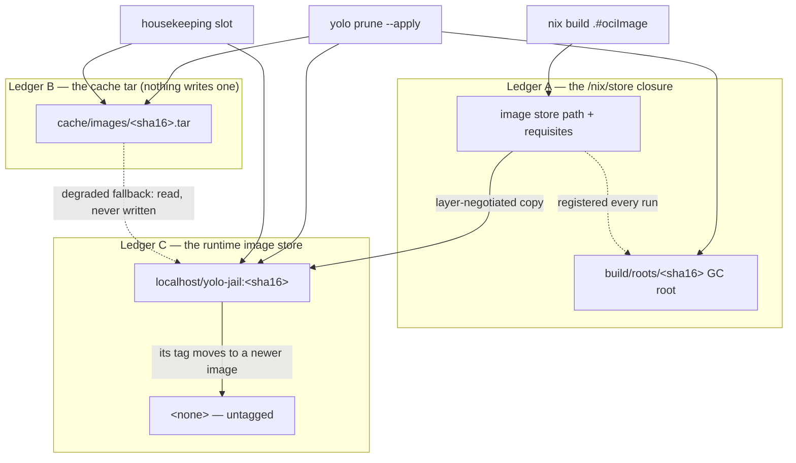

# Disk footprint — reclamation that runs without a human

**Status:** Verified 2026-10-16 against `8e65f3444`. MEASURED: every automatic class is pinned at
its call site and its callee by unit tests, the image reap and the owner label by real launches,
and the host's image-tar backlog read 0 B on 2026-09-14. UNMEASURED: the re-measure of the whole
machine after every reclaimer shipped, and the mise store after its first 30-day window
([owed](#owed-measurements)).

yolo writes bytes in many stores: the runtime's image store, `/nix/store`, the shared download
cache, the shared mise tool store, vendor version directories, captures and staging trees. Every
one of them has a reclaimer, an explicit statement that nothing reclaims it, or an owner that is
not yolo. Reclaimers run from the **housekeeping slot** of every launch, never from a timer, and
`yolo prune` is the recovery tool that runs the same functions by hand. `yolo stores` lists every
store, its size and who, if anyone, reclaims it.

This reference was graduated from two design docs, `minimal-disk-footprint.md` (the image
ledgers and the reclaimer invariants) and `disk-levers-and-backfill.md` (the backfill policy, the
slot and the inventory), and from the lifecycle-sweep half of the plan `storage-lifecycle.md`.

| Component | Lives in |
| :--- | :--- |
| The housekeeping slot, its locks and its per-class debounce | `internal/cli/run` (`runHousekeeping`, `withHousekeepingPass`, `classDebounce`) |
| The offered tier: the prompt and the recorded answers | `internal/cli/run` (`offer.go`) |
| The image reap (Ledger C) | `internal/prune` (`AutoReapOldImages`, `PruneOldImages`), `internal/cli/run` (`autoreapimages.go`) |
| Image tars (Ledger B) | `internal/prune` (`PruneImageCache`, `ResolveImageCacheKeep`) |
| yolo's own store outputs and the prefix roots | `internal/prune` (`storeoutputs.go`, `LivePrefixSources`, `PruneOrphanPrefixRoots`), `internal/image` (`RegisterPrefixRoot`) |
| The shared cache's age purge | `internal/prune` (`PurgeCacheByAge`, `CachePurgeDefaultSubdirs`) |
| The host content-addressed cache alias | `internal/hostcas` (`Stores`, `Plan`), `internal/cli/run` (`hostcasalias.go`) |
| The mise use record and its reclaimer | `internal/miseuse`, `internal/entrypoint` (`miseuserecord.go`), `internal/prune` (`miseversions.go`) |
| The inventory and its sample ledger | `internal/cli/stores` |
| Lifecycle sweeps | `internal/prune` (`staleoutlinks.go`, `agentstaging.go`, `agentlogs.go`) |

**Reads with:** [`image-retention.md`](image-retention.md) (what the image and GC-root reapers
may delete, and on what evidence), [`image-staging-vs-baking.md`](image-staging-vs-baking.md)
(how an image is built and delivered), [`storage-and-config.md`](storage-and-config.md) (where
these stores live), [`in-jail-nix-roots.md`](in-jail-nix-roots.md) (roots a jail makes).

---

## Principles

### The reclaimer invariants

<a id="reclaimer-invariants"></a>

Numbered so code comments can cite them; `internal/capture`, `internal/prune` and the image
loader do.

**P1. A running jail's image closure is reachable from a durable GC root at every instant.** The
root is re-asserted on every run before the build's ephemeral out-link is dropped, so there is no
unrooted window ([a GC is safe at any moment](image-retention.md#a-gc-is-safe-at-any-moment)).

**P2. Reclamation is fail-safe on unknown liveness.** If yolo cannot enumerate the running jails,
it reaps nothing. Every liveness-gated sweep has this polarity.

**P3. Deleting a cache tar never strands a running jail.** A tar is a one-shot load artifact; the
runner depends on the store closure. This is what licenses deleting tars aggressively, so it is
the invariant to guard hardest: anything that makes a tar load-bearing at run time (a lazy
re-load, a rollback that reads it) breaks it.

**P4. No reclaimer may delete an artifact an in-flight launch is between steps on.** It is honored
by naming and by recovery, not by a lock: an in-flight archive is named so no sweep matches it or
is spared by an age floor, and the one reader a reclaimer can still race, the degraded tar
fallback, re-verifies each candidate at the point of use and moves on when one vanished.

> [!WARNING]
> **A reclaimer's reach is a filename pattern, and a write path can start matching it without
> anyone editing the reclaimer.** That is how the `*.tmp` sweep under `cache/images` came to
> delete an in-flight delivery's archive, fixed by an age grace floor. A new writer under a
> swept directory must check what the sweeps there match. Do not read P4 as a lock: nothing asks
> a deleter's permission.

**P5. yolo never carelessly collects the host store.** Store deletion is bounded, rooting-aware,
host-only, and scoped to paths yolo itself realized; never a blanket collect.

**P6. yolo does not manage host symlinks or mounts as a general primitive.** A layout a human
declared, which yolo consumes, is the only acceptable shape
([`cache-relocation.md`](../plans/cache-relocation.md)). No reclaimer may become a way around it.

**P7. A reclaimer must be safe to run at an arbitrary moment.** An automatic trigger makes this
literal: the slot runs whenever any jail starts, including while others are mid-build. Anything
added here closes its race before, or in the same change as, it gains a trigger.

### The backfill rules

<a id="backfill-rules"></a>

Two terms, coined in the design doc this reference replaces:

- **Steady-state retention** — bounding what a mechanism produces from now on: a reaper with a
  trigger, or a write path that leaves nothing behind. It says nothing about what is already on
  disk, and it is a rule, not a byte budget.
- **Backfill** — the bytes a mechanism put on disk before its steady-state fix shipped, which
  the fix stopped producing but did not remove. Not a leak (a leak is still growing). Its
  defining property: the reaper's own evidence usually does not reach it, because the bytes
  predate the reaper's records.

**BF-P1. Backfill and steady state get separate dispositions, decided per store.**

**BF-P2. A first pass over a backlog is a one-time event per store per machine, and its outcome
is recorded on disk.** After it the steady-state reaper owns the store.

**BF-P3. Automatic where the evidence is complete and regeneration is bounded and known** — "a
`nix build` or an image copy", not "a re-download of unknown size". Complete evidence means the
same veto that protects live state covers everything the pass could touch.

**BF-P4. Offered, at a launch on a terminal, with the measured size, where the evidence is
partial, the store is shared with the user's non-yolo work, or regeneration is expensive.** An
offer is a prompt, not a hint.

### Why a hint is not a trigger

Every reclaimer once existed, was correct and tested, and had exactly one caller: a human typing
`yolo prune`. `yolo prune` printed a hint whenever the image-tar cache passed a size threshold;
the hint was true for over a month, and the 125 tars it named, 404 GiB, were still on disk byte
for byte ten days after they were first counted (MEASURED 2026-08-25). **A reclaimer whose only
trigger is a human noticing is a suggestion, not a mechanism.** So the delete lives in the
process that made the bytes, or in the launch that follows, and `yolo prune` is demoted to the
recovery tool for what crashed mid-write, what predates a fix, and what another backend left.

## The three ledgers of an image

One loaded image is stored three times, with three owners and three reclaim stories. A **ledger**
*(a term from the design doc this replaces)* is one of those copies.



### Ledger A — the store closure

<a id="ledger-a"></a>

Pinned by an indirect GC root under `build/roots/`, keyed by the same hash of the store path as
every other per-image artifact, and re-asserted on every run. Its reaper and its rules are
[`image-retention.md`](image-retention.md#gc-root-retention--age-except-under-a-running-image)'s.
Growth here is roots doing their job; what the store accumulates is unrooted paths, which is the
host's `min-free` setting ([the host's auto-GC](image-retention.md#the-hosts-auto-gc-warn-never-edit))
and, for yolo's own outputs, [the store-output reaper](#yolos-own-store-outputs).

### Ledger B — the cache tar

<a id="ledger-b"></a>

**No backend writes a retained tar.** Podman takes a layer-negotiating copy straight from the
store, and a backend that cannot (Apple Container, podman on macOS) gets a temporary archive the
launch removes, built in a per-attempt directory under the state dir's `image-delivery/`
([delivering into the runtime](image-staging-vs-baking.md#delivering-into-the-runtime)). What a
machine still holds is the legacy backlog.

- **The reaper** keeps the newest *keep* tars by modification time, drops the rest, and sweeps
  `*.tmp` older than a grace floor. *Keep* is per runtime: zero on podman, a few on Apple
  Container ([OQ-BF6](#why-its-this-way)).
- **The trigger** is the slot, on its own debounce, and `yolo prune`.

> [!WARNING]
> **Zero tars retained is not zero tars readable.** The degraded fallback (`newestTars`) still
> loads any `*.tar` it finds when a build failed or was skipped and the runtime holds no image.
> A change that "finishes" [OQ-DF1](#why-its-this-way) by deleting that reader removes the
> offline safety net the ruling kept. Temporary archives are named so the reader cannot match
> them: a temporary archive loaded as a legacy tar would claim the wrong tag on the path that
> exists to rescue a launch.

### Ledger C — the runtime image store

<a id="ledger-c"></a>

Every configuration keeps a permanent content-addressed tag, so a superseded image is a visible
row rather than an orphan. Which rows are kept is [image retention](image-retention.md#image-retention--one-pointer-per-workspace)'s
rule. This section is about **which rows yolo may consider at all**.

An image goes `<none>` when the last name it held moves to another image: the legacy `:latest`
alias moving off an image that held nothing else (a pre-content-tag image, or one loaded by the
degraded tar fallback, which carries only `:latest`). A nameless row has lost the repository name
that was the evidence it was yolo's.

**Provenance is a label baked into the image config**, `org.yolo-jail.owner`, which survives the
loss of the tag and stays filterable. The reaper lists candidates with two queries, the
repository-name filter and the label filter, because podman refuses both in one. The label value
is the flake's image identity, the finest identity nix can spell, so it proves ownership, not
which build. The probe passes no `-a`, which would surface build intermediates the ruling does
not cover.

> [!WARNING]
> **A label says "ours". It never says "not in use", and a removal needs both.** The liveness
> veto ([`image-retention.md`](image-retention.md)) still gates every removal, and removal is not
> forced, so an image with a container refuses to go. Rows older than the label are left alone
> permanently and listed by `yolo stores` as a class nothing reclaims; `podman image prune` is the
> user's to run ([OQ-DF3](#why-its-this-way)).

Ledger C has no write-path moment to clean up after itself: a launch that mints a new tag never
supersedes another workspace's. That is why it is reaped from the slot and Ledger B was fixed
at its writer ([OQ-DF2](#why-its-this-way)).

## The housekeeping slot

<a id="the-housekeeping-slot"></a>

The **housekeeping slot** *(coined in the design doc this replaces)* is the window in the host
`yolo` process after the container is running and attached, while the launcher waits on its
child. The launcher spawns the runtime and waits rather than exec'ing into it, so the window
exists for the jail's whole life. Work there never delays the jail, needs no daemon (it dies with
the launch), and runs with the host's view of every store. It is not a background job: same
process, same lifetime, same environment.

**What runs there, each class on its own daily stamp:** the superseded-image reap, yolo's own
store outputs, the shared cache's measure and (with consent) purge, the mise store's measure and
(with consent) removal, agent-staging orphans with retired loophole state, image tars,
superseded flake-bundle generations, unused [development bundles](#development-bundles), and the start of the detached scratch-volume remover
([`durable-scratch-space.md`](jail-home.md)). `runHousekeeping` is the
list.

Three properties anything added must respect:

- **The goroutine dies on `os.Exit`.** A class can be cut mid-delete, so every pass is
  restartable and stamps its debounce only on completion, and not while a signal is ending the
  process.
- **Both streams are the container's.** The slot writes only to
  `<workspace>/.yolo/housekeeping.log`. It printed on stderr once, which landed on top of a
  running agent's TUI; `yolo stores` and `yolo prune` are the human-facing surfaces.
- **Nothing that needs a terminal runs there.** The [offer](#the-offer) happens before the
  container attaches.

**On `macos-user`** the launch runs a slot of its own for two classes only, the retired
loophole-state generations and the shared cache's offered purge, started on its own goroutine
before the backend's dispatch ([BF-D3](#BF-D3)). **`yolo host`** runs none: it execs into its
program, and none of the slot's stores grows at that notch.

## Two tiers, one mapping

<a id="two-tiers"></a>

| Store | Tier | Why | Steady state |
| :--- | :--- | :--- | :--- |
| Tagged podman images | automatic | evidence complete (the runtime's liveness and the per-workspace pointers); regeneration is an image copy | one current image per workspace |
| Image tars on a streaming runtime | automatic | a tar is one-shot (P3); regeneration is a build | none |
| Superseded vendor versions | automatic, in the launcher itself | the live symlink is complete evidence | two builds per program |
| Agent staging, retired loophole state | automatic | tri-state gated; small | swept |
| Development bundles (`just dev`) | automatic, and after each new bundle is published | the runtime and the process table say what is in use; regeneration is a rebuild | the newest three, plus any in use |
| yolo's own unrooted store outputs | automatic, host-only | every running jail's prefix is rooted ([OQ-BF4](#why-its-this-way)), and nix refuses a live path | deleted by name |
| Shared cache, older than its age cutoff | **offered**, then automatic | regeneration is a re-download of unknown size | age purge, once consented |
| Unused mise tool versions | **offered**, then automatic | regeneration is a re-download for a workspace that returns | versions no jail used within the window, once consented |
| Untagged podman rows | automatic for labelled rows; never for rows older than the label | a row without the label carries no evidence it is yolo's | listed by `yolo stores` |
| Agent worktrees | never | not yolo's bytes | none |

### The offer

<a id="the-offer"></a>

One prompt shape for every offered class, before the container attaches, on a terminal:

```console
$ yolo
Reclaimable on this machine (measured 2026-09-06 21:45, older than yolo's rules allow):
  cache files older than 30 d      49.3 GiB   (pants 39.4, pex 6.4, uv 3.1, npm 0.4)
Reclaim now? [y]es / [n]ot now (ask again in 7 days) / ne[v]er (yolo prune stays available)
```

- **`y`** makes the class automatic; it is never asked again, and its pass runs in that same
  launch's slot, debounce or not ([DF-D10](#DF-D10)).
- **`n`** defers it; the offer returns once the deferral has aged.
- **`never`** is the only answer that stops the asking without deleting anything.
- **The offer recurs**: a class is offered whenever its last measurement is above the threshold
  and no standing answer covers it ([OQ-BF1](#why-its-this-way)). For a class that recurs by
  normal use (the cache, the store outputs, untagged rows) that is the steady state; for a
  one-shot class (tars on podman, the tagged image backlog) a returning offer **is** the bug
  report.
- **Without a terminal**, one line names the size and `yolo prune --apply`; no prompt, no
  deletion. Never an implicit yes.
- **Every offered class due at one launch shares one prompt.**

### Triggers and defaults

<a id="triggers-and-defaults"></a>

- **Automatic tier:** every launch, in the slot, at most once a day per class. A host launch
  acts on host stores; a nested launch acts on its own podman store and state dir, never on
  `/nix/store`.
- **Offered tier:** before the container attaches, as above.
- **Measure late, offer early.** The size a prompt shows is the previous slot's dated
  measurement, or a probe cheap enough to run in front of a launch. A cache walk never runs
  there. Each walk has a time budget; a walk that exceeds it reports a partial figure and says
  so.
- **Degenerate inputs.** An empty store or a class with nothing reclaimable is silent. A store
  the probe cannot read declines its class for this pass and does not stamp the debounce, so the
  next launch retries.

## One writer, concurrency, failure

<a id="one-writer-concurrency-failure"></a>

**One writer per store.** A store's reaper is its only deleter in yolo, and `yolo prune --apply`
calls the same function. The load sentinel keeps its one writer.

**The race that matters**: launch B decides its image is present, launch A's reap sees no
container on it yet and no sentinel entry and removes it, and B's `podman run` fails. Two locks
close it:

- **The shared housekeeping lock** is taken by a launch around its image re-inspect-and-record,
  and by a pass around **each deletion**, rechecking under it that the item is still unused.
- **The pass lock** is held, non-blocking, for a whole pass, so two passes never interleave; a
  loser skips its pass and leaves its debounce unstamped.

The shared lock used to be held for a whole pass, which kept a launch's re-inspect waiting for
it ([OQ-PR2](podman-readiness.md#why-its-this-way)). While an upgrade mixes
versions, an older pass that knows only the shared lock can run between a newer pass's
deletions; their deletions still never overlap
([PR-D14](podman-readiness.md#PR-D14)).

**Failure paths.** A measurement that fails skips its class silently. A delete that fails midway
stops the class, names what was and was not removed, and does not stamp. A store deletion nix
refuses as still alive is the veto working, never retried with `--ignore-liveness`. A stamp that
cannot be written fails toward checking more often. The offer has no timeout, and Ctrl-C aborts
the launch.

> [!CAUTION]
> **Forbidden, in the slot and in `yolo prune` alike:** deleting outside yolo's own stores, the
> `yolo-jail` image repository and yolo's own store output names; touching a workspace tree
> beyond its `.yolo/`; `podman image prune`, `podman system prune`, `nix-collect-garbage` or an
> unbounded `nix store gc`; removing a path any `build/roots`, prefix root or resolving out-link
> points at; acting on `/nix/store` from inside a jail; prompting without a terminal; blocking
> the container's start on a delete or a walk.

## yolo's own store outputs

<a id="yolos-own-store-outputs"></a>

Every from-source launch builds an install prefix (the mounted yolo binaries) and a Go build
behind it, and nothing collected either: the host daemon's `min-free` was zero and yolo's only
store collector was opt-in. The Go build is garbage the moment the prefix exists, because the
prefix copies the binaries.

**The reaper deletes yolo's own unrooted `*-yolo-jail-install-prefix` and `*-yolo-jail-go-0-dev`
paths by name** with `nix store delete`, host-only, in the slot and in `yolo prune`. Nix's own
refusal to delete a live path stays as the second veto. A named, self-scoped deletion of paths
yolo realized is not the careless collect P5 forbids ([OQ-BF3](#why-its-this-way)).

### Prefix roots

<a id="prefix-roots"></a>

Since the binaries left the image, a jail's pid1 runs from a store path the launch bind-mounts.
The build's out-link is one per checkout and moves to the newest prefix, so a long-running jail
would run from a path nothing roots. **Every prefix a container is running from has a durable
root under `build/prefix-roots/`, registered at launch and held while a container runs from it**
([OQ-BF4](#why-its-this-way)). The reaper asks the runtime which prefix each running jail mounts;
a container with no prefix mount is an answer, and one that cannot be inspected declines the
whole pass, naming the container.

> [!WARNING]
> **Neither the load sentinel nor an age floor may protect a prefix.** The sentinel is a
> most-recently-used list and cannot answer "in use"; an age cutoff reaps a jail's binaries more
> certainly the longer it runs. One test decides a root's policy: can losing it cost only a
> rebuild? An idle image closure, yes, so age; a running jail's prefix, no, so liveness. Prefix
> roots therefore must not live in `build/roots`, whose reaper ages roots out.

In a jail, a prefix root is registered under the host's spelling of its link
([`in-jail-nix-roots.md`](in-jail-nix-roots.md#yolos-own-roots)).

### The prefix on macOS

<a id="the-prefix-on-macos"></a>

A macOS podman runs in a VM that shares no host store, so a prefix mounted out of `/nix/store`
does not exist there. **The launch refuses on darwin when either mount source is under
`/nix/store` and `YOLO_NIX_HOST_DAEMON` is unset** (`prefixUnreachableFromVM`), naming the two
ways forward: share `/nix` with the VM and set that variable, or launch from an installed bundle,
which stages under `$HOME` ([OQ-BF7](#why-its-this-way)).

> [!WARNING]
> **Staging the prefix under the home is not refuted, only not built.** It would be a second
> delivery mechanism for the binaries, a copy per build plus a lifecycle to reap. If the
> population of macOS developers on a live checkout grows, it is still the shape, and it would
> remove the refusal. The macOS nightly shares `/nix`, so no CI job covers the refusal's default
> path; `TestDarwinRefusesAStorePrefix` pins the decision, not the podman behavior behind it.
> Apple Container is not verified on hardware.

## The shared cache

<a id="the-shared-cache"></a>

`cache/` under the machine store is mounted at `~/.cache` in every jail and shared by every
workspace. Its reclaimer is an age purge by modification time over a default subdir list, with
browser and tool-profile subdirs refused even when named.

**Which caches manage themselves decides the list** ([OQ-BF2](#why-its-this-way)): Go's build
cache and `staticcheck` trim themselves (Go's cache evicts entries unused for days), so a purge
there is a no-op. `go-build` stays on the list because removing it would be a change with no bytes
behind it, and must never be cited as evidence the purge works. `staticcheck` stays off. `nce`,
content-addressed with no eviction, is on. pants, uv, pip, npm and pex do not self-trim; they are
why the purge is offered.

> [!WARNING]
> **A path expression is evaluated in the frame that runs it.** The cache root resolves to the
> host's tree when host `yolo` runs and to a nested jail's own tree when an in-jail `yolo` does.
> Pricing a host operation from the jail's frame produced a wrong retraction once; `yolo stores`
> states which frame it measured for this reason.

### Aliasing a host content-addressed cache

<a id="host-cas-aliasing"></a>

A third disposition beside backfill and retention: make a store **not exist twice**. A recognized
host cache is bind-mounted writable at the path the jail's own copy of the tool uses, so the jail
and the host share one store. pants' content-addressed `lmdb_store` came first
([OQ-BF10](#why-its-this-way)); package caches joined it ([OQ-BF11](#OQ-BF11)).

- **Two kinds of store, one mechanism.** A content-addressed store's keys are digests of their
  contents, so a jail can add a wrong blob only under a name the reading tool rejects. A
  path-keyed store (npm's index, Go's build cache, pip's HTTP cache) lets a jail write content the
  host tool later reads because of where it sits. Poisoning one takes intent, which
  [the misguided-agent principle](misguided-agent-principle.md) puts out of scope, so package
  caches are shared too. pants' `named_caches` and `nce` stay out: they record jail paths, so
  sharing them breaks the host's pants.
- **Caches only, never a tool's config or credentials.** `.npmrc`, `.pypirc`, cargo's
  `credentials.toml` and `config.toml`, and `~/.config/<tool>` never cross. Where a tool keeps
  cache and config in one directory (`~/.cargo`, `~/.npm`), only the cache subdirectory is
  aliased. A unit test fails on an entry whose path is or contains such a location.
- **The set is a fixed list in code** (`hostcas.Stores`), with no config key and no dial: yolo
  picks both sides of the mount, so no path is user-supplied. Each host path is the tool's
  documented Linux default, honoring the environment variable the tool honors; a path set in the
  tool's own config file is not read, so such a host simply has no store found. See
  [the table](#aliased-host-stores).
- **Gated on**, for every store: podman; never a macOS host; the host matching the jail's OS and
  architecture; a writable source that exists; not yolo's own tree; never a segment the user
  relocated with `cache_relocations`; and not an empty host store over a warm private copy.
  **A path-keyed store also needs rootless podman**, read from the launch's `podman info`, so that
  files the jail writes end up owned by you. Rootful declines, and so does a podman that did not
  answer. Apple Container declines every store. macos-user is admitted only in its run-as-you
  mode, where the sandbox runs as you, so its files are yours: there each store has a macOS row
  (the tool's documented macOS default, honoring the same variables, still to be confirmed on a
  Mac) and the alias is a link in the sandbox's home plus a profile allow, never a bind
  ([MMP-D12](../design/macos-user-model-plan.md#MMP-D12)). That mode is opt-in, with
  `"macos_user_mode": "self"` in the user config, so a macos-user launch in the default account
  mode declines every store
  ([the macos-user model](../design/macos-user-model.md)).
- **Disclosed.** Each active alias prints at launch with both paths (a writable bind of the host
  user's cache is host access); several print under one heading. A decline the user could act on
  prints too; a structural decline (no store, rootful podman, another backend) prints nothing.
  `yolo stores` lists every store in its own section as `not yolo's`, with the reason for each
  decline.
- **Nothing is recorded or migrated.** The launch and `yolo stores` re-derive the decision through
  `hostcas.Plan`. The private copy under the alias is stranded, not deleted; the age purge covers
  it for a `~/.cache` segment on its list, and `yolo stores` says when nothing does.

<a id="aliased-host-stores"></a>

| Store | Host path (Linux default; variable honored) | Jail path |
| :--- | :--- | :--- |
| pants `lmdb_store` (content-addressed) | `$XDG_CACHE_HOME/pants/lmdb_store` | `~/.cache/pants/lmdb_store` |
| npm | `~/.npm/_cacache` (`npm_config_cache`) | `~/.cache/npm/_cacache` |
| pnpm store | `~/.local/share/pnpm/store` (`PNPM_HOME`, `XDG_DATA_HOME`) | `~/.local/share/pnpm/store` |
| pnpm metadata | `$XDG_CACHE_HOME/pnpm` | `~/.cache/pnpm` |
| yarn (classic) | `$XDG_CACHE_HOME/yarn` (`YARN_CACHE_FOLDER`) | `~/.cache/yarn` |
| pip | `$XDG_CACHE_HOME/pip` (`PIP_CACHE_DIR`) | `~/.cache/pip` |
| uv | `$XDG_CACHE_HOME/uv` (`UV_CACHE_DIR`) | `~/.cache/uv` |
| Go build cache | `$XDG_CACHE_HOME/go-build` (`GOCACHE`) | `~/.cache/go-build` |
| Go module cache | `~/go/pkg/mod` (`GOMODCACHE`, `GOPATH`) | `~/go/pkg/mod` |
| cargo registry | `~/.cargo/registry` (`CARGO_HOME`) | `/mise/cargo/registry` |
| mise downloads | `~/.local/share/mise/downloads` (`MISE_DATA_DIR`, `XDG_DATA_HOME`) | `/mise/downloads` |

`$XDG_CACHE_HOME` falls back to `~/.cache`. The jail sets `YARN_CACHE_FOLDER` to
`~/.cache/yarn`, because yarn classic running as root would otherwise use `/usr/local/share`.
Yarn berry's `~/.yarn/berry/cache` is not on the list: `~/.yarn` is not writable in a jail, so
there is no jail-side cache to share. cargo's `git/` checkouts are not on the list either. A
host path taken from an environment variable is not shared when it is the home, an ancestor of
it, inside `~/.config` or `$XDG_CONFIG_HOME`, or a directory yolo keeps out of every jail.

A shared cache is one cache: an agent that clears it inside a jail (`go clean -modcache`,
`uv cache clean`, `npm cache clean --force`) clears the host's too. pnpm may keep a separate
store on the mount of a project under `/workspace` instead of the shared one, so its sharing
can be partial.

Concurrent writers across PID namespaces were already the status quo for the pooled store.
UNMEASURED: whether LMDB's process-shared robust write mutex recovers a dead owner whose thread
was in another PID namespace.

## The shared mise tool store

<a id="the-mise-use-record"></a>

The mise store is one tree for every jail (`/mise` in a jail, `mise/` in the machine store), but
mise's own record of what is in use lives in each workspace's home, so `mise prune` in one jail
would remove what another still runs. It was the one named store growing with no reclaimer
([OQ-DF4](#why-its-this-way)).

The **mise use record** *(coined for this build)* is the set of files, under the store's own
`.yolo-use/`, in which every jail says which installed versions its workspace uses. It makes
"used" machine-wide.

- **A version is reclaimable** when no record in force names it and its own directory is older
  than the window. A record is in force while younger than the window, or while its jail runs.
- **The sweep declines** (reclaims nothing; `yolo prune` exits non-zero naming the next step)
  when the runtime cannot say which jails run, a running jail has no record, or a record in force
  says its jail could not tell and is its workspace's newest.
- **The sweep waits** (not a failure) until the record has covered one whole window from the
  first host launch that bound the store.
- **Where it runs:** the slot of every host launch measures for the next launch's offer and
  removes only on consent; `yolo prune` lists and, with `--apply`, removes the same set;
  `yolo stores` names the reclaimer on the `mise/` row.
- **Not covered:** a Mac's tool store, kept inside a runtime VM or per sandbox account, and a
  sealed build jail's own store, which it discards.

| ID | Decision | Why |
| :--- | :--- | :--- |
| <a id="DF-D1"></a>DF-D1 | **Each jail writes its own record into the store; the host reads only the store.** | A host-side reading would need the host to evaluate mise configs, which only mise can resolve, and would miss nested jails, whose `/mise` is the host's store. |
| <a id="DF-D2"></a>DF-D2 | **The record is what mise would keep: `mise ls --installed` minus `--prunable`, joined with `--current`, run offline in the workspace.** | It is mise's own definition of "in use", tracked configs included. The join can only add versions. Offline, "latest" is the newest installed version, the one the shims run. |
| <a id="DF-D3"></a>DF-D3 | **One record per jail under a random name, written by the jail's main process at the start of its hold, once provisioning has an outcome, and daily.** | Per jail, so a version a workspace used last week stays protected. The first write lands within seconds of the start; the refresh keeps a long-running jail's tools protected. |
| <a id="DF-D4"></a>DF-D4 | **A jail whose `mise ls` fails writes an "unknown" record, and the host declines while it is in force — unless a newer record of the same workspace supersedes it.** | "Could not tell" must be its own answer. Without the supersession the decline outlived its fix. |
| <a id="DF-D5"></a>DF-D5 | **The host waits a full window from a `since` marker that only a host launch creates, published whole.** | Versions used under a yolo that did not record would otherwise read as unused. A nested jail starting the clock would let it run while the host's own launches recorded nothing. |
| <a id="DF-D6"></a>DF-D6 | **A running jail with no record declines the sweep, and a running jail's record counts whatever its age.** | The slot may run before its own jail's first record, and a jail an older yolo started never writes one. |
| <a id="DF-D7"></a>DF-D7 | **A record can only protect.** The host removes only version directories it lists itself, beneath an `os.Root` at the store, and refuses a link at `.yolo-use/`. | Every jail writes the store, so a forged record can at most keep versions alive. |
| <a id="DF-D8"></a>DF-D8 | **A removal renames the version hidden, removes aliases naming it, then deletes it, rechecking the records under the housekeeping lock first; every pass finishes a hidden leftover first and reports its bytes.** | A half-deleted version mise still runs is worse than either state. |
| <a id="DF-D9"></a>DF-D9 | **The writers bound the record directory themselves**, expiring records a week past the window. | It needs no reclaimer and no consent of its own. |
| <a id="DF-D10"></a>DF-D10 | **Every offered class due at one launch is in one prompt, and a yes runs its class in that launch's slot, debounce or not.** | The offer reads the previous launch's measurement, so a yes used to wait up to a day. |

## Vendor version directories

<a id="vendor-versions"></a>

An agent's launcher keeps the newest two version directories of its program, and since
[BF-D1](#BF-D1) prunes on every invocation, not only after an update, so the backlog goes on the
first run. The rule itself is [the V-axis prune](agent-cli-copies.md#the-v-axis-prune).

## `yolo stores` — the inventory

<a id="yolo-stores"></a>

`yolo stores [--json] [--age] [--no-record]` lists every store yolo knows of: the path, the size
and how it was obtained (measured, cached sample with its date, or unknown), the growth rate when
a prior sample exists, the reclaimer or `none`, the trigger or `none`, and a verdict of who can
reclaim it (`yolo`, `human`, `not yolo's`). A store nothing owns is as legible as one that is
swept; that is the half `yolo prune --dry-run`, which answers only "what would I delete?", cannot
show.

- **The header states whose disk it measured**, host or nested jail.
- **Cost:** one directory-level size per store by default; the per-file age breakdown is behind
  `--age` and prints its elapsed time.
- **An unreadable store prints `unknown` with the reason and never fails the command;** a missing
  one prints `absent`.
- **It never deletes, moves or mutates a store**, never takes the nix GC lock, and never launches
  a container. It runs on demand only, never in a launch or the slot.
- **Its one write** is the sample ledger: one dated line per store per run, default on,
  `--no-record` to opt out, bounded per store, `yolo stores` its single writer
  ([OQ-BF9](#why-its-this-way)). A growth rate needs two dated samples, which a read-only command
  could never take.
- **On `macos-user`** it lists the backend's own storage, reading root-owned parts as unknown with
  the `sudo du` command to run, and it runs no `sudo` itself ([BF-D2](#BF-D2)).

## Lifecycle sweeps

<a id="lifecycle-sweeps"></a>

Three sweeps of derived junk, from `yolo prune` and, for staging, the slot:

- **Dangling out-links** in `build/` (`run-result-*`) whose target is gone. No liveness needed: a
  dangling link protects nothing.
- **Orphaned agent staging** (`agents/<name>`) for names with no tracking file, no live container
  and no live host-services session, past an age floor. A staging sweep declines when the session
  listing cannot run.
- **Regenerable agent logs**, age-purged per workspace overlay. Claude transcripts are excluded:
  they are durable user data.

## Development bundles

<a id="development-bundles"></a>

`just build-dev-bundle` and `just dev` (`scripts/matched-bundle.py`) publish one read-only
directory per source snapshot under the state dir, `dev-bundles/<identity>-<uuid>/`: the
launcher at `bin/yolo` and the bundle a launch mounts under `share/yolo-jail/`. A developer's
machine gains one per edit-and-run: 113 of them, 16 GB, in the maintainer's jail on 2026-10-24.
`prune.PruneDevBundles` is the one rule, and three callers run it: `yolo prune` (reported in the
dry run, reclaimed by `--apply`), the [housekeeping slot](#the-housekeeping-slot), and
`yolo internal dev-bundle-reap`, which `matched-bundle.py` runs with each launcher it has just
published.

**A bundle is kept** when any of these holds:

- **It is one of the three most recently used**, by directory mtime. A publish sets the mtime,
  and `matched-bundle.py` touches a bundle it reuses, so the bundle for the source `just dev`
  runs now is the newest one. The other two cover the snapshots a developer switches back to,
  each of which would otherwise cost a rebuild.
- **It was used within the last hour.** That covers the gap between `matched-bundle.py` choosing
  a bundle and its launcher starting, which neither check below can see. A guarded deletion reads
  the mtime again, so a reuse after the listing keeps the bundle.
- **A running jail mounts it.** A dev launch mounts the bundle's own helpers at
  `/opt/yolo-jail/bin`. The runtime is asked, as it is for [prefix roots](#prefix-roots).
- **A live process runs out of it**: the dev `yolo` for the whole of its launch, and every host
  daemon it starts. The check reads `/proc/<pid>/exe` for this user's processes.

**It declines whole, removing nothing,** when the runtime cannot list or inspect its running
jails, the process table cannot be read, or a process that could be a yolo binary hides its
executable. It says which of these happened. A process whose name is not a yolo binary's is no
evidence either way: every executable in a bundle is named `yolo*`, and ssh-agent hides its
executable from its own user. **On macOS it always declines.** A `macos-user` session runs as the
sandbox account, whose processes this user cannot read, so a bundle such a session uses would
look unused. The decline names the by-hand removal.

`.building-*` publish directories older than an hour belong to a publish that died, and go under
the same liveness checks. A bundle is renamed to `.reap-*` before deletion, so a concurrent
`just dev` never picks a half-deleted one, and an interrupted deletion is finished next time.
Directories are 0555, so each is made owner-writable before its children are removed. Nothing
else under `dev-bundles/` is touched.

## The levers

<a id="the-levers"></a>

The design that preceded this reference ranked nine levers by measured bytes. Code cites them by
number; each is now one of the mechanisms above.

| Lever | What it became |
| :--- | :--- |
| L1 | [The shared cache](#the-shared-cache)'s offered age purge, `nce` added |
| L2 | The tagged image reap, moved into [the slot](#the-housekeeping-slot) |
| L3 | [yolo's own store outputs](#yolos-own-store-outputs), behind [prefix roots](#prefix-roots) |
| L4 | [Ledger B](#ledger-b)'s keep of zero on podman |
| L5 | Layer-aware delivery ([`image-staging-vs-baking.md`](image-staging-vs-baking.md#delivering-into-the-runtime)) |
| L6 | Store-delivered packages ([`image-staging-vs-baking.md`](image-staging-vs-baking.md#store-delivered-packages)) |
| L7 | [The vendor version prune](#vendor-versions) at every invocation |
| L8 | The small liveness-gated sweeps, in the slot |
| L9 | [Host content-addressed cache aliasing](#host-cas-aliasing) |

## What this does not license

<a id="what-this-does-not-license"></a>

- **A daemon, timer or cron entry for reclaim** ([A6](#why-its-this-way)). The slot gives the same
  benefit without a lifecycle yolo does not have.
- **A byte-budget config key** ([OQ-DF4](#why-its-this-way)). A ceiling evicts what the next
  launch rebuilds; residue with a name gets a reclaimer instead.
- **Reclaiming an agent's worktrees** or anything else under a workspace tree beyond `.yolo/`.
- **Removing an untagged image yolo cannot prove is its own**, or relaxing P5 for the host store.
- **Editing the host's `nix.conf`.** `yolo check` warns about `min-free`; the edit is the
  human's ([owed host steps](image-retention.md#owed-host-steps)).
- **Agent logs, transcripts and browser profiles** are durable user data, not reclaimable bulk.

## Owed measurements and open gaps

<a id="owed-measurements"></a>

- **The machine re-measure, after every reclaimer shipped.** On a host and in a development jail,
  check the done conditions: the first terminal launch shows one dated offer and a `y` frees at
  least its figure within the jail's lifetime; `yolo prune`'s dry run reports nothing for every
  automatic class within a day; the runtime holds one current image per workspace plus what a
  running container holds; `cache/images` is empty on podman; every running jail's prefix has a
  durable root, unrooted install prefixes number at most the checkouts on the machine, and Go
  builds number zero after a slot; a launch's wall clock is unchanged by any reclaim. The vendor
  prune at every invocation is unmeasured in bytes.
- **The mise store once its first window has passed:** the first offer, and the store's growth
  against its last samples.
- **A possible defect in the cache age purge for `uv`:** one sample showed it holding several
  windows' worth of growth across a purge. Not diagnosed: it needs a modification-time histogram
  of that subdir on the host. Whether uv refreshes modification times on hits is the first
  candidate.
- **Workspace-local bytes are in no inventory row.** Agent worktrees under
  `<workspace>/.claude/worktrees/` are on the same device and appear nowhere in `yolo stores`;
  whether that belongs to `yolo stores` or to nothing is undecided.
- **Apple Container's image store has no reclaimer** and was never measured; the label probe is
  podman's spelling.
- **No reclaimer exists for `macos-user`'s own storage** (`/var/yolo-jail`, the sandbox account's
  caches); one would run as that account through `sudo`, which only a Mac can verify.

## Why it's this way

<a id="why-its-this-way"></a>

Rulings a maintainer reading only the text above would otherwise undo. The ids are cited from
`internal/prune`, `internal/cli`, `internal/image`, `integration/` and `AGENTS.md`. `BF-D` and
`DF-D` rows are implementation decisions; the `DF-D` rows sit with [the mise use
record](#the-mise-use-record).

| ID | Ruling | Why it holds |
| :--- | :--- | :--- |
| OQ-DF1 | **Keep zero tars**, with no opt-in retention knob; the fallback reader stays. | Ledger C is consulted first and is the fallback in every case where it exists; tars beyond it insured a scenario that also needs the runtime store gone. |
| OQ-DF2 | **Reclamation is placed per ledger**: Ledger B at its writer, Ledger C in the slot, `yolo prune` as recovery. | Ledger C has no write-path moment; the slot pays off the risk of a launch-path sweep (P7) instead of refusing it. |
| OQ-DF3 | **The image reap is automatic in the slot, debounced daily, opt-out `YOLO_NO_AUTO_IMAGE_REAP=1`, and NARROW: yolo never removes an image it cannot prove is its own.** The count it once kept was later deleted ([`OQ-LS3`](image-retention.md#why-its-this-way)). | A veto answers "in use", never "ours"; the label answers "ours". Rows older than the label stay the user's. |
| OQ-DF4 | **A policy, not a number: no byte-budget key; the mise store joins the offered tier**, judged from the mise use record. | The measured residual had a name, and residue with a name wants a reclaimer. |
| OQ-BF1 | **Two tiers, and the offered tier is offered whenever a class is above the threshold, not once.** `never` is the only sticky stop. | Three of the classes recur by normal use; a retired offer would be the missing-trigger defect one level up. |
| OQ-BF2 | **The cache purge is offered then automatic, its cutoff unchanged, `nce` added, `staticcheck` left out.** | The caches the purge cannot help are exactly the ones that trim themselves. |
| OQ-BF3 | **yolo's own unrooted store outputs are deleted by name, host-only, never a blanket collect, never `--ignore-liveness` — once every running prefix is rooted.** | Without the prefix roots an automatic pass could delete a running jail's pid1 binary. |
| OQ-BF4 | **A durable root per prefix store path, held while a container runs from it.** | A bug fix, not a disposition: neither the sentinel nor an age cutoff can answer "in use". |
| OQ-BF5 | **The image reap moved into the slot together with the machine-wide housekeeping lock.** | The slot widens the window the load-versus-reap race already had; the lock is not a follow-up. |
| OQ-BF6 | **Image-tar keep is zero on podman and unchanged on Apple Container.** | Nothing writes a tar on podman, and the reader survives. |
| OQ-BF7 | **The macOS prefix outage is fixed by a refusal, not by staging or baking.** | One measured cause; one line of machine setup is cheaper than a second delivery mechanism. |
| OQ-BF8 | **Dissolved**: liveness moved to the runtime, so the load sentinel's size needs no derivation. | The sentinel keeps only its diagnostic role ([`image-retention.md`](image-retention.md#the-load-sentinel-and-what-it-may-be-cited-for)). |
| OQ-BF9 | **`yolo stores` records one dated sample per store per run, bounded, default on, `--no-record` to opt out.** | A read-only command could never report a rate. |
| OQ-BF10 | **Host-cache aliasing is for content-addressed stores only, and the reason is injection, not size.** Built for pants' `lmdb_store`, which still aliases on any podman. **Superseded by [OQ-BF11](#OQ-BF11), built 2026-10-22**: the content-addressed store keeps its gates and package caches join it. | A path-keyed store is a write channel from jail to host. |
| <a id="OQ-BF11"></a>[OQ-BF11](#OQ-BF11) | **Package caches are aliased too: a fixed list in code, caches never configs or credentials, only where jail-written files are owned by the user, only on a matching OS and architecture, each alias announced.** Ruled and built 2026-10-22; "owned by the user" is rootless podman, and macos-user waits for its run-as-you mode. | Poisoning a path-keyed cache takes intent; [the misguided-agent principle](misguided-agent-principle.md) puts that out of scope, and Safehouse shares the same caches read-write. A config file holds tokens a helpful agent would use, so it never crosses. |
| A6 | **No background or periodic reclaim: no daemon, timer or cron.** Reaffirmed as [OQ-YW1](../research/central-yolo-watcher.md#11-decision-ledger). | It adds a lifecycle yolo does not have and maximizes P7 exposure; the launch fires at least as often as the artifacts are made. |
| <a id="BF-D1"></a>BF-D1 | **The vendor version prune runs once per launcher invocation, after the install-or-update branch, under a frozen update policy too; it yields silently to a writer holding the install lock, pays no subprocess in the steady state, and never fails the command.** | A prune moves no version, so a frozen launcher still needs it; a delete that cannot be made must not stop the program under `set -e`. |
| <a id="BF-D2"></a>BF-D2 | **On `macos-user`, `yolo prune` asks no container runtime and `yolo stores` lists the backend's own storage.** Its running jails are its host-services sessions, read from the locks each session holds; container-only prune sections print one not-applicable line and exit 0; every staging sweep keeps live sessions' staging and declines when sessions cannot be listed; no `sudo`; only this user's sessions are read. | The backend runs no container, so both commands used to fail asking a runtime named `macos-user`. |
| <a id="BF-D3"></a>BF-D3 | **A `macos-user` launch runs a slot of its own for retired loophole state and the shared cache's offer**, after the config approval and before the launch lock, on its own goroutine, never after the backend returns. | Those two classes grow on a Mac whatever the backend; the others need a container runtime's liveness. |

## Current values

Verified at `8e65f3444`. The prose above explains what each of these is for; this table is the
only place the values themselves are stated.

| Value | Setting | Defined in |
| :--- | :--- | :--- |
| Automatic-class debounce | 24 h per class, stamp `build/last-<class>-reap` | `prune.AutoReapInterval`, `classDebounce` |
| Offer threshold | 1 GiB | `run.OfferThreshold` |
| Offer re-ask after "not now" | 7 days | `offerReAskAfter` (`internal/cli/run/offer.go`) |
| Cache walk and purge budget | 60 s per pass | `prune.CachePurgeBudget` |
| Cache age cutoff | 30 days | `yolo prune --cache-age` default |
| Cache purge default subdirs | uv, pip, npm, go-build, mise, pex, pants, node-gyp, gopls, nce | `prune.CachePurgeDefaultSubdirs` |
| Image-tar keep | 0 on podman, 3 on Apple Container | `prune.ResolveImageCacheKeep`, `ImageCacheKeepAppleContainer` |
| `*.tmp` grace floor under `cache/images` | 1 hour | `imageCacheTmpGraceFloor` |
| Owner label | `org.yolo-jail.owner=yolo` | `prune.JailImageOwnerLabel`, `flake.nix` |
| Prefix roots | `build/prefix-roots/<sha16>` | `image.PrefixRootsDir` |
| Housekeeping locks | `locks/housekeeping.lock` (per deletion), `locks/housekeeping-pass.lock` (per pass) | `HousekeepingLockPath`, `HousekeepingPassLockPath` |
| Housekeeping record | `<workspace>/.yolo/housekeeping.log` | `housekeepingLogName` |
| Aliased host stores | pants `lmdb_store`; npm, pnpm (store and metadata), yarn, pip, uv, Go build and module caches, cargo registry, mise downloads ([paths](#aliased-host-stores)) | `hostcas.Stores` |
| Mise use window, refresh, record expiry | 30 days, 24 h, window + 7 days | `miseuse.Window`, `miseuse.Refresh`, `expireAfter` |
| Mise offer threshold | 1 GiB, through the cache's offer | `internal/prune/miseversions.go` |
| `yolo stores` sample ledger | `<state>/stores/<store>.samples`, last 30 per store | `internal/cli/stores` (`ledger.go`) |
| Development bundles kept | the newest 3, plus anything used within 1 hour or in use; `.building-*` judged after 1 hour | `prune.DevBundleKeep`, `prune.DevBundleGrace`, `devBundleStagingFloor` |
| Vendor versions kept | 2 | `KEEP_VERSIONS` in the generated launcher (`internal/entrypoint/shims.go`) |
| Image-reap hatch | `YOLO_NO_AUTO_IMAGE_REAP=1` | `internal/cli/run` |
| macOS prefix opt-in | `YOLO_NIX_HOST_DAEMON` | `prefixUnreachableFromVM` |
