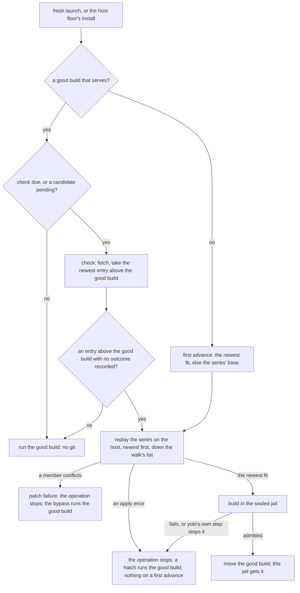

# Patched forks — a patch series that follows its upstream

**Status:** Verified 2026-10-16 against `8e65f3444`. MEASURED: every `git` behavior in
[applying the series](#5-applying-the-series), in scratch repositories with git 2.55.0; and Linux
nested-jail runs of the patched-fork, patched-extension and next-launch-refresh integration tests,
whose nested podman reported `rootless=false`. UNMEASURED: a real rootless host, every macOS
backend, a patched fork's host-floor install with a real sealed build, and the motivating fork's
migration against the maintainer's own series ([§14](#14-unbuilt-and-unmeasured)). The recovery
hatches ([§8.5](#85-recovery-hatches) to [§8.7](#87-the-refusal-and-the-hatches-it-lists)) and the
rules they amend were verified 2026-10-16 against `15c739590`, and `YOLO_SKIP_PATCHES` against
`4a02ccfc5`, from the code and its unit tests.

A **patched fork** is a forked program (the fork route of
[`forked-programs-as-packs.md`](../design/forked-programs-as-packs.md)) whose pack names the
**upstream** repository and carries a patch series. What runs follows the upstream for as long as
the series applies and builds: an hourly **check** finds a newer upstream version, the **advance**
replays the series on the host and builds the result in the sealed capture jail, and this
machine's **good build** moves only once that build is admitted. The same machinery delivers a
patched pi extension as a read-only tree, described in [`pi-extensions.md`](pi-extensions.md);
the two share one implementation through the **owner key** ([PF-D22](#PF-D22)).

The terms in bold are defined in [§1](#1-principles) and where each is first explained below.

**Reads with:** [`forked-programs-as-packs.md`](../design/forked-programs-as-packs.md) (the fork
route this extends; every FP-D id cited here is its), [`pi-extensions.md`](pi-extensions.md) (the
same mode over a `files` tree), [`program-delivery.md`](../design/program-delivery.md) (the
agent-dependency rule this mode brings forks under), and the user guide's
[patch series](../../userguide/guides/patch-series.md) (how to use it).

---

## 1. Principles

The maintainer asked for this mode on 2026-10-03: *"I want another mode where you can specify a
set of patches that will then get applied to the latest of the upstream. So we can essentially have
an evergreen build as long as these patches clean apply."* It amends the fork route's
[patch-set non-goal](../design/forked-programs-as-packs.md#1-goal-and-non-goals) for this mode
only, and it is a field on the existing route, not a new route: a patched fork is a `program` with
`via: "source"` and `fork_of`, exactly as a fork is ([FP-D5](../design/forked-programs-as-packs.md#FP-D5)),
plus `patches` or `patch_branch`. The sealed build ([FP-D9](../design/forked-programs-as-packs.md#FP-D9):
a build jail handed no credential and nothing that writes outside its own workspace), the capture
store, the `build` receipt and the jail's delivery are the fork route's.

Two terms, both coined for this mode:

- A **plain fork** is the fork route without this mode: a `source` pinned at one commit in the
  fork lock, moved only by `yolo pack update` ([FP-D18](../design/forked-programs-as-packs.md#FP-D18)).
- A **patched fork** is a fork that declares `patches` or `patch_branch`: its `source` is the
  upstream, its bytes are the upstream at a commit with the series applied, and what runs follows
  the upstream. It is not a rebase of a fork branch (no fork repository is involved), and not a
  plain fork with a moving ref (nothing moves except through a build).

A forked agent is an **agent dependency**
([program-delivery.md §3.5](../design/program-delivery.md#35-the-second-axis-who-the-dependency-serves-amendment-2026-09-03)),
whose ruled policy is *latest*, refreshed at most hourly, with no pin and a receipt for its record
([OQ-PD11, OQ-PD12](../design/program-delivery.md#decision-ledger)). A patched fork takes that rule
whole, except that its trigger is the notch's readiness act (a fresh jail launch, or the host
floor's install) rather than the agent's own invocation, because a jail mounts the capture store
read-only and reads its fork decisions once at boot ([FP-D14](../design/forked-programs-as-packs.md#FP-D14)).

The five principles, numbered so other documents can cite them:

- **P1. The ref and `follow` decide what moves.** The ref as it does for a pack
  ([`OQ-PF1`](pack-system.md#oq-pf1)): a tag or a full commit holds. On a branch, `follow` says
  whether the newest version tag or the head is taken ([§3.3](#33-what-the-latest-of-the-upstream-is)).
- **P2. What runs moves only through a build this machine admitted, and stays on this machine.**
  The good build moves only once the new build is in this machine's capture store, and it is
  recorded in this machine's pack store, never in the fork lock ([§6.1](#61-the-good-build-is-a-ratchet),
  [§6.5](#65-nothing-in-the-fork-lock)).
- **P3. The series is data on the host and code only in the jail.** The host replays it with no
  hook, no user git config and nothing from the patches or the upstream running; the sealed jail
  builds it; nothing patched is written to the user's tree ([§5](#5-applying-the-series)).
- **P4. A steady-state launch runs no git.** One per-fork hourly check gates every git run
  ([§4.2](#42-the-throttle)).
- **P5. A new upstream version the series does not fit costs a line, never the program.** As
  amended by [PF-D81](#PF-D81): a series that does not *apply* stops the operation by default, with
  opt-in recovery hatches ([§8.5](#85-recovery-hatches)); and, as amended by
  [OQ-PPX3](pi-extensions.md#OQ-PPX3) (2026-10-16), so does a newer version that applies but fails
  to *build*: the good build stays on this machine, and runs only under a hatch or an
  `agent_updates` hold ([§8](#8-failure-and-the-next-step)). As amended by
  [PD-NF1](../design/program-delivery.md#PD-NF1) (2026-10-16), the same holds when one of yolo's own
  build steps keeps the newer version from building: the build jail not starting, a lock wait
  running out, an error replaying the series. An upstream yolo cannot reach is no failure: the good
  build runs, and the line says yolo could not check.

## 2. Where the code lives

| Component | Lives in |
| :--- | :--- |
| Declaration: `patches`, `follow`, `patch_branch`, the recipe | `internal/packdecl` (`fork.go`, `PatchedForkRecipe`, `validatePatchBranchOrSeries`) |
| A use read that skips what this yolo cannot read; `yolo features` | `internal/packdecl` (`DecodeForUse`, `skew.go`, `Features`), `internal/cli` (`runFeatures`) |
| The series, its digest, the replay and the walk | `internal/packsrc` (`ReadSeries`, `WalkSeries`, `replay.go`) |
| The check, its record and lock, the follow rule, the base lag | `internal/packsrc` (`CheckPatched`, `CheckRecord`, `follow.go`, `BaseLag`) |
| A patch branch | `internal/packsrc` (`patchbranch.go`, `PatchBranchSeries`) |
| The error block and the rebase recipe | `internal/packsrc` (`PatchFailure.Render`, `PatchBypass`, `RebaseRecipe`) |
| The recovery hatches: their names, grammar and output shape | `internal/patchrecovery` (`Parse`, `Scope`, `Hatch`, `Section`) |
| The hatch list, the walk-back and its hold | `internal/cli` (`advance.recoveryHatches`, `advance.walkBack`), `internal/packsrc` (`CheckRecord.WalkBack`, `WalkBackHold`) |
| What a set hatch reaches at a launch and at the host; cached-good | `internal/cli/run` (`recoveryscope.go`, `cachedgood.go`, `patchfailures.go`, `missingbuilds.go`), `internal/cli` (`hostrecoveryscope.go`, `cachedgood.go`) |
| The series probe and scratch mirror | `internal/packsrc` (`Store.ProbeSeries`), `internal/cli` (`patchedseriescheck.go`, `lintOnline`) |
| The advance, the swap, the reap | `internal/cli` (`patchedadvance.go`) |
| The build act, its child process and its pool | `internal/cli` (`forkbuild.go`, `forkbuildchild.go`, `buildpool.go`, `buildreport.go`, `buildcauses.go`) |
| Explicit acts: `yolo pack update`, `install`, `status`, `lint`, `series check`, `yolo capture` | `internal/cli` (`patchedfork.go`, `packlintseries.go`, `patchedseriescheck.go`, `capturehost.go`) |
| The launch's slot, its lines and refusals | `internal/cli/run` (`forkbuild.go`, `buildslot.go`, `patchedforkline.go`, `missingbuilds.go`, `patchfailures.go`, `cachedgood.go`, `interruptscope.go`) |
| The delivery record an attach and the reap read | `internal/cli/run` (`forkhanded.go`) |
| Re-keying a legacy series digest | `internal/cli/run` (`patchedrekey.go`) |
| Selection by fork key; the exact lookup | `internal/capture` (`select.go`), `internal/cli` (`resolvePatchedBuild`) |
| The host floor's advance and install | `internal/hostfloor` (`patched.go`), `internal/cli` (`hostfloor.go`, `hostpatchpreflight.go`) |
| The jail's view: fork decisions, receipts, the sealed-build boot | `internal/entrypoint` (`ForkBuildsEnv`, `buildreceipt.go`, `SealedBuildEnv`, `BootRefusal`, `BuildCause`) |

## 3. The declaration

### 3.1 The fields

```jsonc
{
  "kind": "program", "bin": "pi", "via": "source", "fork_of": "pi",
  "source": "git+https://github.com/earendil-works/pi?ref=main",  // the UPSTREAM, and the branch it is read from
  "patches": "patches",                                           // a directory in this pack
  "follow": "release",                                            // "release", "release:<prefix>" or "head"
  "build": "npm ci --ignore-scripts && npm run build && cd packages/coding-agent && npm install -g \"$(npm pack --silent)\"",
  "produces": [".npm-global/bin/pi", ".npm-global/lib/node_modules/@earendil-works/pi-coding-agent"]
}
```

| Field | Meaning | Validated |
| :--- | :--- | :--- |
| `source` | The upstream repository, with the mandatory `?ref=` naming a branch to follow, or a tag or a full commit to hold at. `HEAD` and an abbreviated commit are refused, since neither says whether it moves | statically, as for any fork; the ref's kind at the check |
| `patches` | A clean pack-relative directory holding the series ([§3.2](#32-the-series)). Its presence is the opt-in to this mode | statically: relative, no `..`, only beside `via: "source"`; its contents at each advance |
| `follow` | What a branch ref yields: `release` (the newest version tag on it, the default, [PF-D24](#PF-D24)), `release:<prefix>` (the same, among tags named `<prefix><version>`), or `head` (its newest commit) | statically: the grammar, and only beside `patches` or `patch_branch` |
| `patch_branch` | In place of `patches`: a git repository (a path relative to the pack, `git+file://` or a URL) with `?ref=` naming the branch whose commits are merged against the upstream ([§3.5](#35-a-patch-branch-instead-of-a-series)) | statically: a git address with a ref, not `HEAD`, no `//subdir`, never beside `patches` ([PF-D87](#PF-D87)); a relative path's bound by lint and every check; its commit at each check |

`follow` without `patches` or `patch_branch` is refused, naming the reason: a plain fork's pin moves
only by `yolo pack update`, and following an upstream is this mode's opt-in.

The fork key `<pack>/<bin>` is this route's **owner key** *(coined in [PF-D22](#PF-D22))*: the key
the check, its record and lock, the replay, the ratchet and the explicit acts use. A patched
extension's is `<pack>/<name>` ([`pi-extensions.md` §1](pi-extensions.md#1-defined-terms)), so one
implementation serves both, and a pack's owner keys are unique across the two.

### 3.2 The series

**The series** is the ordered set of patch files a patched fork applies, in the field-standard sense
of a [`git format-patch`](https://git-scm.com/docs/git-format-patch) series. Its rules
([PF-D2](#PF-D2), [PF-D30](#PF-D30)):

- **Its members are the regular files in the `patches` directory whose names end in `.patch`**, in
  byte-wise lexical order. `git format-patch` numbers its output `0001-…`, so its order is the
  series' order. Nothing else is read: no series file, no subdirectory.
- **Each member is a mail-format patch**, its first line the mbox `From <object id> ` line, because
  `git am` makes its commits. A plain diff is refused, naming the file and the command that makes one.
- **No link anywhere on the way.** Every component of the path from the pack root to each member
  is checked with `lstat`, and the reads go through an `os.Root` of the pack: the host reads these
  bytes with a pack's authority, and a link would make the series a read of whatever it names.
- **A series has at least one member.** An empty, missing or unreadable directory is the fork's
  reason, never read as no patches; the reason for an empty one names a plain fork as the way to
  deliver the upstream unpatched.
- **It names its base.** The first member carries the `base-commit:` line `git format-patch --base`
  writes, or a leading cover letter does under `--cover-letter`, which is read for that and never
  replayed. The base must be an upstream commit.
- **Paths are the repository's.** The series is replayed over the whole commit even when `source`
  names a `//subdir`, and the build gets the subdirectory, as a plain fork's does.
- **Read once per advance.** The advance digests the bytes once and replays from that copy, so the
  digest it records describes the bytes it applied, however long it waited for a lock.
- **Linted where it is written.** `yolo pack lint` reads the series by these rules in the pack's own
  directory, never its staged copy ([PF-D63](#PF-D63)); `--online` also probes the upstream
  ([PF-D64](#PF-D64)).

The **series digest** *(coined here)* is the sha256 of the JSON array of `[name, sha256 of the
file's digested bytes]` pairs in series order. A file's **digested bytes** *(coined in
[PF-D61](#PF-D61))* are its bytes less the two parts `git format-patch` writes differently for an
unchanged patch: the mbox `From <commit>` first line, and git's own closing version signature. So
exporting the same patches again is no edit, while a one-character change to a hunk is. A good build
recorded under the earlier digest (the **legacy digest**) is re-keyed, not rebuilt ([PF-D62](#PF-D62)).

### 3.3 What "the latest of the upstream" is

The **follow rule** *(coined here)* is P1 applied to a patched fork. The ref is read from the
upstream's mirror with the pack refresh's own lookup, a tag before a branch:

| The ref is | The candidate commit is |
| :--- | :--- |
| a branch, `follow: "head"` | the branch's commit |
| a branch, `follow: "release"` | the newest tag merged into the branch whose name is a semantic version, optionally `v`-prefixed |
| a branch, `follow: "release:<prefix>"` | the same, among tags named `<prefix>` followed by a semantic version (a monorepo's per-package tags) |
| a tag, or a full commit | that commit, always: the fork is held there |
| `HEAD`, an abbreviated commit, or anything else | none: refused, naming a branch, a tag or a full commit |
| unresolvable | none: the fork's reason ([§8](#8-failure-and-the-next-step)) |

The release rule ([PF-D4](#PF-D4)): **newest** is [semantic-version precedence](https://semver.org/#spec-item-11),
never tag date; a pre-release and a tag that does not parse are never chosen; major versions are
crossed; a re-pointed tag is not followed, because a fetch puts back every tag it moved; and no
ancestry check is made against the good build, so a force-pushed head or an edited `follow` can
name an older commit. Against the series' base there is one: the walk offers only version tags that
contain it ([§6.4](#64-the-newest-fit-and-the-first-advance)). A branch with no version tag the rule
reads is an empty list, and the base is built ([PF-D60](#PF-D60)).

A patched fork is **held** *(coined here)* when what runs is not following: its ref names a tag or a
commit, `agent_updates` holds it, or its newest candidate did not apply or build. Held is not
unavailable: a held fork runs its good build.

### 3.4 Holding a patched fork

| Who | How | What it holds |
| :--- | :--- | :--- |
| The manifest's owner | a tag or a full commit as `source`'s `?ref=` | the upstream commit; the series is still applied there, and the fork rebuilds only when the series or the recipe changes |
| Any user | `agent_updates` off for the fork pack, by name or through `"*"`, or for its base pack ([PF-D19](#PF-D19)) | no check runs, and a recorded patch failure, the background advance's included, never refuses a held launch ([OQ-PBR5](#why-its-this-way)): the good build runs, its held suffix naming the release the hold skips. An edited ref or `follow` waits until the hold lifts, while a change to the series or the recipe is built at the good build's commit, and only a failure recorded at that commit refuses. A fork with no good build still gets its first advance |

The base pack counts because a user who freezes `pi` means the program they run as `pi`. A ref edit
is not a new address: a build is identified by repository, subdirectory, commit and recipe, never
the ref ([§6.3](#63-what-is-served-and-the-store-key)).

### 3.5 A patch branch instead of a series

Ruled 2026-10-15 ([OQ-PFK6](#why-its-this-way)) and built 2026-10-16. A **patch branch** (the manifest's
`patch_branch`, named by the owner) is a commit graph a contribution names in place of a `patches`
series: a repository plus a `?ref=` naming its branch. The repository is written one of three ways:

- **A path relative to the declaring pack's directory**, starting `./` or `../`:
  `"patch_branch": "../..?ref=carry/pi-subagents"` from `yolo-packs/matt` names the repository that
  pack lives in. It is the spelling for a pack that ships inside the repository it patches from,
  because it names the same repository in a jail and on the host: a jail reads its packs from the
  host's tree, so each side resolves the path against the pack's directory as it sees it. The climb is
  bounded by the pack's own git repository (the directory `git rev-parse --show-toplevel` names from
  the pack's directory): a path above it is refused, naming that bound, and so is a path that is not
  a repository's root, naming the one that is.
- **`git+file:///abs/path?ref=…`**, a local repository by its absolute path, which names it on one
  machine and in one notch only.
- **A URL**, `git+https://…?ref=…` or `git+ssh://…?ref=…`.

A `file://` address is a directory read as it is on disk, takes no `?ref=`, and its refusal names the
`git+file://` form. At each check the patch branch's repository is fetched into a mirror of its own and resolved to a
commit and that commit's merge base with the upstream's tip, and the record keeps both, so every
reader rebuilds it with no git. For a relative locator, the record also carries the declaring
repository's filesystem identity (device and inode), not just the locator spelling: distinct clones
cannot share a check or resolved branch, while the same checkout remains the same repository through
its host and jail bind-mount paths. A record written before that identity existed is treated as
unresolved and checked again. At the advance `git merge-tree --write-tree`, with no working tree,
answers whether the patch branch merges into the candidate: a conflict refuses, naming the
conflicting paths, and a clean merge is the tree the build uses.

A patch branch rides the series' machinery whole ([PF-D89](#PF-D89)): it is a series whose one input
is a commit. The merge base is its base, so the walk's list holds the versions that contain it, and
a first advance with nothing that merges falls back to it. Its digest is the commit's hash, so the
build is keyed on the upstream commit and the patch branch's commit, and two machines that resolve
the same commits build the same bytes. A `files` extension takes `patch_branch` the same way.

> [!IMPORTANT]
> **One contribution names `patches` or `patch_branch`, never both** ([PF-D87](#PF-D87)): the pack
> is refused at its decode, before any fetch, naming the owner key, both fields and which to keep
> for what.

The model rests on one invariant: the named repository's ancestry includes the upstream's, so the
merge base is a real commit. yolo never authors that history and never rebases it. A patch branch
with unrelated history is no conflict: git refuses to merge unrelated histories, and the check names
it as its problem. Only the `--write-tree` form answers the question (the legacy three-argument form
exits 0 for a conflict too), and it is under the replay's existing git 2.40 floor, so an older git is
refused by name ([PF-D58](#PF-D58)) and never falls back to a replay. How a patch branch is said in
every line is [PF-D90](#PF-D90).

## 4. Detection

### 4.1 Where the check runs

The **check** *(coined here)* is the act that reads the upstream for a newer candidate. It runs at
the acts that ready a fork's program ([OQ-FP4](../design/forked-programs-as-packs.md#14-decision-ledger):
eager, at the notch's readiness act) and at the explicit acts, through one implementation
([PF-D5](#PF-D5)):

- a **fresh jail launch**, in the fork-build slot, below every attach decision and under the launch
  lock ([FP-D14](../design/forked-programs-as-packs.md#FP-D14));
- the host floor's install act: `yolo host -- <bin>` and `yolo host apply --assert`
  ([§9](#9-notch-coverage), [PF-D50](#PF-D50));
- `yolo capture <forked bin>`, `yolo pack update` and `yolo pack install`, each forcing it
  ([§8.3](#83-the-explicit-acts)). Of these only `yolo capture` builds.

It **never** runs on an attach, a `--dry-run`, inside a jail, inside a capture or build jail, or
while `agent_updates` holds the fork, a first advance aside. An attach builds nothing and says what
the running jail runs ([§7](#7-the-build-and-the-launch)).

[Launch-update preparation](../design/launch-update-preparation.md), in flight, registers a
launch's source demand with an independent worker; it does not replace this check, replay, build
and admit pipeline.

### 4.2 The throttle

**One check per owner key per `BranchRefreshInterval`, measured from the last check attempt,
whatever its outcome.** The interval is the pack refresh's and the agent launchers', so "how often
does something a pack follows move" has one answer across the product.

- **The throttle is a file read, never git.** A **check stamp** *(coined here)* in the check record
  ([§6.2](#62-the-check-record-and-what-is-pending)) is read first. Inside the interval, with
  nothing pending, the launch runs the good build and runs no git and no network (P4,
  [PF-D41](#PF-D41)).
- **It is its own stamp, not the mirror's.** A branch pack on the same repository and branch would
  otherwise leave the mirror's stamp fresh on every launch, and the check would never run.
- **An attempt counts.** A check whose fetch failed still writes the stamp, so an offline machine
  retries once an hour rather than paying a fetch timeout on every launch. **Except with nothing to
  run** ([PF-D88](#PF-D88)): an advance with no good build to serve does not wait out a failed
  fetch, and fetches again itself.
- **An edit to what the check reads makes it due at once.** The record keeps the repository,
  subdirectory, ref, `follow` and series base the last check read ([PF-D28](#PF-D28)).

### 4.3 The check itself

Under the owner key's record lock, re-reading the stamp there:

1. Write the stamp (the attempt).
2. Run the pack refresh's fetch and ref rule for the source's repository and ref, with no checkout:
   bounded by `LaunchFetchTimeout`, no terminal for git, fsck on receipt, every tag a fetch moved
   put back. An explicit act fetches whatever either stamp says, so a version published minutes
   ago is seen.
3. Apply the follow rule to what the mirror now holds and take the candidate, the newest entry of
   the walk's list above the good build, with no replay. Release the mirror's lock, and record the
   commit, its tag and the check's sequence number.

**Concurrency.** Two launches due at once serialize on the record lock; the second re-reads a fresh
stamp and runs no git. Checks of different keys wait for each other only when they name one upstream
repository, on its mirror lock for the fetch, and none of this takes the fork lock
`forks.lock.json`'s writers share.

**Offline.** A failed fetch leaves the mirror's own answer in use, and the record notes the failure.
No advance runs until a check fetches again, since the build needs the network too. The launch says
once that it could not check, with the error, and names `yolo pack update` to check now; with
nothing to serve the refusal names the network when git's error is one of reaching the host, and
promises no hour ([PF-D88](#PF-D88)).

## 5. Applying the series

### 5.1 Where it runs

**On the host, inside the build act, before the sealed jail starts** ([PF-D18](#PF-D18)). Where a
plain fork copies a commit's tree into the staging workspace's `src/`, a patched fork's build act
replays the series and copies the result.

- **A scratch repository outside the staging workspace.** Its git directory and work tree sit in a
  private temporary directory, never in the staging workspace, which is the build jail's
  `/workspace`: a git directory there would be visible to the build and writable by it. It borrows
  the mirror's objects read-only and is deleted when the build act ends.
- **Blobs first, into the mirror.** A repository that borrows another's objects cannot fetch what it
  lacks (MEASURED: a checkout through objects borrowed from a blobless mirror failed until those
  blobs were prefetched). So under the mirror's lock the store's prefetch brings in the whole commit
  of the base and of each entry; a blob still missing is an apply error, never a conflict.
- **The mirror's lock is held from the prefetch to the end of the replay**, and released before any
  record is written and before the build starts.
- **The subdirectory is copied into `src/`** with the copy that never follows a link, so the build
  sees the layout and the absent `.git` a plain fork's build sees.
- **Nothing it makes outlives the build** except the prefetched blobs, as git objects; no tree per
  candidate is checked out in the pack store.

**Two git config regimes**, because the fetch needs the user's config and the replay must not see it:

| Run | Config | Why |
| :--- | :--- | :--- |
| The check's fetch, and the blob prefetch | the pack store's: the user's own git config honored, its hooks and fsmonitor overridden | a private upstream needs the user's credential helpers and `insteadOf` rewrites |
| The replay | no user, system or template config, no attributes file, every `GIT_` variable dropped but `GIT_EXEC_PATH`, hooks, fsmonitor, signing, `core.autocrlf`, rerere, gc and every transport off, a fixed identity and date ([PF-D29](#PF-D29)) | a user setting changes the replay's answer or runs a user program. MEASURED: `commit.gpgsign=true` ran the configured signer and stopped `git am` when it failed; `apply.whitespace=error` failed a member adding a trailing space; a template that turned renames off made a renamed file conflict |

The host replays and the jail builds because the replay needs the upstream's objects, which only the
host's mirror holds; the host can say *which member conflicts* before paying for a jail; and with no
user config, hook, filter or merge driver, no code from the pack, the upstream or the user runs —
`git` parses patch text and merges files.

> [!IMPORTANT]
> **Nothing patched is ever written to the user's tree.** The workspace, the fork pack's own
> directory (whose patch files are read, never written) and any clone of the user's are untouched
> by every act. A conflict prints the git commands that write a new series and leaves running them
> to the user ([§8.4](#84-rebasing-the-series), [PF-D85](#PF-D85)).

### 5.2 The replay, and what "applies cleanly" means

The **replay** *(coined here)* is the series made into commits at its base, then those commits
picked onto the candidate ([PF-D6](#PF-D6), [PF-D29](#PF-D29)):

1. **At the base.** `git am` applies each member, one at a time so a failure names its member, onto
   the series' base commit. A series exported with `--base` applies there by construction; one that
   does not is a malformed series, never a conflict with the upstream.
2. **Onto the candidate.** Each commit is picked onto the candidate three-way, as `git rebase`
   picks: one merge per commit, whose base is that commit's parent, with
   `git merge-tree --write-tree --merge-base=<commit>^` and `git commit-tree`, with no work tree.

The series **applies cleanly** when step 1 applies every member and step 2 stops on no commit — the
bar a hand rebase meets, since a rebase is the same picks.

- **A member whose pick changes nothing is clean, and said once per candidate**, for one of two
  reasons: it is already upstream, or its own commit was empty when the series was written. Only the
  first is reported as already upstream, naming the file to drop.
- **A member whose pick conflicts but whose patch-id equals an upstream commit's** between the base
  and the candidate is already upstream too ([PF-D86](#PF-D86)), the rule by which `git rebase` drops
  one. Only commits that change exactly the member's paths can share its patch-id, so they are found
  from the trees alone and only their blobs are fetched.
- **A conflict** is a pick that stopped with conflicting paths while every object it read was
  present. Anything else that stops the replay (a missing blob, a git that failed or ran out of time,
  a git older than 2.40) is an **apply error** *(coined here)*: the candidate stays pending and the
  next check retries it; meanwhile, while a good build serves, every act that would run it stops
  ([PF-D93](#PF-D93)).

> [!WARNING]
> **Do not replace the replay with `git am --3way` onto the candidate.** A later member's preimage is
> the base plus the earlier members, a blob that exists only where the series was made. MEASURED
> 2026-10-03: on a two-member series in a repository holding only the upstream, `git am --3way`
> stopped at the second member with *"could not build fake ancestor"* and no conflict marker, where
> the fork's own `git rebase` and the replay were both clean. Nor plain `git apply` with no three-way,
> which fails where a hand rebase is clean. The replay agreed with a hand rebase in every measured
> case: a context edit, an offset, a rename, a member already upstream, and two real conflicts.

**Never more than that.** No reduced context, no fuzz, no merge strategy that prefers one side, and
no conflict resolution of any kind.

### 5.3 The patched tree

The **patched tree** *(coined here)* is the git tree object of the source's subdirectory (the whole
tree for a repository-root source) in the replay's last commit: the content address of exactly what
is copied into `src/`. It is read before the build jail starts, so nothing the build does can change
it, and it is recorded on the build receipt and the good build. It is a record, not a key: a second
machine whose replay gives another tree builds its own, and is never refused for that ([PF-D15](#PF-D15)).

## 6. The good build, the record and the store key

### 6.1 The good build is a ratchet

A patched fork's **good build** *(coined here)* is this machine's record of the inputs of the last
build of it this machine admitted: the upstream commit, its tag, the series digest, the recipe hash
and the patched tree. It is not a pin: nothing writes it to the fork lock, and it never leaves the
machine ([§6.5](#65-nothing-in-the-fork-lock)).

A **candidate** *(coined here)* is the same inputs for what the manifest and the last check ask for
now: the newest entry of the walk's list above the good build ([§6.4](#64-the-newest-fit-and-the-first-advance)).
With a good build, an empty list leaves the good build's own commit as the candidate, so nothing is
pending and no held suffix is shown. Walking the list newest first and passing over every entry that
did not apply, the candidate is **pending** when the first entry reached has no recorded outcome, or
a build failure past its back-off. The **advance** *(coined here)* is the act that takes a candidate
to a good build: replay down the list, build the newest fit, and, once the build is admitted, move
the good build. It is not the check, which only finds the candidate.

**The good build moves to a new build only after that build is admitted to this machine's capture
store** (P2, [PF-D8](#PF-D8)). That one rule covers every cause of a candidate:

| What changed | Candidate |
| :--- | :--- |
| a check found another upstream commit | (that commit, the manifest's series, the manifest's recipe) |
| the series changed (an edited patch, or the fork pack's own refresh) | (the last check's commit, the new series, the recipe) |
| `build` or `produces` changed | (the last check's commit, the series, the new recipe) |
| the repository, subdirectory, ref or `follow` changed | a check at once, then the first row |
| `agent_updates` holds the fork | (the good build's commit, the manifest's series, the manifest's recipe), with no check |

**The move is a compare-and-swap under the record lock that prefers the newer check.** The good
build moves to this advance's build only if its candidate came from a check no older than the one
behind the good build; at the same check, the later admit wins. A build that loses the swap is
reaped at once, since no launch was handed it.

**A user's own edit is not held** ([PF-D23](#PF-D23)): an edit to the series, `build` or `produces`
that does not apply or build is not served by the previous good build. The series' base is tried,
and with nothing built the program is missing and a fresh launch refuses ([PF-D77](#PF-D77)).

**The move is never silent.** The launch that moves a good build says so in a disclosure line,
*"updated fork `pi-fork/pi`: v0.99.2 → v1.0.1, 3 patches; this jail runs the new build"*, which no
flag hides ([`OQ-RO3`](report-tiers.md#why-its-this-way)).

**What this overrides, for a manifest that declares a series, and only there** ([PF-D8](#PF-D8)): the
fork route's *"never rebuild on a timer or on every launch"*
([§9](../design/forked-programs-as-packs.md#9-failure-modes)); its *"never serve an entry whose key
does not match"*, for the upstream commit only; *"a fork that drifts from its lock is reported,
never silently refreshed"* ([§12](../design/forked-programs-as-packs.md#12-what-this-does-not-license));
[FP-D18](../design/forked-programs-as-packs.md#FP-D18)'s standing pin moved only by `yolo pack update`;
[FP-D16](../design/forked-programs-as-packs.md#FP-D16)'s floor entry that is never polled;
[FP-D17](../design/forked-programs-as-packs.md#FP-D17)'s failed-reinstall removal, for a newer
upstream only; and the done condition that a second machine runs the same binary
([§11](../design/forked-programs-as-packs.md#11-sequencing)): a second machine runs the newest
upstream the series fits there. Every other rule of the fork route stands: a plain fork never moves
at launch, a hit builds nothing, and nothing is built on the host.

### 6.2 The check record, and what is pending

The **check record** *(coined here)* is one record per owner key in the pack store ([PF-D9](#PF-D9),
[PF-D28](#PF-D28)): the check stamp and what the last check read, the last check's commit with its
sequence number and whether its fetch failed, the good build, and one outcome per entry of the walk's
list, so an entry that did not apply is never replayed again however many newer entries follow. It is
machine-local, written only under the record lock through a temporary file and a rename, and read
without a lock.

| Outcome on the record | What later launches do |
| :--- | :--- |
| nothing pending: the list is empty, or every entry did not apply | run the good build; a held suffix only when the list is not empty |
| the **failed newer build** *(coined here: the newest entry the walk reaches, whose build of the series and recipe as they stand failed under this yolo, while a good build of them is here)*, inside its back-off | stop by default, as for the recorded patch failure ([OQ-PPX3](pi-extensions.md#OQ-PPX3)); no rebuild. A newer release passes it by, and `agent_updates` holding the fork runs the good build past it |
| pending | run the advance; the launch waits for it, bounded ([§7](#7-the-build-and-the-launch)) |
| pending, and the last fetch failed | run the good build; no advance until a check fetches (with nothing to serve, fetch again: [PF-D88](#PF-D88)) |
| apply error | stop by default, as for the failed newer build, until the next check replays the list again; `yolo capture` replays it now ([PD-NF1](../design/program-delivery.md#PD-NF1), [PF-D93](#PF-D93); PF-D45's "run the good build" is superseded) |
| did not apply (the member, its paths), for (entry, series digest, yolo version, git version) | the walk passes that entry over, and no launch replays that key again. A new commit, an edited series, another yolo or another git is a new key, since an upgrade may be the fix |
| the **recorded patch failure** *(coined here: the one typed failure the record keeps, with its target, member and paths)*, for (check inputs, series digest) | stop by default ([PF-D81](#PF-D81)) while it governs, as below. At each check that ran, its target is replayed again |
| build failed (the error, the yolo version, the count, and the **cause** when one of yolo's own steps stopped it), for that entry | the failed newer build, above, while a good build is here; retried after [OQ-PD26](../design/program-delivery.md#decision-ledger)'s back-off, reset by another candidate or another yolo, and a retry that fails stops again. With nothing to serve, every fresh launch retries instead |

A build jail that stopped before its build line ran is recorded as the candidate's failed build,
with that cause, while a good build serves ([PF-D92](#PF-D92)); with nothing to serve it is not
recorded, and every fresh launch tries again. Never recorded as an outcome: a lost build-lock wait, a
build jail the runtime would not start now (Apple Container beside a running jail), a retained build
workspace ([§7.1](#71-cancelling-a-launchs-builds)), and an advance a Ctrl-C ended. Each leaves the
candidate pending, and all but the Ctrl-C stop the act that met them while a good build serves
([PD-NF1](../design/program-delivery.md#PD-NF1)).

**A recorded patch failure follows upstream's newest** ([OQ-PBR1](#why-its-this-way)). It governs
only while its target is the newest candidate not already passed over by a conflict of this series,
as the last successful check listed them (`CheckRecord.CurrentPatchFailure`). A newer entry that is
untried, replays cleanly or failed to build passes it by, and so does a good build of this series
that moved past it: the advance then walks from the newest as if nothing were recorded. A clean
newest builds and clears the failure; a conflicting newest becomes the recorded failure, and its
recipe names that version. Never passed by: a failure of the series at its own base, a failure at
the good build's own commit, and a failure read under a check whose fetch failed. So a release that
fixes the conflict ends the refusal at the next launch whose check runs, and inside the check
throttle, with nothing newer listed, the recorded failure stands.

A **walk-back hold** ([§8.6](#86-the-walk-back)) also sets the newest's failure aside, for as long as
it holds.

**Losing the record costs a lookup, not a rebuild.** A record that is gone or unreadable is recovered
from the capture store: the newest admitted build of this owner key, for this platform, whose recipe
is the manifest's (or the legacy digest's, then re-keyed), is the good build. The check starts over,
which costs at most one walk.

### 6.3 What is served, and the store key

- **What is served is the good build**, when its series digest and recipe are the manifest's. Its
  upstream commit may lag the candidate.
- **It is found exactly**: by the owner key and platform, then by repository, subdirectory, commit
  and recipe, never newest-then-compare ([PF-D7](#PF-D7), [PF-D36](#PF-D36)). Two forks of one
  upstream, a `yolo capture` of a candidate and a swap one launch lost each leave a newer entry that
  is not the good build, and an exact lookup is unmoved by all three.
- **The ref is not part of a build's identity.** The build's lock, staging and receipt name the
  repository and subdirectory, never the source as written, so moving a hold from `?ref=main` to
  `?ref=v0.99.2` finds the build already there.
- **The revision is the upstream commit**, not a synthetic patched commit: the upstream commit is a
  fact any machine can fetch.
- **The recipe hash gains the series digest, for a patched fork only.** A plain fork's recipe is
  byte-for-byte what it was, so no existing entry stops hitting. A patched fork's recipe is never
  read from the manifest alone, which would equal a plain fork of the same upstream and serve the
  unpatched build ([PF-D31](#PF-D31)).
- **The `build` receipt gains `fork`, `series`, `tree`, `tag` and `version`.** The fork key is what a
  patched build's selection keys on, so a plain fork's query never selects a patched build.
- **The move reclaims what no jail uses** ([PF-D20](#PF-D20), [PF-D37](#PF-D37)). Each fresh launch
  writes a **delivery record** *(coined in PF-D37)*, `<tree>.forks.json` beside its pack tree, naming
  what it handed its jail; it goes only once the container is known gone. A move reaps every other
  build of the key that no record names, keeps every build when a record cannot be read, and passes
  over a build another advance has admitted and not yet settled ([PF-D46](#PF-D46)). A jail
  materializes its build at the program's first run, not at boot, which is why a handed build must
  outlive the move. `yolo prune` is unchanged: it keeps the newest build per selection key.

### 6.4 The newest fit, and the first advance

**Every advance takes the newest fit** *(coined here)*: the first entry of a list, newest first, onto
which the series replays cleanly ([PF-D10](#PF-D10)). Not "the newest, else the base", which would
drop a second machine, or an edited series, to the base even where v1.2 fits and only v1.3
conflicts. The list:

1. Under `follow: "head"`, the branch's tip.
2. The version tags merged into the branch that contain the series' base, the base's own tag
   included, by the release rule's precedence; under `release:<prefix>`, only that prefix's.

A tag or commit ref lists that commit alone. With a good build, the list holds only entries above
it; a hold's commit, and a list read under another ref or `follow` than the good build's, are cut at
the good build's commit instead ([PF-D34](#PF-D34)).

- **Replays run down the list**, each entry's blobs prefetched first. A conflict is recorded against
  its entry, and an entry with one is passed over with no replay; an apply error ends the walk,
  leaves the entries it did not settle pending, and, while a good build serves, stops the act
  ([PF-D93](#PF-D93)).
- **The first clean entry is the newest fit, and the advance builds it**, replaying it again under
  its build lock to put the source in `src/` ([PF-D44](#PF-D44)).
- **Bound:** the walk and the build's replay share one budget, apart from the check's fetch, so git
  holds a launch at most twice that budget before a build. The series' base, built after a walk or a
  build that came to nothing, gets a budget of its own. A walk that runs past its budget is an apply
  error for the entries it did not reach ([PF-D45](#PF-D45)).
- **Tags must contain the base**, so an older version cannot pass for an update: a branch whose
  newest version predates the base builds the base, nothing is pending afterwards, and later
  launches show no held suffix ([PF-D27](#PF-D27)).

A patched fork with no good build on this machine, after recovery, gets a **first advance**:

- **The good build is written after the admit.** A first build that fails leaves no good build, and
  the next fresh launch tries again with no back-off, since nothing serves.
- **If nothing on the list fits, the series' base is built**, when the followed branch contains it.
  The series applies there by construction, so a migrating user gets a working program on the first
  launch, held at the base, and the line says why. A tag or commit hold gets no fallback, since the
  user named the commit.
- **The same fallback covers any state with nothing to serve** ([PF-D40](#PF-D40)), a user's failed
  edit included: the edited series is built at its own base before the program goes.
- **A patch failure is the exception** ([PF-D81](#PF-D81)): a member that conflicts at the newest
  version stops the operation, and no older fit or base is built in its place, unless the act was
  asked for the walk-back ([§8.6](#86-the-walk-back)).
- **With nothing built, the launch refuses before booting** ([PF-D77](#PF-D77)).

### 6.5 Nothing in the fork lock

**A patched fork has no entry in `forks.lock.json`, and every fork-lock pinner skips it** — the
launch's, the host floor's and `yolo capture`'s, all through `packload.PinForks`, and `yolo pack
install` and `update` ([PF-D16](#PF-D16), [PF-D33](#PF-D33)). Four reasons, each enough:

- **The class's record is a receipt, not a lockfile** (*Pin: none*,
  [program-delivery.md §3.5](../design/program-delivery.md#35-the-second-axis-who-the-dependency-serves-amendment-2026-09-03)).
- **The lock travels** with the user config. A good build in it would name another machine's admit,
  so the receiving machine would run nothing until it had built that.
- **An older yolo that rewrites the lock** writes back only the fields it decoded.
- **`yolo pack install` and `update` prune** the entries of forks the user-scope selection lacks.

A plain-fork entry left under the key from before a migration is ignored, and the next `yolo pack
install` or `update` drops it, saying so. A hold that should travel is spelled in the manifest or in
`agent_updates`, both of which travel already.

### 6.6 Locks, and their order

| Lock | Held across | Never held across |
| :--- | :--- | :--- |
| the build's own lock (per build identity) | the replay into `src/`, the build, and the build's settlement | — |
| the owner key's record lock (in the pack store) | a read-modify-write of the record, and the check's fetch | a build |
| the upstream mirror's lock | a fetch, a blob prefetch and the replay | a record write, a build |

> [!WARNING]
> **The order is the build lock, then the record lock, then the mirror lock**, and nothing waits for
> a lock earlier in that order while it holds a later one ([PF-D17](#PF-D17)). The fork lock
> `forks.lock.json`'s writers share, when an act holds it too, comes before the record lock. Every
> flock in the pack store blocks with no bound, so an order inverted anywhere is two launches hung
> for good.

**A launch that waited for another's build of the same candidate takes its result, success or
failure.** A build is **settled** *(coined in [PF-D46](#PF-D46): its failure recorded, or its move
made, then the hand and the reap)* under the record lock while its build lock is still held, so a
waiter that takes the build lock next reads the winner's result rather than building a failing
candidate again.

### 6.7 What the mode never does

- **Never moves the good build to a build this machine has not admitted**, and never writes a good
  build to the fork lock.
- **Never runs the check or a build on an attach, a dry run, in a jail or in a build jail**, nor the
  check while `agent_updates` holds a fork that has a good build.
- **Never runs git on a launch inside the throttle** with nothing pending.
- **Never builds on the host**, and never replays the series inside the jail.
- **Never replays with the user's git config**, and never puts the scratch repository where the
  build can reach it.
- **Never writes a patched file into the user's tree**, nor any file into the fork pack.
- **Never falls back to the base's own delivery** when a patched fork has no build, which the fork
  route's failure modes already forbid for a plain fork
  ([`forked-programs-as-packs.md` §9](../design/forked-programs-as-packs.md#9-failure-modes)).
- **Never silently turns a patch failure into a warning** ([PF-D81](#PF-D81)). It refuses a launch
  over a series that does not apply, even while a good build serves, unless the bypass is set; and
  with nothing to serve, a fresh launch at a notch that builds forks refuses before booting
  ([PF-D77](#PF-D77)). A check that could not fetch while a good build serves refuses nothing.
- **Never falls back to an older build on its own** ([OQ-PPX3](pi-extensions.md#OQ-PPX3),
  [PD-NF1](../design/program-delivery.md#PD-NF1)): a newer build that fails, or that one of yolo's
  own steps keeps from running, stops the act as a patch failure does, and the good build runs in its
  place only under a recovery hatch the user set or an `agent_updates` hold.

## 7. The build and the launch



**The build is the fork route's build act**: the same sealed jail, the same `produces` and link
checks, the same per-build lock and its bounded wait (`forkBuildWaitBound`). Its checkout differs
([§5.1](#51-where-it-runs)), its identity ignores the ref ([§6.3](#63-what-is-served-and-the-store-key)),
and a waiter takes the winner's result ([§6.6](#66-locks-and-their-order)). The toolchain record a
build jail's script writes first tells a build line that ran and failed from a jail that never ran
it ([PF-D39](#PF-D39)), and the error block says which; while a good build serves, both stop the act
and both are recorded as the candidate's failed build, the second with its cause
([PF-D92](#PF-D92), superseding [PF-D21](#PF-D21)). A
sealed build jail renders no pack-declared surface and runs no pack hook ([PF-D78](#PF-D78)), and its
seal does not trip over its own narrowing ([`pi-extensions.md` PPX-D39](pi-extensions.md#PPX-D39)).

**The launch that finds a candidate waits for it** ([PF-D25](#PF-D25)), bounded at
`forkBuildWaitBound` and ended early by a Ctrl-C. The jail starts on the new build on success, and
on the previous one after a Ctrl-C; a failure of any kind, the bound and a wait for another build's
lock that runs out included, stops the launch, which runs the previous build only under a recovery
hatch ([OQ-PPX3](pi-extensions.md#OQ-PPX3), [PD-NF1](../design/program-delivery.md#PD-NF1)). A
build stopped at the bound is recorded as failed; one a Ctrl-C ended is not. **One Ctrl-C ends an act's whole wait** ([PF-D57](#PF-D57)): every advance of one act shares one
**act interrupt** *(coined in PF-D57)*, so an advance that begins after a Ctrl-C ran no check and is
handed what serves, with nothing handed when nothing serves.

**A jail launch builds its keys at once** ([PF-D80](#PF-D80)), every patched fork and patched
extension in one pool under the act's interrupt scope (an **interrupt scope**, *coined in
[PF-D38](#PF-D38)*, is an arm of the launch-arm stack that cancels the advance's context on a signal
and never ends the process). A key with a good build is handed it when a Ctrl-C ends the pool; one
with none goes without, its line naming the next fresh launch and `yolo capture`, and the launch goes
on to [PF-D77](#PF-D77)'s refusal when what it left out is needed. `yolo host` and `yolo capture` are
unchanged: a Ctrl-C in a first advance there ends the act.

**Each build is shown as a start line, a progress line and a result line** ([PF-D79](#PF-D79)). The
start line, printed before the build line runs, names what is built and why, the wait, the build's
own log, and its disclosures: the seal and the build line, whole. One progress line stands for the
pool. The result line, among its key's lines in declaration order, is the move line with the store's
key, path count and size. Every build a jail launch runs is the `yolo internal fork-build-jail`
child, whose streams go to `.yolo/launch.log` and the build's own log, never the terminal, except its
launch's warnings and refusals, repeated under the result. Off a terminal, with illustrative names
and numbers:

```text
build extension matt/pi-ext: v1.2.0 (3f2a9c1e) + 1 patch (series 5d1c09ab), the first build of it on this machine; log: .yolo/build-matt--pi-ext-1a2b3c4d.log
  sealed: no credential, no host file, no env_sources, and a bridged network, never the host's; it runs, then copies the checkout: npm ci && npm run build
Waiting for this launch's builds… building extension matt/pi-ext; 0 of 1 done
built extension matt/pi-ext: v1.2.0 (3f2a9c1e) + 1 patch; this jail runs it — store key 08c4436a41fefb86, 812 paths, 14.2 MB (41.3s)
Waiting for this launch's builds: done (41.4s)
```

**Every fork line names the series**, at launch and in the footprint's claim line: *"pi-fork/pi:
v1.0.1 (3f2a9c1e) + 3 patches (series 5d1c09ab), patched fork of pi"*. The upstream commit alone is
not *"the commit that produced the binary on your PATH"*
([OQ-FP6](../design/forked-programs-as-packs.md#14-decision-ledger)). The launch's disclosure also
names the whole build line by its recipe digest and `yolo pack status <key>`
([`report-tiers.md` OQ-RO9](report-tiers.md#why-its-this-way)), a digest distinct from the series
digest.

**A fork line names its series' base lag** *(coined for [OQ-PFK7](#why-its-this-way), 2026-10-15)*: the
version tags of the followed branch newer than the series' `base-commit:`, elided past three, and
which of them the check record knows take the series as it stands — *"its base v1.0.0 (…) is 2
releases behind: v1.1.0, v1.2.0; v1.2.0 takes the series as it stands"*. It is read from the record,
so the launch runs no more git. `yolo pack status` says it as a `base lag:` line and, when the newest
version takes the series, prints the rebase recipe onto that version ([§8.4](#84-rebasing-the-series)).

**An attach says what the running jail runs**, from that jail's delivery record, never the good build
as it stands: *"this jail runs pi-fork/pi at v0.99.2 + 3 patches; v1.0.1 + 3 patches is built, and
the next fresh launch, once this jail stops, runs it"*.

### 7.1 Cancelling a launch's builds

A fresh launch runs its fork-build slot before the image step and before the jail's command starts.
Each running build is a `yolo internal fork-build-jail` child, a complete nested launch with its own
signal arms and keeper-managed jail. The launch's act interrupt is the single owner of the pool's
whole wait; the TTY proxy, which wraps the container command later, and pi's own pre-launch refresh
([`pi-extensions.md` §17.2](pi-extensions.md#172-the-execution-tier)) are separate signal paths.

- **Each child leads its own process group.** The act forwards SIGINT to the whole group, waits a
  grace, then SIGKILLs the group, so a compiler descendant cannot outlive the cancel.
- **Output drains under a bound.** The child has explicit stdout and stderr pipes, drained
  concurrently under a bound; incomplete output is a failed build, never a truncated success.
- **A cancelled child always reports an interrupt** (status 130) whatever its own exit status, so a
  child that handles SIGINT and exits zero cannot publish partial work as a success.
- **A forced stop retains its workspace.** A forced stop cannot prove that the child's detached jail
  keeper or runtime teardown has ended, so the build keeps its staging tree and host-side jail state
  instead of deleting them. A same-key retry cleans them only after taking the workspace launch lock
  without waiting, establishing that the keeper is gone, and getting a known-absent answer from the
  *original* capture backend — the runtime the build's own run pipeline recorded after confinement
  and fallback, outside the jail-mounted stage. An unknown backend, a busy lock, a live keeper or a
  live runtime refuses. One exception: a stopped child whose whole process group is gone and that
  never recorded a runtime never dispatched, so its workspace is cleaned.
- **A finished build waits out late container removal** for a bounded time before declaring its
  output unowned, since `--rm` removal can trail the keeper.
- **A retained workspace is no recorded failed build**: the advance records no outcome and starts no
  back-off, and the next launch builds the commit. While a good build serves, the act that met it
  still stops ([PF-D92](#PF-D92)).
- **On macos-user** there is no container listing or capture-completion witness, so an abnormal stop
  stays unknown; the refusal names the build ID and retained paths and asks a host operator to verify
  that capture has ended before clearing them.

> [!WARNING]
> Group cleanup cannot reach a compiler process that deliberately calls `setsid` or `setpgid`, and
> the bounded drain detects only a process that keeps a pipe open; it fails the build but cannot
> reap the escaped process. Current build tools are expected to inherit the build child's group.

Store admission still owns its completion marker, written last, so an interrupted capture stays
unavailable and is rebuilt once its previous jail is known gone. These rules are pinned by Linux pty
tests, which prove Linux terminal signal delivery and Unix process-group cleanup only
([§14](#14-unbuilt-and-unmeasured)).

## 8. Failure, and the next step

**A patch failure is fatal by default** (the maintainer's ruling of 2026-10-09, [PF-D81](#PF-D81)):
an available previous good build or older fit does not silently turn it into a warning. The error is
shown before incidental progress, naming the subject, the upstream target, the failed patch and the
concrete conflict or replay cause; it stands out without color and copies whole, with no generated
agent prompt. Under the repair it lists the **recovery hatches** that would get that act running
([§8.5](#85-recovery-hatches)), each a copyable command; no hatch admits a failed or partly patched
build, and none widens another authority.

**A newer build that fails is fatal too** (the maintainer's ruling of 2026-10-16,
[OQ-PPX3](pi-extensions.md#OQ-PPX3)): *"if a build fails, we don't want to automatically roll back to
some other version because warnings may be missed"*. While a good build of the series as it stands
is here, the act stops with the same block: an `ERROR` line naming the upstream version whose build
failed, the build's error, `yolo capture <bin>` under `Repair:`, and the hatches that would run the
good build or try an older release. Inside the failure's back-off every launch stops on the record
with no rebuild; past it, the next launch builds it again. A newer release passes it by, and an
`agent_updates` hold runs the good build past it ([OQ-PBR5](#why-its-this-way)). Fetch, interruption
and platform-support failures keep their own dispositions below.

**So is a newer build one of yolo's own steps keeps from running** (the maintainer's ruling of
2026-10-16, [PD-NF1](../design/program-delivery.md#PD-NF1)): the build jail not starting, Apple
Container unable to start one beside a running jail, a wait for another build's lock that runs out,
an earlier build jail not yet known gone, an error replaying the series. These were "not failed
builds" under [PF-D21](#PF-D21) and [PF-D45](#PF-D45), which kept the good build running with a
warning; now the act stops with the same block. Its head says `yolo could not build upstream
v1.3.0 (…)`, or `the patch series could not be replayed onto upstream v1.3.0 (…)` for an apply
error; its `Cause:` or `Replay:` line says what stopped it; its repair names what to fix before
`yolo capture <bin>` ([PF-D91](#PF-D91)). Which of them later launches stop on too is
[PF-D92](#PF-D92) and [PF-D93](#PF-D93). **Being unable to reach upstream is not a failure**: yolo
cannot know a newer version exists, so the good build runs and the line says yolo could not check
([PF-D95](#PF-D95)).

**Explicit recovery from an older build** ([PF-D82](#PF-D82)): `YOLO_USE_CACHED_GOOD` runs the
record's older good build for one fresh jail launch, after validating its store entry and receipt,
for a patched fork or a patched extension ([§8.5](#85-recovery-hatches)). It does not roll back the
pack, change the series, mark the failed candidate successful, or claim the old build holds the
current edits; with no usable prior build it refuses with the repair. It is refused on an attach.

**Which hatches are offered** ([PF-D83](#PF-D83), widened by [PBR-D1](#PBR-D1)) is decided by what is
on this machine. With an intact admitted build of the series as it stands, `YOLO_ALLOW_PATCH_FAILURES`
runs it for one run and `YOLO_ALLOW_MISSING_PROGRAMS` does not waive the failure. With nothing of the
program to run, the failure is a missing program like any other, which `YOLO_ALLOW_MISSING_PROGRAMS`
waives by starting without it. The block lists only the hatches that work
([§8.7](#87-the-refusal-and-the-hatches-it-lists)).

**Where a patch failure stops** ([PF-D84](#PF-D84)): a jail launch prints every error block as soon
as the build slot ends, before any line about what the slot delivered and before the image step,
then refuses whatever the command. A host verb that renders into the home stops before its first
write: a recorded patch failure is read before the render with no advance.

**A patched fork with nothing to run refuses the launch** ([PF-D77](#PF-D77)). Wherever a row below
leaves nothing, a fresh launch at a notch that builds forks refuses before booting, whatever the
command, since yolo never reads the command line ([HP-DIR2](host-agent-environment.md#HP-DIR2)).
Its reason is that row's message and next step, and it also names `yolo pack series check` and the
rebase recipe for a series that no longer applies, `yolo capture <bin>` to retry, and dropping the
fork pack to run without it. The fork's in-jail launcher, which refuses when it was handed no build,
is the backstop for an attach and a nested launch.

Every stop names its next step ([`happy-path-principle.md`](happy-path-principle.md)). "Said once"
means on the launch whose check or advance found it ([PF-D11](#PF-D11)); every later launch carries a
short held suffix on the fork's line until the candidate changes, naming `yolo pack status`, which
prints the recipe: *"held at v0.99.2: upstream v1.0.1 does not take 0002-….patch — `yolo pack status`
prints the git commands that rebase it"*.

### 8.1 The failure table

| Failure | What runs | Recorded | Said, with the next step |
| :--- | :--- | :--- | :--- |
| The check's fetch fails | the good build, at a jail launch and at `yolo host -- <bin>` alike: not a failure ([PF-D95](#PF-D95)); with none, a fresh fetch at every launch ([PF-D88](#PF-D88)) | the attempt, and that the fetch failed | once per failed check: that yolo could not check, the error and `yolo pack update` |
| The ref is `HEAD`, an abbreviated commit, or names nothing | the good build, held; without one, the launch refuses | — | the ref, and the spellings that work |
| A release rule finds no version tag on the branch ([PF-D60](#PF-D60)) | the good build; with none, the series' base | the check's note | once: that the series stays there until a tag appears or `follow` changes, naming `follow: "head"`; and in `yolo pack status` and `update` |
| The series cannot be read: missing, unreadable or empty, a link on its path, a plain diff, no `base-commit:` | nothing ([PF-D23](#PF-D23)), so the launch refuses | — | the file, and the fix for its cause |
| The series does not apply at its own base | as the row above | — | the member, and re-exporting with `git format-patch --base` |
| A member conflicts at the newest version | nothing new; the operation stops, its good build included, unless a recovery hatch is set ([PF-D81](#PF-D81), [§8.5](#85-recovery-hatches)) | the recorded patch failure, for the series as it stands, until a newer release passes it by ([§6.2](#62-the-check-record-and-what-is-pending)) | once: the error block ([§8.2](#82-the-conflict-message)) |
| An object the replay needs cannot be fetched, git fails, or git is older than 2.40, in the walk or in the build's own replay | nothing new; the operation stops, its good build included, unless a recovery hatch is set ([PF-D93](#PF-D93)); with nothing serving, the series' base | apply error; every act stops on it until the next check replays the list | the error block: the replay's error, what to fix (git, the network), `yolo capture <bin>`, and the hatches ([PF-D58](#PF-D58)) |
| A member is already upstream | the new build: the series is clean | — | once per candidate, naming the file to drop |
| The build jail stops before its build line runs | nothing new; the operation stops, its good build included, unless a recovery hatch is set ([PF-D92](#PF-D92)); with none, the launch refuses with this row's lines | with a good build here, build failed with its cause and the back-off; with none, nothing | its cause in plain words, from its boot's record or its last lines ([`pi-extensions.md` PPX-D42](pi-extensions.md#PPX-D42)), once per cause; for a yolo bug, where to report it; on Apple Container, that a capture jail cannot start beside a running one; then the error block |
| Apple Container cannot start a build jail now (another jail runs, or `container ls` cannot say) | nothing new; the operation stops, unless a recovery hatch is set ([PF-D92](#PF-D92)) | nothing; the next launch asks again | the error block: the running jails, and `yolo capture <bin>` once `container ls` shows none |
| The build fails, or runs past `forkBuildWaitBound` | nothing new; the operation stops, its good build included, unless a recovery hatch is set ([OQ-PPX3](pi-extensions.md#OQ-PPX3), [§8.5](#85-recovery-hatches)) | build failed, with back-off; inside it every launch stops again with no rebuild | the error block, after the build's last lines and both logs at a jail launch ([PF-D79](#PF-D79)): `yolo capture <bin>` to retry, and the hatches |
| Another build of this candidate holds the build lock past the wait | nothing new; the operation stops, unless a recovery hatch is set ([PF-D92](#PF-D92)) | nothing: that build records its own result | the error block: the pid holding it, and `yolo capture <bin>` once that build ends or is stopped |
| An earlier build jail of this candidate is not yet known gone ([§7.1](#71-cancelling-a-launchs-builds)) | nothing new; the operation stops, unless a recovery hatch is set ([PF-D92](#PF-D92)) | nothing; the next launch tries again | the error block: the retained workspace, and `yolo capture <bin>` once that jail is gone |
| Another launch's build of this candidate failed while this one waited | as the row above: the operation stops | already, by that launch | that launch's error, in the error block |
| The user's own edit does not apply or build, nor at the series' base | nothing ([PF-D23](#PF-D23)), so the launch refuses | as the cause's row | the cause, and that reverting the edit brings back the good build |
| The good build's entry is gone (a prune, a wiped store) | rebuilt from its own inputs | — | as a first build |
| The record is gone or unreadable | the good build recovered from the store | rewritten | once: that it was recovered |
| A crash mid-advance | the good build | — | nothing; the exact lookup finds an admitted entry as a hit |

### 8.2 The conflict message

One error block, on the operation that found it (`packsrc.PatchFailure.Render`, the one writer every
actor uses), in the shape the maintainer ruled on 2026-10-16 ([PBR-R10](#PBR-R10)): one `ERROR` line,
the facts under it, then the repair, then the hatches, each set off by a blank line. With color on,
the `ERROR` line is bold red and each command bold cyan; without it the block copies whole.

```text
ERROR: fork pi-fork/pi: patch series does not apply to upstream v1.0.1 (3f2a9c1e)
  Patch: 0002-tui-compact-footer.patch
  Conflict: packages/tui/src/footer.ts

Repair:
    git clone https://example.com/pi.git pi-fork-pi-rebase && cd pi-fork-pi-rebase
    git checkout -q -b yolo-rebase 5d1e07b2… && git am ~/packs/pi-fork/patches/*.patch && git tag yolo-applied
    git rebase 3f2a9c1e…
  resolve each stop (edit, git add, git rebase --continue), then replace the series — this line changes nothing until the rebase is done:
    test -n "$(git rev-list -n 1 yolo-rebase --not 3f2a9c1e… yolo-applied --)" && mkdir ~/packs/pi-fork/patches.new && git format-patch --src-prefix=a/ --dst-prefix=b/ --no-signature --suffix=.patch --base=3f2a9c1e… -o ~/packs/pi-fork/patches.new 3f2a9c1e…..yolo-rebase && mv ~/packs/pi-fork/patches ~/packs/pi-fork/patches.old && mv ~/packs/pi-fork/patches.new ~/packs/pi-fork/patches && rm -r ~/packs/pi-fork/patches.old

Start anyway:
  YOLO_ALLOW_PATCH_FAILURES=pi-fork/pi yolo    run v0.99.2 (8092abf0) + 3 patches
  YOLO_SKIP_PATCHES=pi-fork/pi yolo            run upstream without the patches
```

The commits and paths are printed whole; they are shortened here. The Repair lines are the rebase
recipe of [§8.4](#84-rebasing-the-series), and the `Start anyway:` list is decided as
[§8.7](#87-the-refusal-and-the-hatches-it-lists) says. A series that does not apply at its own base
says `Base rejection:` and names re-exporting with `git format-patch --base` as its repair; a patch
branch's block says it does not merge, and its repair is the merge of [§3.5](#35-a-patch-branch-instead-of-a-series).

### 8.3 The explicit acts

| Act | On a patched fork |
| :--- | :--- |
| `yolo pack update` | forces the check, ignoring the throttle, both stamps and any recorded outcome, even under an `agent_updates` hold; replays the series down the whole list in a scratch repository; reports *applies; the next launch builds it* or the conflict with its recipe; exits non-zero on a failed fetch, an unreadable series or nothing that takes it ([PF-D32](#PF-D32)). It records the outcome, builds nothing and never moves the good build. The host apply it runs builds no patched fork or extension ([PF-D56](#PF-D56)) |
| `yolo pack install` | the same, for a patched fork with no good build; one with a good build is left alone |
| `yolo capture <bin>` | forces the check, then builds the pending candidate now, ignoring a back-off; with none, rebuilds the good build's own inputs; its build goes through the swap ([PF-D12](#PF-D12)) |
| `yolo pack status` | the good build (commit, tag, patch count, series digest, whether the store holds it), the candidate and its outcome with the rebase recipe under a conflict, what holds the fork, the base lag, and when the next check is due, all offline |
| `yolo pack lint <dir>` | reads the series as a launch does, and fails on one that does not read ([PF-D63](#PF-D63)); offline, so it resolves no `?ref=` and says so for each patched fork or extension: *"ref not resolved (offline) — `yolo pack lint --online <dir>` checks it"*. `yolo check` says the same of a selected one no check on this machine has resolved |
| `yolo pack lint --online <dir>` | also runs the **series probe** *(coined in [PF-D64](#PF-D64): the check, forced, then the series replayed at its base)* in a scratch mirror it deletes, failing on what the check records as a problem and on a series that does not apply at its base |
| `yolo pack series check [<pack-dir>] [--onto <ref>] [--online]` | for patch series, checks a disposable scratch mirror it deletes; for a patch branch, reads its current check record and replays from existing mirrors without fetching. If that verdict is absent or stale, says to run `yolo pack update` on the host or start a launch. `--online` explicitly checks a patch branch in a disposable scratch mirror, which cannot populate the durable record. It builds nothing and moves nothing |
| `yolo features` | lists what this yolo reads in a pack, `patch-series` and `patched-extensions` among them ([PF-D71](#PF-D71)) |

### 8.4 Rebasing the series

What a launch can do with no human, it does: a member upstream already holds, even one upstream
merged and then edited, is dropped by patch-id ([PF-D86](#PF-D86)). A conflict that needs a human is
resolved with plain git, by the user or their agent ([PF-D85](#PF-D85): *"either it's automatic or
it's not a command"*), so every line that names the repair prints the **rebase recipe** *(coined
here: the git commands that rebase a series onto one upstream commit, with the commits filled in;
`packsrc.RebaseRecipe`)*. It is printed under the error block's Repair line, under `yolo pack
status`'s, `update`'s and `series check`'s conflicts, in cached-good recovery's record, and under a
base lag whose newest version takes the series. One-line places point at it instead: the held suffix
and a missing build's reason name `yolo pack status`. Typing the retired `yolo pack rebase` says it
was removed and where the commands are printed.

The recipe, run from any directory:

1. `git clone <upstream> <pack>-<bin>-rebase && cd <pack>-<bin>-rebase`.
2. `git checkout -q -b yolo-rebase <base> && git am <patches>/*.patch && git tag yolo-applied`: the
   series applied at its `base-commit:`, and the applied tip tagged.
3. `git rebase <target>`, not `--onto <target> <base>`: the same commits are replayed, and only this
   spelling drops a member upstream holds by patch-id, as the launch's replay does.
4. Resolve each stop: edit, `git add`, `git rebase --continue`.
5. **The export, one command line**, each step run only once the one before it succeeded: a test
   that the branch holds a commit neither the target nor `yolo-applied` reaches, so pasted
   mid-rebase, after an abort, or after a rebase that dropped every member it changes nothing; a
   `mkdir` of `<patches>.new`, which refuses an earlier export's leftover; `format-patch` with `.patch`
   names, `a/` `b/` prefixes and no signature whatever the user's git config says; then two renames
   that swap the new series in. A launch that reads the series between the renames finds no
   directory, which is that one launch's reason, never an empty or partial series.

`<patches>` is the series directory when it is the user's own. A pack fetched from git, or one yolo
ships, has its copy in yolo's state directory, which no act writes, so the recipe prints the
placeholder `<patches>` with a line naming the pack and its series directory, to export into the
user's own clone of the pack's repository. In a container jail, `yolo pack series check` of a pack
outside the jail's workspace says the export belongs on the host; a macos-user sandbox reads every
pack path as the host's own ([PF-D74](#PF-D74)).

### 8.5 Recovery hatches

A **recovery hatch** *(coined here)* is an environment variable a user puts in front of one command
to get that command running past a patched fork or patched extension that will not apply or build.
It is for broken external state, an upstream that moved incompatibly or broke its own build, never
for a yolo bug, by the maintainer's rule for hatches.
Every hatch is opt-in, read by the act it is typed in front of, never written to a record, a lock or
a manifest, and never forwarded into a jail. Without one, a failure still stops by default
([PF-D81](#PF-D81)). The vocabulary is `internal/patchrecovery`.

| Hatch | Gets the act running by | For |
| :--- | :--- | :--- |
| `YOLO_ALLOW_PATCH_FAILURES` | running the intact admitted build of the series as it stands, past a recorded patch failure, a failed newer build or one of yolo's own steps that stopped it ([PD-NF1](../design/program-delivery.md#PD-NF1)), for this run ([PF-D83](#PF-D83)) | forks and extensions |
| `YOLO_USE_CACHED_GOOD` | running the record's good build for one fresh jail launch, with no check or build: an older one whose series or recipe is no longer the manifest's ([PF-D82](#PF-D82)), or the good build a newer build failed past ([OQ-PPX3](pi-extensions.md#OQ-PPX3)), whether its build line failed or yolo's own step stopped it | forks and extensions |
| `YOLO_ALLOW_OLDER_UPSTREAM` | the **walk-back**: building the series on an older upstream release when the newest does not take it or does not build ([§8.6](#86-the-walk-back)); never past one of yolo's own steps ([PF-D91](#PF-D91)) | forks and extensions |
| `YOLO_SKIP_PATCHES` | building and running the upstream with no series applied ([Skip the patches](#skip-the-patches)) | forks and patched extensions |
| `YOLO_SKIP_EXTENSIONS` | starting the owning agent without a built extension ([`pi-extensions.md` §9.1](pi-extensions.md#91-recovery-hatches-for-an-extension)) | built extensions, patched or unmodified |
| `YOLO_ALLOW_MISSING_PROGRAMS` | starting the jail without a program it cannot deliver; the program's own launcher still refuses ([PF-D77](#PF-D77)) | any program, by any non-empty value |

Every hatch serves forks and extensions alike, by the maintainer's ruling ([OQ-PBR6](#why-its-this-way)).

#### The value grammar

The first five hatches, the **scoped hatches**, share one grammar (`patchrecovery.Parse`,
[PBR-D1](#PBR-D1), [PBR-R9](#PBR-R9)):

- `1` covers every patched build the act selects.
- Otherwise a comma-separated list of names. A name covers a patched build when it equals its owner
  key (`pi-fork/pi`), its pack (`pi-fork`) or its program or extension name (`pi`). Spaces around a
  name and duplicates are dropped; an empty value is unset.
- **A name that covers nothing selected is a warning, never a refusal** ([PBR-D3](#PBR-D3)): a hatch
  left in a shell profile must not stop a workspace that does not select the pack it names. The
  warning lists the patched builds that are here. `YOLO_USE_CACHED_GOOD` set to one owner key that
  covers nothing warns the same way.
- `YOLO_ALLOW_PATCH_FAILURES` once accepted the literal `1` alone, and `YOLO_USE_CACHED_GOOD` exactly
  one key. Both still mean what they meant.

#### Where a hatch acts

A hatch is read by a **fresh jail launch** on podman or Apple Container, by `yolo host -- <bin>` and
`yolo host apply --assert`, and by `yolo capture`, which takes the walk-back too. The walk-back
never runs in the background advance or in a build another launch owns, so it never runs unasked.
Where a set hatch has nothing to act on, the act says so in one line rather than refusing:

| Where | What a set hatch does |
| :--- | :--- |
| An **attach** | nothing: the running jail keeps what it was handed; the line says the hatch applies at the next fresh launch. `YOLO_USE_CACHED_GOOD` refuses there, naming `yolo stop` |
| **In a jail** | nothing, since a jail launch builds no patched build; `YOLO_USE_CACHED_GOOD` refuses |
| **macos-user** | a patched fork's hatches act as on podman, its darwin build being this backend's ([PF-D97](#PF-D97)), `YOLO_USE_CACHED_GOOD` serving the darwin good build; a patched extension's act as well, its darwin build likewise this backend's ([`pi-extensions.md` PPX-D45](pi-extensions.md#PPX-D45)) |
| **`--update`** | `YOLO_ALLOW_PATCH_FAILURES` does not carry a fresh check past a failure, and `YOLO_USE_CACHED_GOOD` refuses to combine with it, naming either launch without `--update` |

`YOLO_USE_CACHED_GOOD` additionally needs a capture store the runtime can mount read-only. With it,
each covered fork or extension skips its advance for this launch and is handed the record's good
build after its store entry and receipt validate: a fork's program, or an extension's tree copied as
the launch's per-launch copy, each with one disclosure line naming the older build. Nothing is
checked, replayed, built or recorded.

#### Skip the patches

`YOLO_SKIP_PATCHES` ([PBR-R7](#PBR-R7)) covers a patched fork or a patched extension: the run
delivers an **upstream build** *(coined here: the upstream's newest list entry built with no series,
under the fork's own build recipe)*. It keeps its own record, so the series' good build, failures,
holds and back-offs are untouched, and with the variable unset the next launch is what it would have
been. It is cached: a second launch with the variable reuses the store entry and follows the same
check throttle. It says one disclosure line every run,
`fork pi-fork/pi: running upstream v1.4.0 without its 3 patches`, and if the upstream build itself
fails the launch refuses, listing the hatches left. An unmodified extension has no patches to skip.

The upstream build is the fork with its series cleared, run through the same advance under its own
owner key, `<pack>/<bin>#upstream` (`packload.Fork.UpstreamBuild`): its own check record, build lock,
receipts and reaps, so neither build's move reaps the other's entry. The background advance never
reads the variable, and under `--update` it says one line and the series is prepared as usual.

### 8.6 The walk-back

The **walk-back** *(coined here)* is
`YOLO_ALLOW_OLDER_UPSTREAM`: one run tries older upstream releases when the newest does not take the
series or does not build with it. It replaces nothing [PF-D81](#PF-D81) rules for a run that did not
ask: without the variable a conflict at the newest still stops the operation.

- **When it acts.** For a covered key whose newest entry conflicts, at a check or as the recorded
  patch failure, or whose newest fit fails to build. Not for a failure of the series at its own base,
  nor past one of yolo's own build steps — a build jail that did not start, a lock wait, an apply
  error — which an older release would meet as well ([PF-D91](#PF-D91)); and only while the source
  follows a branch: a tag or commit `?ref=` names the version, so there is nothing older to choose.
- **What it tries.** The walk's list, newest first ([§6.4](#64-the-newest-fit-and-the-first-advance)),
  passing over recorded conflicts, builds still backing off, and what this run already tried; then,
  with nothing serving, the series' base. It walks release tags, never the commits between them.
- **Never backwards past what serves** ([PBR-D4](#PBR-D4)). With a build of the series as it stands
  serving, only entries newer than that build are tried; with nothing serving, it goes down to the
  base.
- **How.** Each entry is replayed; a conflict is recorded against its entry and passed over; each
  clean entry is built until one is admitted, within a small fixed budget of builds per key per run
  ([OQ-PBR4](#why-its-this-way)), the newest's own failed build and the base each counting as one.
- **What it records.** The admitted build becomes the good build, and the record keeps a **walk-back
  hold** *(coined here: the newest entry the series did not take, beside the build
  the walk-back admitted in its place; `CheckRecord.WalkBack`)*. The newest's own failure stays
  recorded as it was.
- **What it says.** One disclosure line per key, which no flag hides:
  `fork pi-fork/pi: walked back to v1.3.0; upstream v1.4.0 does not take the series`, or *does not
  build with the series* for a build failure.
- **When nothing builds.** The run refuses with the newest's own failure and its hatches, or with the
  last build's failure.

**The result sticks until upstream changes** ([OQ-PBR3](#why-its-this-way)). While the walk-back hold
names the entry that is still the newest on the last check's list, and the good build is the one it
admitted for the series as it stands, a launch **without** the variable runs that build held, with
the hold's line as its held suffix, and refuses nothing. When a check lists something newer, the
advance tries the newest again: a clean build moves the good build and clears the hold, and a
failure refuses, listing its hatches, the hold no longer covering it. Any other admitted build
clears the hold too.

### 8.7 The refusal, and the hatches it lists

Every refusal of a patched build has one shape, ruled 2026-10-16 ([PBR-R10](#PBR-R10)) and pinned by
golden tests: an `ERROR` line, the facts, a blank line and `Repair:` (or `Retry:` for a missing
build), then a blank line and `Start anyway:` with one copyable command per hatch, each command the
hatch, the subject's owner key as its value, and the act's own command (`yolo`, `yolo host -- pi`,
`yolo capture pi-fork/pi`), with a few words of label. No sentence justifies a hatch.

**One authority decides the list**: the advance, which knows what serves and what its list holds
([PBR-D5](#PBR-D5)). It hands the list on the delivery, and the launch prints it as is. A hatch is
listed only when it would get that act running:

| Hatch | Listed when |
| :--- | :--- |
| `YOLO_ALLOW_PATCH_FAILURES` | a build of the series as it stands serves |
| `YOLO_USE_CACHED_GOOD` | the act is a fresh jail launch, the record's good build validates, and either nothing serves or a newer build failed, or one of yolo's own steps stopped it, while it serves ([OQ-PPX3](pi-extensions.md#OQ-PPX3), [PD-NF1](../design/program-delivery.md#PD-NF1)) |
| `YOLO_ALLOW_OLDER_UPSTREAM` | the act reads it, the source follows a branch, the failure is not the series' own at its base nor one of yolo's own steps ([PF-D91](#PF-D91)), and the walk-back has an entry left to try |
| `YOLO_SKIP_PATCHES` | the build applies a series |
| `YOLO_SKIP_EXTENSIONS` | an extension an agent pack loads |
| `YOLO_ALLOW_MISSING_PROGRAMS` | a fork at a jail launch with nothing to run |

A jail launch's **missing-build refusal** ([PF-D77](#PF-D77)) lists the union of its missing builds'
hatches, a hatch two builds share once with their keys joined in one value. A build the advance gave
no list falls back to `YOLO_ALLOW_MISSING_PROGRAMS` for a fork and `YOLO_SKIP_EXTENSIONS` for an
extension. With `YOLO_ALLOW_PATCH_FAILURES` already covering a build, its block lists nothing and
one `Continuing with …` line follows it instead.

## 9. Notch coverage

A notch is where an agent runs: a jail, the host through `yolo host`, or the unbuilt guest
([the fork route's §8](../design/forked-programs-as-packs.md#8-notch-coverage-and-the-one-that-does-not-exist)).

| Notch / backend | Patched fork |
| :--- | :--- |
| **jail, podman (Linux or a macOS VM)** | yes: the check, the host replay and the sealed build run at a fresh launch |
| **jail, Apple Container** | as a plain fork: above the read-only bind floor, yes; below it, no store is mounted and the fork's reason says so. A capture jail cannot start beside a running jail (INFERRED), so while another workspace's jail runs an advance cannot build: nothing is recorded, the candidate stays pending, and the launch stops, naming `yolo capture <bin>` once the other jails stop and the hatches that run the good build meanwhile ([PF-D92](#PF-D92)). With no good build, the launch refuses with that line |
| **jail, macos-user** | yes ([PF-D97](#PF-D97)): the check and the host replay run at a fresh launch as on podman, the build is the sealed darwin build of the macos-user act ([FP-D24](../design/forked-programs-as-packs.md#FP-D24)), one at a time, and the launch stages the build into the sandbox's capture store, whose source launcher materializes it. With no build the launch refuses, naming `YOLO_RUNTIME=container yolo`, `YOLO_RUNTIME=podman yolo` and `YOLO_ALLOW_MISSING_PROGRAMS=1 yolo` ([JR-D6](program-readiness.md#JR-D6)). A dry run builds nothing. A patched extension is not built there yet: the launch says so and the agent starts without it |
| **`yolo host`, Linux** | yes ([PF-D14](#PF-D14), [PF-D50](#PF-D50)–[PF-D53](#PF-D53), [PF-D55](#PF-D55)): the floor's install act runs the advance first, outside the floor's own lock and the render gate's budget, honoring `agent_updates` for the fork pack and its base. Its readers of the recipe read the good build's. A newer upstream that fails, or that one of yolo's own steps keeps from building, keeps the installed copy, which `yolo host -- <bin>` then runs only under a recovery hatch or a hold ([OQ-PPX3](pi-extensions.md#OQ-PPX3), [PD-NF1](../design/program-delivery.md#PD-NF1)); an upstream it cannot reach runs the installed copy, said ([PF-D95](#PF-D95)); the user's own edit that does not build removes it. The floor's installed copy serves while the good build's store entry is gone |
| **`yolo host`, macOS** | yes ([PF-D97](#PF-D97)): the floor's advance runs as on Linux, its build the macos-user act's darwin build; a Mac whose act cannot run (no sandbox account, root, no `sandbox-exec`) gets no entry, the reason naming the act's step, as for a plain fork |
| **guest** | unbuilt, as every verb there is |

**How a patched fork reaches macos-user** ([PF-D97](#PF-D97)): the macos-user arm of the run
pipeline runs the fork half of the fresh launch's build slot before its session, with the darwin
platform and the macos-user runtime, so the advance is the container launch's own (check, replay,
recorded failures, hatches, the refusal) and only its builder differs: the sealed act building the
replayed tree as the sandbox account. The delivered store key is staged into the sandbox's
root-owned copy of the capture store. Not measured on a Mac yet: see [§14](#14-unbuilt-and-unmeasured).

## 10. Migration from a plain fork

1. **Export the series** from the fork's checkout, naming its base:
   `git format-patch --base=$(git merge-base <upstream>/main HEAD) -o <fork pack>/patches <upstream>/main..HEAD`.
2. **Edit the fork pack's manifest**: point `source` at the upstream with `?ref=` its branch, add
   `"patches": "patches"`, and `follow` if not the default.
3. **Launch.** The old fork-lock entry is ignored until the next `yolo pack install` or `update`
   drops it. The first advance builds the newest fit, or the series' base, and the jail waits for
   that first build.

Every plain fork's lock entry, recipe and store entry are untouched, and the old plain fork's build
stays in the store until `yolo prune` reaps it.

**An older yolo** refuses a manifest that carries `patches` with its strict decode, and on the host
that refusal fails every launch, not just the fork's. A yolo from this mode's release on skips a
contribution it cannot read and names it, instead of refusing the pack ([PF-D68](#PF-D68)); a
**use read** *(coined in PF-D68)* is a read whose result a launch or a host verb acts on, while `yolo
pack lint`, `yolo pack footprint` and the packs yolo ships are authoring reads, which still refuse. A
contribution that only restricts the agent is kept without the unknown field rather than skipped
([PF-D69](#PF-D69)), a contribution whose sibling was skipped is skipped too ([PF-D76](#PF-D76)), and
`yolo host apply --assert` refuses a set holding a skipped contribution ([PF-D70](#PF-D70)). `yolo
features` lets a host be checked before a pack depends on the mode ([PF-D71](#PF-D71)). A pack author
keeps the plain-fork manifest where older users point and publishes the patched one on a new ref.

## 11. Traps: the obvious alternatives

> [!WARNING]
> Each of these is the thing a maintainer would reach for, and each was rejected for a reason that
> still holds:
>
> - **The series as a ref range** (the commits on a fork branch since its merge base). Two moving
>   refs, a set the merge base defines implicitly, and a second remote to trust. A patch branch
>   ([§3.5](#35-a-patch-branch-instead-of-a-series)) is the supported form of that idea, merged by
>   hash rather than rebased.
> - **Applying inside the sealed build jail.** The jail gets a copied tree with no git objects, so
>   no three-way pick, and a replay failure would cost a jail boot and read as a build failure.
> - **`git apply`, or `git am --3way` onto the candidate.** Both fail where a hand rebase is clean
>   ([§5.2](#52-the-replay-and-what-applies-cleanly-means)).
> - **A quilt-style `series` file.** A second source of truth for an order `format-patch` names.
> - **A synthetic patched commit as the revision.** No remote holds it.
> - **Sending fork sources through the launch's hourly pack refresh.** That refresh moves a ref with
>   no build, the near-miss the ratchet exists to prevent.
> - **A series of zero patches.** A plain fork that rebuilds on a timer, a second way to deliver one
>   thing ([`fill-the-matrix-principle.md`](fill-the-matrix-principle.md)).
> - **The good build in the fork lock, shared across machines.** The lock travels, so the receiving
>   machine would run nothing until it had built another machine's admit.
> - **A `yolo pack rebase` verb.** Retired by the maintainer ([PF-D85](#PF-D85)): a verb that needs a
>   human to resolve conflicts adds nothing over plain git.
> - **The walk-back by default when nothing serves.** It reverses [PF-D81](#PF-D81), and the
>   maintainer asked for an opt-in hatch ([OQ-PBR2](#why-its-this-way)).
> - **Walking the upstream commits between release tags.** Ruled out: the walk-back rolls back "to
>   some sane thing", never bisects ([OQ-PBR2](#why-its-this-way)).
> - **A walk-back for one launch only.** Its result sticks until upstream changes
>   ([OQ-PBR3](#why-its-this-way)).
> - **A hatch name that matches nothing refusing the launch.** A hatch left in a shell profile would
>   stop every other workspace ([PBR-D3](#PBR-D3)).
> - **`YOLO_ALLOW_MISSING_PROGRAMS` starting pi without its extension.** pi looks for the tree and
>   fails on an empty mountpoint; `YOLO_SKIP_EXTENSIONS` leaves the entry out instead
>   ([PBR-R8](#PBR-R8)).
> - **A user-scope override of `source`'s ref.** An `agent_updates` hold already gives a user who
>   does not own the manifest the same pin ([OQ-PBR5](#why-its-this-way)).

## 12. Risks that stay live

| Risk | Mitigation |
| :--- | :--- |
| **A clean three-way pick that is wrong**: code that compiles and misbehaves, as a hand rebase can produce | The build is the only automatic check, and that is stated; every move is disclosed with both versions; a hold is one ref edit or one `agent_updates` key |
| **Upstream code arrives unreviewed**, on the host floor too | The same exposure an agent's own npm delivery has, since agent dependencies are evergreen ([OQ-PD12](../design/program-delivery.md#decision-ledger)); the build runs sealed, every move is disclosed, and the replay runs no user program |
| **The store grows by a build per upstream version taken** (a pi build is over a hundred MB) | The move reaps every build no running jail was handed, so the store holds the good build and the builds running jails use; the mirror grows by git objects only |
| **A new upstream build that cannot be relocated** leaves `yolo host` without the program while jails run it | Said at the host with the jail's home named; a hold keeps the fork at the last relocatable version |
| **A launch waits on the network or a build** | The check's fetch and the walk each have their own bound, once an hour; a build wait is bounded by `forkBuildWaitBound` and a Ctrl-C ends it |

## 13. What this does not cover

- **Resolving a conflict.** yolo replays or holds; it never edits a patch, and no agent is asked to,
  though the printed rebase recipe can be handed to one.
- **An automatic walk-back, a bisect, or a rollback of a serving build.** The walk-back runs only
  when asked, walks release tags, and never replaces a serving build with an older one
  ([§8.6](#86-the-walk-back)).
- **A pin written by a hatch.** No recovery hatch writes the fork lock, a manifest or a ref.
- **Writing the series.** No verb writes the fork pack's files.
- **Plain forks.** Their behavior, lock entries and store keys do not change.
- **A good build shared across machines**, or a remote build cache, cross-compilation or reproducible
  builds: the fork route's [non-goals](../design/forked-programs-as-packs.md#1-goal-and-non-goals) stand.
- **A major-version constraint on `follow: "release"`.** A user who wants to stay on one line holds.
- **Notification outside a launch.** A held fork is said in the launch stream and `yolo pack status`;
  nothing polls when no act runs.
- **A kept rebase clone, and a `yolo check` warning for a stale series** ([OQ-PFK7](#why-its-this-way)): the
  base lag is the signal instead.
- **pi extensions and other trees**: the same mode over a `files` tree is [`pi-extensions.md`](pi-extensions.md).

## 14. Unbuilt and unmeasured

- **A real rootless host.** The nested-jail runs report `rootless=false`, so image delivery and ID
  mapping on a rootless podman are verified only by CI and a real host.
- **macOS.** Apple Container and a podman machine are unverified by any run of this mode; the Linux
  pty tests do not prove macOS terminal signal ordering, rootless teardown, Apple Container or
  macos-user cancellation ([§7.1](#71-cancelling-a-launchs-builds)). Nor is [PF-D92](#PF-D92)'s stop
  beside a running Apple Container jail seen on a Mac: the tests stand the runtime's listing and its
  refusal in.
- **The host floor with a real sealed build.** Every floor test stands the build jail in; a series
  replayed and built in a real sealed jail, then run with `yolo host -- <bin>`, has not been observed.
- **The migration kit against the maintainer's own series**: the fork route's
  [host-notch measurement](../design/forked-programs-as-packs.md#host-notch-measurement), rerun on
  his series against a newer upstream, is not run, and no user series was substituted.
- **Native final acceptance of launch-update preparation's combined boundary**
  ([its implementation map](../design/launch-update-preparation-plan.md#remaining-acceptance)).
  There, a required build Apple Container cannot start is pending, never failed; exact artifact reuse
  precedes the capability query; and a retained build workspace is checked against its original
  backend before a new child is admitted.
- **A patched fork on macos-user** ([PF-D97](#PF-D97)): built and pinned by Linux unit tests
  with the act stood in; the three cells in `integration/macosuserpatchedfork_test.go` run only on
  the `macos-user.yml` job, and no Mac has run them or a real fork's darwin build.
- **A patched extension on macos-user**: built and delivered ([`pi-extensions.md`
  PPX-D45](pi-extensions.md#PPX-D45)), unit-tested with the act stood in; the cells in
  `integration/macosuserpatchedext_test.go` run only on the `macos-user.yml` job, and no Mac has run
  them.

## Current values

Verified at `8e65f3444`, the recovery hatches' rows at `15c739590`. The prose above explains what
each of these is for; this table is the only place the numbers themselves are stated.

| Value | Setting | Defined in |
| :--- | :--- | :--- |
| Check throttle | 3600 s, from the last attempt | `packsrc.BranchRefreshInterval` |
| A check's fetch bound | 60 s per repository | `packsrc.LaunchFetchTimeout` |
| The walk's and the replay's bound | 60 s | `packsrc.ReplayTimeout` |
| A build's wait bound | 20 minutes | `forkBuildWaitBound` (`internal/cli/forkbuild.go`) |
| A cancelled build child's SIGINT grace, then SIGKILL | 5 s | `forkBuildChildGrace` (`internal/cli/forkbuildchild.go`) |
| A cancelled child's output drain bound | 5 s | `forkBuildChildDrain` |
| A finished build's wait for late container removal | 30 s | `forkBuildGoneWait` |
| A failed build's back-off | a day, doubling to a week | [OQ-PD26](../design/program-delivery.md#decision-ledger), read by the advance (`internal/cli/patchedadvance.go`) |
| Minimum host git | 2.40 (`git merge-tree --merge-base`) | `packsrc.GitTooOldError` |
| A series read's size cap | 64 MiB | `packsrc` (`series.go`) |
| Check record and its lock | `<PacksDir>/checks/<owner slug>.json`, `<PacksDir>/locks/check-<owner slug>.lock` | `packsrc/checkrecord.go` |
| Delivery record | `<tree>.forks.json` beside the launch's pack tree | `run` (`forkhanded.go`) |
| A build's own log | `<workspace>/.yolo/build-<slug>.log` | `cli` (`buildreport.go`) |
| A refused boot's structured cause | `<workspace>/.yolo/boot-refusal.json` | `entrypoint.BootRefusalName` |
| The jail's fork decisions | `YOLO_FORK_BUILDS` | `entrypoint.ForkBuildsEnv` |
| A sealed build jail | `YOLO_SEALED_BUILD=1` | `entrypoint.SealedBuildEnv` |
| Patch-failure bypass | `YOLO_ALLOW_PATCH_FAILURES=<1 or names>` | `patchrecovery.AllowPatchFailuresEnv` (`paths.AllowPatchFailuresEnv`) |
| Cached-good recovery | `YOLO_USE_CACHED_GOOD=<1 or names>` | `patchrecovery.UseCachedGoodEnv` |
| The walk-back | `YOLO_ALLOW_OLDER_UPSTREAM=<1 or names>` | `patchrecovery.AllowOlderUpstreamEnv` |
| The walk-back's build budget | 3 builds per key per run | `walkBackBuilds` (`internal/cli/patchedadvance.go`) |
| Skip the patches | `YOLO_SKIP_PATCHES=<1 or names>` | `patchrecovery.SkipPatchesEnv` |
| Skip an extension | `YOLO_SKIP_EXTENSIONS=<1 or names>` | `patchrecovery.SkipExtensionsEnv` |
| Missing-program bypass | `YOLO_ALLOW_MISSING_PROGRAMS` (any non-empty value) | `paths.AllowMissingProgramsEnv` |
| A refusal's hatch heading | `Start anyway:` | `patchrecovery.StartAnyway` |
| Named capabilities | `patch-series`, `patched-extensions`, `skips-unreadable-contributions` | `packdecl.Features` |

## Why it's this way

Rulings and implementation decisions a maintainer would otherwise undo, keeping their original ids —
cited from Go comments, tests and sibling docs, and this is where they resolve. Graduated from the
patched-fork design doc, whose full ledger, with each row's measurements and test names, is in git
history. [OQ-PFK1](#why-its-this-way) to [OQ-PFK4](#why-its-this-way) were decided on their leanings under the maintainer's delegation of
2026-10-04 (*"if there's design decisions you can make, make them and build it. And we can always
adjust later."*), and remain his to overrule.

| ID | Ruling |
| :--- | :--- |
| <a id="PF-D1"></a>PF-D1 | A patched fork is a `via: "source"` fork with a `patches` field whose `source` names the upstream: no new `via` and no new kind, because the delivery is the fork route's. The strict decode's unknown-field refusal says a newer yolo may read the field |
| <a id="PF-D2"></a>PF-D2 | The series is the regular `*.patch` files of the `patches` directory, in byte-wise lexical order, each in `git format-patch` form, at least one, the first naming its base; links, non-regular members, plain diffs and a missing base are refused; the bytes are read once per advance and digested ([§3.2](#32-the-series)) |
| <a id="PF-D3"></a>PF-D3 | The ref and `follow` decide what moves: a tag or full commit holds, a branch follows as `follow` says, `HEAD` and an abbreviated commit are refused; `follow` is refused without a series |
| <a id="PF-D4"></a>PF-D4 | A version is the newest semver tag merged into the branch, by precedence; pre-releases and unparseable tags are never chosen, a re-pointed tag is not followed, major versions are crossed, no ancestry check against the good build; the walk lists only versions containing the base |
| <a id="PF-D5"></a>PF-D5 | The check runs at the acts that ready a fork's program and at the explicit acts, which force it; never on an attach, a dry run, in a jail or build jail, or under an `agent_updates` hold; throttled per key by a stamp read before any git; due at once when what it reads changed; a fetch with no checkout |
| <a id="PF-D6"></a>PF-D6 | The replay: `git am` at the base, then each commit picked three-way onto the candidate; clean when neither step stops; a pick that changes nothing is clean (already upstream, or empty when written); a conflict needs every object present, anything else is an apply error. Chosen over `git am --3way`, measured unable to replay a stacked series |
| <a id="PF-D7"></a>PF-D7 | The revision stays the upstream commit; a patched recipe appends the series digest and a plain one stays byte-identical; the receipt gains `fork`, `series`, `tree`; a patched build is selected by fork key, identified without the ref, and found by an exact lookup |
| <a id="PF-D8"></a>PF-D8 | What runs moves only after a candidate's build is admitted here, by a compare-and-swap under the record lock that prefers the newer check, with a disclosure line; a newer upstream that does not build leaves the good build running. Overrides, for a patched fork only, the fork route's no-timer, exact-key, drift-reported, standing-pin, unpolled-floor and same-binary rules ([§6.1](#61-the-good-build-is-a-ratchet)). Amended by [PF-D77](#PF-D77) and, for a patch failure, [PF-D81](#PF-D81). **Its "leaves the good build running" is superseded by [OQ-PPX3](pi-extensions.md#OQ-PPX3), 2026-10-16:** a newer upstream that does not build leaves the good build in place but stops the act, which runs it only under a recovery hatch or an `agent_updates` hold |
| <a id="PF-D9"></a>PF-D9 | A machine-local check record per owner key, written under its lock and read without one, with one outcome per entry of the walk's list; a conflict is never replayed again for the same (entry, series, yolo, git); a build failure backs off while a good build serves and is retried every launch while nothing serves; an apply error, failed fetch, lost lock wait, unstarted build jail and Ctrl-C record nothing; a lost record is recovered from the store. Amended by [OQ-PBR1](#why-its-this-way): the recorded patch failure follows upstream's newest. **Amended by [OQ-PPX3](pi-extensions.md#OQ-PPX3), 2026-10-16:** while a good build is here, a build failure inside its back-off stops every launch, as a patch failure does, with no rebuild; the back-off now spaces the retries rather than keeping the good build running. **Amended by [PD-NF1](../design/program-delivery.md#PD-NF1), 2026-10-16:** an unstarted build jail is recorded as a failed build, with its cause, while a good build serves ([PF-D92](#PF-D92)), and the record's apply error stops every act until the next check ([PF-D93](#PF-D93)) |
| <a id="PF-D10"></a>PF-D10 | Every advance takes the newest fit down a list (the tip under `follow: "head"`, then the version tags containing the base, above the good build); conflicts recorded per entry; the walk has its own bound; with no fit the good build holds; a first advance builds the base and writes the good build only after its admit. Replaces "the newest, else the base" |
| <a id="PF-D11"></a>PF-D11 | Each failure is said once, on the launch that found it, with its next step; later launches carry a held suffix naming the step; every fork line names the series; an attach names the build its jail was handed |
| <a id="PF-D12"></a>PF-D12 | `yolo pack update` and `install` force the check and the replay and record the outcome, never building or moving the good build; `yolo capture <bin>` builds the candidate now or rebuilds the good build, through the swap; `yolo pack status` reads the good build and the candidate apart |
| <a id="PF-D13"></a>PF-D13 | Superseded by [PF-D85](#PF-D85): `yolo pack rebase`, a verb that cloned the upstream and replayed to the conflict, is retired |
| <a id="PF-D14"></a>PF-D14 | The host floor runs the advance at its install act from a source arm of its refresh, honoring `agent_updates`; its recipe readers read the good build's; a newer upstream that fails keeps the installed good build. **Superseded for what runs by [OQ-PPX3](pi-extensions.md#OQ-PPX3), 2026-10-16:** that copy stays installed, but `yolo host -- <bin>` stops, running it only under a recovery hatch or an `agent_updates` hold |
| <a id="PF-D15"></a>PF-D15 | The patched tree is recorded on the receipt and the good build; a machine whose replay gives another tree builds it and is never refused |
| <a id="PF-D16"></a>PF-D16 | A patched fork's good build is machine-local, and `forks.lock.json` holds no entry for it; every fork-lock pinner skips it, and install and update drop a plain-fork entry left under its key, saying so |
| <a id="PF-D17"></a>PF-D17 | Lock order: the build lock, the record lock, then the mirror lock; the record lock never across a build, the mirror lock never across a record write or a build; a waiter takes the winner's result, success or failure |
| <a id="PF-D18"></a>PF-D18 | The replay runs in a scratch repository outside the staging workspace, borrowing the mirror's objects after a prefetch under its lock, with no user git config; the fetch keeps the store's regime for credentials; `src/` is copied with no link followed |
| <a id="PF-D19"></a>PF-D19 | `agent_updates` off for the fork pack or its base holds a patched fork: no check, an edit built at the good build's commit, and a first advance still runs. Amended by [OQ-PBR5](#why-its-this-way): a recorded failure never refuses a held launch |
| <a id="PF-D20"></a>PF-D20 | The move reaps every other build of the key no running jail was handed, keeps every build when a delivery record cannot be read, and reaps a swap-loser at once; `yolo prune` is unchanged |
| <a id="PF-D21"></a>PF-D21 | ~~A build jail the runtime would not start is not a failed build: nothing recorded, the candidate pending, the line naming the runtime's error and the step that builds it~~; with nothing to serve the launch refuses with that line. **Superseded 2026-10-16 by [PD-NF1](../design/program-delivery.md#PD-NF1)** for a newer build while a good build serves: it stops the act, and is recorded as that candidate's failed build with its cause ([PF-D92](#PF-D92)) |
| <a id="PF-D22"></a>PF-D22 | The check, its record and lock, the replay and walk, the ratchet and the explicit acts are keyed by an owner key, `<pack>/<bin>` or `<pack>/<name>`; one implementation serves patched forks and patched extensions, and a pack's owner keys are unique across both |
| <a id="PF-D23"></a>PF-D23 | ([OQ-PFK1](#why-its-this-way).) A user's own edit to the series, `build` or `produces` that fails is not held on the good build: the base is tried in the same advance, and with nothing built the program is missing and the launch refuses |
| <a id="PF-D24"></a>PF-D24 | ([OQ-PFK2](#why-its-this-way).) With no `follow`, a patched fork follows its upstream's newest version tag (`packsrc.DefaultFollow`) |
| <a id="PF-D25"></a>PF-D25 | ([OQ-PFK3](#why-its-this-way).) A fresh launch and `yolo host -- <bin>` wait for the advance up to `forkBuildWaitBound`; a Ctrl-C ends the advance and the launch starts on the good build |
| <a id="PF-D26"></a>PF-D26 | ([OQ-PFK4](#why-its-this-way).) Superseded by [PF-D85](#PF-D85): the `yolo pack rebase` verb is retired |
| <a id="PF-D27"></a>PF-D27 | A branch whose versions all predate the base is an empty list: the base is built, nothing pending, no held suffix. Equal-precedence tags keep the name that sorts last, and a commit two versions name is one entry, so the list is the same on every machine. Its no-tag-at-all half is reversed by [PF-D60](#PF-D60) |
| <a id="PF-D28"></a>PF-D28 | The check record is JSON at `<PacksDir>/checks/<slug>.json` with a flock beside it; what a check read includes the series' base; the attempt writes the stamp alone and what was read is written with what was found, so a killed check leaves the record due; outcomes are keyed by the stamped yolo version and commit |
| <a id="PF-D29"></a>PF-D29 | The replay's mechanism: `git am --no-3way` one member at a time at the base, then `git merge-tree --write-tree --merge-base` and `git commit-tree` with no work tree; the whole commit prefetched, since rename detection reads anywhere; no user, system or template config, every `GIT_` variable dropped but `GIT_EXEC_PATH`, a fixed identity ([§5.1](#51-where-it-runs)) |
| <a id="PF-D30"></a>PF-D30 | A member is mail-format by its mbox first line; a leading cover letter carrying no diff names the base, is never replayed, and is in the digest; any other diff-less file is refused; a read takes at most a fixed size; the reads go through an `os.Root` and each member is re-checked once open |
| <a id="PF-D31"></a>PF-D31 | The series is read by the acts, never at selection; a patched fork's manifest recipe is empty, matching no stored build, so a plain fork of the same upstream can never be served as the patched program |
| <a id="PF-D32"></a>PF-D32 | `yolo pack update` checks and replays a patched fork even under an `agent_updates` hold, saying so, walks the whole list ignoring recorded outcomes, and exits non-zero on a failed fetch, an unreadable series or nothing that takes it; both acts run after the fork lock is released |
| <a id="PF-D33"></a>PF-D33 | Every fork-lock pinner skips a patched fork at `packload.PinForks`, and `ForkPins` ignores a plain-fork entry left under its key |
| <a id="PF-D34"></a>PF-D34 | The list is cut at the good build by precedence only when read under the same repository, subdirectory, ref and `follow` the good build's check read (`GoodBuild.Read`); otherwise it is cut at the good build's commit, so a hold or an edited rule can name an older commit |
| <a id="PF-D35"></a>PF-D35 | A line names only what this yolo does; `yolo capture <bin>` of a patched fork never names a verb that does not exist; `yolo pack status` says a tag or full-commit ref holds the fork |
| <a id="PF-D36"></a>PF-D36 | A patched receipt records `fork`, `series`, `tree`, `tag` and `version`, and its declared source is the repository and subdirectory with no ref; selection and prune file a patched build under (bin, platform, fork); the exact lookup scans every entry's records |
| <a id="PF-D37"></a>PF-D37 | Each fresh launch's **delivery record**, `<tree>.forks.json` beside its pack tree, names what it handed its jail; it goes with its tree; a move's reap reads every record on the machine and keeps every build when any cannot be read |
| <a id="PF-D38"></a>PF-D38 | A launch waits for an advance under an **interrupt scope** that cancels the advance's context on a signal and never ends the process; the build jail is a child yolo, sent a SIGINT on the cancel and killed after a grace (now 5 s, [§7.1](#71-cancelling-a-launchs-builds)); a SIGHUP or SIGTERM ends the advance and is raised again for the launch; pack-store flocks are not interruptible |
| <a id="PF-D39"></a>PF-D39 | A build jail that ran its build line is told from one that never did by the toolchain record its script writes first; a build the bound stopped is a failed build either way |
| <a id="PF-D40"></a>PF-D40 | With nothing serving and a good build on the record, the list is the candidates above it, then the good build's commit, then the base; a fit that fails to build, or a walk that stopped on an apply error, sends the same advance on to the base with a bound of its own |
| <a id="PF-D41"></a>PF-D41 | Inside the throttle a recorded conflict holds under whichever git recorded it, and `git version` is asked only when a check runs, so a steady-state launch runs no git process |
| <a id="PF-D42"></a>PF-D42 | The good build's version is its entry's, the newest version a followed tip contains, or none for the base; a Ctrl-C that cuts a check's fetch clears the stamp |
| <a id="PF-D43"></a>PF-D43 | The launch's fork block names the series and the good build with the held suffix, read from the record with no git (`CheckRecord.HeldAt`), on every launch including an attach |
| <a id="PF-D44"></a>PF-D44 | An advance replays the newest fit twice — the walk finds it, the build replays it under its build lock into `src/` — sharing the walk's bound; the base built afterward gets a bound of its own |
| <a id="PF-D45"></a>PF-D45 | An apply error is no outcome; the record keeps the check whose list the last walk could not replay (`CheckRecord.ApplyErr`), so a serving launch reading the same check replays nothing ~~and shows a held suffix~~, while nothing serving retries every launch and builds the base meanwhile. **Superseded 2026-10-16 by [PD-NF1](../design/program-delivery.md#PD-NF1)** for what a serving launch does: it stops on the kept error, as on a failed newer build, until the next check ([PF-D93](#PF-D93)) |
| <a id="PF-D46"></a>PF-D46 | A patched build is **settled** under the record lock while its build lock is still held, so the next waiter reads the result; a reap passes over a build whose build lock another holds; the good build never moves to a build that left the store before its move |
| <a id="PF-D47"></a>PF-D47 | Superseded by [PF-D85](#PF-D85): the retired rebase verb's clone |
| <a id="PF-D48"></a>PF-D48 | Superseded by [PF-D85](#PF-D85): the retired rebase verb's directory rules |
| <a id="PF-D49"></a>PF-D49 | Superseded by [PF-D85](#PF-D85), its export line kept: the recipe's export runs each step only once the one before succeeded, and changes nothing until the rebase is done ([§8.4](#84-rebasing-the-series)) |
| <a id="PF-D50"></a>PF-D50 | The host floor runs a patched fork's advance as a launch's — throttled, backed off, bounded, interruptible while a good build serves — at `yolo host -- <bin>` and `yolo host apply --assert` through one wiring (`cli.floorAdvance`), first in the install act and outside the floor's own lock and the render gate's budget |
| <a id="PF-D51"></a>PF-D51 | The floor's copy of a patched build records nothing for the reaper; it is checked whole against the entry's completion marker once it ends, and a reap mid-copy fails only that install |
| <a id="PF-D52"></a>PF-D52 | The floor's readers read the good build's commit and recipe, offline; the install record's declaration has no ref, so a ref edit is no new declaration; a newer upstream whose install fails keeps the installed copy, while the user's failed edit and an unrelocatable good build remove it. **Superseded for what runs by [OQ-PPX3](pi-extensions.md#OQ-PPX3), 2026-10-16:** the kept copy runs only under a recovery hatch or an `agent_updates` hold |
| <a id="PF-D53"></a>PF-D53 | `yolo host -- <bin>` prints a patched fork's line on every launch, naming the build the floor runs and the held suffix, and says when the record's good build is not the installed copy |
| <a id="PF-D54"></a>PF-D54 | Where a patched fork cannot run, the launch says where it can: a Mac's `yolo host` names a jail on a container backend; a macos-user launch names both container backends and hands the sandbox's launcher the same reason |
| <a id="PF-D55"></a>PF-D55 | At the host, the floor's installed copy serves while no store entry of the good build does: the advance treats it as a serving good build, never builds the base in its place, and does not rebuild the good build merely because its entry is gone |
| <a id="PF-D56"></a>PF-D56 | The host apply `yolo pack update` runs builds no patched fork and no patched extension: it installs what is admitted and renders what is built, naming `yolo host apply --assert` or the next `yolo host` launch as the act that builds |
| <a id="PF-D57"></a>PF-D57 | One Ctrl-C ends an act's whole wait: an **act interrupt** is shared by every advance of one act, and an advance that begins after a Ctrl-C runs no check, replay or build; the bound stays per build, so a healthy later build is never stopped early and recorded failed |
| <a id="PF-D58"></a>PF-D58 | A host git older than 2.40 is its own error (`packsrc.GitTooOldError`), and every line that meets it names updating git rather than a retry. While a good build serves it is an apply error that stops the act, whose repair names git first ([PF-D93](#PF-D93)) |
| <a id="PF-D59"></a>PF-D59 | ([OQ-PFK5](#why-its-this-way).) A patched fork reaches macos-user only with the fork route's own macos-user step, after install-capture H4; until then the launch names a container backend . **Superseded by [PF-D97](#PF-D97), 2026-10-16** |
| <a id="PF-D97"></a>PF-D97 | The maintainer's ruling, 2026-10-16, overruling [OQ-PFK5](#why-its-this-way)'s *"defer"*: *"Patched forks definitely need to work on macOS user. Sure, we can refuse until then, but let's fix it now ASAP."* **A patched fork gets a darwin build on macos-user**: its advance (the upstream check, the replay of its series or the merge of its `patch_branch`, the recorded failures and the recovery hatches) runs at a macos-user launch with the sealed darwin build act of [FP-D24](../design/forked-programs-as-packs.md#FP-D24) as its builder. The good build's commit stays one per fork, and each platform serves its own build of it (the exact lookup is per platform, [§6.3](#63-what-is-served-and-the-store-key)), so a Mac that launches on podman and on macos-user builds that commit once for each. **Until a darwin build exists, the launch keeps refusing** ([JR-D6](program-readiness.md#JR-D6) stands, not amended into a [JR-D5](program-readiness.md#JR-D5) skip), and the refusal names `YOLO_RUNTIME=container yolo`, `YOLO_RUNTIME=podman yolo` and `YOLO_ALLOW_MISSING_PROGRAMS=1 yolo`. A patched pi extension follows the same ruling ([`pi-extensions.md` PPX-D45](pi-extensions.md#PPX-D45)) |
| <a id="PF-D60"></a>PF-D60 | Under a release rule, a branch with no version tag at all is the same empty list as one whose versions predate the base: the base is built and a good build keeps running; the check records a note, never a problem, said once at a launch and every time by the explicit acts, naming `follow: "head"` |
| <a id="PF-D61"></a>PF-D61 | The series digest is taken over each file's **digested bytes**, less the mbox `From` line and git's own version signature, so a re-export of the same patches is no edit |
| <a id="PF-D62"></a>PF-D62 | A good build recorded under the **legacy digest** is the build of the series as it stands: every reader that loads the record with the series re-keys it once under the record lock (`run.LoadPatchedRecord`), appending a receipt under the new recipe; a good build of another recipe is an edit |
| <a id="PF-D63"></a>PF-D63 | `yolo pack lint` reads every series as a launch reads it, in the pack's own directory, never its staged copy, which would turn a link into a file and drop an empty directory |
| <a id="PF-D64"></a>PF-D64 | `yolo pack lint --online` runs the **series probe** in a scratch mirror it deletes, so nothing on this machine changes and it runs in a jail too; its verdict is the check's, a tagless branch only a warning |
| <a id="PF-D65"></a>PF-D65 | `yolo pack series check` checks patch series in a disposable scratch mirror. For a patch branch it reads the current durable check record and replays from existing mirrors without fetching; an absent or stale record names `yolo pack update` on the host or a launch. `--online` retains the disposable scratch check for a patch branch but cannot populate its durable record; see [PF-D98](#PF-D98) |
| <a id="PF-D66"></a>PF-D66 | Superseded by [PF-D85](#PF-D85): the retired scratch rebase |
| <a id="PF-D67"></a>PF-D67 | Superseded by [PF-D85](#PF-D85), its export kept: the export writes `.patch` names, `a/` `b/` prefixes and no signature whatever the user's git config says |
| <a id="PF-D68"></a>PF-D68 | A host **use read** (the one pack resolver, `config.ResolvePack`, and an attach's read of a running jail's tree) skips a contribution holding a kind, `via` or field this yolo does not know, naming each skip; `yolo pack lint`, `footprint` and the shipped packs stay authoring reads, which refuse |
| <a id="PF-D69"></a>PF-D69 | A contribution whose kind only restricts the agent (`blocked-tool`, `intercept`, `autonomy`) is kept without the unknown field rather than skipped; if what is left does not validate, the pack is refused |
| <a id="PF-D70"></a>PF-D70 | `yolo host apply --assert` refuses a pack set holding a contribution this yolo cannot read and writes nothing; its dry run names each skip; the launch gate renders nothing over it and launches on the last apply |
| <a id="PF-D71"></a>PF-D71 | `yolo features` lists what this build reads in a pack: every kind and `via` from their closed sets, and hand-kept names for capabilities (`patch-series`, `patched-extensions`, `skips-unreadable-contributions`) |
| <a id="PF-D72"></a>PF-D72 | `yolo pack series check` reads the pack as a launch reads a local pack, a use read, and says each skip first |
| <a id="PF-D73"></a>PF-D73 | Superseded by [PF-D85](#PF-D85): the retired rebase verb's directory locks |
| <a id="PF-D74"></a>PF-D74 | A macos-user sandbox reads every pack path as the host's own; only a container jail limits the series check to a pack inside its workspace |
| <a id="PF-D75"></a>PF-D75 | A pack the use read still refuses names what it skipped in the same refusal |
| <a id="PF-D76"></a>PF-D76 | A contribution that cannot work without a sibling the read skipped is skipped too, naming the sibling and `update yolo` |
| <a id="PF-D77"></a>PF-D77 | The maintainer's ruling, the fork side of [`pi-extensions.md` OQ-PPX3](pi-extensions.md#OQ-PPX3): *"if a build fails, of course that's fatal"*. A fresh jail launch refuses before booting when a selected patched fork has no build to deliver at a notch that builds forks, whatever the command, decided at the fork-build slot before the image step, naming the ways back. The launcher's refusal stays as the backstop for an attach and a nested launch. The reading of "a build fails" was settled there on 2026-10-16: a newer build that fails is fatal even with a good build; for a patch failure it is superseded by [PF-D81](#PF-D81) |
| <a id="PF-D78"></a>PF-D78 | A fork's sealed build jail renders no pack-declared surface and runs no pack hook, told by `YOLO_SEALED_BUILD=1` |
| <a id="PF-D79"></a>PF-D79 | A jail launch shows each build as a start line, a progress line and a result line on stderr; every launch build is the `fork-build-jail` child, bounded at `forkBuildWaitBound`, whose streams go to launch.log and the build's own log, never the terminal; a failure prints the build's last lines and both logs |
| <a id="PF-D80"></a>PF-D80 | A jail launch runs every key of its fork-build slot at once, in one pool under the act's interrupt scope, and one Ctrl-C ends every build and wait, a first advance's included; `yolo host` and `yolo capture` are unchanged |
| <a id="PF-D81"></a>PF-D81 | The maintainer's ruling, 2026-10-09: when a patch series cannot be applied, the operation fails by default, even when an older build can serve, with an easy explicit bypass beside a prominent, self-contained error and repair step. Supersedes earlier nonfatal patch-application continuation, not unrelated failure classes. Amended by [OQ-PBR2](#why-its-this-way): a conflict at the newest stops the operation unless the walk-back is asked for |
| <a id="PF-D82"></a>PF-D82 | The maintainer's request, 2026-10-09: explicit recovery by launching an identified, validated prior cached good build (`YOLO_USE_CACHED_GOOD`), disclosed as older and refused when none is usable; never a rollback or silent fallback. Widened by [OQ-PBR6](#why-its-this-way) to extensions, by [PBR-D1](#PBR-D1) to the scoped grammar, and by [OQ-PPX3](pi-extensions.md#OQ-PPX3) to the good build a newer build failed past, which a launch lists it for |
| <a id="PF-D83"></a>PF-D83 | One rule for a patch failure's bypass, decided by what is on this machine: an intact admitted build of the series as it stands is run by `YOLO_ALLOW_PATCH_FAILURES=1`; with nothing to run, the failure is a missing program `YOLO_ALLOW_MISSING_PROGRAMS` waives; the block offers only the bypass that works. Widened by [PBR-D1](#PBR-D1): the block lists every hatch that would get that act running |
| <a id="PF-D84"></a>PF-D84 | A jail launch prints every patch-failure block as soon as the build slot ends, before the image step, and refuses; a host verb that renders into the home stops before its first write |
| <a id="PF-D85"></a>PF-D85 | The maintainer's ruling, 2026-10-15, overruling [PF-D26](#PF-D26): *"either it's automatic or it's not a command"*. `yolo pack rebase` is retired; a conflict prints the git rebase recipe; yolo still never writes the fork pack |
| <a id="PF-D86"></a>PF-D86 | A member whose pick conflicts is already upstream when its `git patch-id --stable` equals an upstream commit's between the base and the entry; checked only for a conflicting member, so one upstream merged and later reverted is still applied |
| <a id="PF-D87"></a>PF-D87 | A contribution naming both `patch_branch` and `patches` is refused at decode, before any fetch, naming the owner key, both fields and which to keep |
| <a id="PF-D88"></a>PF-D88 | A failed fetch is a fault of the moment, never the upstream's answer, and with nothing to serve it is not waited out: the advance checks again whenever the last check could not fetch; an answer the upstream gave still holds for the interval || <a id="PF-D89"></a>PF-D89 | A patch branch is a series whose one input is a commit, so the check, record, lock, throttle, walk, ratchet, store key and explicit acts serve it unchanged |
| <a id="PF-D90"></a>PF-D90 | How a patch branch is said: *"+ patch branch `<ref>@<commit>` of `<repository>`"* in the fork and extension lines, its lag as its merge base's base lag, a `patch branch:` line in `yolo pack status`; lint fetches nothing of it offline, and says its ref is not resolved; a `//subdir` patch branch is refused |
| <a id="PF-D91"></a>PF-D91 | Implementation decision under [PD-NF1](../design/program-delivery.md#PD-NF1), 2026-10-16: one of yolo's own build steps that keeps a known newer candidate from building, while a build of the series as it stands serves, stops every act that would run that build (a jail launch, `yolo host -- <bin>`, `yolo host apply`) through the one path a failed newer build takes: a `PatchFailure` of kind `build` with a **cause** *(coined here: which of yolo's own steps stopped it — the build jail, a lock wait, the runtime, a retained workspace, the replay; `packsrc.BuildCause*`)*. The cause names the error block's head (*"yolo could not build upstream …"*, or *"the patch series could not be replayed onto upstream …"*), its `Cause:` or `Replay:` line and its repair. The walk-back is neither run nor listed past a cause, since an older release meets the same jail, lock, runtime or git, and its hold would pin a release past a cause that clears by itself. A hatch or an `agent_updates` hold runs the good build, as for any failed newer build. Not `yolo capture` or a fresh preparation, which fail on their own terms, nor the background advance or a shared lane, which run no program |
| <a id="PF-D92"></a>PF-D92 | Implementation decision under [PD-NF1](../design/program-delivery.md#PD-NF1): which causes later acts stop on too. **A build jail that stops before its build line** is recorded, while a good build serves, as the candidate's failed build with its cause and [OQ-PD26](../design/program-delivery.md#decision-ledger)'s back-off, so a background advance's or a `yolo capture`'s stops the next launch, and every launch inside the back-off stops with no retry (`yolo capture` retries at once; on Apple Container, once no other jail runs). The others are not recorded and the next launch tries again: **a lock wait that runs out** (that build records its own result), **Apple Container not starting a build jail now** (re-read in two seconds at every launch), **an earlier build jail not yet known gone**, and **a seal an earlier build of the same launch saw refused**. Supersedes [PF-D21](#PF-D21) |
| <a id="PF-D93"></a>PF-D93 | Implementation decision under [PD-NF1](../design/program-delivery.md#PD-NF1): an **apply error**, in the walk of the check's list or in the build's own replay, git older than 2.40 included, stops the act while a good build serves, and the record's `ApplyErr` stops every act after it — a jail launch inside the check throttle, the next-launch read after a background advance, the pre-write read of a patched extension by the apply `yolo pack update` runs (and, for a fork at the host, [PF-D94](#PF-D94)) — until the next check replays the list (`packsrc.CheckRecord.CurrentReplayFailure`, current only while the check is not due). A local replay that reclassifies the error as a conflict still wins, as the recorded patch failure. Supersedes [PF-D45](#PF-D45)'s serving |
| <a id="PF-D94"></a>PF-D94 | Implementation decision under [PD-NF1](../design/program-delivery.md#PD-NF1): at the host floor an apply error that a local replay cannot classify stays the floor's **unresolved authority**, which refuses and which no hatch waives, as before; a jail launch stops on the same error as [PF-D93](#PF-D93) does, which the hatches waive. The stricter host rule is the floor's own, kept rather than loosened here |
| <a id="PF-D95"></a>PF-D95 | Implementation decision under [PD-NF1](../design/program-delivery.md#PD-NF1): **an upstream yolo cannot reach is not a failure**. The check's failed fetch runs the good build with the line *"could not check its upstream (…) — still running …"*, at a jail launch and at `yolo host -- <bin>` alike: the fetch failure is no longer the host floor's operation error, which refused. `yolo capture`, an explicit check, still fails on it. Kept as they were, and not failures of a newer candidate: a check that could not run at all (its record lock or record, before any candidate is known), which serves with its warning; a replay whose check authority another check replaced (another process owns the candidate now); a busy lock `yolo capture` does not wait for, and the background advance's skip of a held lock; a check-record write that failed; and the background advance's retained workspace, which leaves the candidate pending for the next background advance |
| <a id="PF-D98"></a>PF-D98 | Implementation decision, 2026-10-18: a relative patch branch's check inputs and resolved record include the declaring repository's filesystem identity (device and inode), so distinct clones cannot share a throttle, branch resolution or build; bind-mounted host/jail paths to the same checkout retain the identity. Records lacking that identity cannot answer a relative locator and are checked again. The 2026-10-18 handoff requested `series check` read the durable verdict by default, with an explicit scratch-fetch option; an independent review found both clone contamination and the candidate's fetch-only deviation, and this implementation addresses both without removing the online scratch option |
| <a id="PF-D96"></a>PF-D96 | Implementation decision under [PD-NF1](../design/program-delivery.md#PD-NF1): Apple Container's **check-only** background advance is not a failed build: by design it builds nothing, and leaves the candidate pending for the next fresh launch, whose own advance builds it or, beside a running jail, stops ([PF-D92](#PF-D92)) |
| OQ-PFK1 | Decided on its leaning (B) under delegation: a user's own failed edit is not held on the previous good build. Recorded as [PF-D23](#PF-D23), amended by [PF-D77](#PF-D77) |
| OQ-PFK2 | Decided on its leaning (A) under delegation: with no `follow`, the newest version tag. Recorded as [PF-D24](#PF-D24) |
| OQ-PFK3 | Decided on its leaning (A) under delegation: the launch that finds a candidate waits for its build, bounded, and a Ctrl-C ends the advance, not the launch. Recorded as [PF-D25](#PF-D25) |
| OQ-PFK4 | Decided (A, a rebase verb) under delegation, then overruled 2026-10-15 by [PF-D85](#PF-D85) |
| OQ-PFK5 | Ruled in review, 2026-10-05: *"defer"*. macos-user delivery waits on install-capture H4 and the fork route's own macos-user step. Recorded as [PF-D59](#PF-D59) . **Overruled 2026-10-16** by the maintainer: *"Patched forks definitely need to work on macOS user."* Recorded as [PF-D97](#PF-D97) |
| OQ-PFK6 | The owner's ruling, 2026-10-15: *"We should support both carry and patches in YOLO, but they cannot be used for the same thing. That is a conflict and a fatal error."* Both a patch branch and a series are supported; one contribution naming both is refused. Named `patch_branch` on 2026-10-16 (*"yes, patch_branch"*); `carry` is not an alias ([§3.5](#35-a-patch-branch-instead-of-a-series)) |
| OQ-PFK7 | Settled by [PF-D85](#PF-D85): no clone is kept; a stale series is signalled by its base lag in the fork line and `yolo pack status`. Not built: a kept clone and a `yolo check` warning |

### The recovery hatches' rulings

Graduated from the patched-build recovery design, deleted once built; its diagnosis and measured
scenarios are in the repository's history. Every row is the maintainer's of 2026-10-16 unless it
says it is an implementation decision. **Built** was read in the code at `15c739590`.

| ID | Ruling / Decision | Built |
| :--- | :--- | :--- |
| OQ-PBR1 | A recorded failure follows upstream's newest ([§6.2](#62-the-check-record-and-what-is-pending)). *"Number one, yes, for sure. Sounds like a bug."* | ✅ |
| OQ-PBR2 | Build the walk-back, opt-in, release tags only ([§8.6](#86-the-walk-back)). *"the walkback should exist. Obviously it should try the latest, but if we can do something older when the latest fails then do it."* / *"I don't think we should go commit by commit to try to bisect this. We should roll back to some sane thing."* | ✅ |
| OQ-PBR3 | The walk-back's result sticks until upstream changes ([§8.6](#86-the-walk-back)). *"The walkback's result should stick up until upstream changes and we should try again."* | ✅ |
| OQ-PBR4 | At most three builds per walk-back ([§8.6](#86-the-walk-back)). *"yes, let's take three, but I think in practice it won't be that bad because we will likely already have had a successful one."* | ✅ |
| OQ-PBR5 | A hold runs what you have, whatever is recorded ([§3.4](#34-holding-a-patched-fork)). *"Your prior state should have absolutely no bearing on your current state if you turn off updates or whatever."* | ✅ |
| OQ-PBR6 | Every hatch works for forks and extensions alike, cached-good included ([§8.5](#85-recovery-hatches)). *"All of my opinions here go for anything that could be patched, the PI agent or PI extensions."* | ✅ |
| <a id="PBR-R7"></a>PBR-R7 | An opt-in hatch that applies no patches: *"just use upstream directly"* ([Skip the patches](#skip-the-patches)) | ✅ |
| <a id="PBR-R8"></a>PBR-R8 | An opt-in hatch that starts pi without a patched extension ([`pi-extensions.md` §9.1](pi-extensions.md#91-recovery-hatches-for-an-extension)) | ✅ |
| <a id="PBR-R9"></a>PBR-R9 | A hatch may name a pack: *"Yes, definitely allow naming a specific pack."* ([the value grammar](#the-value-grammar)) | ✅ |
| <a id="PBR-R10"></a>PBR-R10 | Refusal output is a normal tool's: *"named very clearly and very readable, set off by, you know, a blank line, maybe using colors … I don't want weird prose justifying these decisions in the user output here. Just do something normal like a normal tool would do."* ([§8.7](#87-the-refusal-and-the-hatches-it-lists)) | ✅ |
| <a id="PBR-D1"></a>PBR-D1 | *Implementation decision (orchestrator, reversible):* every scoped hatch takes `1` or names; every refusal lists every hatch that would get that act running, with the exact command | ✅ |
| <a id="PBR-D2"></a>PBR-D2 | *Implementation decision (lead, reversible):* the names `YOLO_ALLOW_OLDER_UPSTREAM`, `YOLO_SKIP_PATCHES`, `YOLO_SKIP_EXTENSIONS`, beside the existing `YOLO_ALLOW_*` and `YOLO_USE_CACHED_GOOD`: `ALLOW_` for a hatch that lets yolo do more than it would, `SKIP_` for one that leaves something out | ✅ |
| <a id="PBR-D3"></a>PBR-D3 | *Implementation decision (lead, reversible):* a name covers a build by key, pack or program or extension name; an unmatched name warns and never refuses | ✅ |
| <a id="PBR-D4"></a>PBR-D4 | *Implementation decision (lead, reversible):* with a build serving, the walk-back tries only entries newer than it, so it never moves a serving build backwards | ✅ |
| <a id="PBR-D5"></a>PBR-D5 | *Implementation decision (lead, reversible):* the advance is the one authority for a refusal's hatch list and hands it on the delivery | ✅ |
